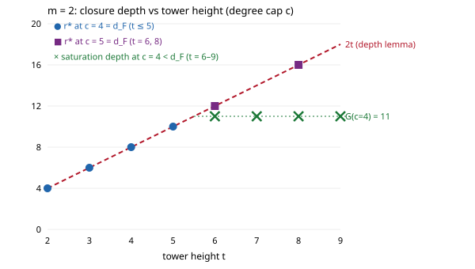

# Closure depth: why λ is a closure pseudo-solution, and a route to a growing bound on d_F (2026-11-15)

Status: research note. There is no `pcc` claim, so every number below is `[pcc:unverified]`. Everything ran locally on one core, using the Python closure of lab A (`../../kummer_wave2_20261115/KM3-LQR-CLOSURE/hky_closure.py`), which was validated against committed Rust `d_F` values.

## Round-indexed closure

For a degree cap `c`, define:
- `W_0 = span(F ∩ R_{≤c})`;
- `W_r = W_{r−1} + span{ x·g : g ∈ W_{r−1} ∩ R_{<c}, x a variable }`.

The union of the `W_r` is the HKY closure `V_{F,c}`. Two quantities come out of it:
- `r*(c)`: the first round in which 1 enters;
- `G_t(c)`: the number of rounds in which the space still grows.

## Depth lemma (proof below) `[pcc:unverified]`

**Statement.** Take Kummer towers of height `t`.
- At m = 2, with the hypotheses of D4: `r*(c) ≥ 2t` for every `c`.
- At m = 3, with the hypotheses of D10 (including `λ(1) ≠ 0`): `r*(c) ≥ 2t + 2`.

**Proof.**
1. Every element of `W_r` can be written `Σ a_μ μ·F_i`, where each `μ` is a product of at most `r` variables. This holds by induction, since a closure step multiplies one representative by one variable. With `u`-factors counted, μ reduces in `R` to `z^k u^j`.
2. Popcount is subadditive modulo `K`. So `popcount(k_i)` is at most the number of tower-`i` factors of `μ`.
3. *m = 2.* `λ_f(g) = Σ_x x_1 x_2 g(x)/f(x)` is zero on `μ·f` unless `k_1 = k_2 = K − 1`, by orthogonality of characters on `μ_K` (as in D10). That needs at least `t + t` factors. Since `λ_f(1) ≠ 0`, it follows that `1 ∉ W_r` for `r < 2t`.
4. *m = 3.* By D10's proof, λ is zero on every `ν·F_2`, and on `μ·F_1` unless `k_1 = k_2 = K−1` and either `j ≥ 2`, or `j = 1` with `k_3 = K − 1`. That needs at least `2t + 2` factors. ∎

**Consequences.**
- **Explanation of LQR-CLOSURE.** At every `c`, the elements of `V_{F,c}` reached within fewer than `2t` (resp. `2t+2`) rounds are killed by λ. If the closure saturates within that many rounds, λ kills all of `V_{F,c}`.
- **Lower-bound criterion.** If `G_t(c) < 2t` at m = 2 (resp. `< 2t + 2` at m = 3), then `d_F > c`. A growing lower bound on `d_F` therefore reduces to bounding the saturation depth `G_t(c)` by a function of `c` alone.

## Measurements `[pcc:unverified]`

Source: `depth.py`, with output in `raw/*.jsonl` and the table in `table.md` / `table.json`. Primes 40961 and 12289, N1's instance generator, 1–6 draws per cell. Draws with the same `(m, t, c)` agree on every value.

| m | t | c | r* (1 enters) | G (growth rounds) | lemma bound |
|---|---|---|---|---|---|
| 2 | 2–5 | 4 = d_F | 2t (24/24 cells) | 2t | 2t |
| 2 | 6 | 5 = d_F | 12 (3/3) | 12 | 12 |
| 2 | 8 | 5 = d_F | 16 (1/1) | 16 | 16 |
| 2 | 6, 7, 8, 9 | 4 < d_F | — | **11, 11, 11, 11** | 12, 14, 16, 18 |
| 2 | 2–7 | 2, 3 | — | 0, 1 (no falls) | 2t |
| 3 | 2 | 5 = d_F | 6 (6/6) | 6 | 6 |
| 3 | 3 | 6 = d_F | **9** (6/6) | 9 | 8 |
| 3 | 3 | 5 < d_F | — | 6 | 8 |
| 3 | 2, 3 | 4 | — | 4, 2 | 6, 8 |

**What the table shows** `[pcc:unverified]`
1. The depth lemma holds on every cell (`r* ≥ bound`).
   - At m = 2 it is attained exactly: `r* = 2t` on all 28 cells where 1 enters.
   - At m = 3 it is attained at t = 2 and exceeded by one at t = 3 (`r* = 9`, against the bound 8).
2. **The saturation depth at c = 4 does not depend on t:** G = 11 at t = 6, 7, 8 and 9, while the closure's dimension grows (605, 829, 1061, 1301).
3. Together, 1 and 2 reproduce the measured m = 2 step. At c = 4 the closure can grow for 11 rounds and 1 needs `2t`, so `d_F = 4` exactly when `2t ≤ 11`, i.e. `t ≤ 5`. The measured `d_F` steps from 4 to 5 at t = 6.

**Frozen predictions** (`PREDICTIONS.md`, committed before the t ≥ 8 runs, sha256 `cadbf70b…`):
- P1 (`G_t(4) = 11` at t = 8, 9, 10): **held at t = 8 and 9.** t = 10 was not run (see deviations).
- P2 (`r* = 16` at m = 2, t = 8, c = 5): **held.**
- P3 (`G_10(5) = 19`): **not run here**. The Rust closure in `../depth_rust/` ran it: **held** (2/2 draws). P4 (`G_11(5) = G_12(5) = 19`, frozen after P3) also **held**. See `../depth_rust/RESULTS.md`.

**Deviations.** At t = 10 an m = 2 grid has `K² ≈ 10⁶` points. At p = 40961 a random target then has a grid zero almost surely, and N1's generator found no inconsistent draw in an hour. Lab A's closure is exact only for p < 2^16, so t = 10 needs a different closure (a larger prime and exact integer linear algebra, or the Rust engine instrumented to report rounds).

## The route this opens (conjecture, not shown)

**Conjecture D.** For each `c` there is `B(c)`, independent of t, with `G_t(c) ≤ B(c)` for every t at which `c < d_F`.

By the depth lemma, Conjecture D gives `d_F ≥ min{c : B(c) ≥ 2t}`, a lower bound that grows with t.
- If `B(4) = 11` and `B(5) = 19` (the growth-law fit), the bound has slope about 1/4, the same as the fitted `d_F = 4 + ⌊(t−2)/4⌋`.
- Measured so far: `B(4) = 11` (flat for t = 6…12) and `B(5) = 19` (flat for t = 10…12), both from the Rust closure. The increment is 8 per degree.
- A proof would have to show that the closure's frontier rises at most a bounded number of tower levels per degree. That fits KM-ART-DEGEN: `d_F` depends on carry transport, not on the wrap.

This reformulates the open item in DERIVED.md ("no growing lower bound on `d_F`"). It does not resolve it.
