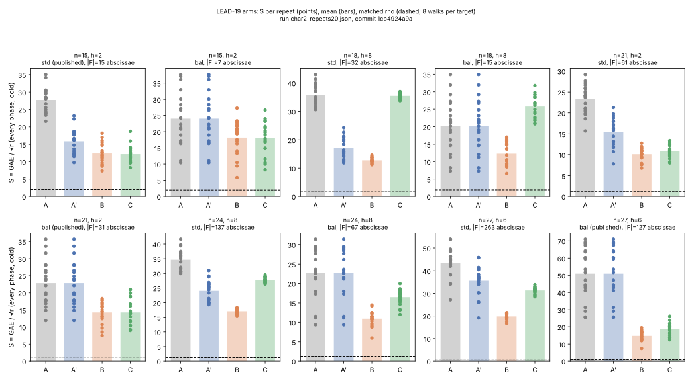
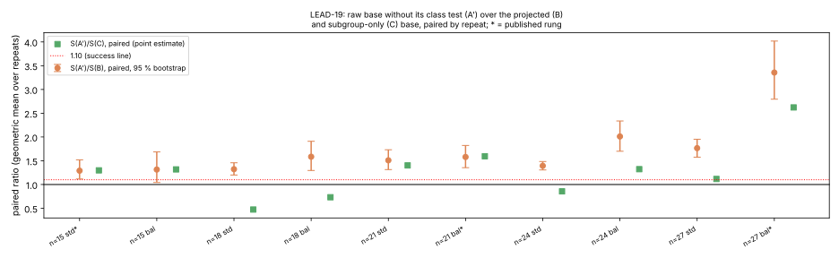

# LEAD-19: the cofactor-projected factor base on the random-binary ladder

**Date.** 2026-10-23.  **Status.** Measured under a protocol frozen before
any run (`PROTOCOL.md`), two director-compiled task cards run by the
mechanical executor and assessed `executed_as_specified`, every answer
verified, the prime-order control counter-identical across arms, the raw
arm reproducing the frozen round-5 counters exactly.  **Result class
(AGENTS.md §3).** **Engineering** on the relation phase of the
random-binary rows of `docs/ic/LEADERBOARD.md` Table B: a different factor
base, the same oracle, table, walk, linear algebra and verification,
lowering the end-to-end cold `S` on the same instances by a measured,
paired, bootstrap-bounded factor.  An improvement to the baseline and so a
success under the owner's criterion; not an advance, because every
operation involved (group operations, `[h]`, a membership test, a hash
table) is on the generic line and the family's `r^{1/6}` shape is
unchanged.  Every row stays above its matched rho, and the gap is reported
as a distance.  **Not yet a leaderboard row**: the validation gate's three
artefacts are owed first (§8 below).

| file | what it is |
|:--|:--|
| [`PROTOCOL.md`](PROTOCOL.md) | the frozen preregistration: arms, instances, commands, stop checks, predictions P1–P5, kill and success rules, the analysis plan and the §5a band |
| `cards/` | the two task cards, their receipts, the executors' verbatim reports and the director's assessments (`*.assessment.yaml`) |
| `char2.json`, `prime24.json` | card 1's raw records (five repeats; the control) |
| `char2_repeats20.json` | card 2's raw record (the pre-registered twenty-repeat extension) |
| `analysis.json`, `analysis.md`, `analysis_repeats20.*` | the frozen comparison's output for each record, by `docs/ic/tools/lead19_projected_base_compare.py` |
| `reports/run-20261023T2154Z/`, `reports/run-20261023T2201Z/` | the run reports (observations only) with graphs and PDFs |
| `plot_lead19.py` | the graphs' source (layout only) |
| `../pdp_literature_leads_20261022/leads/LEAD-19.md` | the dossier this protocol came from (desk estimates, prior art, obstructions) |
| `src/cryptanalysis/ic_boundary.rs`, `src/bin/ic/boundary.rs` | `--base-arms raw,projected,subgroup`: `project_factor_base`, `binary_subgroup_factor_base`, `prime_subgroup_factor_base`, `folded_table_class_census`, four unit tests |

## 1. The question and the mechanism

The random-binary rows of Table B (`icv1-f2m15-t131-ed7256f0`, h = 2;
`icv1-f2m21-t2591-de54d72e`, h = 2; `icv1-f2m27-t12543-569dca8b`, h = 6)
are `mitm_m2_negfold_walk` rows: a negation-folded pair table of base-point
sums, one walked target per trial, one hash probe.  Their factor base is
scanned from raw points of `E(F_{2^n})` with no projection into the
prime-order subgroup `⟨G⟩`, while every walked target lies in `⟨G⟩`.  A
table entry `P_i + P_j` whose cofactor class `[r](P_i + P_j)` is not zero
can therefore never match a target.  The class census of the landed bases
(measured by the run, P1) puts the useful fraction at 0.50, 0.50 and 0.17
on the three rows: half or five sixths of every table is dead weight.

Arm B replaces each abscissa's point `P` by `[h]P` (and its negative).
`[h]` kills `E[h]` and is an automorphism of `⟨G⟩`, so the base, and every
table entry, is in `⟨G⟩`; the relation yield per trial rises by about `h`
at the same `|F|`, at the price of one scalar multiplication by `h` per
abscissa (one doubling at h = 2; two doublings and one addition at h = 6)
charged to the base phase, and no class test.  Arm C keeps only points
already in `⟨G⟩`, scanning a larger window to the same `|F|`; at h = 2 the
membership test is the Kosters–Yeo trace parity `Tr(x) = Tr(a)`, at h = 6
or 8 it is `[r]P = O`, charged.

The lever is measured against **A′**, the raw row minus the `[r]P`
admissibility test the std rung carries (the test is a diagnostic the raw
pipeline could skip; charging it to A would mix accounting into the lever).
The ratio against the published rows is reported beside it as the
accounting it is.

## 2. What ran

- Card 1 (`CARD-lead19-projected-base-20261023-1`): the frozen char2 ladder
  at degrees 15, 18, 21, 24, 27, five targets per curve (repeats 0 to 2 the
  frozen round-5 targets), arms raw / projected / subgroup at the std and
  balanced rungs, plus the 24-bit prime-order control; 36.9 s and 21.5 s.
- Card 2 (`…-2`): the same char2 command with `--repeats 20`, the extension
  PROTOCOL.md §9 pre-registered for a published-rung interval that straddles
  1.10 (card 1's f2m15 read 1.00 with CI 0.82–1.21); 66.6 s.
- Stop checks (PROTOCOL.md §6), both cards: all rows verified; the
  prime-order control's projected and subgroup rows identical to the raw
  rows in `trials`, `relations_found`, `total_gae` and every phase counter;
  arm A's repeats 0 to 2 equal to the frozen round-5 counters on every
  char2 instance and rung.

## 3. Results (card 2, twenty repeats; card 1 in brackets)

`S` = GAE/√r, every phase, cold, mean over repeats; ratios are per-repeat
paired geometric means with the 95 % paired-bootstrap interval; "yield" is
pooled relations per trial.  The published rung is the leaderboard's.

| row | h | rung | S(A) | S(A′) | S(B) | S(C) | **S(A′)/S(B)** | S(A′)/S(C) | yield B/A | rho | B/rho (was) |
|:--|--:|:--|--:|--:|--:|--:|:--|--:|--:|--:|:--|
| f2m15 | 2 | std (published) | 27.75 | 15.88 | 12.35 | 12.16 | **1.29 (1.12, 1.52)** [1.00 (0.82, 1.21)] | 1.30 | 1.86 | 2.02 | 6.1× (13.1×) |
| f2m21 | 2 | bal (published) | 22.84 | 22.84 | 14.29 | 14.29 | **1.58 (1.35, 1.82)** [1.54 (1.35, 1.77)] | 1.59 | 1.96 | 1.24 | 11.5× (18×) |
| f2m27 | 6 | bal (published) | 50.99 | 50.99 | 14.75 | 18.84 | **3.36 (2.80, 4.02)** [2.85 (1.73, 4.99)] | 2.62 | 5.57 | 1.02 | 14.4× (38.2×) |
| f2m15 | 2 | bal | 24.02 | 24.02 | 18.20 | 17.98 | 1.31 (1.04, 1.69) | 1.32 | 1.80 | 2.02 | 9.0× |
| f2m21 | 2 | std | 23.35 | 15.46 | 10.11 | 10.83 | 1.51 (1.31, 1.73) | 1.40 | 2.03 | 1.24 | 8.1× |
| f2m27 | 6 | std | 43.57 | 35.54 | 19.80 | 31.26 | 1.77 (1.57, 1.95) | 1.12 | 5.78 | 1.02 | 19.4× |
| f2m18 | 8 | std | 35.90 | 17.20 | 12.75 | 35.50 | 1.32 (1.20, 1.46) | 0.47 | 3.78 | 1.91 | 6.7× |
| f2m18 | 8 | bal | 20.24 | 20.24 | 12.25 | 25.76 | 1.58 (1.30, 1.91) | 0.73 | 3.67 | 1.91 | 6.4× |
| f2m24 | 8 | std | 34.66 | 24.02 | 17.08 | 27.79 | 1.39 (1.31, 1.48) | 0.86 | 3.84 | 1.28 | 13.4× |
| f2m24 | 8 | bal | 22.75 | 22.75 | 10.94 | 16.49 | 2.01 (1.70, 2.34) | 1.32 | 3.90 | 1.28 | 8.6× |

- **Verdict of the frozen comparison** (PROTOCOL.md §9, read on the
  published rung): success on all three primary rows at twenty repeats
  (card 1 alone: n = 21 and n = 27, with n = 15 in the pre-registered
  extension).  No kill condition fired: P2 (yield B/A within `[0.7h, 1.3h]`)
  holds on every primary row, the control did not move, and no S(A′)/S(B)
  ratio on a primary row reads below 1.10 (lowest published-rung interval
  bound 1.12).
- **Predictions.** P1 (class census 0.50 / 0.50 / 0.17) within 1 % (0.502,
  0.501, 0.167); P2 1.86 / 1.96 / 5.57 inside the bands; P3 1.29 / 1.58 / 3.36
  against the desk's 1.4–1.5 / 1.4–1.5 / about 3: f2m15 came in below the
  desk estimate (its base phase is half the row and B needs more relations
  to close, 219 against 194 over twenty repeats), the other two inside or
  above; P4 (B and C yields within 15 % at h = 2) 0.99 and 1.03; P5 exact.
- **Best rung.** B's best rung is the std base at f2m15 and f2m21 (S 12.35
  and 10.11) and the balanced base at f2m27 (14.75); the paired best-rung
  ratios S(A′)/S(B) are 1.29 (1.12, 1.52), 1.51 (1.31, 1.73) and 2.41 (2.18,
  2.67).
- **Pricing band** (AGENTS.md §5a).  The only unpriced native work in the
  comparison is arm C's trace parity; at 0, 0.1 and 1 GAE per test S(C)
  moves by at most 0.25 and every A′ > B and A′ > C order holds, so the
  ranking stands across the band.  Rho carries no unpriced work.
- **Yield.** On the primary rows every arm realises its exact counting
  ceiling (`yield_over_ceiling_exact` 0.98–1.08 at the published rungs): the
  projection raises the ceiling (all pairs class-zero) rather than the
  realisation, which is the mechanism the dossier predicted.
- **B against C.** Equal at h = 2 (same yield; C's selection is a free
  parity and a scan about twice as long).  B wins at h = 6 and 8, where C's
  `[r]P` membership test is a charged scalar multiplication per candidate
  (1,547 of them at f2m27 std): at the std rung C's base phase is `S` 29.2,
  24.1 and 26.5 on f2m18, f2m24 and f2m27 against B's 6.4, 13.3 and 14.9
  (1.8 to 4.6×), while the relation phases of B and C match (6.2 and 6.2,
  3.7 and 3.7, 4.9 and 4.7).  B is the recipe.

Figure sources: `plot_lead19.py` reading `analysis_repeats20.json`; card 1's
five-repeat graphs are under `reports/run-20261023T2154Z/`.

### 3.1 What is lever and what is accounting

| row (published rung) | frozen A (round 5) | B now | published-row ratio | lever S(A′)/S(B) | accounting |
|:--|--:|--:|--:|--:|:--|
| f2m15 std | 26.31 | 12.35 | 2.13 | 1.29 | the std rung's class test (1,516 GAE per target, 12 of A's 27.75 units) is not charged to B: that part is accounting, A′ carries the same scan |
| f2m21 bal | 24.39 | 14.29 | 1.71 | 1.58 | the balanced rung carries no class test; the difference between 1.71 and 1.58 is the frozen row's three-seed mean (24.39) against this run's twenty-repeat A (22.84) |
| f2m27 bal | 36.93 | 14.75 | 2.50 | 3.36 | no class test; this run's twenty-repeat A (50.99) is heavier-tailed than the frozen three seeds (25.5, 59.5, 25.7) |

Only the lever column is claimed.  The cost B adds is in the record:
`projection_doubles` 15 / 61 / 526 and `projection_adds` 0 / 0 / 263 on the
std rungs (one `[h]` per abscissa), against relation phases of thousands to
hundreds of thousands of GAE.

### 3.2 Distance to rho

| row | published rung | B | matched rho | gap now | gap on the leaderboard |
|:--|:--|--:|--:|--:|--:|
| f2m15 | std | 12.35 | 2.02 | 6.1× | 13.1× |
| f2m21 | bal (best: std 10.11) | 14.29 | 1.24 | 11.5× (8.1× at std) | 18× |
| f2m27 | bal | 14.75 | 1.02 | 14.4× | 38.2× |

The gap is the distance remaining, not a gate (AGENTS.md "Success
criterion").  The family's shape stays `r^{1/6}` in the exponent (ledger
§11.2); this lever is a constant.

## 4. Controls and checks

- **Negative control** (`icv1-fp24-t1577-77336155`, h = 1): arms B and C
  are the identity by construction and the run shows them counter-identical
  to A in every phase (S 24.9 std, 14.3 balanced, all three arms).
- **Frozen counters**: arm A's repeats 0 to 2 reproduce
  `docs/ic/runs/ic-boundary-ledger-round5-2026-09-22.json` exactly
  (`trials`, `relations_found`, `total_gae`) on every char2 instance and
  rung, so the raw rows of this run are the ledger's rows and the pairing is
  a comparison, not two runs.
- **Default path unchanged**: `--base-arms raw` leaves the record as it was
  (the configuration key is omitted; the unit test
  `lead19_char2_arms_run_and_verify` checks no arm row and no census appear).
- **Verification**: every row recovers the planted logarithm; the control's
  and every char2 row's `verified` is true in both records.

## 5. Literature and prior art checked

- Kosters, Yeo, *Notes on summation polynomials*, arXiv:1503.08001v3 (2015),
  Prop. 4.2 and Remark 4.8: the trace map `P ↦ Tr(x(P) + a)` has kernel
  `2E`, and relations may be sought in that kernel.  Read at source for the
  dossier; the trace test of arm C is that remark made an arm.
- Fong, Hankerson, López, Menezes, *Field inversion and point halving
  revisited*, IEEE Trans. Computers 53(8) (2004), Lemma 3.1.4: `(x, y) ∈
  ⟨G⟩ ⇒ Tr(x) = Tr(a)` for `G` of odd order.  The unit test
  `lead19_projected_and_subgroup_bases_lie_in_the_subgroup` checks the
  equivalence on every lifted abscissa of a 64-element window at h = 2.
- This repository: `koblitz_index_calculus.rs`
  `build_subgroup_orbit_factor_base_with_cost` already multiplies by the
  cofactor on Koblitz bases ("so no sample is wasted"); the random-binary
  ladder had no such hook (`BinarySubspaceBase`, `binary_subspace_factor_base`).
  `research/isogeny_conductor_gap_ic_20261010` measured the fiber-aware
  oracles (lifts, closed tables) on cofactor curves: yield up by about `h`
  but `S` not, because they pay `h` probes or an `h×` table per target; B
  gets the yield with the same table and one probe.  KN-FIND-007 (yield
  conservation, `C(B+m−1, m)/N`) fixes `N` as the order of the group the
  sums live in; moving the base into `⟨G⟩` changes `N` from `#E` to `r`.
- Dossier: `../pdp_literature_leads_20261022/leads/LEAD-19.md` (desk
  estimates 1.4–1.5× at h = 2, about 3× at h = 6; obstructions O1–O8).

## 6. Honest limits

- The matched rho is the ledger's own negation walk in the same process,
  eight walks per target; its mean has its own spread, and the gap figures
  move with it.
- The raw arm's `S` is heavy-tailed (f2m27 balanced: 25.5 to 71.0 over
  twenty repeats); the paired ratio absorbs the target-to-target part of
  that, the bootstrap interval the rest.
- f2m15's lever (1.29) is below the desk's 1.4–1.5: at `|F| = 15` the base
  and table are half the row, and B's relation graph closes later (the
  dossier's O4).  The card-1 interval straddled 1.10 and only the
  pre-registered extension decided it.
- The secondary rows (h = 8) and the m = 3 rows were not pre-registered
  predictions; their numbers are reported, not claimed.
- Nothing here is a replay certificate, a validator report or a
  `VALIDATION.json`; the leaderboard rows keep their round-5 figures until
  those exist (§8).

## 7. Classification

**Engineering** (AGENTS.md §3: `S` fell, the method stays on the generic
line) on the relation phase of the random-binary rows: the base is
projected into the subgroup, the pipeline's end-to-end cold `S` fell on
every primary row with every answer verified, under a protocol frozen
before timing and a kill rule that did not fire.  It is an improvement to
the baseline and so a success under the owner's criterion; it is reported
as engineering and not as an advance, since the oracle is a pair table and
a hash probe and nothing here moves the family's `r^{1/6}` shape.  The
published-row ratios above 1.29 / 1.58 / 3.36 are partly accounting (the
std rung's class test) and partly the frozen rows' seed means, and are not
claimed.

## 8. Next steps, in the order they decide the most per unit of cost

1. **Land the rows through the validation gate** (`docs/VALIDATION_GATE.md`):
   a replay certificate (an independent re-run of the two cards on another
   host; the run is deterministic in the seed, so the counters must repeat
   bit for bit), a validator report recomputing `S`, the paired ratios and
   the band from the raw records, and a `VALIDATION.json` naming the
   matched negation rho and the §5a band; then regenerate the leaderboard
   with B as the Table B recipe (f2m15 12.35 std, f2m21 10.11 std, f2m27
   14.75 balanced) and a `benchmarks/` entry.
2. **Make `projected` the ladder's default for cofactor curves** once the
   rows are validated, and re-run the balanced-rung search with B (the
   dossier's desk model put B's best rung at the std base on f2m21; the run
   agrees there and at f2m15, and finds the balanced base best at f2m27).
3. **m = 3 rows.** The same projection makes every three-summand probe `h×`
   more productive; not a leaderboard recipe today, cheap to measure with
   the arms already in place.
4. **Koblitz Table A/C rows**: confirm which recipe each used
   (`compact-orbit-scan` and `build_subgroup_orbit_factor_base` already
   project; the dossier did not open every row).
