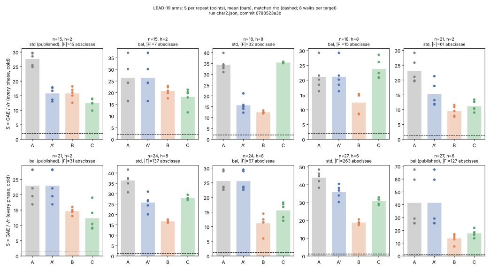
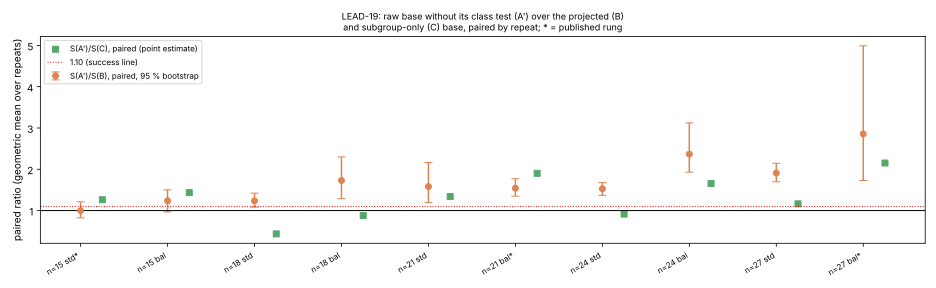

# Run report: LEAD-19 projected-base protocol, card 1 (2026-10-23T21:54Z)

Observations only (research-visuals skill, "Every experiment run").  The
interpretation is in [`../../README.md`](../../README.md); the protocol is
[`../../PROTOCOL.md`](../../PROTOCOL.md).

## What ran

| item | value |
|:--|:--|
| card | `cards/CARD-lead19-projected-base-20261023-1.yaml` (sha256 `3d655e8f…def9b`), compiled by `experiment-director`, run by `executor-mechanical` through `python3 tools/task_card.py run` |
| receipt | `cards/CARD-lead19-projected-base-20261023-1.receipt.json` (sha256 `bb2e3b71…5c86`), status `completed`, three commands, one attempt each, exit 0 |
| commit | `6783523a3b75266db669d6138decdf142d14e16d` (the card's pin; the record's own `host.git_commit` is `null`, the binary was built outside a git-aware step) |
| binary | `target/release/ic`, sha256 `373c0f1d…e2ec` (bound by the card), blake3 `83689465…59b5` (recorded by the run) |
| command 2 | `ic boundary --regime char2 --char2-degrees 15,18,21,24,27 --repeats 5 --seed 123212651130 --s4-max-degree 0 --base-arms raw,projected,subgroup --out research/lead19_projected_base/char2.json`, 36.9 s |
| command 3 | `ic boundary --regime prime --prime-bits 24 --repeats 5 --seed 123212651130 --s4-max-degree 0 --base-arms raw,projected,subgroup --out research/lead19_projected_base/prime24.json`, 21.5 s |
| host | Intel Xeon @ 2.10 GHz (cloud container), 4 logical cores, linux x86_64 |
| isolation | none earned and none needed: the metric is counted group operations and native counters; wall times are a practicality note |
| raw records | `../../char2.json` (1.48 MB), `../../prime24.json` (0.34 MB); stdout and stderr of both commands under `../../receipts/` |
| analysis | `../../analysis.json`, `../../analysis.md`, by `docs/ic/tools/lead19_projected_base_compare.py` (the frozen plan, PROTOCOL.md §8); recorded values only |

## Arms, instances, seeds

- Arms per instance and rung: `mitm_m2_negfold_walk` (A, the raw base), the
  same minus its class test (A′, derived: `total_gae` minus
  `admissibility_adds + admissibility_doubles`), `…_projected` (B),
  `…_subgroup` (C); each at the std rung and, where the ladder has one, the
  balanced rung (`…_balanced`).  The ladder's other rows (`mitm_m3*`,
  `mitm_m2_negfold`) ran as always and are in the record but are not arms.
- Instances: `icv1-f2m15-t131-ed7256f0` (h = 2), `icv1-f2m18-t393-d2c04152`
  (h = 8), `icv1-f2m21-t2591-de54d72e` (h = 2), `icv1-f2m24-tm3047-2d0c0e8c`
  (h = 8), `icv1-f2m27-t12543-569dca8b` (h = 6); control
  `icv1-fp24-t1577-77336155` (h = 1).
- Seeds: curves fixed by `--seed 123212651130`; five targets per instance
  (repeats 0 to 2 are the frozen round-5 targets); eight matched-rho
  negation walks per target.
- Requested and completed: 5 instances × 5 repeats × 4 arms × 2 rungs = 200
  arm rows on the char2 ladder, 1 × 5 × 3 × 2 = 30 on the control; all
  completed, none failed, none timed out.

## Stop checks (PROTOCOL.md §6)

| check | result |
|:--|:--|
| every row `verified`, both records `status: complete` | yes (`all_verified: true` in both) |
| prime-order control: `raw`, `projected`, `subgroup` bit-identical per repeat in `trials`, `relations_found`, `total_gae`, `rank`, every phase's `group_ops` and `native` | yes, no differences |
| arm A, repeats 0 to 2, equals the frozen round-5 counters (`trials`, `relations_found`, `total_gae`) on every char2 instance, both rungs | yes, no drift |

## Measured values

`S` = group-addition equivalents per √r, every phase, cold, priced with the
repository's pinned ratios; mean over the five repeats, with every repeat's
value in `analysis.json` (`s_per_repeat`).  "rho" is the matched negation
rho of the same process.  The paired ratio is the geometric mean over
repeats of S(A′)/S(B) with the 95 % percentile interval of 10,000 paired
bootstrap resamples (seed 20261023).  "yield" is pooled relations per trial.

| row | h | rung | S(A) | S(A′) | S(B) | S(C) | S(A′)/S(B) (95 % CI) | S(A′)/S(C) | yield B/A | yield C/A | rho | S/rho: A′, B, C |
|:--|--:|:--|--:|--:|--:|--:|:--|--:|--:|--:|--:|:--|
| f2m15 | 2 | std (published) | 27.65 | 15.78 | 15.79 | 12.49 | 1.00 (0.82, 1.21) | 1.26 | 1.42 | 1.64 | 2.03 | 7.8×, 7.8×, 6.2× |
| f2m15 | 2 | bal | 26.40 | 26.40 | 20.71 | 18.16 | 1.24 (0.97, 1.50) | 1.43 | 1.90 | 1.99 | 2.03 | 13.0×, 10.2×, 8.9× |
| f2m18 | 8 | std | 34.39 | 15.68 | 12.49 | 35.41 | 1.24 (1.08, 1.42) | 0.44 | 3.28 | 3.01 | 1.96 | 8.0×, 6.4×, 18.0× |
| f2m18 | 8 | bal | 21.13 | 21.13 | 12.42 | 23.77 | 1.73 (1.29, 2.30) | 0.88 | 3.72 | 3.68 | 1.96 | 10.8×, 6.3×, 12.1× |
| f2m21 | 2 | std | 23.11 | 15.22 | 9.49 | 11.15 | 1.58 (1.19, 2.16) | 1.34 | 2.13 | 2.01 | 1.32 | 11.5×, 7.2×, 8.4× |
| f2m21 | 2 | bal (published) | 22.95 | 22.95 | 14.63 | 12.35 | 1.54 (1.35, 1.77) | 1.90 | 1.74 | 1.88 | 1.32 | 17.4×, 11.1×, 9.3× |
| f2m24 | 8 | std | 36.38 | 25.74 | 16.68 | 27.89 | 1.53 (1.37, 1.68) | 0.91 | 3.97 | 3.51 | 1.23 | 20.8×, 13.5×, 22.6× |
| f2m24 | 8 | bal | 25.59 | 25.59 | 11.19 | 15.58 | 2.37 (1.93, 3.12) | 1.65 | 3.60 | 3.44 | 1.23 | 20.7×, 9.1×, 12.6× |
| f2m27 | 6 | std | 43.96 | 35.93 | 18.76 | 30.80 | 1.91 (1.70, 2.14) | 1.16 | 5.46 | 5.77 | 1.08 | 33.3×, 17.4×, 28.5× |
| f2m27 | 6 | bal (published) | 41.47 | 41.47 | 13.76 | 17.75 | 2.85 (1.73, 4.99) | 2.15 | 5.69 | 6.20 | 1.08 | 38.4×, 12.7×, 16.4× |

Per-repeat `S` on the three primary rows (the spread behind the means):

| row | rung | A′ | B | C |
|:--|:--|:--|:--|:--|
| f2m15 | std | 13.0, 16.7, 13.6, 17.7, 17.9 | 18.2, 16.1, 15.1, 12.6, 17.0 | 12.5, 9.9, 12.4, 13.8, 14.0 |
| f2m15 | bal | 24.2, 37.1, 30.1, 24.2, 16.4 | 19.9, 22.4, 22.9, 17.6, 20.8 | 11.5, 21.3, 20.2, 18.0, 19.8 |
| f2m21 | std | 18.0, 21.3, 11.9, 13.2, 11.7 | 9.5, 7.6, 7.9, 11.6, 10.9 | 13.4, 10.4, 9.0, 12.6, 10.3 |
| f2m21 | bal | 16.9, 28.1, 28.2, 19.5, 22.1 | 13.0, 16.1, 14.5, 14.5, 15.1 | 14.1, 19.0, 9.2, 10.4, 9.0 |
| f2m27 | std | 36.8, 30.3, 34.0, 40.5, 38.2 | 18.4, 18.8, 20.5, 18.6, 17.4 | 32.9, 31.7, 28.5, 29.2, 31.7 |
| f2m27 | bal | 25.5, 59.5, 25.7, 29.2, 67.4 | 16.9, 7.5, 14.8, 13.1, 16.5 | 21.9, 18.0, 16.5, 18.5, 13.8 |

Trials and relations found, primary rows, published rung (per repeat):

| row | arm | trials | relations found |
|:--|:--|:--|:--|
| f2m15 std | A | 485, 621, 524, 746, 756 | 8, 12, 9, 10, 8 |
| f2m15 std | B | 797, 534, 649, 450, 661 | 13, 12, 13, 14, 14 |
| f2m15 std | C | 445, 250, 469, 550, 524 | 13, 5, 13, 11, 13 |
| f2m21 bal | A | 14160, 25479, 25557, 16863, 19395 | 16, 24, 28, 14, 20 |
| f2m21 bal | B | 10266, 13329, 11723, 11763, 12286 | 21, 19, 21, 23, 20 |
| f2m21 bal | C | 11350, 16340, 6405, 7730, 6215 | 20, 26, 15, 13, 17 |
| f2m27 bal | A | 100598, 259298, 101707, 117757, 295813 | 22, 71, 26, 32, 63 |
| f2m27 bal | B | 60226, 16886, 50307, 42154, 58325 | 82, 25, 67, 56, 87 |
| f2m27 bal | C | 59505, 41477, 34399, 43512, 21778 | 76, 68, 52, 77, 31 |

Class census of the folded pair tables (fraction of pairs with class sum
zero; `classes` = distinct `[r]P` among the signed base points):

| row | raw std | raw bal | projected (both rungs) | subgroup (both rungs) |
|:--|:--|:--|:--|:--|
| f2m15 | 0.502 (2 classes) | 0.510 (2) | 1.0 (1) | 1.0 (1) |
| f2m18 | 0.265 (4) | 0.280 (4) | 1.0 (1) | 1.0 (1) |
| f2m21 | 0.501 (2) | 0.505 (2) | 1.0 (1) | 1.0 (1) |
| f2m24 | 0.250 (4) | 0.267 (4) | 1.0 (1) | 1.0 (1) |
| f2m27 | 0.167 (6) | 0.169 (6) | 1.0 (1) | 1.0 (1) |

Base-phase work the arms add (native counters of the arm bases, std rung):

| row | B: `[h]P` doubles + adds (one scalar multiplication per abscissa) | C: abscissae scanned → lifted → kept, and the test |
|:--|:--|:--|
| f2m15 | 15 + 0 | 69 → 32 → 15, 32 trace tests (unpriced) |
| f2m18 | 96 + 0 | 308 → 162 → 32, 162 `[r]P` tests = 2268 doubles + 1944 adds (charged) |
| f2m21 | 61 + 0 | 265 → 132 → 61, 132 trace tests (unpriced) |
| f2m24 | 411 + 0 | 1167 → 569 → 137, 569 `[r]P` tests = 11949 doubles + 3983 adds (charged) |
| f2m27 | 526 + 263 | 3119 → 1547 → 263, 1547 `[r]P` tests = 37128 doubles + 18564 adds (charged) |

The class test A′ removes from A's std rung, in GAE per repeat (identical
across repeats): 1516 (f2m15), 3384 (f2m18), 8068 (f2m21), 15400 (f2m24),
37992 (f2m27).  The balanced rung never carried it.

Pricing band (PROTOCOL.md §8.5): the one unpriced native counter is arm C's
trace test; at w = 0, 0.1 and 1 GAE per test, S(C) moves by at most 0.25
(f2m15 std, 12.49 → 12.74) and the A′ > B and A′ > C orders are unchanged on
every row and rung (`order_holds_across_band: true` throughout).

Predictions (PROTOCOL.md §7), as the analysis script evaluated them:

| row | P1 class-zero fraction (predicted) | P2 yield B/A (band) | P3 S(A′)/S(B) at the published rung (predicted) | P4 yield B/C (h = 2) | P5 control |
|:--|:--|:--|:--|:--|:--|
| f2m15 | 0.502 (0.50): within 10 % | 1.42 ([1.4, 2.6]): holds | 1.00, CI (0.82, 1.21) (1.4–1.5) | 0.87: within 15 % | identical |
| f2m21 | 0.501 (0.50): within 10 % | 1.74 ([1.4, 2.6]): holds | 1.54, CI (1.35, 1.77) (1.4–1.5) | 0.92: within 15 % | identical |
| f2m27 | 0.167 (0.17): within 10 % | 5.69 ([4.2, 7.8]): holds | 2.85, CI (1.73, 4.99) (about 3) | not applicable | identical |

Published-row ratio (accounting, not the lever; frozen round-5 mean S over
this run's mean): f2m15 26.31 / 15.79 = 1.67 (B), 2.11 (C); f2m21 24.39 /
14.63 = 1.67 (B), 1.98 (C); f2m27 36.93 / 13.76 = 2.68 (B), 2.08 (C).

The frozen comparison's verdict line (PROTOCOL.md §9, read on the published
rung): **success on rows n = 21, n = 27**; on n = 15 the interval straddles
1.10, which is the pre-registered `--repeats 20` extension.

## Graphs

Sources beside the graphs: `../../plot_lead19.py` reading `../../analysis.json`.

## Missing or not measured

- No isolation tier, no `perf` counters, no wall-clock claim.
- No replay certificate, validator report or `VALIDATION.json` yet: this
  run is the lever's measurement, not a leaderboard row.
- The `S₄` oracle was skipped (`--s4-max-degree 0`); it is not an arm.
