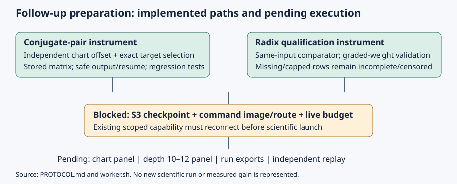

# Conjugate-pair repair and radix-grading follow-up

Native chart-selection/resume support and a native matched-input radix comparator
are implemented. Scientific qualification panels are **blocked, not launched**.
Development observations are producer assertions under `PCC-20261106-ded5b6`
(standing: unverified), not independent scientific verification.

| Requested work | Current deliverable | Remaining evidence |
| --- | --- | --- |
| Pursue conjugate-pair repair | Exact target/chart selection; stored matrix/solver seed; safe resume and native twelve-call readout | Independent-chart panel; extraction of short relations; exceptional base-point handling |
| Pursue radix grading | Native comparator; matched t=10,11,12 protocol and worker | Qualification controls, larger-depth runs, memory/cost analysis and independent replay |
| Preserve and publish | This source-linked report, diagram, PDF, two blocked backlog cards and shared problem update | Run reports/exports/claims after actual execution |

## Code and checks

`examples/conjpair_decomp_cost.rs` adds `--chart-seed N`, `--only-target NAME`
and `--no-r3` (all require `--inf`). Seed zero preserves the historical matrix
stream; offsets change the chart without consuming the curve/target stream.
New infinity rows include the actual chart matrix, chart offset, Macaulay degree
and solver seed. The R3 filters now honor arm/curve/target restrictions.

`--skip-existing` parses the input completely before opening any output. The same
canonical path appends; a fresh different destination copies the source history
before appending. Existing other destinations, missing inputs, malformed/truncated
JSON and duplicate solve identities are refused. Solve keys include field, curve,
arm, target, set, transformed flag, Macaulay degree and chart offset. Historical
records default to degree 29 and offset zero; the legacy A1 degree stays explicit.
Completed halves of interrupted pairs are preserved instead of repeated.

The native `chart_compare` readout enforces the exact twelve-call population,
plain A/A and nonsingular canonical matrices. A failed solve remains unknown
even when empty sets match. This is producer consistency, not independent replay.

The native radix comparator pairs by exact curve/tower/target identity, checks grading
weights and terminal producer summaries, refuses missing/duplicate draws or
inconsistent completed outcomes, and leaves capped costs as `ratio=null`.
Its unit-grading parser accepts the pilot's canonical `weights:null` encoding.
No Python research execution or analysis path was added.

Development commands (builds/tests only):

```sh
cargo test --locked --manifest-path research/lead_followup_20261106/native/Cargo.toml
cargo test --release --example conjpair_decomp_cost
cargo test --release --lib
bash -n research/lead_followup_20261106/worker.sh
```

Focused tests and their actual outcomes are retained in `validation/`.
The comparator was also exercised on the existing depth-10 three-arm files as
a compatibility check; that is analysis of historical records, not a new trial.
The full-library and touched-example build outcomes are reported in
`validation/checks.md` when available. A passing helper suite alone does not
qualify the expensive solver or either scientific panel.

## Next executable work

[PROTOCOL.md](PROTOCOL.md) freezes the populations, controls, correctness rules,
accounting limits and finite resource/stop envelopes. [worker.sh](worker.sh) is a
thin payload for a separately admitted command job; it does not submit a job,
verify a cloud capability, build an image, or authorize spending. Its admission
receipt must bind source, binaries, controls, checkpoint and budget/capacity.

- [Chart card](../../backlog/XP-20261106-conjugate-chart-followup/README.md): two
  original targets, chart offsets 0/1/2, plain/transformed controls.
- [Radix card](../../backlog/XP-20261106-radix-depth-followup/README.md): m=2,
  depths 10/11/12, three radices, tower/null, two draws, four threads.

The checkpoint gate with a complete resume note reports no upload transport in
this environment. There is no configured AWS identity or EKS MCP tool. GitHub
access works, but the ecbench-only dispatch is not a command route for these
examples. The [existing shared problem](../../problems/arity-completion-launch-gates.md)
records the missing capability and checkable exit conditions. Reconnect the
existing scoped capability through environment settings; do not put credentials
in chat, reports or Git. No claim that computation continues in the background.



## Sources and publication scope

Sources checked (KB): KB unavailable (no tools; wrapper exits 127). Directly
read both predecessor studies and the primary Petit–Kosters–Messeng paper,
sections 2.4, 3, 4.2, 5. See the protocol's source list and unavailable primary
Gaudry PDF. No new mathematical identity, proof or novelty claim is made.

The historical study plots, `docs/index-calculus-scoreboard.html`,
`docs/ic-leaderboard.html`, progress timeline and browser remain unchanged:
there is no new scientific observation or admitted comparison to plot. The new
visual is an implementation/dependency diagram, not a graph of measured gains.
No new benchmark record or progress metric is invented for an unperformed panel.
These changes do not modify an ecdb-imported curve/result/benchmark source.

The readable report source is [report.typ](report.typ); its PDF is generated
from that source and the same [workflow.svg](workflow.svg).
