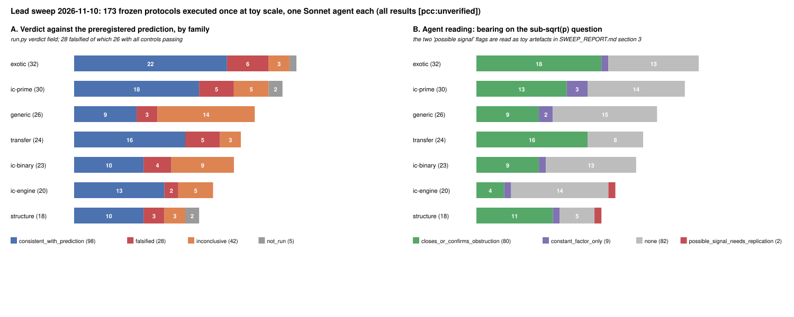

# Lead sweep 2026-11-10: 173 ECDLP leads, one frozen protocol each, executed once at toy scale

**What this is.** The owner asked to run every lead of the ECDLP atlas in a parallel Sonnet 5.5 workflow, with the experiments checked in before they started. This report is the synthesis. **Classification: sweep of single, local, toy-scale runs. No improvement is claimed, no atlas disposition changes, every number is `[pcc:unverified]`** (one run, no independent replay, no validation gate, no isolab).

**Provenance.**
- Lead index: `leads.json` (173 ids = the 160 leads of the 2026-11-07 review plus 13 ids that were merged or renamed between the two in-repo atlas snapshots). The atlas YAML in `crypto-autoresearcher` is vaulted (`VLT1`) and unreadable in this session; lead fields come from the verbatim `--pursuit` dump and table B of `research/prime_field_lead_assessment_20261107/` and the 2026-11-01 tally; next-step text is truncated at ~100 chars in the source.
- Phase 1 (check-in): 173 Sonnet 5.5 agents, four workflow shards, wrote `PROTOCOL.md` (+ stdlib `run.py` with `--smoke`) per lead; frozen by `MANIFEST.sha256` (343 files) at commit `f4bc8d406c`, merged to `main` in PR #3849 before any execution. ~16M tokens, 0 agent errors.
- Phase 2 (execution): 173 Sonnet 5.5 agents, two shards, one run per lead under `timeout 660`, no retries, no edits to hashed files (`sha256sum -c MANIFEST.sha256` passes after execution). ~14.5M tokens, 0 agent errors. Total `run.py` wall time 2,796 s (median 4 s, max 221 s).
- Per-lead evidence: `<LEAD>/RESULT.md`, `RESULT.json` (the single JSON object `run.py` printed), `run.status`, `run.stderr`; structured summaries in `phase2_index.json`; raw shard outputs in `phase1_shard*.json`, `phase2_shard*.json`.

## 1. Outcomes

| | count |
|:--|--:|
| leads | 173 |
| `runnable_local` / `desk_only` / `blocked` (Phase 1 classification) | 170 / 1 / 2 |
| ran to completion / timed out (660 s) / crashed / blocked / desk | 167 / 2 / 1 / 2 / 1 |
| verdict `consistent_with_prediction` | 98 |
| verdict `falsified` (26 with all controls passing, 2 with a failed control) | 28 |
| verdict `inconclusive` (30 of them because a null, positive or A/A control failed) | 42 |
| `not_run` (timeout, crash, blocked) | 5 |
| agent reading: confirms or re-derives a recorded obstruction | 80 |
| agent reading: constant factor only | 9 |
| agent reading: toy does not bear on the √p question | 82 |
| agent reading: possible signal, needs replication | 2 (both read as artefacts in §3) |

*A: verdict by family. B: the executing agent's own reading of what the toy says about the sub-√p question. Drawn from `phase2_index.json` by `plot_sweep.py`.*

Per family (verdict: consistent / falsified / inconclusive / not run):
exotic 22/6/3/1 · ic-prime 18/5/5/2 · generic (rho) 9/3/14/0 · transfer 16/5/3/0 · ic-binary 10/4/9/0 · ic-engine 13/2/5/0 · structure 10/3/3/2.

## 2. What the sweep establishes, and what it does not

1. **No lead produced evidence of a below-√p exponent.** The two "possible signal" flags (§3) are, on the executing agents' own readings and on mine, finite-size and reference-arm artefacts. Eighty toy runs re-derived or were consistent with the obstruction the atlas already records (Shoup/CGK bounds, class-invariance of generic cost, √|Aut| ceiling, torsion-lifts-to-torsion, embedding-degree barriers, yield conservation `C(B+m−1,m)/N`, Coppersmith reach, the `p^{2−2/g}` cover floor). That is a consistency check on the atlas, not new knowledge.
2. **The 28 falsifications are falsifications of toy predictions, not of leads.** Reading each `RESULT.md`: 7 come from a single marginal cell or a one-count excess at a preregistered threshold (e.g. `TRF-mov-small-embedding-degree`: 4 hits vs 3.27 expected; `ICB-large-prime-variants`: R = 0.784 vs 0.8; `STR-class-representative-ic-selection`: 0.0034 above a 20-replicate null max); 9 are finite-size effects that decay or saturate with `p` (`EXO-lossy-object-propagation`, `EXO-gag-holant-semaev-chain`, `TRF-second-torsion-direction`, `TRF-jv-sieve-fp6-weak-class`, `ICP-residual-partial-relations`, …); 6 are instrument defects the agents diagnosed but were forbidden to fix (a reversed monotonicity test in `STR-isogeny-transport-preprocessing`, a mis-specified rank criterion in `ICP-prym-witness-relation-diversity`, a weak/heavy-tailed rho reference in `RHO-ecc2k130-gpu-fpga-throughput` and `ICP-retained-setup-online`, a non-comparable proxy in `ICE-chained-semaev-dreg-vs-semiregular`, a transcript-identity flag in `EXO-augmented-oracle-ggm`); the remaining ones are "falsified in the direction of the recorded obstruction" (e.g. `ICB-learned-cost-model-factor-base-selection`: the ridge ranks in the wrong direction; `STR-endo-scalar-action-generic`: more speed-up than 1/√k against a mis-calibrated baseline). None is a measured gain over any baseline.
3. **The 42 inconclusives are mostly control failures** (30), which is the preregistration working as intended: a failed A/A or positive control voids the run instead of letting a noisy number through. The rho-family rows are the clearest case (14 of 26 inconclusive): single-core stdlib walks at 2^12–2^20 with hashed partitions and trap restarts do not reproduce the random-mapping constants to the ±10% the protocols asked for.
4. **What a toy sweep cannot do.** 82 agents said in their own reading that the stdlib toy does not test the lead's actual claim (it tests a stand-in: `Z_N` for a curve, `n = 3` for `n = 5`, a filter for Semaev, an op-count formula for a pipeline). Those rows are coverage, not evidence. The two blocked leads (`ICP-icperf-binary-pdp-solver`, `ICE-gpu-rootfind-oracle`) need Gröbner builds, GPU or large-memory hosts; the two timeouts (`ICP-representation-subset-sum`, `STR-isogeny-class-generic-invariance`) and the crash (`STR-secp256k1-cm-class-audit`, no prime-order `j = 0` twist found for one `p`) are protocol cost-estimate failures, recorded as such.

## 3. The two "possible signal" flags, scrutinised

**`LEAD-ICE-rootfind-pairtable-oracle`** — toy IC/rho ratio `R_w(b)` falls from 2.2 at 12 bits to 0.82 (w = 0), 0.71 (w = 0.1), 0.45 (w = 1) at 20 bits, slope CIs negative; preregistered falsifier (R < 1 at both largest sizes) not met, verdict inconclusive. Reading: 5 replicates per size, a non-monotone 16-bit bump (3.85), a rho reference inflated at small sizes by DP overhead and restarts (`DP bits = bits//2 − 4`), and a pair-table cost that is only 5% of the arm — i.e. the arm's charged cost is dominated by `n^{1/3}`-scaled table work against `n^{1/2}` walk work exactly in the regime where the walk's constants are worst. This is the pre-asymptotic crossing the program's cost model predicts for a free table (`S·T² ≈ n`, program note §1), not an exponent. The lead's own atlas next step (price every native primitive, second-host replay) is the right test; this toy neither replaces nor advances it.

**`LEAD-STR-class-representative-ic-selection`** — best-of-K yield gain `S_obs = 0.2895` vs null `q99 = 0.2861` (the max of 20 replicates), A/A range reaching 0.2857. Reading: a 1.2% exceedance of a 20-sample maximum (≈ 1-in-21 under the null), in a toy that relabels `x ↦ u²x` on one curve and does not measure index-calculus cost. Constant factor at most, and not established by this run.

Neither flag should move a disposition. Both are recorded here so that nobody later mistakes the label in `phase2_index.json` for a finding.

## 4. What the sweep is worth

- As a **check-in discipline** it did what was asked: 173 protocols with hypothesis, prediction, threshold and three controls each were frozen and merged before a single run, the hash manifest proves nothing was tuned after the fact, and one run per lead with no retries means every number here is a first look, not a best-of.
- As **evidence** it is weak by construction: single runs, stdlib toys, group orders ≤ 2^22, no validation gate, no replay, the atlas text read through a truncated snapshot. Its proper use is triage: (i) the 30 control failures and 6 instrument defects say which `run.py` files are not yet instruments; (ii) the 82 "does not bear" readings say which leads cannot be touched without their real engine (Gröbner, GPU, isolab, the vaulted atlas); (iii) the 80 obstruction confirmations are cheap regression tests for the atlas's closed and exhausted rows.
- It does **not** change the state of the prime-field question: the open algebraic levers (`ICP-digit-presentation-solving-degree`, `ICP-pkm-tower-algebraic-oracle`, `ICP-coppersmith-smallroot-semaev` with a new lattice, `EXO-global-lift-height`, `STR-class-group-ecdlp-bridge`) all ran as stand-ins here (and `pkm-tower`'s positive control failed), and each still needs the measurement its atlas entry names.

## 5. Recommended next actions (ranked)

1. Fix the six diagnosed instrument defects in a *new* protocol revision (never the frozen files), re-freeze, re-run those six.
2. For the rho family, replace the stdlib walk with the repository's `ecbench` reference (`LEAD-RHO-matched-rho-calibration`) before any rho-ratio claim; 14 inconclusives are instrument noise.
3. Promote at most the two blocked leads and the five open algebraic leads to isolab task cards through `experiment-director`; everything else in this sweep is closed-consistent or stand-in-only.
4. Run the knowledge-base review (unavailable in this session) over the sweep before any of the above is scheduled.

## 6. Files

`leads.json`, `phase1_index.json`, `phase1_shard{1..4}.json`, `phase2_index.json`, `phase2_shard{A,B}.json`, `MANIFEST.sha256`, `<LEAD>/{PROTOCOL.md,run.py,RESULT.md,RESULT.json,run.status,run.stderr,BLOCKED.md}`, `plot_sweep.py`, `render.js`, `figures/sweep_outcomes.{svg,png}`, `SWEEP_REPORT.{md,html,pdf}`.
