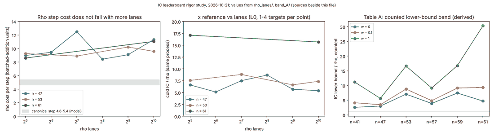

# Keeping the IC leaderboard rigorous and current (2026-10-21, merged with main 2026-10-26)

Follow-up to the slice A validation sweep (#2293). Question: what makes a number on the board true, and what
keeps it true when the code under it changes?

## What was measured

| item | result | evidence |
|:--|:--|:--|
| Recompute of Tables A, B, C from raw records (jq, no shared code with the builder) | all 28 rows, S, reference S, x reference and x floor agree to 1e-8, against rule v7 for Table A after the merge | `scripts/ic_audit/check_board_recompute.sh` |
| Counter drift in 5 inherited-F4 / F6-IC sessions | replays 72/72 at the recording commit 03ac2e467, 24/72 from main 16e74770d, good at 7ab28103d; main did not build in between, so the first changing commit is not isolated (a window, not a commit) | `bisect/` |
| Is Table A's rho step cost a lane effect? | No: 8.4 to 12.5 units a step at every lane count, 32 to 1,024 (slice A said otherwise; corrected) | `rho_lanes/`, `CORRECTIONS.md` |
| Table B | an independent per-instance rho comparison reproduces the 13 instances; main validated the same rows through the gate in parallel, and the gate evidence on main is the one used | `replay_B/`, `docs/ic/runs/VALIDATION.json` |
| Replay of every cited session on current main | 15 sessions: 12 reproduce 12 of 12 or have nothing to replay; ladder n23 (4 of 12), cross-family R13 (8 of 12) and R19 (4 of 12) drift | `plan_runs/results.tsv` |

## What the PR adds so the board stays true

1. Recompute check on every PR and push to main; tamper tests show that a 1% change to any compared field in any table, or a deleted row, fails it.
2. Reference currency: git blob hashes of the rho source, so a change under a table's reference fails until someone writes down an assessment.
3. Replay plan: every cited session is `identical` or `drift` with a reason; new drift, healed drift and an unlisted session all fail the daily workflow.
4. Optional `expires` date for the pre-gate freeze files (not set: the owner's decision).

## What it does not do

- It does not isolate the commit that changed the counters.
- Table C has no counted section 5a band and its reference comes from another experiment; it stays pre-gate.
- Table A on rule v7 was not re-checked for the step-cost gap measured on the v3 figures.
- Nothing here is a speedup.

