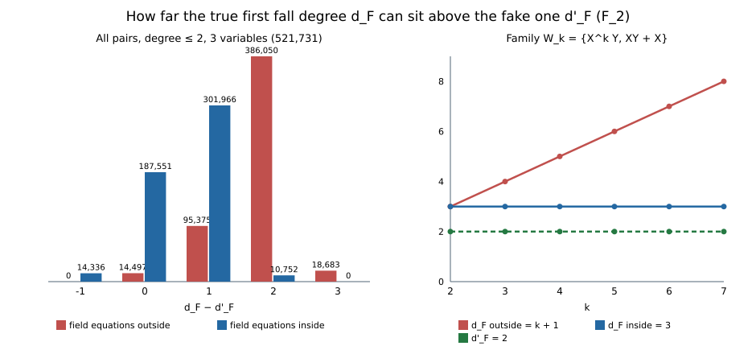

# Fake-degree assumptions attacked with exact witnesses and Lean (2026-11-02)

**Verdict.**
- **A1 REFUTED.** Outside, no function of the fake first fall degree bounds the true one.
- **A2 REFUTED (`+1` form).** Inside, `d_F ≤ d'_F + 1` fails; whether any bound holds is open.
- **A3 SURVIVES.** The reverse repair with independent reduced generators survives
  three-generator systems.

All results are exact. No cost or speed claim is made.

Protocol: [`PROTOCOL.md`](PROTOCOL.md), frozen before computing, with Amendment 1.
Definitions: Nagao ePrint 2015/984 Definitions 5 and 6, equality reading, over `F_2`.



## A1. Outside, the fake degree bounds nothing

After Lemma 4 (`d_F ≤ d'_F`) was refuted, an estimate "the fake degree is small, so the
true first fall degree is small" still needs some weaker statement: `d_F ≤ d'_F + c`, or
`d_F ≤ f(d'_F)` for some function `f`. None holds with the field equations outside.

**Family.** `W_k = {X^k Y, XY + X}`, `k ≥ 2` (`W_2` is witness A).

- **Fake degree.** Modulo the field equations `X^k Y ↦ XY`, so every `W_k` has the same
  reduced system as witness A, and `d'_F = 2`.
- **True degree, outside.** `X^{k-1}(XY + X) + X^k Y = X^k` is a fall at `k + 1`. Below
  `k + 1`, no nonzero multiple of `X^k Y` is admissible, and multiples of the one
  remaining generator never fall, because the sum is a single product. So `d_F = k + 1`.

| k | 2 | 3 | 4 | 5 | 6 | 7 |
|---|---|---|---|---|---|---|
| `d'_F` | 2 | 2 | 2 | 2 | 2 | 2 |
| `d_F` outside | 3 | 4 | 5 | 6 | 7 | 8 |
| `d_F` inside | 3 | 3 | 3 | 3 | 3 | 3 |

Source: `results/family.txt`.

**Lean.** `IcNegative.FakeDegreeGap.gap_two_witnessW3` kernel-checks `k = 3`
(`d'_F = 2`, `d_F = 4`), which already refutes `d_F ≤ d'_F + 1`. It is core Lean using
`decide +kernel`, and the repository proof gate passed it (run 41399938870: target PASS,
40 theorems, 8 of them new, 0 trusted). The all-k statement is the hand proof
above plus the native table.

## A2. Inside, the gap reaches 2

Inside, `W_k` stays at `d_F = 3`, which suggested a bounded-gap repair. Over all
521,731 pairs of degree ≤ 2 in three variables (`results/p3gap.txt`):

| `d_F − d'_F` | −1 | 0 | 1 | 2 | 3 |
|---|---:|---:|---:|---:|---:|
| outside | 0 | 14,497 | 95,375 | 386,050 | 18,683 |
| inside | 14,336 | 187,551 | 301,966 | 10,752 | 0 |

**Witness for gap 2 inside.** `F = {YZ + 1, XZ + X + 1}`.

- **Fake fall at 1.** `(1 + Z)(YZ + 1) + Z(XZ + X + 1)` reduces to `1`.
- **True fall at 3, inside.** `Z(XZ + X + 1) + X(Z² + Z) = Z`, with no fall below 3.

So `d_F(inside) = 3 = d'_F + 2`. Two implementations agree:
- the linear-algebra census (Rust);
- a brute force over every admissible multiplier tuple, sharing no code with it
  (Python, `results/brute_inside_witness.txt`).

This witness has three variables, so it falls outside the two-variable Lean encoding and is
not kernel-checked.

Open: is `d_F(inside) − d'_F` bounded at all (`GAP-FAKE-GAP-INSIDE-BOUNDED`,
`RT-FAKE-GAP-INSIDE`)?

## A3. The surviving reverse repair, three generators

The open form is `d'_F ≤ d_F` (outside) when the reduced generators are linearly
independent (`GAP-LEMMA4-REVERSE`). Census over all unordered triples (`results/t1.txt`,
`results/t2.txt`):

| population | triples | reduced-independent | reverse counterexamples (dependent / independent) |
|---|---:|---:|---|
| T1: all deg ≤ 2, n = 2 | 37,820 | 25,536 | 266 / **0** |
| T2: multilinear deg ≤ 2, n = 3 | 325,500 | 322,896 | 0 / **0** |

The open form survives. Together with the pair census, it has 0 counterexamples among all
pairs and triples tested.

## Gate receipts for earlier work

Proof gate runs 41390917050 and 41396053760 passed all 97 targets. The corpus now records
these claims as kernel-checked:

- the reverse-repair witness (`Lemma4Reverse`);
- Salizzoni Ex. 3.9 (`SalizzoniEx39`);
- the four JKSST counterexamples (`research/jksst_xedni_audit_20261101/lean`,
  294 theorems).

Per-target summaries are in `../disprove_easy_targets_20261102/results/gate/`.

## What this does not say

- Nothing about Nagao's Proposition 5. Per-instance certificates, whose products already
  have unreduced degree ≤ `d'_F`, still certify a true fall; only a bound through `d'_F`
  alone is ruled out (outside).
- A2 and A3 cover only degree ≤ 2 with n ≤ 3 (pairs), and the T1/T2 triples.

## Reproduce

```sh
D=research/lean_attacks_20261102
rustc --edition 2021 -C opt-level=3 -o /tmp/fg $D/fall_gap_census.rs
/tmp/fg family; /tmp/fg t1; /tmp/fg p3gap; /tmp/fg t2    # ~0.01 s, ~1 s, ~34 s, ~16 s
python3 -I $D/brute_inside_witness.py                      # ~3 s
python3 -I $D/plot_gaps.py
```
