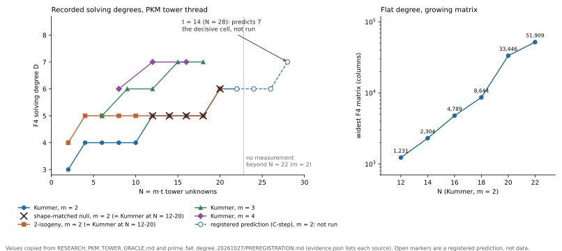

# Lever 2, sub-B-degree membership: the exact-count falsifier is an identity, and the open question is a solving degree

2026-10-31. Source question: `RESEARCH_PRIME_FIELD_BREAKTHROUGH_PROGRAM.md` §4 item 2, "count
solutions of the combined system over `F̄_p` for a toy `p`; if it is `≥ B^{m−1}`, the lever is
dead." No new run was made: the check below is a derivation plus a reading of records that
already hold the exact counts and the solving degrees.

## Result

- **Derived.** For a base whose membership splits over `F_p`, the closure count of
  `S_{m+1} = 0` with the membership equations, for a target `r`, is the number `c(r)` of size-`m`
  multisets of the base summing to `r`. Its mean over all targets is exactly
  `C(B+m−1, m)/N` for every base of size `B` (`KN-FIND-007`), so at the program's operating point
  `B^m ≈ N` it is about `1/(m!·B^{m−1})` of the threshold. The falsifier as worded cannot fire on
  the mean.
- **Derived.** On the maximum it fires for the wrong bases. The small-multiples base
  `{kP : 1 ≤ k ≤ B}` has a target with exactly `B = B^{m−1}` ordered representations at `m = 2`
  and `3/4·B^{m−1}` at `m = 3` (exact enumeration at `B = 100`: 100 and 7,500 of 10,000). Its
  coverage is far below a random base's: the recorded ratio is 0.0021 at `N ≈ 2^18` with a
  concentration statistic of 1224× (`KN-FIND-007`, consequence 3).
- **Checked.** `EV-FBG-001` counted exactly over the complete target space in 288 cells
  (`N ≈ 2^14 … 2^18`, `m = 3`, 12 prime-order curves): the exact mean differs from
  `C(B+2,3)/N` by 0 in all 144 cells of the three untyped geometries, and the exact coverage ratio
  to the matched random base stays within about 1%.
- **Mapped.** What is left of "sub-`B` degree" is the per-equation degree of a presentation whose
  scheme degree is still at least `B`. Two atlas leads hold it: the PKM tower
  (`open_blocked`) and the digit presentation (`open_next_step`). The figure plots the
  solving degrees the tower thread recorded.
- **Related record on main.** `research/prime_factor_base_degree_20261031` landed while this note
  was written. It restates the yield identity for `m = 2` (equal-size bases have the same total
  ordered yield `K²−K`) and adds a presentation-level constant-factor degree reduction at toy
  scale; §5 places it.

## 1. Claim classes

| claim | class | basis |
|:--|:--|:--|
| mean closure count per target is `C(B+m−1,m)/N` for every base | theorem / identity | each multiset sums to exactly one target |
| the §4.2 threshold cannot fire on the mean at `B^m ≈ N` | theorem / identity | the line above and `B^m/(m!·N) ≈ 1/m!` against `B^{m−1}` |
| the small-multiples base reaches `B^{m−1}` at `m = 2` | exact computation | enumeration, `B = 100`, reproduced by hand: `B` pairs `(k, B+1−k)` |
| 288-cell exact yield and coverage ratios | exact computation | `EV-FBG-001`, recorded and independently validated there |
| a size-`B` algebraic description has scheme degree `≥ B` | theorem, scoped | `IDEA-20260801-021`, Theorems 1 and 1G; universal form open (`KN-OPEN-020`) |
| solving degrees in the figure | recorded measurements | tower thread, copied; not re-run here |
| the registered prediction at `t = 14` | heuristic estimate | `PREREGISTRATION.md`, Amendment 6; a prediction, not data |
| any statement about the cost of an attack | out of scope | not established here |

## 2. Why the count cannot decide the lever

Let `D ⊂ G` be a base of `B` elements in a group of order `N`, and let `c(r)` count the size-`m`
multisets of `D` that sum to `r`. Every multiset sums to exactly one `r`, so
`Σ_r c(r) = C(B+m−1, m)` and the mean of `c` is `C(B+m−1, m)/N`, whatever `D` is. When the
membership equations split completely over `F_p`, as in every tower, digit, subgroup, coset and
random base, the zero set of the combined system for the target `r` is exactly the set of those
multisets (with orderings), so its size is `c(r)` and nothing outside `F_p` contributes. A mean of
about `1/m!` at `B^m ≈ N` sits far below `B^{m−1}`, so a falsifier written as `count ≥ B^{m−1}`
has nothing to find in the mean.

A single target can reach the threshold only through additive structure of the base in the group.
`D = {kP : 1 ≤ k ≤ B}` gives the target `(B+1)P` exactly `B` ordered pairs `(kP, (B+1−k)P)`, which
equals `B^{m−1}` at `m = 2`. That is concentration: the same sums repeat, the sumset shrinks, and
coverage falls below the random base's. The threshold therefore flags the bases that are worse for
index calculus.

The count is also not what separates the extension-field case from `F_p`. Over `F_{q^n}` the
Weil-descent system has no membership equations at all and a closure count that does not depend on
`q`. Over `F_p` the membership equations stay in the system, so the count after adding `S_{m+1}` is
small while the work to reach it is set by the degrees that Gröbner elimination passes through.
That quantity is the solving degree, and it is what the tower thread measures.

## 3. What the degree theorem covers, and what stays open

`IDEA-20260801-021`, Theorem 1G: for a target-independent proper algebraic locus `Z` with finite
intersection degree `Δ` against the curve, every base inside `E ∩ Z` has at most `Δ` points. A
zero-dimensional locus contributes its scheme degree, a complete intersection its Bezout product.
A tower with `t` quadrics per coordinate cuts out `2^t = B` points, so its scheme degree is `B`
and the theorem leaves no room below it. "Sub-`B` degree" can only mean the degree of each
equation, with `t` quadrics standing in for one polynomial of degree `2^t`. The tower note puts the
Macaulay bound at `N + d` against `m·2^t` for the single-polynomial form (§3.1). Whether the
solving degree stays bounded in `N` is `KN-OPEN-020`'s open core and the question of both leads
below. The theorem record itself states that it is a scoped negative and that the unrestricted
statement is open.

## 4. The recorded solving degrees

`D` is the largest degree F4 reaches before the solution or the refutation; `N = m·t`. Values are
copied into `evidence.json` with their sections.

| `m` | `N` and `D` | source |
|--:|:--|:--|
| 2 | 2→3, 4–10→4, 12–18→5, 20→6, 22→6 | tower note §17, §11.7 K1 |
| 3 | 6→5, 9→6, 12→6, 15→7, 18→7 | §10.2, §11.7 M3, §16 |
| 4 | 8→6, 12→7, 16→7 | §10.2, §12 |

- At `m = 2` the shape-matched null and the 2-isogeny tower read the same `D` as Kummer at every
  `N` from 12 to 20 (K1n, I0). The recorded values do not separate elliptic structure from the
  shape of the system.
- `D` rose from 3 to 6 over `N = 2 … 20` at `m = 2` and has not risen over `N = 20 … 22`. The
  registered conjecture `d_F = 4 + ⌊(t−2)/4⌋` reproduces all eleven recorded medians, `t = 1 … 11`,
  ten of which it was fitted to, and predicts 6 at `t = 12, 13` and 7 at `t = 14`. Only `t = 12 … 14`
  are blind tests of it. They have not been run.
- The widest matrix at `m = 2` grows from 1,231 to 51,909 columns over `N = 12 … 22`, a factor 42,
  while `D` moves from 5 to 6.
- The values come from different rounds, primes and builds of one thread. They are a record, not
  one controlled comparison. At `N = 2` the reduced presentation reads 3 and the raw pilot table 4.

## 5. Where each piece stands

| piece | status | record | what would change it |
|:--|:--|:--|:--|
| mean closure count of the combined system | identity, cannot fire | `KN-FIND-007`; `EV-FBG-001` | nothing; arithmetic |
| maximum count | fires for concentrated bases, which lose coverage | §2 here; `KN-FIND-007` | not applicable |
| scheme degree of a size-`B` description | `≥ B`, scoped theorem | `IDEA-20260801-021`; `KN-OPEN-020` | a description whose cost is not charged by intersection degree |
| coverage of structured bases | within about 1% of random for the untyped geometries (`EV-FBG-001`); the lead record adds 13 families at `N = 2^24 … 2^26` within 0.0003 bits at `m = 2`, from an external repository the atlas check does not resolve. Headroom exists but is a constant: a Bose–Chowla Sidon base reaches 1.1071, the ceiling is about +54%, and the gain per relation is at most 1.582 (`KN-FIND-007`) | `LEAD-ICP-algebraic-membership-factor-base` | a coverage excess that grows with `N` |
| per-equation degree, split-graph secant presentation, `m = 2` | positive at toy scale: homogeneous degree `d+1` against `2d+1` for a base of size `2d` (Lean-checked for the monomial-coverage core, written proof for the group-law bridge); observed handled F4 degree lower than matched secant and dense arms over `F_17 … F_127`, e.g. 3 against 4 and 6 at graph degree 2; a factor 2, at fixed base size | `research/prime_factor_base_degree_20261031` (`THEORY.md`, `SECANT_GRAPH.md`, `parallel_20261031/RESULTS.md`) | its own open items: F4 solving degree at scale, natural yield, field-operation cost, literature novelty |
| per-equation degree, PKM tower | `open_blocked` | `LEAD-ICP-pkm-tower-algebraic-oracle` | `t = 12 … 14` at `m = 2`; `m = 4`, `N = 20` (240–380 GB) |
| per-equation degree, digit presentation | `open_next_step`; first fall degree equals a curve-free null | `LEAD-ICP-digit-presentation-solving-degree`; `EV-PFDR-1394a4` (toy tier; not a solving degree) | the ladder over `s = 2 … 8` with blocking controls |

## 6. Correction to the program note

`RESEARCH_PRIME_FIELD_BREAKTHROUGH_PROGRAM.md` §4 item 2 gave the falsifier as "count solutions of
the combined system over `F̄_p`; if it is `≥ B^{m−1}`, the lever is dead." That count is the
identity of §2 and cannot fire on the mean, and on the maximum it flags bases that lower coverage.
The note now carries a dated correction under that item pointing here and to the two leads. §2.3
of the same note says the system `S_{m+1} = 0, L(x_i) = 0` has about `(2B)^m/m!` solutions over
the closure; that figure matches the number of candidate point tuples before `S_{m+1}` is
imposed, and with it imposed the closure count is `c(r)`. The conclusion drawn there, that a
solver costs at least `B^{m−1}`, is the solving-degree question of §3, not a count.

## 7. What was not done, and why

- **No new run.** The count is an identity and `EV-FBG-001` already measured it exactly. Both
  open leads carry preregistered or prescribed protocols owned by other lanes; running their cells
  here would produce rows outside those protocols, which the preregistration says it would have to
  report separately.
- **Route.** `AGENTS.md` §9a sends supported x86 experiments to Iso Lab on EKS Spot. This container
  has no `aws` CLI and none of the `taskq/deploy/eks-karpenter` clients, and the lead record says
  `isolab.eks.request/v1` accepts only ecbench specs, so the tower study uses the harness-host
  `isolab_k8s_run` route. That is a reported integration gap, not a reason to substitute a local
  run.
- **Next step that would add information.** The `t = 12, 13, 14` cells at `m = 2` of
  `research/prime_fall_degree_20261027`, with `t = 14` decisive, then the `m = 4`, `N = 20` cell on
  a host of 240–380 GB, and the digit ladder of its lead.

## 8. Sources checked and scope

- Repository: the program note (§0, §2.3, §2.4, §4, §5); `RESEARCH_PKM_TOWER_ORACLE.md` (summary,
  §2.4, §3, §10.2, §11.7, §17, round summaries of §12–§16); the head of
  `RESEARCH_INDEX_CALCULUS_FACTOR_BASE.md`; the module headers of `pkm_criterion.rs`,
  `prime_small_x.rs`, `f4_fp_tower.rs`, `ic_framework/prime_tower.rs` and
  `examples/pkm_tower_pilot.rs`; `research/prime_fall_degree_20261027` (preregistration,
  Amendments 6 and 7, headings of `DERIVED.md`).
- Sibling `crypto-autoresearcher` at `bb835c7787`: the lead atlas README and the leads
  `LEAD-ICP-algebraic-membership-factor-base`, `-digit-presentation-solving-degree` and
  `-pkm-tower-algebraic-oracle` (head); `IDEA-20260801-021` (statement, Theorems 1, 1G and 2);
  in this repository, `research/prime_factor_base_degree_20261031` (`README.md`, `THEORY.md`, the
  head of `parallel_20261031/RESULTS.md`; read after merging main, not the proof files);
  `KN-OPEN-020`; `KN-FIND-007` (statement and consequences); `EV-FBG-001` (observations);
  `EV-PFDR-1394a4` (head).
- External: Petit, Kosters, Messeng, PKC 2016, from the authors' PDF text (introduction, §3.1, §5):
  the factor base is the zero set of a composition of low-degree maps, Semaev's base is
  `L(x) = ∏_{α<B}(x − α)`, and the asymptotic complexity is stated as open. Amadori, Pintore, Sala
  (ePrint 2017/609), Yokoyama, Yasuda, Takahashi, Kogure (J. Math. Cryptol. 2020), Huang, Kosters,
  Yeo (CRYPTO 2015) and the Galbraith–Gaudry survey were read at abstract level only: the
  ePrint PDF returned 403 and the others were not retrieved in full.
- Not done: `tools/lead_atlas.py --match` was not run (the sibling worktree here is stale); the
  lead files were read directly from `origin/main`. Theorems 3 and 4 and later sections of the
  bounded-degree theorem record were not read.

## 9. Reproduce

`/tmp/report-venv/bin/python plot_degree.py evidence.json degree_growth` rebuilds the figure from
`evidence.json`; `sh build_report.sh` rebuilds this PDF. The enumeration in §2 is
`awk` over `a + b (+ c) = S`, `1 ≤ a, b, c ≤ 100`.
