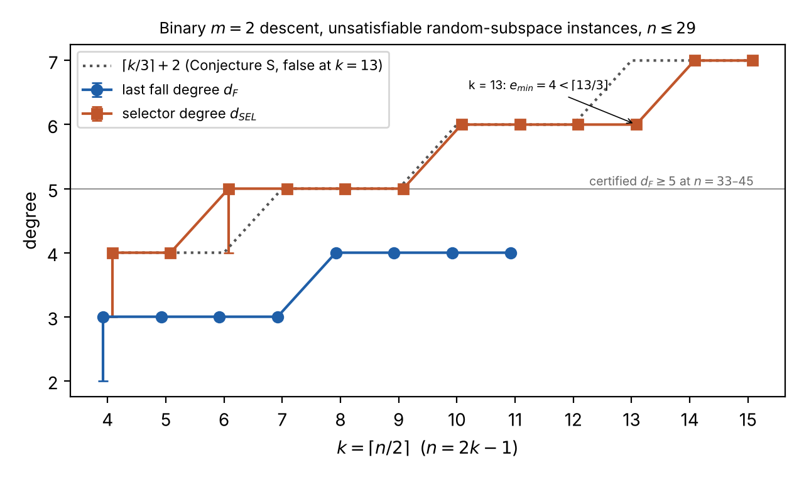

# A growing lower bound on the last fall degree of the binary Weil descent of Sem3: attempt and obstructions

Date: 2026-11-11. Treatise open problem 12
(`papers/ecdlp-index-calculus-treatise/sections/prog_openproblems.tex`).
Status: research note, committed with #3878 and updated through the C runs of
#3887, #3891 and #3893. Nothing was run off this machine (a 4-vCPU, 15 GB cloud
container). No `pcc` claim exists for anything below, so every statement is
`[pcc:unverified]`. The labels **PROVED**, **SKETCH**, **MEASURED**,
**HEURISTIC** and **CONJECTURE** below say what kind of support each statement has.

## 1. Question

Let `F = F(n, V, z)` be the Boolean Weil descent of `Sem3(X1, X2, z)` over
`K = GF(2^n)`, with `X1, X2` ranging over an `F2`-subspace `V` of dimension `k`
(`N = 2k` Boolean variables, field equations implicit). For unsatisfiable `F`,
the last fall degree `d_F` is the least `D` with `1 in W_D(F)` (treatise
`falldegree.tex`, Prop. `bridges`). The question has two parts:

- Is there a lower bound on `d_F` that provably grows with `n` (or `k`), for any
  presentation of the system?
- If not, what precisely prevents a proof?

**Short answer.** No growing lower bound is proved here for `d_F`, in any
presentation. What this note establishes:

1. **The literal "any presentation" question has a negative answer** (Lemma 2,
   PROVED). Every unsatisfiable instance has a degree-2 presentation of the same
   solution set with `d_F = 2`. It uses `sum_{j=2..D} C(N, j)` extension variables
   and *instance-independent* quadratic axioms. So a meaningful lower bound must
   either fix the presentation or bound its size.
2. **Fixing the presentation up to every natural re-encoding gives one number**
   (Lemma 1, PROVED). The re-encodings are a basis of `K`, a basis of `V`, an affine
   change of variables, and a basis of the equation span.
3. **Three proof routes have barriers:**
   - restriction (Lemma 4 ceiling, PROVED);
   - generator degree (Lemma 3, PROVED; it is the mechanism of every growing bound
     proved so far in the repository);
   - locality and expansion (Lemma 5, PROVED invariant, MEASURED size).
4. **A weaker, well-defined proof system has a measured linear growth.** This is the
   "selector" Nullstellensatz, the proof system of the treatise's `k+2` upper bound.
   - Its degree has an exact dual characterisation (Prop. S, S*, PROVED).
   - Its degree was measured at `ceil(k/3) + 2` on the diagonal for `k = 4..12`,
     which gave Conjecture S.
   - **Conjecture S is false as stated** (§6, COUNTEREXAMPLE, checked independently
     in both directions). At `n = 25`, `k = 13`, both instances tested have
     `e_min = 4 < ceil(13/3) = 5`. At `k = 14, 15` the measured value is back at
     `ceil(k/3)`. The selector degree still grows, but not as `ceil(k/3)`.
   - Local (flat-supported) dual certificates cannot prove more than `e >= 1`
     (Lemma F, PROVED, with a MEASURED premise).
   - Even a proof of Conjecture S would not bound `d_F`: measured `d_F` is 1–2 below
     the selector degree.

## 2. Sources checked

- **research-kb: not available.** `scripts/research-kb status` prints
  "research-kb: no executable found". No MCP server `research-kb` is configured in
  this session. So no `source_id` receipts exist. Repository files and the
  literature were read instead.
- **Sibling `isogeny-labs/crypto-autoresearcher`:** `knowledge/leads/ecdlp/*`
  (README.md, REVIEW_STATE.json, coverage.tsv) begin with the bytes `VLT1`. They are
  vault-encrypted and unreadable here; no decryption was attempted. The lead atlas
  (`tools/lead_atlas.py --brief`) was therefore not consulted.
- Repository (`/home/user/crypto`), all read in this session:
  - `papers/ecdlp-index-calculus-treatise/sections/falldegree.tex` (whole chapter);
  - `.../sections/prog_openproblems.tex` (problems 1, 12, 13);
  - `.../sections/prog_theory.tex`;
  - `.../ecdlp-index-calculus-treatise` bibliography entries `hky2015`,
    `kosters2015notes`, `kousidis2019`, `caminata2023`, `cei1996`, `iterated2023`;
  - `research/guarded_fall_degree_20261028/{README.md, STATUS.md,
    extensions/growing_b/proof.txt}` (formal/ listed, not re-read);
  - `research/prime_fall_degree_20261027/DERIVED.md` (D1–D8);
  - `research/pkm_falldegree_unblock_20261107/README.md` (launch logistics only, no
    theory);
  - `research/fall_degree_bounds_20261008/RESULTS.md` (E1–E8 headline);
  - `research/notes/index-calculus/RESEARCH_FALL_DEGREE_BOUNDS.md` (§0–2.4,
    references);
  - `research/notes/index-calculus/RESEARCH_FFD_PROOF_COMPLEXITY.md` (§1–3).
- Literature fetched in this session (WebSearch / WebFetch):
  - HKY, ePrint 2015/573 (abstract);
  - Kosters–Yeo, arXiv:1503.08001 (abstract);
  - Kousidis–Wiemers, arXiv:1906.05594 (abstract);
  - Caminata–Gorla, arXiv:2112.05579 (abstract);
  - Huang, arXiv:2103.07282 (abstract);
  - Gorla–Müller–Petit, arXiv:2011.01050 (ar5iv full text, summarised by the fetch
    tool);
  - Steiner, arXiv:2310.03637 (abstract).
- Cited from the repository ledger or from memory, **not re-read here** (marked † in
  the table):
  - Petit–Quisquater 2012;
  - Hodges–Petit–Schlather 2014;
  - Semaev–Tenti 2021;
  - HKYY arXiv:1505.02532;
  - Ding–Schmidt 2013;
  - Dubois–Gama 2010;
  - Ding–Hodges 2011;
  - Bardet–Faugère–Salvy;
  - the proof-complexity papers: Razborov 1998, Ben-Sasson–Impagliazzo 1999,
    Alekhnovich–Razborov 2001/2003, Buss–Grigoriev–Impagliazzo–Pitassi 2001,
    Clegg–Edmonds–Impagliazzo 1996.

## 3. Literature status

"Presentation" says whether the statement holds for one fixed generating set or for
every one. Quotes are from the fetched abstract or text. Entries marked † are cited
second-hand and need checking against the paper before they are quoted.

| result | quantity, direction | presentation | field | statement (source) |
|:--|:--|:--|:--|:--|
| Petit–Quisquater, ASIACRYPT 2012† | first fall, **upper** `<= m^2+1` | the Weil descent of `S_{m+1}` | `q = 2` (char 2) | Prop. 1 (ledger §2.1). The subexponential claim *assumes* `d_reg ≈ d_ff`. |
| Hodges–Petit–Schlather, FFA 30 (2014)† | first fall, **upper** (2-weight bound) | any Weil descent | any `q` | ledger §2.1 |
| Kosters–Yeo, arXiv:1503.08001 | first fall `= 2` for `Sem3` (a relation, "usually" a fall) | descent of `Sem3` | char 2, ordinary curves | abstract: first fall degree 2, "much lower than expected"; NP-completeness of "check if `S_r` evaluates to zero on some input" is conditional (the abstract does not name the assumption) |
| Kousidis–Wiemers, JMC 2019 | first fall, **upper** `<= m^2 - m + 1` (ledger Thm 3.2) | descent of `S_{m+1}` | binary | abstract: "We improve on the first fall degree bound of polynomial systems that arise from a Weil descent" |
| HKY, CRYPTO 2015 / ePrint 2015/573 | last fall: defined; **upper** for HFE | per presentation (the definition depends on it) | any `q` | abstract: "rigorously bounding last fall degrees of Weil descent systems remains an interesting but challenging open problem" |
| HKYY, arXiv:1505.02532† | last fall, **upper**, `n`-independent in `q, m, d_F(F), deg F, #solutions` | descent of a zero-dimensional radical `F` | any `q` | Thm 1.1 (ledger §2.3). Applied to `{S3, L_V(X1), L_V(X2)}` it gives `<= 4k+6`, linear in `n`. |
| Huang, arXiv:2103.07282 | last fall, **upper** | descents of linearised `F` | any `q` | abstract: relates the last fall degrees of `F_1` and `F'_1`, "As an application we derive upper bounds…" |
| Gorla–Müller–Petit, JSC 109 (2022), arXiv:2011.01050 | solving degree and last fall, **upper** for HFE (Thm 5, Thm 11, Cor. 1 as summarised); **no lower bound** | HFE descent with field equations | any `q` | text: "further work needs to be done to close the gap between experiments and rigorous bounds"; Example 5: the Thm 11 bound "can be reached" in one case |
| Caminata–Gorla, JSC 2023, arXiv:2112.05579 | `sd = max(d_F, max GB degree)` for degree-compatible orders; arbitrary gaps between first fall and `d_F`/`sd`/`d_reg` (Ex. 4.1–4.4, ledger) | one presentation each | any | abstract: "a connection between the solving degree and the last fall degree" |
| Semaev–Tenti, J. Algebra 2021† | `sd <= 2 d_reg - 2` with field equations | one presentation | any `q` | ledger §1 |
| Ding–Schmidt 2013† | the degree of regularity can differ from the solving degree | examples | finite fields | not re-read |
| Dubois–Gama 2010; Ding–Hodges 2011† | HFE `d_reg`, **upper** | HFE | any `q` | not re-read |
| Bardet–Faugère–Salvy† | `d_reg` of semi-regular sequences | generic systems | any | applies only *if* semi-regular; not proved for these systems |
| Steiner, arXiv:2310.03637 | **lower** bounds on Castelnuovo–Mumford regularity (MiMC family), not on the solving degree | iterated systems | prime fields | abstract: lower bounds show regularity-based solving-degree estimates "can never surpass a certain threshold"; they are not `sd` lower bounds |
| Razborov 1998; Ben-Sasson–Impagliazzo 1999; Alekhnovich–Razborov 2001/03; BGIP 2001† | Polynomial Calculus degree, **lower** `Omega(n)` | fixed local encodings: PHP, random `k`-CNF, expanding constant-arity systems | any field (BSI: char ≠ 2) | only for systems whose generators each depend on `O(1)` variables with an expanding dependency graph. By Clegg–Edmonds–Impagliazzo, PC degree = `d_F` for unsatisfiable Boolean systems (ledger §1) |
| repo: guarded chain (`growing_b/proof.txt`) | `d_F >= max(5, B+1)`, `d_ff = B+1` | explicit membership `g(x)` of degree `B` | `F_p`, `p > 3`; binary variant | generator-degree mechanism (Lemma 3 below) |
| repo: PKM naive control D5 (`DERIVED.md`) | `d_F >= 2^t` | `{S3, x_i^K - g^K}` | `F_p` | generator-degree mechanism |
| repo: treatise Prop. `lower3`, Thm. `lfd5`, `lfdexact` | `d_F >= 3` (genericity conditions); `>= 5` certified on named instances; R35a exactly 5 | the Boolean descent | `q = 2` | constants and instances, not growth |

**Status.** In published work every proved bound on the last fall degree or the
solving degree of a Weil-descent system is an upper bound. Every proved lower bound
that grows comes from the degree of an explicit generator (degree-`B` membership,
`x^{2^t}`), or from proof complexity for *local* encodings. None applies to the
fixed-degree Boolean descent of `Sem3`. This agrees with the open-problem statements
of HKY 2015 and Gorla–Müller–Petit quoted above, and with Kousidis–Wiemers as cited
in the treatise.

## 4. Setting and conventions

- **Closure.** `B = F2[x_1..x_N]/(x_i^2 + x_i)`, with degree measured on multilinear
  representatives. `W_D(F)` is the smallest subspace of `B_{<=D}` that contains
  `F ∩ B_{<=D}` and contains `x_i g` whenever `g in W_D(F)` and `deg g <= D-1`.
  This is the convention of the ledger (§0) and of Prop. `bridges`, and equals the
  image of the HKY closure of `F` plus the field equations.
- **Degrees.** `d_F` is the least `D` with `1 in W_D`. `M_D` is the span of the
  `m f` with `deg m + deg f <= D`, and `d_NS` is the least `D` with `1 in M_D`.
- **The descent in `(A, C)` form.** Write `X1 = A`, `X2 = A + C`, so `C = X1 + X2`;
  `A` and `C` range over `V`, with coordinate vectors `a`, `c`. This is an invertible
  linear change of variables. With `S = X1^2 X2^2 + z^2 (X1^2 + X2^2) + z X1 X2 + a6`:

  ```
  S(A, C) = Phi*_C(A) + h_C,
  Phi*_C(A) = A^4 + (C^2 + z) A^2 + z C A,        (F2-linear in A for fixed C)
  h_C       = z^2 C^2 + a6                        (F2-affine in C).
  ```

  Each Boolean coordinate `f_i = Tr(theta_i S)` therefore has the form
  `a^T M_i c + (linear in a) + (affine in c)`. It is affine in `a` for fixed `c`
  and affine in `c` for fixed `a`, as the treatise's proof of Thm. `upper` uses.
  The decomposition at `C` is unsatisfiable iff `h_C ∉ Phi*_C(V)`.

## 5. What is proved here

### Lemma 1 (orbit invariance). PROVED

Let `F, F'` be finite subsets of `B_{<=D}` with `span F = span F'`. Then
`W_D(F) = W_D(F')`. If `phi` is an affine automorphism of `F2^N`, then
`phi*(W_D(F)) = W_D(phi* F)`.

*Proof.* `W_D(F)` is a subspace containing `F`, so it contains `F'`. It is closed
under the rule, so it contains `W_D(F')`; by symmetry the two are equal. Affine
substitution and its inverse do not raise multilinear degree, so `phi*` maps the
closure rule onto itself. ∎

Consequence: `d_F` is the same for every choice of trace basis of `K`, basis of `V`,
affine coordinates, and basis of the equation span, once `D >= 2`. Within this orbit,
"for any presentation" is the same as "for this presentation".

### Lemma 2 (extension variables collapse `d_F` to 2). PROVED; checked computationally

Let `F ⊂ B_N` be unsatisfiable with `max deg F <= 2 <= D := d_F(F)`.
- **Extension variables.** For every monomial `m` with `2 <= |m| <= D`, introduce a
  variable `y_m`. Write `Y(∅) = 1`, `Y({i}) = x_i`, and `Y(m) = y_m` otherwise.
- **Axioms.** `E_D = { x_i Y(m) + Y(m ∪ {i}) : |m| <= D-1, i in [N] }`. The trivial
  ones (`|m| <= 1` and `i in m`) are dropped.
- **Linearised generators.** `f^ = sum_m c_m Y(m)` for `f = sum_m c_m m`.
- **The extended system.** `F^ = {f^ : f in F} ∪ E_D`.

Then:
- (a) the Boolean zeros of `F^` are exactly the lifts `y_m = prod_{i in m} x_i` of
  zeros of `F`, so `F^` is unsatisfiable;
- (b) `1 in W_2(F^)`, so `d_F(F^) <= 2`.

*Proof.*
- (a) By induction on `|m|`, the axiom with `m' = m \ {i}` forces
  `Y(m) = x_i Y(m') = prod x`. Then `f^ = f(x)`.
- (b) Let `L` be the linear map `m ↦ Y(m)` on `B_{N,<=D}`. The set
  `G = {g in B_{<=D} : L(g) in W_2(F^)}` is a subspace containing `F`, since
  `L(f) = f^`. Suppose `g in G` with `deg g <= D-1`. Then
  `L(x_i g) = x_i L(g) + sum_m c_m (x_i Y(m) + Y(m ∪ {i}))`.
  - The first term lies in `W_2(F^)`, because `deg L(g) <= 1`.
  - The sum is a combination of axioms of degree `<= 2`, each in `W_2(F^)`. The
    dropped trivial axioms are 0 in `B`.

  So `G` is closed under the rule and contains `W_D(F)`, which contains 1. Since
  `L(1) = 1`, we get `1 in W_2(F^)`. ∎

Remarks:
- Only the linear forms `f^` depend on the instance. `E_D` depends only on
  `(N, D)`.
- With `D <= k+2` (Thm. `upper`), every instance of a given `(n, k)` has such a
  presentation, with `N + sum_{j=2..k+2} C(2k, j)` variables.
- A "for any presentation" lower bound on `d_F` is therefore **false** as stated.
  The right question is a trade-off between degree and size (number of variables).
  This note claims no theorem about that trade-off.

*Computational check.* `ext_check.py` builds `F^` for unsatisfiable instances. It
gives `1 ∉ W_1(F^)` and `1 in W_2(F^)` on all 6 instances:

| instance | `d_F` | variables of `F^` |
|:--|--:|--:|
| `n = 7` (3 instances) | 3 | 92 |
| `n = 9` (2 instances) | 3 | 175 |
| `n = 11` (1 instance) | 3 | 298 |

Output is in `out/ext.txt`.

### Lemma 3 (generator-degree lemma). PROVED

Let `F = F_0 ∪ F_1`, where `F_0` has a common Boolean zero (in the polynomial-ring
version: a common zero over the algebraic closure) and every element of `F_1` has
degree `>= D_1`. Then `1 ∉ W_D(F)` for every `D < D_1`, so `d_F(F) >= D_1`.

*Proof.* For `D < D_1`, `F ∩ B_{<=D} = F_0 ∩ B_{<=D}`, so `W_D(F) = W_D(F_0)`.
This lies in the ideal of `F_0`, which vanishes at the common zero, while 1 does
not. ∎

This is the mechanism of every growing lower bound proved in the repository:
- the guarded chain `d_F >= B+1` (`growing_b/proof.txt` §4 adds the "no hidden falls
  in the core" argument to reach `B+1`);
- the PKM naive control D5, `d_F >= 2^t`.

It can never give more than `max deg F`. For the descent (`max deg F = 2`) it gives
nothing. This is the precise reason those results "do not transfer"
(`STATUS.md`: "Cardinality lower bounds do not transfer").

### Lemma 4 (restriction, and its ceiling). PROVED

Let `phi: F2^{N'} -> F2^N` be affine and `phi*: B_N -> B_{N'}` the induced
substitution. Then `phi*(W_D(F)) ⊆ W_D(phi* F)`, so `d_F(phi* F) <= d_F(F)` for
unsatisfiable `F`.

*Proof.* `phi*` does not raise degree. Take `g` with `phi* g in W_D(phi* F)` and
`deg g <= D-1`. Then `phi*(x_i g) = (beta + sum_j alpha_j x'_j) phi*(g)`, and each
term is admitted by the rule. ∎ This is the Boolean form of `DERIVED.md` D6.

Corollaries:
- **(4a) Monotone in `V`.** If `V' ⊆ V`, then `d_F(F_{V'}) <= d_F(F_V)`, for
  unsatisfiable `F_V`.
  - Checked: `dF_restricted_k-1 <= dF` on every instance that has the column
    (`out/n7-11.txt`, `out/n13.txt`, `out/n15.txt`, `out/n17.txt`).
- **(4b) Monotone in `t` for Semaev's chain (5).** Substitute `X_t := v in V` and
  `Y_{t-2} := y*`, where `Sem3(y*, v, R_X) = 0`. This turns the last equation into the
  zero function and leaves exactly the `(t-1)`-chain with target `y*`. Hence
  `d_F(chain_t(R_X)) >= d_F(chain_{t-1}(y*))`.
  - **SKETCH:** written for the chain as the treatise states it; not checked
    computationally.
- **(4c) Ceiling.** Restrict `c` to an affine flat of dimension `j` (or `a` to one).
  The restricted system has `d_F <= j + 2`.
  - Proof: it is affine in `a` for each value of the `j` flat coordinates, and the
    indicator construction of Thm. `upper` uses multipliers of degree `j`.
  - Fixing `c` entirely gives `d_F <= 1`.
  - Hence a lower bound obtained by restriction can exceed `j + 2` only if the
    restricted system keeps `>= d-2` free dimensions on both sides, i.e. it is again
    a full-size member of the family. Restriction transfers lower bounds; it cannot
    create them.

### Lemma 5 (no local presentation in the orbit). PROVED invariant, MEASURED size

For quadratic `f in B`, let `B_f(x, y) = f(x+y) + f(x) + f(y) + f(0)`. This is an
alternating bilinear form, and its rank is invariant under affine changes of
variables. If `f` depends on only `r` variables, then `rank B_f <= r`.

For `f_delta = Tr(delta w)` with `delta in ker Tr` (treatise Thm. `reform`), the form
is `[[0, M_delta], [M_delta^T, 0]]` with `M_delta[i][j] = Tr(delta v_i v_j / z)`,
so its rank is `2 rank M_delta`. So every non-trivial generator in any coordinates of
the orbit depends on at least `2 min_delta rank M_delta` variables.

Measured `min_delta rank M_delta` (`--rank`):

| `n` | `k` | min rank |
|--:|--:|:--|
| 7 | 4 | 1–2 |
| 9 | 5 | 2 |
| 11 | 6 | 2–3 |
| 13 | 7 | 2–3 |
| 15 | 8 | 3–4 |

The rank histograms concentrate at `k-1` and `k` (`out/n15ns.txt`). A dimension count suggests
the minimum is about `k - sqrt(2k)` (HEURISTIC).

Consequently the Alekhnovich–Razborov / Ben-Sasson–Impagliazzo expansion method has
no `O(1)`-arity presentation to work on. This is a barrier to that method, not a
proof that the method fails.

### Remark (complexity). PROVED, elementary

Suppose `d_F <= c` held for all unsatisfiable `m = 2` instances, for a constant `c`.
Then computing `W_c` (time `N^{O(c)}`) would decide decomposability in polynomial
time. So any hardness result for the `m = 2` subspace-decomposition decision problem
would imply that `d_F` is unbounded. None is known: the Kosters–Yeo NP-completeness
is for `S_r` with growing `r`, and is conditional. Conversely, an unconditional
`d_F -> infinity` faces no known complexity-theoretic barrier, since PC degree lower
bounds are proved unconditionally for other families. The obstacle is technical.

## 6. The proof attempt: the selector proof system

The treatise's upper bound `d_F <= k+2` is a refutation of the form
`1 = sum_i g_i(c) f_i`, with multipliers depending on `c = a + b` only. Call the
least possible `max deg g_i` the **selector degree** `e_min`, and
`d_SEL := least D with 1 in span{m(c) f : deg m + deg f <= D}`.

Trivially `d_F <= d_NS <= d_SEL <= k+2`, because the multiplier sets are nested.
A lower bound on `e_min` is therefore the weakest statement in this chain. Even that
is not proved; below are the exact reformulations and how far the proof attempt got.

### Proposition S (field form of the selector system). PROVED; checked computationally

Write `lambda := sum_i g_i theta_i`, a map `V -> K` whose coordinate degree is
`max deg g_i`. Then `sum_i g_i(c) f_i = 1` in `B` iff, for every `C in V`:

```
(I)  Tr(lambda(C) * Phi*_C(v)) = 0   for all v in V,
(II) Tr(lambda(C) * h_C)       = 1.
```

*Proof.* For fixed `c`, `sum_i g_i f_i = Tr(lambda(C) S(A, C))
= Tr(lambda(C) Phi*_C(A)) + Tr(lambda(C) h_C)`. This is affine in `A in V`. It is
the constant 1 iff its linear part vanishes on `V` and its constant is 1. Identity
of functions on `F2^{2k}` is identity in `B`. ∎

*Check.* `selector_check.py` solves (I)–(II) by linear algebra over `2^k` points.
That code is independent of the ANF/Macaulay code that computes `d_SEL`. The two
agree, `e_min + 2 = d_SEL`, on all 10 instances run with both:

| `n` | instances |
|--:|--:|
| 7 | 4 |
| 9 | 3 |
| 11 | 3 |

### Proposition S* (exact dual: selector pseudo-solutions). PROVED

Let `F` be unsatisfiable and put `Rc_C := Phi*_C(V) ⊕ F2 h_C`. The sum is direct
because `h_C ∉ Phi*_C(V)`. No selector of degree `<= e` exists iff there is a map
`p: V -> K` with:
- (i) every coordinate of `p` of Boolean degree `<= k-1-e`. Equivalently,
  `sum_{C in U} p(C) = 0` for every affine flat `U` of dimension `k-e`.
- (ii) `p(C) in Rc_C` for every `C`.
- (iii) `#{C : p(C) ∉ Phi*_C(V)}` is odd.

*Proof.* (I)–(II) is an affine system `A lambda = b` over `F2` in the coefficients of
`lambda in P_e`. It has no solution iff some `y` has `yA = 0` and `y.b = 1`.
- Write `y = (y_C in F2^k, eps_C in F2)_C`. Then
  `y.(A lambda) = sum_C Tr(lambda(C) omega(C))` with
  `omega(C) = Phi*_C(sum_j y_{C,j} v_j) + eps_C h_C in Rc_C`.
- In a trace-dual basis, `yA = 0` says every coordinate of `omega` is orthogonal
  to `RM(e, k)`, i.e. lies in `RM(e, k)^perp = RM(k-e-1, k)`.
- `y.b = sum_C eps_C`, and `eps_C` is the `h_C`-component of `omega(C)`.
- Take `p = omega`. ∎

For `e >= k`, (i) forces `p = 0`, so no dual certificate exists and a selector of
degree `k` always exists. This is a second proof of Thm. `upper`.

### Lemma F (flat-supported certificates are too weak). PROVED, with a MEASURED premise

Let `U` be an `(e+1)`-flat. Then `p = rho * 1_U` satisfies (i)–(iii) iff
`rho in cap_{C in U} Rc_C` and `#{C in U : rho ∉ Phi*_C(V)}` is odd. These are
exactly the obstructions visible after restricting to `U`. If
`cap_{C in U} Rc_C = 0` for every 2-flat `U`, flat restriction certifies nothing
beyond `e_min >= 1`.

*Measured* (`flat_check.py`, 1,500 random flats per instance, `out/flat_check.txt`):

| `n` | 2-flat intersections that are 0 | 1-flat intersection dimension |
|--:|:--|:--|
| 7 | 1,345 / 1,409 and 1,275 / 1,405 | mostly 1–2 |
| 9–13 | ≥ 98.9% | mostly 1–2 |
| 15 | 1,494 / 1,495 and 1,495 / 1,496 | mostly 1–2 |

Rare 2-flats keep a 1-dimensional intersection, so they can only certify `e >= 1`.
Any growing lower bound on `e_min` therefore needs genuinely *global* dual maps `p`
of high Boolean degree (`k-1-e`) that satisfy moving pointwise constraints. The
attempt stopped here.

**Where the attempt broke.** To prove `e_min >= e_0`, one needs to exhibit `p` in a
space of dimension `(k+1) 2^k` (pointwise in `Rc_C`). It must satisfy
`n * sum_{j<=e_0} C(k, j)` independent flat-sum conditions and have odd parity.
Counting shows that many `p` exist with conditions (i)–(ii) for `e_0 < k/2`. Parity
is a single linear functional, and showing it is not in the span of the conditions
is the whole difficulty. That is primal infeasibility again; no structural
construction of `p` was found.

### Conjecture S (selector degree grows linearly). FALSIFIED as stated at `k = 13`

As first stated: for unsatisfiable random-subspace instances on the diagonal
`k = ceil(n/2)`, `e_min >= ceil(k/3)`, so `d_SEL >= ceil(k/3) + 2`. The counterexample
and the data beyond `k = 12` follow the original data below.

- **Data** (`out/emin_*.txt`, `out/n*.txt`):

  | `k` | 4 | 5 | 6 | 7 | 8 | 9 | 10 | 11 | 12 |
  |:--|--:|--:|--:|--:|--:|--:|--:|--:|--:|
  | `e_min` | 2 (×5), 1 (×1) | 2 | 2–3 | 3 | 3 | 3 | 4 | 4 | 4 |
  | `ceil(k/3)` | 2 | 2 | 2 | 3 | 3 | 3 | 4 | 4 | 4 |

  The single exception is `n = 7` seed 16, an instance with `d_F = 2`. So the
  conjecture is stated for `k >= 5`.
- **Off-diagonal caveat.** At `n = 15` with `k = 7` (off the diagonal),
  `e_min = 2 < ceil(7/3)`. So `e_min` depends on `n` as well as `k`, and the
  conjecture is stated only for `k = ceil(n/2)`.
- Distinct instances behind the table: 6, 6, 6, 4, 4, 4, 3, 2, 2 for `k = 4..12`. They pool
  `d_SEL - 2` from `lfd_small.py` and `e_min` from `selector_check.py`; the two were
  shown equal at `n <= 11`.
- **Heuristic.** With `n ~ 2k` unknown coordinates times `C(k, <=e)`, against
  `(k+1) C(k, <=e+1)` constraints, solvability needs `e >~ (k-2)/3`.

**Counterexample (`n = 25`, `k = 13`).** COUNTEREXAMPLE, checked independently in
both directions. `lfd_small.make_instance(25, seed)` for seeds 5 and 6 (the first two
unsatisfiable seeds) gives `e_min = 4`, while `ceil(13/3) = 5`.
- **`e_min <= 4` (feasibility).** `emin.c` found `lambda` with every coordinate of
  degree `<= 4` that satisfies all `2^13 * 14 = 114,688` constraints of Prop. S.
  - `verify_lambda.py` re-checks the saved `lambda`
    (`out/c/cert/n25_s{5,6}/lambda_e4.bin`) with `lfd_small`'s own field
    arithmetic: 0 violated constraints, ANF degree 4, for both seeds.
- **`e_min > 3` (infeasibility).** The rows of 838 points
  (`out/c/cert/n25_s{5,6}/points_e3.txt`) are already inconsistent at `e = 3`.
  - `emin verify` rebuilds them by a second code path (`Tr(x^j w)` computed
    directly) with PLUQ elimination: rank 9,371 for the coefficient matrix, 9,372
    with the right-hand side, for both seeds.

So Conjecture S fails as stated `[pcc:unverified]`. Proposition S, the definition of
`e_min`, and the measurements at `k <= 12` are unaffected.

**C data beyond `k = 12`** (`emin.c`, `out/c/emin_n*.jsonl`; seeds are the first
unsatisfiable ones):

| `n` | `k` | seeds | `e_min` | `ceil(k/3)` | unknowns at the last `e` tested |
|--:|--:|:--|:--|--:|--:|
| 23 | 12 | 4, 8 | 4, 4 | 4 | 18,262 |
| 25 | 13 | 5, 6 | **4, 4** | 5 | 27,325 |
| 27 | 14 | 3, 6 | 5, 5 | 5 | 93,771 |
| 29 | 15 | 3, 4 | 5, 5 | 5 | 143,376 |
| 33 | 17 | 1, 5 | `> 4`, `> 4` | 6 | 106,062 |
| 41 | 21 | 1 | `> 3` | 7 | 64,042 |

- **Coverage.** `n = 15–23` reproduces the Python `e_min` on every committed
  instance, and every feasible `lambda` at `n = 25–29` passes `verify_lambda.py`.
- **The `n = 33` and `41` lower bounds are independently re-checked.** `emin verify`
  (second row builder, PLUQ) confirms each point set is inconsistent:
  - `n = 41` seed 1, `e = 3`: rank 63,831 → 63,832;
  - `n = 33` seeds 1 and 5, `e = 4`: rank 105,365 → 105,366 (both seeds).
- **Lower bounds only at `n = 33` and `41`.** The next `e` needs `n * sum_{d<=e}
  C(k,d)` unknowns, which exceeds the 250k-unknown cap of dense elimination on this
  container: 310k for `n = 33, e = 5` and 309k for `n = 41, e = 4`.
- `n = 31, 35, 37, 39` and the second `n = 41` seed are still running.

**What survives.** The measured `e_min` is non-decreasing in `k` on this diagonal:
4, 4, 4, 5, 5 at `k = 11..15`. The `k = 13` value of 4 was certified on both
instances. A weaker form, `e_min >= ceil((k-1)/3)`, fits every diagonal instance
measured so far, including the `n = 7`, seed 16 exception (`k = 4`, `e_min = 1`).
This form is a CONJECTURE fitted to the same data that falsified the original, so it
is not evidence. Only the data at `k >= 16` (running) can test it.

Even a proof of Conjecture S would show only that the strategy of the `k+2` upper
bound cannot be improved to constant degree with `c`-only multipliers. It says
nothing about `d_F`. The measured `d_F` is smaller:

| `n` | `k` | `d_F` | `d_PCc` | `d_NS` | `d_SEL` |
|--:|--:|--:|--:|--:|--:|
| 7 | 4 | 3 (one instance 2) | 3 | 4 (2) | 4 (3) |
| 9 | 5 | 3 | 3 | 4 | 4 |
| 11 | 6 | 3 | 3 | 4 | 4–5 |
| 13 | 7 | 3 | **4** | 4 | 5 |
| 15 | 8 | 4 | 4 | 5 | 5 |
| 17 | 9 | 4 | 4 | 5 | 5 |
| 19 | 10 | 4 | 4 | 5 | 6 |
| 21 | 11 | 4 | — | — | 6 |

`d_PCc` is the closure that may multiply by `c`-variables only. At `n = 13`
(`d_PCc = 4 > d_F = 3`) the falls need multiplication by `a`-variables. These are
exactly the falls of Lemma `deg3`, `Tr(lambda X_i w)` for `lambda in V^perp`, which
no selector can produce.



### Why this does not extend to `d_F`

For `d_F` the dual object is a certificate in the sense of Prop. `cert`. It needs
condition (ii), closure of the kernel under multiplication by variables, which is
Razborov's pseudo-reduction condition. It is not linear in the certificate, so the
clean Fredholm duality of Prop. S* is lost.

A 1-dimensional certificate is forced to be a genuine solution:
- condition (ii) gives `pi(x u) = c_x pi(u)`, with `c_x^2 = c_x`, on `B_{<=d-1}`;
- so certificates must have large rank, consistent with the certified codimensions
  4,888–12,742.

No family of large-rank certificates with a uniform description was found. The
closure data (`W_dims_at_dF_minus_1` at `n = 15–21`: `(0, 1, 3n, ...)`) reproduce
Lemma `deg3`'s count `3n` for the degree-`<=2` part of `W_3`, and give no further
handle.

## 7. Small computations

All exact over `F2`, pure Python 3.13 plus numpy, on this machine. Instances are
seeded by `random.Random(seed)`, with:
- `a2 in {0, 1}`;
- `a6` random;
- `z` the abscissa of a random curve point;
- `V` a random `k`-dimensional subspace, `k = ceil(n/2)` unless `--k` is given;
- the field `GF(2^n)` defined by the lowest-weight irreducible polynomial.

`--unsat m` scans seeds 1, 2, … and keeps the first `m` unsatisfiable instances. The
skipped satisfiable count is printed. Satisfiability is checked by exhaustive
evaluation over all `2^{2k}` points (`lfd_small.py`) or by exact per-`C` linear
algebra (`selector_check.count_solutions`); the two select identical seeds at
`n = 11, 13`.

Commands, run from `research/lfd_lower_bound_20261111/`:

```sh
for n in 7 9 11; do python3 lfd_small.py --n $n --unsat 6 --ns --sel --rank --restrict --maxD 7; done > out/n7-11.txt
python3 lfd_small.py --n 13 --unsat 4 --ns --sel --rank --restrict --maxD 7 > out/n13.txt        # 16 s
python3 lfd_small.py --n 15 --unsat 3 --sel --restrict --maxD 6 > out/n15.txt                    # 5 s
python3 lfd_small.py --n 15 --unsat 3 --ns --rank --maxD 6 > out/n15ns.txt                       # 73 s
python3 lfd_small.py --n 17 --unsat 3 --sel --restrict --maxD 6 > out/n17.txt                    # 25 s
python3 lfd_small.py --n 17 --unsat 2 --ns --maxD 6 > out/n17ns.txt                              # 10 s
python3 lfd_small.py --n 19 --unsat 2 --sel --maxD 6 > out/n19.txt                               # 86 s
python3 lfd_small.py --n 19 --unsat 1 --pcc --ns --maxD 6 > out/n19_pcc_ns.txt                   # 52 s
python3 lfd_small.py --n 21 --unsat 1 --sel --maxD 6 > out/n21.txt                               # 173 s
python3 lfd_small.py --n 15 --k 6 --unsat 3 --sel --ns --maxD 7 > out/n15_kscan.txt              # also --k 7, --k 5
for n in 7 9 11 13; do python3 lfd_small.py --n $n --unsat 4 --pcc --sel --maxD 7; done > out/pcc_7_13.txt
for n in 15 17; do python3 lfd_small.py --n $n --unsat 3 --pcc --maxD 6; done > out/pcc_15_17.txt
python3 selector_check.py --n 7 --unsat 4; python3 selector_check.py --n 9 --unsat 3; python3 selector_check.py --n 11 --unsat 3
python3 selector_check.py --n 13 --unsat 4 --no-dsel
for n in 15 17; do python3 selector_check.py --n $n --unsat 4 --no-dsel --maxe 7; done > out/emin_15_17.txt
python3 selector_check.py --n 19 --unsat 3 --no-dsel --maxe 7 > out/emin_19.txt                  # 33 s
python3 selector_check.py --n 21 --unsat 2 --no-dsel --maxe 7 > out/emin_21.txt                  # 71 s
python3 selector_check.py --n 23 --unsat 2 --no-dsel --maxe 7 > out/emin_23.txt                  # 229 s
python3 ext_check.py --n 11 --unsat 1 > out/ext.txt; python3 ext_check.py --n 7 --unsat 3 >> out/ext.txt; python3 ext_check.py --n 9 --unsat 2 >> out/ext.txt
for n in 7 9 11 13 15; do python3 flat_check.py --n $n --unsat 2 --samples 1500; done > out/flat_check.txt
```

Raw outputs are in `out/`, one Python dict per instance, and include the curve,
`z`, `V` and the field polynomial.

**Agreement with the treatise.**
- `d_F = 3` at `n = 11, 13` and `d_F = 4` at `n = 15–21` on every instance. This
  matches Thm. `lfdexact` (3 at `n = 11, 13`; 4 for random subspaces at `15 <= n`).
- `dim(W_3 ∩ B_{<=2}) = 3n` (45, 51, 57, 63 at `n = 15, 17, 19, 21`), as in Lemma
  `deg3`.
- These are independent re-computations at sizes the treatise already covers. They
  are not new evidence about growth.

**Off-diagonal (`n = 15`).**

| `k` | `d_F` | `d_NS` | `d_SEL` |
|--:|:--|:--|:--|
| 5 | 2, 2 | 3, 3 | 3, 3 |
| 6 | 3, 3 | 3, 4 | 4, 4 |
| 7 | 3, 3, 3 | 4, 4, 4 | 4, 4, 4 |
| 8 | 4 | 5 | 5 |

At `k = 5` and `k = 6` a third seed (seed 3) is refuted at degree 1 by the linear
trace equations alone.

## 8. Cheapest next step

1. **Done: `e_min` ported to C** (`emin.c`, #3887). It runs `n = 23` in 2 s,
   against 229 s for the Python version. Exact values hold to `n = 29`; lower bounds
   to `n = 41` are running.
   - The port falsified Conjecture S at `k = 13` (§6).
   - Exact values above `n = 29` need sparse or structured elimination, or a host
     with more memory (EKS). The dense system has 0.3–8M unknowns there.
   - Still open: solve the *dual* system of Prop. S* at `n = 13–25` and inspect the
     certificate `p` (support, degree, dependence on `C`). Comparing the
     `k = 13` instances with `k = 12, 14` should show what lets degree 4 suffice at
     `k = 13`.
2. **Measure `d_PCc` and `d_F` side by side at `n = 23–29`**, reusing the existing
   M4RI closure with a restricted multiplier set. This shows whether the
   `a`-multiplication falls (Lemma `deg3`) are the whole gap between `d_F` and
   `d_SEL`. If `d_PCc - d_F` stays at 0–1 while `d_SEL` grows, the next target is a
   pseudo-reduction that handles only those falls.
3. The guarded chain at `B = 4, 5` over a small `F_p` (5 variables, degree `<= 11`)
   is a cheap exact computation for problem 13. Lemma 3 shows its outcome cannot
   bear on problem 12.

## 9. Not claimed

- **No lower bound on `d_F`** that grows with `n`, `k`, `t` or `B` is claimed for
  the Boolean descent, in any presentation.
- **Lemma 2 does not claim** that small extended presentations exist; it uses
  `~N^{d_F}` variables. Nothing is claimed about size–degree trade-offs, Extended PC,
  or any proof-complexity simulation.
- **Lemma 5 does not prove** that expansion methods fail; it only shows that every
  presentation in the orbit has non-constant arity. The growth `k - sqrt(2k)` of the
  minimum rank is heuristic.
- **Conjecture S is false as stated** (`k = 13`, two instances). The weaker form
  `e_min >= ceil((k-1)/3)` is fitted to the same data and is not claimed. Any such
  bound would cover only the selector degree, never `d_F`. Propositions S and S* are
  exact reformulations, not bounds.
- **The `n = 33`, `41` rows are lower bounds** on `e_min` only. No exact value is
  claimed above `n = 29`.
- **Corollary 4b** (monotonicity in `t`) is a sketch for the chain as stated in the
  treatise; it was not checked computationally.
- **The small-size data are not evidence about asymptotic growth of `d_F`.** At
  `n <= 21` they reproduce known values (3, then 4).
- **No security, speed, ECDLP or subexponentiality claim** is made. Nothing here
  supports or refutes Semaev's or Petit–Quisquater's heuristics.
- **No `pcc` claim was filed.** All statements are `[pcc:unverified]`.
- Entries marked † in §3 were not re-read in this session.
