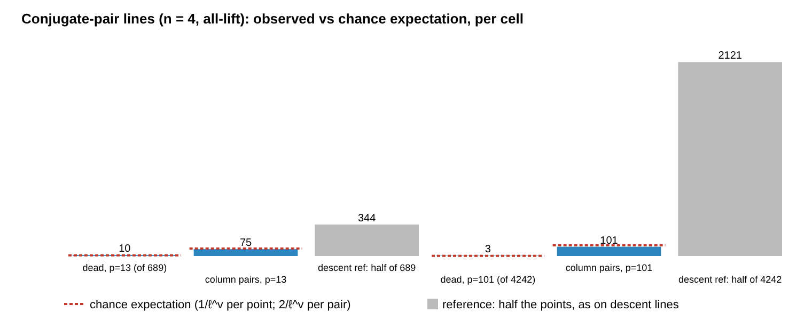

# The conjugate-pair family: 6 lines per generic F_{q⁴} curve, no descent, columns at chance level

2026-11-06. This is the third piece checking the claims that came from
another session as an unverified assertion. The earlier pieces are
[`lift_dense_torsion_pairing_20261106`](../lift_dense_torsion_pairing_20261106/README.md)
(char 2, 2-torsion pairing) and
[`lift_dense_orbit_parity_20261106`](../lift_dense_orbit_parity_20261106/README.md)
(odd char, criterion and descent).

The protocol was frozen before any data, at `b3954a0e9e`
([`PROTOCOL.md`](PROTOCOL.md); post-hoc analysis under "Amendments"). The
instrument is [`conjpair/`](conjpair/), std-only Rust. Its field, curve and
line code is copied from the previous piece's checked `orbit/` crate. The
run is [`reports/run-20261106T0417Z/`](reports/run-20261106T0417Z/), at
commit `30a9b09fb5`. Report: [`REPORT.pdf`](REPORT.pdf).

Every statement below is an unverified assertion of this session
[pcc:unverified]. The claim record is at the end.

## The claim checked

> Two roots are Frobenius-conjugate. This needs n even, n ≥ 4, and full
> 2-torsion over K. There is no descent and the columns are useful. A
> generic such curve over F_{q⁴} has 6 of these lines, found by solving one
> F_q-linear equation. All 146 lines constructed behaved as predicted. Only
> 3 of about 1,050 points were dead, and the number of distinct columns was
> at chance level.

## Construction

Take E : y² = (x−e₁)(x−e₂)(x−e₃) over K = F_{q^n}, and a line x₀ + u·F_q
with t_i = (e_i − x₀)/u. Pick a lone root c and a pair (a, b). Put
w = 1/u and x₀ = e_c − γu with γ ∈ K₀ = F_{q^{n/2}}. Then the conditions
"t_c ∈ K₀ and t_b = σ^k(t_a)" become one F_q-linear equation in (w, γ):

(e_b − e_c)·w + γ − σ^k(γ) = σ^k((e_a − e_c)·w).

Its solutions modulo the shift (0, F_q) and F_q-scaling are the lines.
With k ≠ n/2:

| n | dimension of the solutions | lines |
|:--|:--|:--|
| 4 | a point | 3 × 2 = **6** |
| 6 | P¹(F_q) | 12(q + 1) |
| 2 | none (only k = n/2 exists) | none |

With k = n/2 a solution needs N_{K/K₀}((e_b−e_c)/(e_a−e_c)) = 1. That is
not generic, and when it holds the root set is σ^{n/2}-stable, which is the
descent case.

## Answer

- **The family exists as claimed, on generic curves.**
  - **n = 4:** 31 of 32 curves with full 2-torsion over F_{13⁴} and F_{101⁴}
    have exactly 6 lines. Each comes from one F_q-linear system.
  - **n = 6:** all 4 curves over F_{13⁶} have exactly 12(q + 1) = 168
    lines, as derived.
  - **Behaviour:** every one of the 877 constructed lines (n = 4 and 6)
    satisfies the orbit criterion. Each has its lone root in K₀ and its
    pair in one Frobenius orbit, and each is all-lift or all-twist.
    **None** is a descent line (σ^{n/2}-stable), and no curve has
    j ∈ K₀. 0 exceptions.
  - **Share:** 449 of the 877 lines are all-lift (51 %). The others are
    all-twist.
- **The columns are useful at the scope measured** (n = 4, all-lift lines):

  | (p, n) | dead points | chance expectation | column-collision pairs | chance expectation |
  |:--|:--|:--|:--|:--|
  | (13, 4) | 10 / 689 | 7.6 | 75 | 81.1 |
  | (101, 4) | 3 / 4,242 | 1.2 | 101 | 116.2 |

  - Descent lines in the previous piece had about half their points dead.
  - The planted positive control works on every line: adding P + T_c never
    adds a new column, so the detector does see 2-torsion pairing when it
    is there.
- **"6 lines" is the generic count, not a bound.**
  - One (13,4) curve has 19. On it, one system (and its mirror) has a
    3-dimensional solution space instead of 2, which gives a pencil of
    q + 1 lines.
  - That curve has j ∉ K₀, and all 19 of its lines pass every behaviour
    check.
  - This is a coincidence of probability about 1/q per system. It was 2 of
    the 384 n = 4 systems.
- **n = 2 has no conjugate-pair lines on generic curves.** One (101,2) curve
  with j ∈ F_q (by chance) has k = n/2 solutions. That is the n = 2 descent
  case on a subfield-type curve. The raw count of 202 is solution points,
  which is about one line after scaling and shift (derived after the data).
- **Odd n.** The pattern needs the lone root in F_{q^{n/2}}, so odd n has no
  such lines. That is consistent with the previous piece, where no n = 3
  line met the criterion except by chance.

What this does **not** establish:

- the cost: the 2^m yield per trial, against 6 lines per curve (n = 4) and
  their 51 % all-lift share;
- any scaling beyond q = 101.

No ECDLP cost was measured, so there is no leaderboard, benchmark or rho
row. This is the only family across the three pieces that survives as a
candidate lever on generic curves.

## Registered verdicts (`conjpair summarize`)

| rule | verdict | detail |
|:--|:--|:--|
| C1 n = 4: 6 lines on ≥ 90 % of curves, none > 6; k = n/2 gives 0 on ≥ 90 % | **FAIL** | 31/32 with 6 lines, 1 curve with 19 (pencil); 32/32 with 0 from k = n/2 |
| C2 behaviour of every constructed line | **PASS** | 877 lines, 0 exceptions, 0 curves with j ∈ K₀ |
| C3 n = 2: 0 lines | **FAIL** | 1 of 16 curves (j ∈ F_q by chance) has k = n/2 solutions (202 raw solution points) |
| C4 dead ≤ E + 3√E + 3 | **PASS** | 10 vs 7.6 and 3 vs 1.2 |
| C5, C5+ collisions ≤ E₂ + 3√E₂ + 3; planted control exact | **PASS** | 75 vs 81.1 and 101 vs 116.2; control exact on 95/95 lines |
| C6 n = 6 count (report) | — | 168, 168, 168, 168 against 12(q+1) = 168 |
| Orders | ok | BSGS = enumeration on 16/16 (13,4) curves; [#E]P = O on all 52 curves |
| A/A | **PASS** | byte-identical `rows.jsonl` (sha256 `c083e110…`) |

## Per cell

| p | n | lines per curve (k ≠ n/2) | null-space dimension per system |
|--:|--:|:--|:--|
| 13 | 2 | 0 ×8 | k = 1: dimension 1 on 48 |
| 101 | 2 | 0 ×8 | k = 1: dimension 1 on 46, 2 on 2 (the j ∈ F_q curve) |
| 13 | 4 | 6 ×15, 19 ×1 | dimension 2 on 190, 3 on 2 |
| 101 | 4 | 6 ×16 | dimension 2 on 288 |
| 13 | 6 | 168 ×4 | dimension 3 on 120 |



The full tables are in
[`SUMMARY.md`](reports/run-20261106T0417Z/SUMMARY.md).

## Sources checked

The `research-kb` server and CLI are not available in this container. A
grep of the checkouts for this family found nothing. The external
literature was not searched, as the source also says.

## Reproduce

```sh
cd conjpair && cargo build --release && cargo test --release && cd ..
./conjpair/target/release/conjpair run reports/run-X        # ~40 s, 4 threads
./conjpair/target/release/conjpair summarize reports/run-X
./conjpair/target/release/conjpair validate reports/run-X claimed.json
```

## Claim record

| claim | standing | content |
|:--|:--|:--|
| `PCC-20261106-047693` | not covered (unsigned) | line counts, behaviour, dead and collision tallies ([`validator-report.json`](reports/run-20261106T0417Z/validator-report.json), values in [`claimed.json`](claimed.json)) |
