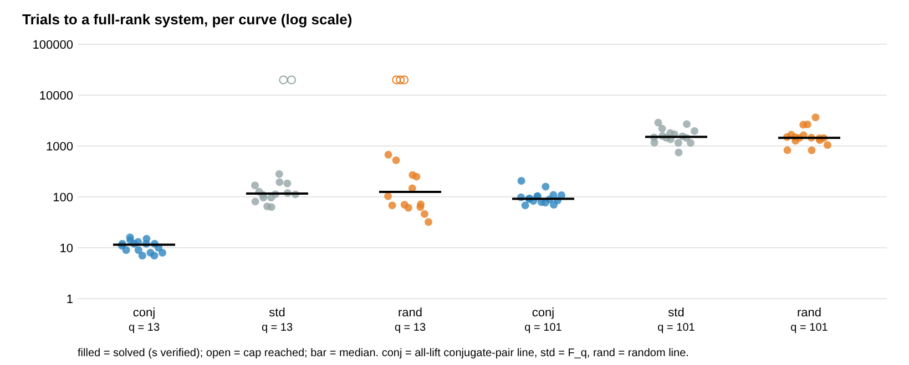

# Conjugate-pair factor base in a complete toy index calculus: ≈ 36× relations per trial, 11–17× fewer trials to full rank, 2× the columns

2026-11-06. This follows
[`lift_dense_conjugate_pair_20261106`](../lift_dense_conjugate_pair_20261106/README.md),
which found the lines. Here they are used as a factor base in a complete
index-calculus solve and compared with the standard base on the same curves,
the same secret and the same targets.

The protocol was frozen before any data, at `578d0db3b0`. Amendment A1,
the small-cofactor cells, was registered at `572a3df92a`, after the main run
and before its own data ([`PROTOCOL.md`](PROTOCOL.md)). The instrument is
[`cpcost/`](cpcost/), std-only Rust with fresh F_{p⁴} arithmetic. Report:
[`REPORT.pdf`](REPORT.pdf).

Every statement below is an unverified assertion of this session
[pcc:unverified]. The claim record is at the end.

**Setup.**

- E : y² = (x−e₁)(x−e₂)(x−e₃) over K = F_{q⁴}, so full 2-torsion; q = 13
  and 101 [pcc:unverified]. P has prime order ℓ, Q = [s]P, and each trial decomposes
  R = [a]P + [b]Q into m = 4 factor-base points (Gaudry–Diem).
- Every relation of a trial is found exactly, by meet-in-the-middle.
  Relations are collected until the system has full rank. Then s is solved
  mod ℓ and checked.
- The arms differ only in the factor base:
  - `conj`: the first all-lift conjugate-pair line;
  - `std`: the line F_q;
  - `rand`: a random line.
- No wall-clock time is measured. All counts are exact.

## Answer, small cofactor (A1: h = #E/ℓ ≤ 16, the cryptographically relevant case)

| q | arm | lifted x (k) | columns D | relations / trial | trials to full rank (median) | solved |
|--:|:--|--:|--:|--:|--:|--:|
| 13 | conj | 13.0 | 12.8 | 1.811 | 12 | 16/16 |
| 13 | std | 6.8 | 6.8 | 0.0495 | 112 | 14/16 |
| 13 | rand | 6.6 | 6.5 | 0.0232 | 71 | 13/16 |
| 101 | conj | 101.0 | 101.0 | 1.339 | 92 | 16/16 |
| 101 | std | 48.7 | 48.7 | 0.0374 | 1518 | 16/16 |
| 101 | rand | 48.3 | 48.3 | 0.0348 | 1448 | 16/16 |

| q | Y(conj)/Y(std) | (k_c/k_s)⁴ | ρ(conj)/ρ(std) | median T(std)/T(conj) | D(conj)/D(std) |
|--:|--:|--:|--:|--:|--:|
| 13 | 36.6 | 13.3 | 19.5 | 11.5 | 1.88 |
| 101 | 35.8 | 18.5 | 17.2 | 17.2 | 2.07 |

- **The conjugate-pair base solves every curve** [pcc:unverified] (claim `PCC-20261106-a9d73a`). It recovers the secret on
  32/32 small-cofactor curves and on 32/32 curves of the main run.
- **Relations per trial are about 36× the standard base.** That is about
  twice the lift-density prediction (k_c/k_s)⁴ ≈ 2⁴. The `std` arm itself
  matches the counting prediction: (2k)⁴/(24·#E) gives 0.036 at q = 101
  against 0.037 observed.
- **Trials to full rank are 11–17× fewer.** That is net of the doubled
  column count. The algebra without the extra factor predicts 2³ = 8.
- **The extra factor of 2 is exact algebra, worked out after the data.**
  - On a conjugate-pair line, x − e_c = u(t − γ) with t − γ ∈ K₀, and every
    element of K₀ is a square in K. So χ(x − e_c) = χ(u) is constant.
  - In 2-descent terms, every factor-base point lies in one coset of the
    index-2 subgroup cut out by (x − e_c) mod squares.
  - Sums of four of them always land in the subgroup itself. That subgroup
    contains every odd-order target, so they hit ⟨P⟩ twice as often as
    random sums.
  - The standard and random lines have no such constraint.
- **The protocol's bands were too narrow on the high side.** Y1 (yield),
  Y2 (per column) and Y4 (trials, q = 101: 17.2 > 16) fail as registered.
  Each fails because the measured advantage is larger than predicted, and
  the 2-descent factor accounts for it.

## Main run (as frozen: any v = 1 cofactor)

| q | Y(conj)/Y(std) | median T(std)/T(conj) | conj solved | std solved | rand solved |
|--:|--:|--:|--:|--:|--:|
| 13 | 2.77 | 12.0 | 16/16 | 7/16 | 6/16 |
| 101 | 2.50 | 12.0 | 16/16 | 13/16 | 13/16 |

- On curves with a large cofactor (q = 13: h ≥ 84; q = 101: h > 10⁵), ⟨P⟩
  has only a few hundred elements [pcc:unverified]. Targets repeat and relations stop adding
  rank, so `std` and `rand` hit the 20,000-trial cap.
- Their pooled relations per trial is then dominated by those repeats. That
  is why Y1 and Y2 fail there with ratios of only 2.5–2.8. The ratio is
  confounded, not small.
- Y3 (conj solves all) and Y4 (median trial ratio 12.0) pass.
- Amendment A1 removes the confound.

## Cost

**Derived model.** Not a measurement of time. The model assumes a
decomposition trial costs the same on every affine F_q-line, because the
Weil-restricted summation-polynomial system has the same shape. That is not
measured here.

- **Relation phase:** 11–17× fewer trials with the conjugate-pair base.
- **Linear algebra:** columns about 2×. That is about 4× for dense
  elimination and about 2× for sparse.
- **Brute force:** the decomposition used here costs 20,578 group additions
  per trial at q = 101 (`conj`) against 4,538 (`std`). That is the
  meet-in-the-middle over the larger factor base, not what a
  summation-polynomial solver would do.

**Applicability (algebra plus counts).**

- The family needs n even with n ≥ 4, and full 2-torsion over K. So the
  cofactor is divisible by 4.
- It never applies to prime-order curves, and never to odd n
  (EcGFp5 is n = 5).
- Among curves drawn with full 2-torsion, the share with h ≤ 16 was 16/52
  at q = 13 and 16/132 at q = 101.

**What this is not.**

- It is not a speed measurement, and no rho comparison is made.
- It is an IC-versus-IC factor-base comparison on toy fields (q ≤ 101,
  n = 4).
- No leaderboard, benchmark or rho row follows from it. Every gain is a
  constant factor.

## Registered verdicts

| rule | main run | A1 (h ≤ 16) |
|:--|:--|:--|
| Y1 yield ratio within [0.6, 1.6]·(k_c/k_s)⁴, rand/std in [0.5, 2] | FAIL (2.77, 2.50; confounded) | FAIL (36.6 and 35.8, above band; rand/std 0.47 at q = 13) |
| Y2 ρ ratio in [4.8, 12.8] | FAIL (1.75, 1.27) | FAIL (19.5, 17.2, above band) |
| Y3 conj solves every curve, s verified | **PASS** 32/32 | **PASS** 32/32 |
| Y4 median T(std)/T(conj) in [4, 16] | **PASS** (12.0, 12.0) | FAIL (11.5 ok, 17.2 above band) |
| A/A | byte-identical (`c6ba92ef…`) | see `AA.sha256` |

## Files

- `reports/run-20261106T0430Z/`: the main run, as frozen.
- `reports/run-20261106T0514Z/`: Amendment A1.
- Each run directory holds `rows.jsonl`, `SUMMARY.md`, `summary.json`, the
  figure and the A/A hashes.



## Reproduce

```sh
cd cpcost && cargo build --release && cargo test --release && cd ..
./cpcost/target/release/cpcost run reports/run-X          # main, ~23 min, 4 threads
./cpcost/target/release/cpcost run-smallh reports/run-Y   # A1, ~11 min
./cpcost/target/release/cpcost summarize reports/run-Y
./cpcost/target/release/cpcost validate reports/run-Y claimed.json
```

## Claim record

| claim | standing | content |
|:--|:--|:--|
| `PCC-20261106-a9d73a` | not covered (unsigned) | A1 yields, trial ratios and solves ([`validator-report.json`](reports/run-20261106T0514Z/validator-report.json), values in [`claimed.json`](claimed.json)) |
