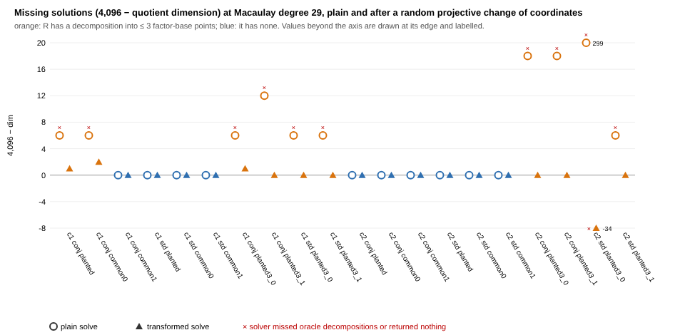

# The 6 missing solutions are 3-point decompositions at infinity; a random projective chart recovers every 4-point decomposition at the same cost

2026-11-06. This follows
[`lift_dense_conjugate_pair_decomp_20261106`](../lift_dense_conjugate_pair_decomp_20261106/README.md).
There, on curve 1, the counted k = 4 Gaudry solver found quotient dimension
4,090 instead of 4,096 on both conjugate-pair targets that decompose, and
returned nothing. This study asks two questions:

1. Why are 6 of the 4,096 solutions lost?
2. Does a solver that does not assume 4,096 affine solutions recover the
   decompositions?

- **Protocol.** Frozen before any data at `44edbfbc20`. Amendment A1 was
  registered before its own data at `0b64bace85` ([`PROTOCOL.md`](PROTOCOL.md)).
- **Instrument.** [`examples/conjpair_decomp_cost.rs`](../../examples/conjpair_decomp_cost.rs)
  `--inf`, at `f5dcb899a4`. It adds a random projective change of
  coordinates, a short-decomposition oracle and 3-point-planted targets.
  `gaudry_quartic` is called unchanged.
- **Provenance.** The run was resumed after the 2-hour task limit. The
  commits for each part are in
  [`reports/run-20261106T1550Z/commit.txt`](reports/run-20261106T1550Z/commit.txt).
- **Host.** This container, 4 cores and 15 GB. Iso Lab EKS needs an AWS
  identity this container does not have. The metric is a deterministic
  count, and the A/A rule passes.
- **Report.** [`REPORT.pdf`](REPORT.pdf).

Every statement below is an unverified assertion of this session
[pcc:unverified]. The claim record is at the end.

## Method

- **Setup.** p = 29, the same 2 curves, lines and H as the previous study.
  The system is 4 Weil components of degree 8 in e = (e₁, …, e₄).
- **Transform.** Homogenise the system with e₀ and substitute
  (e₀, …, e₄) = A·(y₀, …, y₄), with A ∈ GL₅(F_p) drawn uniformly from a
  seeded stream. Then dehomogenise at y₀ = 1 and solve with the unchanged
  `solve_system4_with` (chains, sparsest, Macaulay degree 29).
- **Mapping back.** Each rational solution maps back by
  (e₀, e) = A·(1, y). If e₀ ≠ 0 it is an affine solution e/e₀, which is
  checked against the original components. If e₀ = 0 it is a point at
  infinity.
- **Oracles.** An exact meet-in-the-middle gives the 4-point
  decompositions. A second oracle counts the 1-, 2- and 3-point multisets
  of the line's factor base that sum to R.
- **Runs** (40 solves at degree 29, plus 6 for A1) [pcc:unverified]:
  - **R1:** the previous study's 12 targets, plain.
  - **R2:** the same 12 targets, transformed.
  - **R3:** 8 new targets, each planted as a sum of 3 factor-base points
    (2 per arm and curve), solved both plain and transformed.

## Answer to question 1: the missing solutions are shorter decompositions, sent to infinity



- **The deficit appears exactly when a short decomposition exists**
  (rule Q1-a) [pcc:unverified].
  - On all 20 plain solves, dim < 4,096 if and only if R is a sum of at
    most 3 points of the line's factor base.
  - There are 0 exceptions. Both of the previous study's failing targets
    are among the 20; each has exactly one 3-point decomposition.
  - Every target with no short decomposition has dim 4,096, and the solver returns its decompositions.
- **The mechanism.**
  - The leading coefficient of S₅ in x₁ is S₄(x₂, x₃, x₄, x_R)².
  - So a decomposition R = ±P₂ ± P₃ ± P₄ is a solution of the Weil system
    with one coordinate sent to O, which means one e-coordinate at
    infinity.
  - Those points of the Bézout count leave the affine chart. The plain
    Macaulay solve then reports "border unreachable" (or, on curve 2, a
    broken chain structure) and returns nothing, even though some 4-point
    decompositions are still affine.
- **This is generic, not specific to conjugate-pair lines** (rule Q1-c,
  PASS).
  - Targets planted as 3-point sums lose dimension on the ordinary F_p
    line as well (dim 4,090), and the plain solver fails there in the
    same way.
  - Curve 1's conj line hit this on random targets because a
    conjugate-pair base carries many more relations, so short ones too.
    The previous study measured about 36× more relations per trial.
- **The size of the deficit** (observed, no rule).
  - Eight targets have exactly one 3-point decomposition and no shorter
    one. The deficit is 6 on six of them, 12 on curve 1 conj
    `planted3_1`, and 18 on curve 2 conj `planted3_0`.
  - It is 18 on curve 2 conj `planted3_1`, which has three.
  - On curve 2 std `planted3_0` it is 299. That is the one target that is
    itself a factor-base point (short1 = 1); see below.

## Answer to question 2: the transformed solve recovers every 4-point decomposition

- **19 of 20 transformed solves succeed** [pcc:unverified].
  - On all 19, the affine solutions equal the oracle's 4-point
    decompositions exactly (rule Q2).
  - That includes the two curve 1 targets that failed before, with 3/3
    and 2/2 found. It also includes the 3-point-planted targets with
    4-point decompositions (2/2, 1/1, 2/2 and 3/3).
- **The 20th fails** on curve 2 std `planted3_0[0, 14, 14]`.
  - That R is itself a factor-base point, so R = R + T + (−T) for every T
    on the line. That is a one-dimensional family of decompositions, a
    positive-dimensional component of the solution set.
  - Plain, the component lies at infinity (dim 3,797). After the
    transform it enters the affine chart: dim 4,130 > 4,096 at degree 29,
    and the solver reports "border unreachable".
  - That target has no 4-point decomposition, so Q2 passes there only
    vacuously.
  - This explanation is derived after the data and was not registered.
- **The 3-point decompositions appear at infinity** (rule Q1-d, report
  only).
  - Every successful transformed solve with a short decomposition
    returns at least one rational point with e₀ = 0.
  - Where short3 = 3 there are 3 such points. Some targets have more
    points at infinity than 3-point multisets (2 against 1 on curve 1
    conj `planted3_1`, 3 against 1 on curve 2 conj `planted3_0`).
- **Cost: the same as a generic solve** (rule Q2-cost, PASS).
  - The 12 R2 solves cost 0.970–1.030× the main run's mean generic plain
    solve on the same curve and arm. That is 1.124–1.191·10¹¹ F_p
    multiplications.
  - The transform itself costs 2.3–2.9·10⁶ multiplications, about 2·10⁻⁵
    of a solve.

| curve | arm | target | plain dim | plain solver/oracle | transformed dim | transformed solver/oracle | transformed / generic cost |
|--:|:--|:--|--:|--:|--:|--:|--:|
| 1 | conj | planted | 4,090 | **0/3** | 4,095 | 3/3 | 1.028 |
| 1 | conj | common 0 | 4,090 | **0/2** | 4,094 | 2/2 | 1.016 |
| 1 | conj | common 1 | 4,096 | 0/0 | 4,096 | 0/0 | 0.970 |
| 1 | std | planted | 4,096 | 1/1 | 4,096 | 1/1 | 1.030 |
| 2 | conj | planted | 4,096 | 3/3 | 4,096 | 3/3 | 1.012 |
| 1 | conj | planted3_0 | 4,090 | **0/2** | 4,095 | 2/2 | — |
| 1 | std | planted3_0 | 4,090 | **0/1** | 4,096 | 1/1 | — |
| 2 | conj | planted3_0 | 4,078 | **0/2** | 4,096 | 2/2 | — |
| 2 | conj | planted3_1 | 4,078 | **0/3** | 4,096 | 3/3 | — |
| 2 | std | planted3_0 | 3,797 | 0/0 | **4,130** | 0/0, failed | — |

This table shows a selection. All 40 rows, with outcomes and short counts,
are in [`SUMMARY.md`](reports/run-20261106T1550Z/SUMMARY.md).

## Amendment A1: the remaining shortfall is not truncation

On curve 1's two degenerate conj targets, the transformed system has
dim 4,095 and 4,094, not 4,096, even though the solver returns every decomposition. Rule M2
asked whether a higher Macaulay degree closes that gap [pcc:unverified]:

| target | degree | matrix | dim | F_p muls | solver/oracle |
|:--|--:|:--|--:|--:|--:|
| planted | 30 | 48,580 × 46,376 | 4,095 | 1.588·10¹¹ | 3/3 |
| planted | 31 | 56,124 × 52,360 | 4,095 | 2.089·10¹¹ | 3/3 |
| planted | 32 | 64,458 × 58,905 | 4,095 | 2.712·10¹¹ | 3/3 |
| common 0 | 30 | 48,580 × 46,376 | 4,094 | 1.571·10¹¹ | 2/2 |
| common 0 | 31 | 56,124 × 52,360 | 4,094 | 2.068·10¹¹ | 2/2 |
| common 0 | 32 | 64,458 × 58,905 | 4,094 | 2.685·10¹¹ | 2/2 |

- **M2: not truncation.** The dimension is unchanged from degree 29 to
  32, so 1 and 2 solutions, counted with multiplicity, are still outside
  the chart.
- **Candidates, reported but not decided:**
  - a solution that also lies on the new hyperplane at infinity. A random
    F_p-rational hyperplane contains a given rational point with
    probability about 1/p;
  - a solution of multiplicity above 1 at infinity;
  - a non-zero-dimensional component.
- **The cheapest test** would be a second independent A on the same
  targets. That was not run.
- **Decompositions are unaffected.** Every oracle decomposition is
  recovered at every degree.
- **Q1-b.** The verdict stays as registered at degree 29.

## Registered verdicts (`--summarize-inf`)

| rule | verdict | detail |
|:--|:--|:--|
| A/A: R1 reproduces the main run's total_muls and dim | PASS | 12/12 |
| Q1-a: plain dim < 4,096 ⇔ a ≤ 3-point decomposition exists | **PASS** | 20 plain solves, 0 exceptions |
| Q1-b: transformed dim = 4,096 | **FAIL** | 4,095, 4,094 and 4,095 on curve 1 conj (planted, common 0, planted3_0); 4,130 on curve 2 std planted3_0 (positive-dimensional, see above) |
| Q1-c: R3 plain dim < 4,096 on both arms | **PASS** | 8/8, conj and std |
| Q2: transformed solver = oracle | **PASS** | 20/20; on curve 2 std planted3_0 only vacuously (solve failed, oracle 0) |
| Q2-cost: R2 within [0.9, 1.1] × generic | **PASS** | 0.970–1.030 |
| Q1-d: points at infinity vs short counts (report) | — | at least one per short decomposition on every successful solve |
| A1 / M2: dim 4,096 at some degree ≤ 32 | not reached | 4,095 and 4,094 through degree 32: not truncation |

## What this changes

- **The previous study's curve 1 failure is not a property of
  conjugate-pair lines.** It is the standard degeneracy of
  summation-polynomial systems when R has a shorter decomposition. With
  a random projective chart, the per-trial cost and correctness on
  conjugate-pair lines match the F_p line on both curves.
- **What this means for the family's relation phase.** The cost study's
  11–17× fewer trials, at equal cost per trial, now holds on both curves
  measured [pcc:unverified]. The previous caveat ("only on curves where
  the solver handles the system") is removed for targets that are not
  themselves factor-base points.
- **A further gain left unused.** A transformed solve also returns the
  3-point relations, at infinity. They are not counted here.
- **Scope.** Two curves at p = 29, one A per target. No ECDLP cost
  against rho is claimed, and there is no leaderboard or benchmark row.

## Reproduce

```sh
cargo build --release --example conjpair_decomp_cost
B=./target/release/examples/conjpair_decomp_cost
$B --p 29 --curves 2 --inf --out rows.jsonl                         # ~2.3 h (resumable: --skip-existing rows.jsonl)
$B --p 29 --curves 2 --inf --macdeg 30,31,32 --only-arm conj --only-curve 1 \
   --only-decomposable --out a1_rows.jsonl                          # ~56 min
$B --summarize-inf rows.jsonl a1_rows.jsonl \
   research/lift_dense_conjugate_pair_decomp_20261106/reports/run-20261106T0643Z/rows.jsonl out/ claimed.json
python3 research/lift_dense_conjugate_pair_infinity_20261106/fig.py out/   # layout only
```

## Claim record

| claim | standing | content |
|:--|:--|:--|
| `PCC-20261106-e1a9d3` | not covered (unsigned) | rule counts, cost band, A1 degrees ([`validator-report.json`](reports/run-20261106T1550Z/validator-report.json), values in [`claimed.json`](claimed.json)) |
