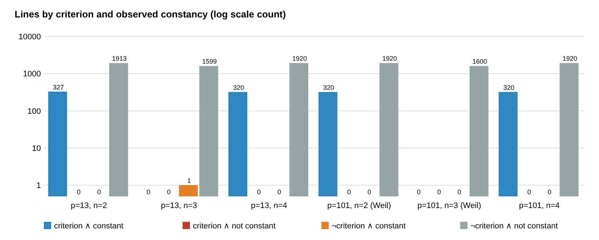

# Odd-characteristic lift-dense lines: the orbit-parity criterion holds, and descent lines lose their lifted half

2026-11-06. This is the second piece checking the claims that reached this
repository from another session as an unverified assertion. The first
piece was
[`lift_dense_torsion_pairing_20261106`](../lift_dense_torsion_pairing_20261106/README.md).

The protocol was frozen before any data, at `89611afe58`
([`PROTOCOL.md`](PROTOCOL.md); deviations under "Amendments"). The
instrument is [`orbit/`](orbit/), std-only Rust written fresh for this
check. The run is
[`reports/run-20261106T0306Z/`](reports/run-20261106T0306Z/), at commit
`eedd7b0a6d`. Report: [`REPORT.pdf`](REPORT.pdf).

Every statement below is an unverified assertion of this session
[pcc:unverified]. The claim record is at the end.

## The claims checked

E is y² = f(x), a cubic over K = F_{q^n} with q = p odd. A line is
x₀ + u·F_q. The shifted cubic F(t) = f(x₀ + ut)/u³ has roots
t_i = (e_i − x₀)/u.

1. **Criterion.** A line is all-lift or all-twist exactly when, for each
   q-Frobenius orbit O of the roots of F, n·r_O/s_O is even.
2. **Descent case.** Half the lifted points sit on the twist and are dead
   columns for the target.

## Answer

- **The criterion holds in both directions at the scope tested**
  (q ∈ {13, 101}, n ∈ {2, 3, 4}).
  - All 1,287 lines that satisfy it are constant, with 0 exceptions.
  - Where the Weil bound leaves no room for chance, (101,2) and (101,3),
    none of 3,520 lines that fail it is constant.
  - At q = 13, one line out of 1,600 at n = 3 fails the criterion and is
    still constant: all 13 values are nonsquares. That is the chance
    constancy the Weil bound allows at small q, as registered.
  - The multiplicity identity behind the criterion (n·r/s is an integer and
    the orbit masses sum to 3n) held on every line.
- **Descent lines.** These are lines whose root set is σ^{n/2}-stable.
  - They exist on curves with j(E) ∈ K₀ = F_{q^{n/2}}, which are subfield
    curves up to isomorphism: 32 built curves, all with j ∈ K₀.
  - Each of the 1,280 built lines satisfies the criterion and has
    F ∈ K₀[t].
  - Each built line is all-lift exactly when χ_K(u³) = 1, so on one curve
    the built lines are either all all-lift or all all-twist. There were
    0 exceptions.
- **"Half dead" holds, but "predicted which with 0 mismatches" fails as
  registered.**
  - On all-lift descent lines, the pooled dead fraction is 0.505–0.615 per
    cell, inside the registered [0.35, 0.65].
  - The rule "dead iff the point lies on the side of #C(K₀)·#C′(K₀) that
    does not contain ℓ" mispredicts 405 of 27,880 lifted abscissae.
    Every one is the same kind: the point is observed dead but predicted
    alive. No predicted-dead point was alive.
  - So the twist side is always dead. The misses are points on the
    ℓ-side whose order is prime to ℓ (the cofactor part), which the rule
    ignores.
  - At (101,4), a uniform estimate of how many such points to expect
    gives 68, and 70 were observed. At n = 2 the estimate is too high
    (224 and 333 against 80 and 240). There the line is all of K₀, so a
    uniform estimate does not fit. That residual is unexplained.
- **What it means as a lever.** All criterion-satisfying lines seen here
  were descent lines; no other mechanism appeared.
  - All 1,287 criterion lines lie on curves with j ∈ K₀:
    - 1,280 are built descent lines;
    - 4 are random lines on descent curves;
    - 3 are random lines on the one generic curve whose j happens to lie
      in F₁₃, at (13,2).
  - Every random line on the other 31 generic curves in even-n cells
    (j ∉ K₀) failed the criterion.
  - The descent case lives only on subfield-type curves (j ∈ K₀), where
    the lifted half on the twist side is dead for the target. So it is no
    lever for the target subgroup.
  - That matches the n = 2 subfield finding of the first piece in
    characteristic 2.
  - The conjugate-pair family, which the source says gives useful columns
    on generic curves with full 2-torsion, is the next piece. It needs
    constructed lines, because random lines never hit it here.

## Registered verdicts (`orbit summarize`)

| rule | verdict | detail |
|:--|:--|:--|
| O1 criterion ⇒ constant | **PASS** | 1,287 criterion lines, 0 not constant |
| O2 ⇐ where Weil decides, (101,2) and (101,3) | **PASS** | 3,520 lines fail the criterion, 0 constant |
| O2′ ⇐ elsewhere (report only) | — | 1 chance-constant line at (13,3), 0 at (13,2), (13,4) and (101,4) |
| O3 descent lines | **PASS** | 1,280 built lines: criterion, σ^{n/2}-stable, F ∈ K₀[t], all-lift iff χ_K(u³) = 1; 0 exceptions |
| O4 dead set exact, fraction in [0.35, 0.65] | **FAIL** | 520 decidable lines, 405 mismatches (all observed dead / predicted alive); fractions 0.505–0.615 (that part passes) |
| O5 multiplicity identity | **PASS** | 0 exceptions on 12,160 lines |
| A/A | **PASS** | two runs give byte-identical `rows.jsonl` (sha256 `273431a9…`) |

**Curve checks.**

- #E(K) = #C₀(K₀)·#C₀′(K₀) (or its K-twist) passed [#E]P = O on 8 points
  of each of the 32 descent curves.
- ℓ divides both sides on 3 curves, which O4 excludes as registered.
- On 18 of the 32 descent curves α is a nonsquare, so their built lines
  are all-twist and do not enter O4.

## Per cell

| p | n | Weil decides | lines | criterion true | constant | criterion false, constant |
|--:|--:|:--|--:|--:|--:|--:|
| 13 | 2 | no | 2240 | 327 | 327 | 0 |
| 13 | 3 | no | 1600 | 0 | 1 | 1 |
| 13 | 4 | no | 2240 | 320 | 320 | 0 |
| 101 | 2 | yes | 2240 | 320 | 320 | 0 |
| 101 | 3 | yes | 1600 | 0 | 0 | 0 |
| 101 | 4 | no | 2240 | 320 | 320 | 0 |

| p | n | decidable lines | lifted x | dead observed | dead predicted | mismatches | dead fraction | predicted dead, alive |
|--:|--:|--:|--:|--:|--:|--:|--:|--:|
| 13 | 2 | 160 | 2080 | 1280 | 1200 | 80 | 0.615 | 0 |
| 13 | 4 | 120 | 1560 | 840 | 825 | 15 | 0.538 | 0 |
| 101 | 2 | 120 | 12120 | 7160 | 6920 | 240 | 0.591 | 0 |
| 101 | 4 | 120 | 12120 | 6116 | 6046 | 70 | 0.505 | 0 |



The full tables are in
[`SUMMARY.md`](reports/run-20261106T0306Z/SUMMARY.md).

## Not covered

- The conjugate-pair family needs n even, n ≥ 4, and full 2-torsion over
  K. The source says a generic such curve over F_{q⁴} has 6 such lines,
  found from one F_q-linear equation. It is not checked here.
- "Odd n has no lever" is consistent with these data: no n = 3 line met
  the criterion apart from the one chance-constant line. But that rests
  only on random lines, not on a search.
- The 2^m yield gain is not measured. No ECDLP cost was measured, so there
  is no leaderboard, benchmark or rho row.

## Sources checked

The `research-kb` server and CLI are not available in this container. A
grep of the three checkouts for odd-characteristic all-lift lines found
nothing. The char-2 trace version is
[`lift_dense_factor_base_20261027`](../lift_dense_factor_base_20261027/README.md).

## Reproduce

```sh
cd orbit && cargo build --release && cargo test --release && cd ..
./orbit/target/release/orbit run reports/run-X          # ~75 s, 4 threads
./orbit/target/release/orbit summarize reports/run-X
./orbit/target/release/orbit validate reports/run-X claimed.json
```

## Claim record

| claim | standing | content |
|:--|:--|:--|
| `PCC-20261106-3e6fc4` | not covered (unsigned) | O1–O5 counts and the dead-point tallies ([`validator-report.json`](reports/run-20261106T0306Z/validator-report.json), headline values in [`claimed.json`](claimed.json)) |
