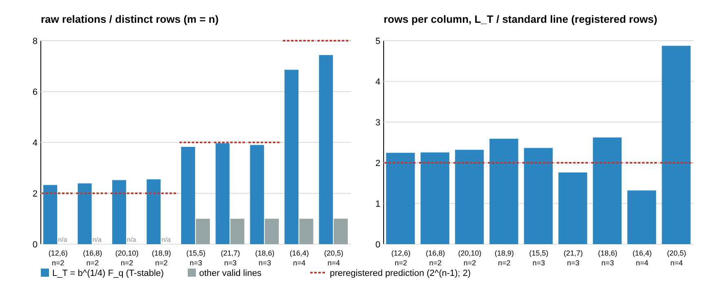

# Lift-dense lines and the 2-torsion point: L_T = b^{1/4}·F_q pairs, and no lead line lies on it

2026-11-06. This follow-up to
[`lift_dense_factor_base_20261027`](../lift_dense_factor_base_20261027/README.md)
checks a claim that reached this repository from another session as an
unverified assertion. The claim:

> If u ∈ b^{1/4}·F_q, then adding the 2-torsion point maps the line to itself,
> so its columns come in pairs. Those lines give about 2×, not 2^n. The
> u-count used for costs should exclude them.

The protocol was frozen before any data, at `c7878791e4`
([`PROTOCOL.md`](PROTOCOL.md); deviations under "Amendments"). The
instrument is [`pairing/`](pairing/): std-only Rust, written fresh for this
check. The run is [`reports/run-20261106T0235Z/`](reports/run-20261106T0235Z/),
at commit `62a40ce4cf`. Report: [`REPORT.pdf`](REPORT.pdf).

Every statement below is an unverified assertion of this session
[pcc:unverified]. The claim records are listed at the end.

## Answer

- **The mechanism is real.** On every one of 90 toy curves:
  - a valid T-stable line exists exactly when Tr_{N/d}(b^{1/4}) = 0;
  - when one exists it is b^{1/4}·F_q, and it is the only one (48 curves,
    0 mismatches).

  On all 48 such lines, for every lifting x:
  - √b/x lies on the line and lifts;
  - group addition gives x(P + T) = √b/x(P).
- **The cost consequence matches "about 2×, not 2^n" once rows are counted
  as linear equations.** On L_T, relation rows per column come to
  1.76–2.89 × the standard line. Ordinary valid lines give 3.2–5.3 × at
  n = 3 and 6.7–7.4 × at n = 4. That ratio uses signed column vectors, a
  post-hoc count (table below). L_T relative to the other valid lines on the
  same cells is 0.54–0.56 at n = 3 and 0.28–0.29 at n = 4, against the
  algebra's 2/2^{n−1} = 0.5 and 0.25.
- **The correction does not change any number the Oct 27 lead reports.**
  - None of the 27 twisted lines the Oct 27 study measured lies on L_T.
  - None of the five c2pnb curves has a T-stable line:
    - Tr_{N/Q}(b^{1/4}) ≠ 0 on all of them;
    - this instrument reproduces the counts of 180 and 330 valid u (12 and
      22 lines);
    - excluding T-stable u removes 0 from each.

  The +0.5 to +0.8 bit C1 model rows for c2pnb208w1 and c2pnb368w1 are
  untouched. For a uniform b, L_T occurs with probability about 1/q. It is a
  rule for constructing lines (skip u ∈ b^{1/4}·F_q), not a discount on
  existing rows.
- **For n = 2, the lever is absent for a different reason.** A valid line
  exists only when √b ∈ F_q (Oct 27), and then it is L_T = F_q. With
  Tr(a) = 0 the curve is isomorphic over F_{2^N} to y² + xy = x³ + b, which
  is defined over F_q, and x is unchanged. So the line's points satisfy
  π_q(P) = ±P. They split into two subgroups of size about q, which merges
  columns beyond T: D/k = 0.30–0.36, not 0.5. That last explanation is
  algebra written after the data, not a measured check.

## Registered verdicts (PROTOCOL.md, coded in `pairing summarize`)

| rule | verdict | detail |
|:--|:--|:--|
| P1 T-stable line ⇔ Tr_{N/d}(b^{1/4}) = 0, equal to b^{1/4}F_q | **PASS** | 90 curves, 48 with L_T, 0 mismatches |
| P2 exact pairing on L_T, D = (k−1)/2 on ≥ 90 % | **FAIL** | Pairing and translation exact on 48/48, and D ≤ (k−1)/2 on 48/48. Equality holds on 19/48: n = 3 12/12, n = 4 7/12, n = 2 0/24 (the subfield effect above). Positive control: 18 lines, 0 violations |
| P2′ D ≥ k − 2 on ≥ 95 % of non-T-stable lines | **PASS** | 101/106. All five exceptions are n = 2 standard lines (chance merges by 2-power torsion) |
| P3 raw/rows on L_T in [0.6, 1]·2^{n−1}; ≤ 1.05 elsewhere; positive control ≥ 1.3 | **FAIL** | n = 3: 3.83–3.97 (band [2.4, 4]); n = 4: 6.86, 7.44 (band [4.8, 8]); non-T-stable ≤ 1.001. n = 2 L_T: 2.33–2.55, above its band of 2. The positive control passes at n = 2 (2.14–2.67) and is void at n ≥ 3 (see below) |
| P4 ρ(L_T)/ρ(std) in [1.3, 3]; ρ(valid)/ρ(std) in [0.6, 1.6]·2^{n−1} | **FAIL** | 16 of 18 comparisons in band. Out of band: (20,5) ρ(L_T)/ρ(std) = 4.88 and (16,4) ρ(valid)/ρ(std) = 3.72. In both n = 4 cells the std baseline has only 16 and 33 rows |
| P5 c2pnb: reproduce 180/330; T-stable u ∈ {0, 15} | **PASS**, s = 0 | All five c2pnb curves: valid u 180, 180, 270, 210, 330; every class has 15 elements; T-stable u 0; √b ∉ F_Q |
| P6 Oct 27 twisted lines on L_T | 0/27 | 27/27 are valid by this instrument |
| A/A | **PASS** | Two runs give byte-identical `rows.jsonl` (sha256 `9ecf6a49…`). The superseded first run gives the same c2pnb output |

**Two design faults, found after the data.**

1. The positive control (the line F_q with b ∈ F_q) is degenerate for odd n.
   - F_q-abscissae there lie in E₀(F_q) or its twist, which are subgroups of
     size about q. Random targets fall outside them, so the control has 0
     relations at n = 3 and 4.
   - It still shows the column pairing (P2: 0 violations).
   - Under the protocol's rule, P3 is void in those cells. The control did
     its job only at n = 2.
2. The protocol counts a row as a multiset of projected points.
   - That definition keeps degenerate relations such as {P, −(P + T), Q, S}
     as separate rows, although their columns cancel to one equation.
   - The signed-column-vector count `rows_vec` merges them. It is reported
     only as post hoc.

## Per-cell data (registered row definition; post-hoc vector rows in the last column)

| N | d | n | group | lines | k | D | raw | rows | raw/rows | ρ/ρ(std) | rows_vec |
|--:|--:|--:|:--|--:|--:|--:|--:|--:|--:|--:|--:|
| 12 | 6 | 2 | L_T | 4 | 63 | 22.5 | 15134 | 6504 | 2.33 | 2.25 | 6488 |
| 16 | 8 | 2 | L_T | 4 | 255 | 85.0 | 14996 | 6276 | 2.39 | 2.26 | 6269 |
| 20 | 10 | 2 | L_T | 4 | 1023 | 362.5 | 16749 | 6649 | 2.52 | 2.32 | 6649 |
| 18 | 9 | 2 | L_T | 4 | 511 | 151.2 | 15576 | 6109 | 2.55 | 2.59 | 6109 |
| 15 | 5 | 3 | L_T | 4 | 31 | 15.0 | 2468 | 645 | 3.83 | 2.36 | 510 |
| 15 | 5 | 3 | valid | 8 | 31 | 31.0 | 3889 | 3889 | 1.00 | 3.45 | 3769 |
| 21 | 7 | 3 | L_T | 4 | 127 | 63.0 | 2110 | 532 | 3.97 | 1.76 | 532 |
| 21 | 7 | 3 | valid | 2 | 127 | 126.0 | 958 | 958 | 1.00 | 3.17 | 958 |
| 18 | 6 | 3 | L_T | 4 | 63 | 31.0 | 2180 | 559 | 3.90 | 2.62 | 528 |
| 18 | 6 | 3 | valid | 4 | 63 | 62.0 | 2007 | 2005 | 1.00 | 4.70 | 1945 |
| 16 | 4 | 4 | L_T | 4 | 15 | 6.8 | 288 | 42 | 6.86 | 1.32 | 28 |
| 16 | 4 | 4 | valid | 28 | 15 | 14.9 | 1833 | 1833 | 1.00 | 3.72 | 1511 |
| 20 | 5 | 4 | L_T | 4 | 31 | 15.0 | 580 | 78 | 7.44 | 4.88 | 33 |
| 20 | 5 | 4 | valid | 28 | 31 | 30.9 | 1942 | 1938 | 1.00 | 8.41 | 1702 |

- k is the number of lifting abscissae on the line (k = q − 1 on an all-lift
  line).
- D is the number of distinct columns x([2^e]P), excluding O.
- raw is the number of distinct multisets of m = n factor-base points
  summing to the target. It is summed over 2000 (n = 2), 400 (n = 3) or
  100 (n = 4) targets per curve.
- ρ = rows/(targets·D).
- The std rows (the standard line on the `generic` curves), the positive
  control and every cell are in
  [`SUMMARY.md`](reports/run-20261106T0235Z/SUMMARY.md).

**Post hoc, rows as signed column vectors.** Each entry is a ratio of
ρ_vec = rows_vec/(targets·D) between two line groups in the same cell.

| (N, d) | n | L_T / std | valid / std | L_T / valid | 2/2^{n−1} |
|:--|--:|--:|--:|--:|--:|
| (12,6) (16,8) (20,10) (18,9) | 2 | 2.24, 2.25, 2.32, 2.59 | n/a | n/a | 1 |
| (15,5) (21,7) (18,6) | 3 | 1.87, 1.76, 2.89 | 3.34, 3.17, 5.32 | 0.559, 0.555, 0.543 | 0.5 |
| (16,4) (20,5) | 4 | 1.94, 2.06 | 6.75, 7.39 | 0.287, 0.279 | 0.25 |



## What this changes in the Oct 27 lead

The Oct 27 README gains a dated note:

- exclude u ∈ b^{1/4}·F_q when building all-lift lines;
- on that line, rows per column are about 2× the standard line, not 2^{n−1};
- none of the Oct 27 lines and none of the c2pnb lines is affected, so
  every number in that README stands.

No ECDLP cost was measured, so there is no leaderboard, benchmark or rho
row. Every effect here is a constant factor on toy fields
(N = 12–21).

## Not covered here

The other claims from the same message remain unchecked:

- the orbit-parity criterion for all-lift/all-twist lines;
- the descent case (half the points dead);
- the odd-characteristic conjugate-pair family over F_{q⁴};
- "odd n and n = 2 have no lever".

They are the next pieces.

## Sources checked

- The `research-kb` server and CLI are not available in this container
  (`scripts/research-kb`: no executable), so no knowledge-base query ran.
- A grep of the three checkouts finds the translation x(P + T) = √b/x(P) in
  two places:
  - `crypto:RESEARCH_IC_LEADS_AND_CONNECTIONS_20261010.md` §6, where it
    appears as the FGHR 2-torsion symmetry (x ↦ 1/x for b = 1);
  - `crypto:docs/ic/factor-base-encyclopedia/README.md` (the yline-d4
    columns {±P, ±(P + T)}).
- The Oct 27 lead never applies it to its lines.

## Reproduce

```sh
cd pairing && cargo build --release && cd ..
./pairing/target/release/pairing run reports/run-X ../lift_dense_factor_base_20261027/reports/run-20261027T0356Z/lines_amend3/rows.jsonl   # ~40 s, 4 threads
./pairing/target/release/pairing summarize reports/run-X
./pairing/target/release/c2pnb_pairing ../lift_dense_factor_base_20261027/reports/run-20261027T0356Z/c2pnb_input_binary-curve-params.txt reports/run-X/c2pnb.jsonl   # ~30 s
```

The superseded first run,
[`reports/run-20261106T0229Z/`](reports/run-20261106T0229Z/), counted only
signed-vector rows; it is kept unchanged.

## Claim records

| claim | standing | content |
|:--|:--|:--|
| `PCC-20261106-b8a052` | unverified | the L_T criterion, the pairing, and the post-hoc rows-per-column ratios (`summary.json`) |
| `PCC-20261106-eff1c3` | unverified | no Oct 27 line and no c2pnb line is T-stable; the c2pnb u-counts reproduce (`c2pnb.jsonl`) |
