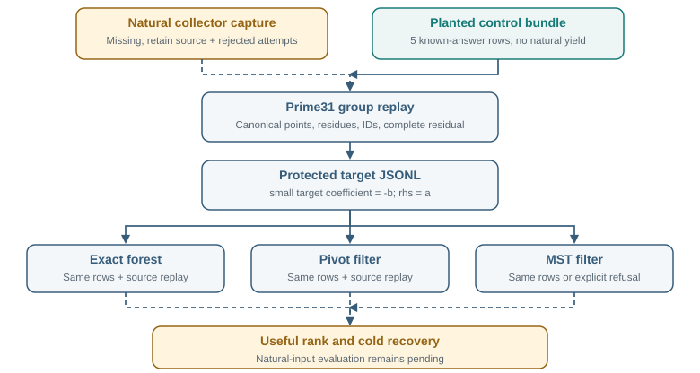

# Prime31 group admission: native qualification

23 November 2026 | PR [#5076](https://github.com/isogeny-labs/crypto/pull/5076) | NATIVE GATE PASSED

## Outcome and evidence scope

The continuation preserves the admission implementation byte for byte and expands its Rust test module from two tests to seven. It adds a five-row planted input, independently constructed expected JSONL, a negative-target companion and a deliberately corrupt final row. These qualify the group-to-graph boundary; they do not generate a natural relation stream. [1-3]

**Native standing:** 7/7 admission tests and 41/41 existing graph tests passed. Both valid CLI outputs matched expected bytes; all five invalid-input controls exited 1 with empty stdout.

| Evidence category | Recorded status |
|---|---|
| Source preservation | Original two tests retained; production prefix unchanged |
| Authored controls | Seven Rust tests; fixed planted input of five rows |
| Native execution | 7/7 admission tests passed; 41/41 graph tests passed; passed CLI gate; passed (all three arms accepted) graph gate |
| Planted execution | LP rank 2; LP left-nullity 3; all three arms accepted, with useful and augmented rank 2 |
| Natural measurement | No qualifying capture or qualified performance/RSS/cold comparison; timing fields not interpreted |
| Independent PCC | unverified |

### Fixed public instance

p = 2147483647; ell = 2147446831. Curve y^2 = x^3 + 847514846 x + 2087444724; G = (625037715, 2100627251). The original Arithmetic/check_curve code is reused. [7]



The diagram separates missing natural input from the planted qualification branch. Dashed paths are pending natural-input work. No benchmark chart is included because this continuation has no measured performance series; canonical performance plots receive no new result point.

### Exact control contract

For each accepted original row, verify sum(c_i P_i) + sum(d_j L_j) = aG + bQ. Export -b modulo ell in protected small column u32::MAX, with RHS a. Validate every row before emitting JSONL. A bad final row must cause unsuccessful exit and empty stdout.

The five planted rows have LP arities 0, 1, 2, 1, 2. With S, L, M the canonical orientations of 3G, 5G, 11G and Q = 7G, their equations are 2S = aG; -S + L = aG + Q; 2S - L + 3M = aG + 4Q; S + M = aG + 2Q; S - L + M = aG + 3Q. The negative-target control substitutes -Q and -b. Expected exports are built from these predetermined coefficients and known-answer RHS values, independently of the admission output.

R41 + R42 - 3R43 cancels both LPs and leaves (-2, +1) on (S,Q). Together with R40 = (2,0), this gives the expected projected rank 2; the negative-target case changes +1 to -1. This is fixture analysis, not observed natural rank or a general performance result.

## Natural source: mapping and workload gap

Source inspection identifies the existing ml-ecdlp-generic-large-prime-transcript/v2 producer, not a qualifying fixed-curve capture. Its residual pair table belongs to the generic-decomposition track. The binary/Koblitz collector hook from #5029 is a separate field setting. [4-6]

| Admission field | Existing transcript source |
|---|---|
| target | public_instance.target |
| small_points | Enumerated small.columns; canonical points |
| large_points | Enumerated residual.domain.columns |
| row id | Accepted attempt.sequence |
| a, b | attempt.coef_a, attempt.coef_b |
| small terms | attempt.row.small; validate/remove target slot |
| large terms | attempt.row.large |

**Target-column rule:** the source target index is small.columns.len() and must carry -b mod ell. Check and remove that column before conversion. The admission output writes u32::MAX. Retaining both would count the target twice.

Replay the native transcript verifier and check the exact curve, G, Q and source binding first. Preserve the full transcript, rejected attempts, configurations, pair-table setup, counters and filter certificates in a hashed custody sidecar. Group-valid JSONL alone does not establish how rows were collected.

### Derived upper bound, not a measurement

The current producer caps queries at 4096 and residual columns at 32. At most 64 signed points supply 64*65/2 = 2080 unordered pairs with repetition. Excluding 32 opposite-sign identity pairs leaves at most 2048 nonidentity pair sums; collisions reduce support.

Under independently uniform a in F_ell and independent b/small choices, the residual query is uniform, so E[accepted rows] <= 4096 * 2048 / 2147446831 = 8388608 / 2147446831 ~= 0.003906317. This bound precedes duplicate and rank rejection and is not a fixed-PRNG-seed guarantee. [4-5]

The unchanged capped producer cannot credibly furnish the intended 256/1024/4096-row checkpoints under that model. No cap increase or collection is authorized by this report. The next input must come with a separately admitted yield, support, memory and query-budget protocol.

## Qualification receipt and next gate

### Observed fixed-control results

| Arm | Accepted | Useful rank | Augmented rank | Replayed | Replay failures |
|---|---|---:|---:|---:|---:|
| Exact forest | yes | 2 | 2 | 3 | 0 |
| Pivot filter | yes | 2 | 2 | 3 | 0 |
| MST filter | yes | 2 | 2 | 3 | 0 |

Both valid CLI controls exited 0 and matched their expected JSONL bytes. The invalid-final-row, malformed-json, oversized-input, missing-argument and extra-argument controls each exited 1 with empty stdout. No evaluator timing field is interpreted as a performance measurement.

- Run 45258713611; job 137987328432
- Source commit: b4b87e654950ad57d264e518ec6bb190efd88bba
- Checkout: b4b87e654950ad57d264e518ec6bb190efd88bba
- Rust: rustc 1.100.0 (0ef1bc386 2026-11-09)
- Test result: 7/7 admission tests passed; 41/41 graph tests passed
- CLI status: passed; graph status: passed (all three arms accepted)
- Run evidence: https://github.com/isogeny-labs/crypto/actions/runs/45258713611
- Artifact evidence: https://github.com/isogeny-labs/crypto/actions/runs/45258713611/artifacts/14857459488

Artifact ZIP SHA-256: `c7e76b6397f5c58b978ef8822a00ede7cf39584a347a07a80742a0ca45e63ee7`; 1389093 bytes. Retention is 14 days, expiring 2026-12-07T20:25:09Z (7 Dec 2026, 12:25:09 PST). This is not durable archival; retain compact raw receipts with the PR.

Standalone gate: one existing hosted development job, one build/test thread, 4 GiB address-space cap, 300 seconds for adapter build/test and 60 seconds for fixed CLI checks. This does not qualify the full root crate. Retain source/lockfile/executable hashes, compiler version, complete stdout/stderr and failures. [3]

Run the original example with:

```sh
cargo test --locked --release \
  --manifest-path research/prime31_ic_20261115/native/Cargo.toml \
  --example prime31_lp_group_admission -- --nocapture --test-threads=1
```

The control bundle consists of valid.json, expected.jsonl, late-invalid.json, negative-target.json and negative-target-expected.jsonl. PRIME31_ADMISSION_CONTROL_DIR retains those files; without it the test uses and cleans a unique temporary directory. The recorded run passed exact CLI byte comparisons, final-row atomic rejection and original evaluator replay on the fixed control.

The remaining dependency is an authentic fixed-curve capture with a feasible, admitted workload. Compare forest, pivot and MST on identical admitted input and include materialization, source replay, useful rank, memory and recovery costs. Preserve failures and explicit refusals. No measured speedup is claimed; no merge or paid compute is authorized.

## Sources

[1] [Live scope and continuation](https://github.com/isogeny-labs/crypto/pull/5076)

[2] [Original group-admission source](https://github.com/isogeny-labs/crypto/blob/17db8809963a5570211328aa5e431fd1e6507ddd/research/prime31_ic_20261115/native/examples/prime31_lp_group_admission.rs)

[3] [Preregistered native qualification](https://github.com/isogeny-labs/crypto/blob/0c6544e231b5d00daef33a5bb2521319a8e205bd/research/lp_graph_algorithms_20261123/PRIME31_GROUP_ADMISSION_NATIVE_20261123.md)

[4] [Capture source map and derived workload bound](https://github.com/isogeny-labs/crypto/blob/b4b87e654950ad57d264e518ec6bb190efd88bba/research/lp_graph_algorithms_20261123/PRIME31_CAPTURE_SOURCE_20261123.md)

[5] [Generic residual-pair producer](https://github.com/isogeny-labs/crypto/blob/5403e9ab890e9b9dc92fa67c661ab7df0ea3c860/src/ml_dataset/relations_generic.rs)

[6] [Existing transcript source map](https://github.com/isogeny-labs/crypto/blob/5403e9ab890e9b9dc92fa67c661ab7df0ea3c860/research/ml_dataset_large_prime_trace_20261028/SOURCE_MAP.md)

[7] [Original Arithmetic and fixed-curve certificate](https://github.com/isogeny-labs/crypto/blob/17db8809963a5570211328aa5e431fd1e6507ddd/research/prime31_ic_20261115/native/lib.rs)

## Re-render

Edit report_data.json only when a source-bound receipt supports the update; run node render_report.cjs. The generator writes this Markdown, the diagram SVG and the PDF. It performs document layout only and does not derive scientific values or run cryptographic code.
