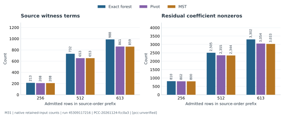

# M31 retained capture: native rank and payload

Run 45309117216 | Job 138160138786 | 24 November 2026 UTC | PR [#5076](https://github.com/isogeny-labs/crypto/pull/5076)

**Standing: unsigned claim `PCC-20261124-fcc0a3`; all native observations remain [pcc:unverified].**

## Recorded outcome

The native converter replayed 645 signed source equations on the fixed M31 curve. It retained 613 rows with at most two LP terms and recorded all 32 higher-arity exclusions after group replay. The original group-admission bridge and graph evaluator then consumed the same retained source-order prefixes. These are observations from one retained ten-query capture, not repeated samples. [1-4] [pcc:unverified]

All three arms preserved identical useful and augmented ranks at each prefix, while their recorded payload counts differed. Rank equality alone does not establish target identifiability; no scalar recovery was executed here. These counts do not measure runtime.

## Exact instance and scope

The field is **p = 2^31 - 1 = 2147483647**. The curve is y^2 = x^3 + 847514846x + 2087444724 over that field; its relation/scalar modulus is ell = 2147446831. G = (625037715,2100627251), Q = (976979610,1228979761). The target's original orientation is preserved. The source uses Dickson B509 and 168 Y7 extras, with original hybrid point indices retained. [3-4]

This is analysis of a saved generic exhaustive-pair baseline on public queries and a known-answer public target. The producer owns the capture; no collector was invoked by this replay. The Rust converter uses the original arithmetic and fixture construction. Producer-reported rank and recovered-scalar fields are ignored. [3-4]

## Native rank and replay observations

"Useful rank" is the native evaluator's `exact_projected_rank.useful_small_rank` on retained small columns, including its protected target column. Augmented rank also includes the right-hand side. Each prefix is the first recorded admitted rows, with original row identities preserved. Values below are native outputs, not the producer's bespoke rank report. [2,5] [pcc:unverified]

Native LP coefficient ranks recorded by the exact forest: **256 rows: 125; 512 rows: 157; 613 rows: 161**. [2] [pcc:unverified]

| Prefix rows | Arm | Projected rows | Useful rank | Augmented rank | Replay failures |
|---:|---|---:|---:|---:|---:|
| 256 | Exact forest | 131 | 131 | 131 | 0 |
| 256 | Pivot | 131 | 131 | 131 | 0 |
| 256 | MST | 131 | 131 | 131 | 0 |
| 512 | Exact forest | 355 | 355 | 355 | 0 |
| 512 | Pivot | 355 | 355 | 355 | 0 |
| 512 | MST | 355 | 355 | 355 | 0 |
| 613 | Exact forest | 452 | 452 | 452 | 0 |
| 613 | Pivot | 452 | 452 | 452 | 0 |
| 613 | MST | 452 | 452 | 452 | 0 |

## Payload observations



Figure 1. Native source-witness term counts and residual coefficient nonzero counts, by arm and source-order prefix; run 45309117216. One retained capture, three prefixes, exact native integer counts. No sampling interval or repeated-run uncertainty was recorded. No timing field is plotted or interpreted. [2] [pcc:unverified]

| Prefix rows | Arm | Source terms | Residual nonzeros | Max row weight | Replayed outputs |
|---:|---|---:|---:|---:|---:|
| 256 | Exact forest | 213 | 810 | 15 | 131 |
| 256 | Pivot | 208 | 802 | 13 | 131 |
| 256 | MST | 208 | 800 | 13 | 131 |
| 512 | Exact forest | 732 | 2,505 | 19 | 355 |
| 512 | Pivot | 653 | 2,355 | 13 | 355 |
| 512 | MST | 653 | 2,344 | 13 | 355 |
| 613 | Exact forest | 988 | 3,302 | 19 | 452 |
| 613 | Pivot | 861 | 3,054 | 13 | 452 |
| 613 | MST | 859 | 3,033 | 13 | 452 |

## Same-input rejection controls

| Corruption of the same M31 input | Exit | Capture stdout bytes |
|---|---:|---:|
| Changed field metadata | 1 | 0 |
| Changed query coefficient | 1 | 0 |
| Flipped source-row sign | 1 | 0 |

The changed field, query coefficient and signed term are corruptions of this same M31 input. They are refusal checks, not extra small-field workloads. The raw command, stderr and exit files are retained. [2] [pcc:unverified]

## Execution and custody

- Exact tested checkout: `3ba271b1f7100bdfd06eafbac8af283ec9d55094`.
- Native run/job: `45309117216` / `138160138786`; GitHub-hosted `ubuntu-latest` development CI.
- The retained-capture stage has a 300-second outer deadline, 4 GiB virtual-address cap and one build/test thread. Each converter/admission/evaluator call is bounded separately by the frozen script. This was not an isolated timing qualification. [3]
- Producer input: commit `577d6c2c1c4a527604d965e6fb62c44df7902f36`; blob `7fd27b9888058399d8814cef373d373243e6a1e5`; 165511 bytes; SHA-256 `e2407b695d4df7a7c9d71eae00895a643aebe3afab50d1c338e58778884dabab`. [4]
- Artifact `14882048762`: 2917091 bytes, SHA-256 `fcc0a3f2946215a7bb247fc0747732352730fc03384419219f402d1b27428b6a`; expires `2026-12-08T02:03:47Z`. Exact archive/file identities and compact native outputs are in the committed receipt. [2]

The original collector does not provide a complete per-probe rejection trace or its original binary/toolchain attestation. Its reported arithmetic counter omits separate fixture setup and bespoke graph arithmetic. Consumer replay does not fill those provenance or complete cold-cost gaps. These graph counts establish neither a timing comparison nor end-to-end ECDLP advantage. The next technical gate is a collector-custodied stream with complete collection/recovery accounting and a matched reference. [3-4]

Canonical performance scoreboards and progress plots receive no new timing or speedup point from this development replay. The earlier planted-control report remains a separate historical record; it is not overwritten. This report contains source-linked unsigned native observations only. [pcc:unverified]

## Sources

[1] [Native run and job](https://github.com/isogeny-labs/crypto/actions/runs/45309117216/job/138160138786)

[2] [Committed native receipt](https://github.com/isogeny-labs/crypto/blob/add6ae761780f9f06a452e0557039cdb5d4b1f01/research/lp_graph_algorithms_20261123/evidence/native-m31-capture-20261124/receipt.json)

[3] [Frozen replay protocol](https://github.com/isogeny-labs/crypto/blob/3ba271b1f7100bdfd06eafbac8af283ec9d55094/research/lp_graph_algorithms_20261123/M31_CAPTURE_REPLAY_20261124.md)

[4] [Immutable producer capture](https://github.com/isogeny-labs/crypto/blob/577d6c2c1c4a527604d965e6fb62c44df7902f36/research/prime31_graph_ecdlp_20261123/evidence/mitm-b677-control-01/ten-query.json)

[5] [Original graph evaluator](https://github.com/isogeny-labs/crypto/blob/3ba271b1f7100bdfd06eafbac8af283ec9d55094/examples/lp_graph_eval.rs)

## Reproduce the presentation

`build_report.py` reads the retained native JSON and exit records, selects the exact recorded fields into `report_data.json`, and writes this report, the SVG/PNG and PDF. Python performs document layout only; no crypto, rank, scalar recovery or timing computation occurs. The committed presentation data also supports re-rendering after the temporary Actions archive expires:

```sh
python3 build_report.py --presentation-data report_data.json
```

To repeat the original selection from the extracted native archive:

```sh
python3 build_report.py --evidence-dir /path/to/m31-retained-capture --metadata report_metadata.json
```
