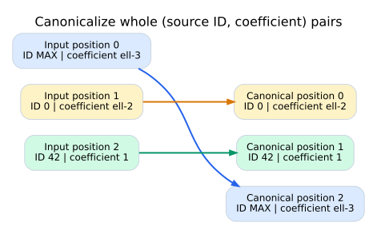

# Graph witness source-ID ordering: M31 regression and fix

**Result.** Corrected a false refusal in graph witness materialization. The unchanged source failed both new eager/lazy regression cases; the corrected source passed all 45 original-module integration tests, including four new M31 scalar-field tests. These are unsigned local development observations. Claim PCC-20261124-a6190c is not a signed scientific verdict. [pcc:unverified]

PR: https://github.com/isogeny-labs/crypto/pull/5118

Tested source publication: e7084130837c91ff5c3c2b14dc058048b6a21c5e

Frozen protocol: 1999bde21a47b8a61db3a1c4daff3a9a83960ac7

## What changed

Cancellation witnesses identify rows by input position. The adapter maps those positions to original source IDs, which can be arbitrary unique u64 labels. Replay returns provenance sorted by source ID. Previously, a witness containing an inversion in source-ID order could be refused by the final exact comparison even though its relation was valid.

The patch sorts complete (source ID, coefficient) pairs before replay. It preserves the original IDs, coefficients, witness basis, LP-cancellation checks, exact provenance comparison, duplicate-ID guard and resource caps. It does not merge duplicate witness terms.

The diagram shows the permutation of whole pairs. Before the fix, the left ordering was compared directly with the right ordering; the fix canonicalizes the left list first.

## Exact regression fixture

All new scalar arithmetic uses ell = 2147446831, the subgroup modulus of the established M31 context. The coordinate prime is p = 2147483647. These are synthetic coefficient fixtures for relation processing; no elliptic-curve collection or group-generated stream was executed.

| Input position | Original ID | Small terms | Large-prime terms | RHS |
|---|---|---|---|---|
| 0 | u64::MAX | (0,1) | (101,1) | 1 |
| 1 | 0 | (0,2) | (102,2) | 2 |
| 2 | 42 | (0,1) | (101,3), (102,4) | 3 |

The fixed-order expectation is -3 times row 0, minus 2 times row 1, plus row 2. The exact canonical source certificate is [(0,ell-2), (42,1), (u64::MAX,ell-3)], the small coefficient is ell-6 and RHS ell-4. These expectations were written before native execution and are asserted directly in both collectors.

## Native observations

| Check | Observed outcome |
|---|---|
| Unchanged production source, two new positive cases | 0 passed, 2 failed; exit 101 |
| Candidate, full original-module integration suite | 45 passed, 0 failed; exit 0 |
| New regression tests | 4 passed |
| Input-row permutations | All 6 orders, each through eager and lazy extraction |
| Source identity before/after final test call | Equal manifests |

The permutation regression checks the unique relation up to nonzero scaling; it does not incorrectly require an invariant streaming basis. Guard cases retain refusal for insufficient source/small caps, mismatched IDs, changed coefficients, and a split duplicate witness term that still cancels the LP columns. The duplicate-ID case rebuilds both the index and batch, so an index/input mismatch cannot mask a missing uniqueness check. [pcc:unverified]

The existing 41 tests retain their historical fixture fields and provenance. They are regression evidence, not new M31 curve measurements.

## Runtime and memory scope

For k source terms in one witness, the added in-place sort costs O(k log k) comparisons in the worst case and performs no field arithmetic. Across witnesses it adds O(sum_i k_i log(k_i+1)). For rank witnesses with at most one term per input row, L total witness terms and R input rows give the bound O(L log(R+1)). It reuses the already allocated mapped-source vector and adds no heap allocation for the sort. Rust's standard-library sort contract supplies the sorting bound; the aggregate bound follows by summation.

Replay order can change intermediate sparse work. No runtime advantage, peak-memory reduction, useful-rank increase or unchanged-cost claim follows from this correctness fix. Existing canonical performance plots and leaderboard rows receive no new point.

## Reproducibility and evidence

The existing source-exact standalone harness was reused. Production graph/filter modules were materialized from base ceba74bb64854027c4dd16f00428bf676383bfdb and checked against their Git blob identities. Only the witness adapter and additive integration tests changed. The harness retains its pre-existing shim for unrelated operation metering.

Rust and Cargo were 1.100.0. Builds used one job and tests one thread, offline cached dependencies, a separate target directory and a 300-second cap. No paid resources, collector rerun or workflow dispatch was started. The repository's normal PR workflow may run separately.

The retained receipt.json pins source files, raw outputs, exact exit statuses, tool versions and the generated dependency lock. raw/baseline-pre-call.sha256 and raw/candidate-pre-call.sha256 bind the calls; raw/candidate-post-call.sha256 matches the latter. Native logs are unsigned producer evidence, not an execution proof.

Run the original harness after setting one build job; for the focused historical failure, use the baseline witness blob with the new tests and filter m31_nonmonotone_source_ids. Full reproducible commands are in COMMANDS.md.

## Coordination, limitations and next step

A separate agent inspected the baseline source and reviewed the exact patch and regression design. It did not execute the tests; this is review within the same assistant team. A separate workflow-review worker failed before completing its audit. Actual elapsed/aggregate worker telemetry was unavailable. The coordinator performed native execution and integration.

Research-KB MCP was unavailable; the repository wrapper returned exit 127. Current source, the existing lane handoff and the Rust sort documentation supplied the bounded fallback. A local shared clone failed on a missing promisor object; authenticated source materialization recovered the required files without editing another worktree. rustfmt was unavailable; native compilation and whitespace checks ran, but no formatter pass is claimed.

The full root crate and independently signed PCC remain outside this test receipt. PR #5076 retains ownership of converter synchronization and eleven-query recovery. This fix enables row-order comparisons while preserving original provenance; the next step is the owning lane's grounded-BFS/eleven-query qualification on the same admitted M31 data.

## Sources

1. Prior source-order audit: https://github.com/isogeny-labs/crypto/pull/5076#issuecomment-7119361207
2. Original adapter and replay source: src/cryptanalysis/large_prime_graph/witness.rs and src/cryptanalysis/large_prime_filter.rs at base ceba74bb64854027c4dd16f00428bf676383bfdb.
3. Native observations: raw/baseline.stdout, raw/baseline.stderr, raw/candidate.stdout, raw/candidate.stderr and receipt.json.
4. Rust 1.100 slice::sort_unstable_by_key contract: https://doc.rust-lang.org/std/primitive.slice.html#method.sort_unstable_by_key

Impact score: 3/10 - Reproduced and corrected a bounded source-order correctness blocker with native regression evidence. It enables the next ordering comparison; performance consequences remain unmeasured.
