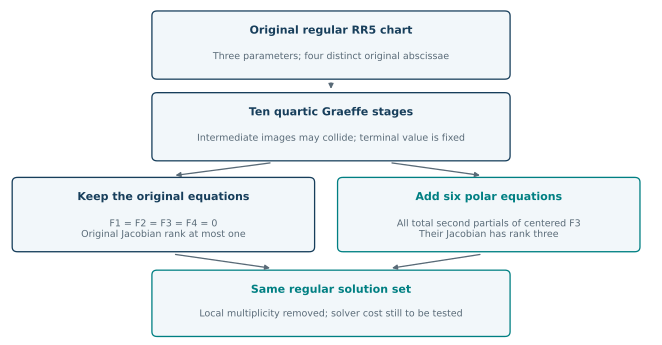
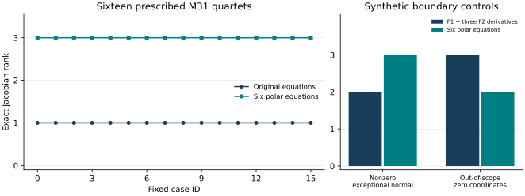

# Repair the collapsed Graeffe system with six polar equations

**M31 research lead | 23 November 2026 Pacific | PR #5136**

Add the six total second derivatives of the third centered elementary
residual to the original four-leaf Graeffe equations. A direct finite-field
argument gives a rank-three Jacobian at every solution in the original
regular RR5 chart, while retaining that chart's entire solution set.
The fixed M31 checker agrees: all sixteen prescribed signed quartets move
from original Jacobian rank one to polar Jacobian rank three.
This is a presentation repair and a qualified research lead, with no
relation-discovery or runtime result. [pcc:unverified]

**Standing:** `PCC-20261124-f381e2`, unsigned statement with native
development attestations. The proof is written and separately reviewed;
it is not a Lean-kernel proof or a signed independent execution verdict.

## 1. The proposed change

The existing RR5 chart has three parameters, theta=(b,c,d), and produces a
monic quartic U whose four signed roots sum to the public target R. Let
phi(X)=D_1024(X)-tau be the fixed squarefree Dickson selector. At a candidate
quartic, put z_i=phi(x_i), and let F_j=e_j(z_1,z_2,z_3,z_4).

The fully collapsed Graeffe presentation imposes F_1=F_2=F_3=F_4=0.
On the regular chart this has the correct root set, but F_j vanishes to
order at least j at each solution. Consequently only F_1 can contribute
a first-order condition: the three-parameter Jacobian has rank at most
one. The earlier distinct-image study identifies this multiplicity problem
and repairs it by retaining only quadruples with distinct intermediate
images. [S1]

The new candidate retains the full terminal collapse and all four original
equations, then appends:

    H_bb = partial_b partial_b F3 = 0
    H_bc = partial_b partial_c F3 = 0
    H_bd = partial_b partial_d F3 = 0
    H_cc = partial_c partial_c F3 = 0
    H_cd = partial_c partial_d F3 = 0
    H_dd = partial_d partial_d F3 = 0

These are derivatives in the original three parameters through the entire
RR5 and Graeffe composition. They require no known solution, point signs,
collision depth, or root ordering to construct.

If the terminal quartic is
Q_10(T)=T^4+g_3 T^3+g_2 T^2+g_1 T+g_0, the required residual is exactly:

    F3 = -g1 - 2*tau*g2 - 3*tau^2*g3 - 4*tau^3.

Centering at tau matters. Differentiating the uncentered coefficient g_1
does not give the same vanishing property. Treating the g_i as independent
graph variables also gives the wrong derivative: the displayed expression
is affine in them and has zero ambient Hessian.

## 2. Why six equations suffice

Fix a regular solution. The original four abscissae are distinct, all
ordinates are nonzero, the selector derivatives are nonzero, and the
public target abscissa lies outside the selector. The normalized RR5 chart
then identifies its three tangent directions with the fixed-sum divisor
tangent space. Differentiating the elliptic sum with the invariant
differential dx/(2y) gives:

    sum_i dx_i / (2*y_i) = 0
    n_i = 1 / (2*y_i*phi'(x_i)) != 0
    image(dz) = W = {z : n dot z = 0}, dimension(W) = 3.

Write L=dz at this solution. The cubic initial term of F_3 is
C(t)=e_3(Lt). All six second derivatives of F_3 vanish at the solution,
and their linear terms are the six second derivatives of C.

Suppose a nonzero parameter direction were invisible to all six linear
terms. Its image w=Lv would make the quadratic Q=partial_w e_3 vanish
on W. A quadratic vanishing on that hyperplane must be
Q=(n dot z)(a dot z). But Q has no squared-variable terms. Their
coefficients in the proposed product are n_i*a_i; since every n_i is
nonzero, every a_i is zero. Thus Q is identically zero.

Let S=sum_i w_i. The coefficient of z_i*z_j in Q is S-w_i-w_j.
All six coefficients being zero forces all four w_i to equal a common
c, followed by 2c=0. Since M31 has odd characteristic, w=0, and L's
injectivity gives v=0. The polar Jacobian therefore has rank three.

This argument holds at every admitted solution; it does not assume a
generic normal or select a convenient three-row minor. The six Hessian
rows may supply different rank-three minors at different roots.

Keeping the original equations ensures exact root preservation on the
regular chart. With Delta=disc_X(U), the full note derives:

    (F1,F2,F3,F4,Hbb,Hbc,Hbd,Hcc,Hcd,Hdd) : Delta^infinity
        = ideal(coefficients of phi mod U).

This is a written saturated ideal identity, not a claim about the
unsaturated repeated-root components. The full assumptions, norm signs,
coefficient formulas, local-ring argument and generalization are retained
in [MATHEMATICS.md](MATHEMATICS.md). [pcc:unverified]

## 3. What the M31 controls checked

The coordinate field is p=2147483647. The unchanged curve is
y^2=x^3+847514846*x+2087444724, with recorded full prime order
2147446831 and generator (625037715,2100627251). The original native
fixture produced the depth-ten terminal tau=1616683971, 1024 distinct
selector abscissae and 509 curve-liftable canonical base points.

Before execution, case k=0,...,15 was fixed to base indices
[4k,4k+1,4k+2,4k+3], with ordinate j negated exactly when bit j of k is
one. The target was their signed elliptic sum. Every case was retained;
there was no search for favorable targets or replacement rule.
This is the pure Dickson B509 component, not the mixed Y7 sectors of B677.

Two native calculation paths were compared. The first propagates all
twenty Taylor coefficients through degree three in b,c,d through the RR5
norm and ten quartic Graeffe maps. The second independently lifts each
simple quartic root by the formal implicit-function equation, applies
scalar Dickson iteration, and reconstructs all four centered elementary
residuals. Each case compares all eighty resulting coefficients.
These are distinct algebraic paths in the same unsigned Rust checker,
not separately signed implementations.

| Check | Recorded outcome | Scope |
| --- | --- | --- |
| Release build | Exit 0 | Frozen native source closure |
| Binary unit tests | 4 passed, 0 failed | Factorials, Graeffe, implicit jets, hypothesis boundary |
| Prescribed signed quartets | 16 passed, 0 replaced | Exact M31 fixture |
| Original collapsed Jacobian | Rank 1 in all 16 | Three original parameters |
| Six polar-equation Jacobian | Rank 3 in all 16 | Same cases and parameters |
| Graeffe/root-jet comparisons | All 80 coefficients agree per case | Through total order three |
| Synthetic algebraic controls | 4 passed | Includes two hypothesis/encoding limits |
| Source checks | 9/9 hashes match across all three calls | Before/after each retained command |
| Checker binary checks | Both hashes match | Checker invocation only |

The raw record retains every signed leaf, target, RR5 parameter, quartic,
normal, tangent matrix, polar Jacobian, and both sets of Taylor coefficients.
The aggregate table above is a presentation of that native output.
[Raw result](evidence/attempt-01/check/stdout.txt) |
[Unit-test output](evidence/attempt-01/unit-tests/stdout.txt) |
[Frozen source manifest](evidence/attempt-01/frozen-source-manifest.json).
[pcc:unverified]

Flow: sixteen cases planned, sixteen attempted, sixteen completed, zero
excluded or replaced. The four synthetic controls and four unit tests are
separate populations. All nine source-file hashes were checked before and
after each command. Only the checker invocation has a binary hash;
the build/test recorder entries used its documented no-binary option.

There are no confidence intervals: these are exact finite-field ranks on
fixed development controls, not estimates from a random sample.

### Controls that distinguish the claim

The cheaper alternative appends only the three first derivatives of F_2.
Together with F_1, its Jacobian has rank three except when both sum(n_i)=0
and sum(n_i^2)=0. The fixed synthetic normal
(1,5,1326042065,821441576) satisfies both equations. The cheaper arm has
rank two there; the six-Hessian arm has rank three.

The deliberately out-of-scope normal (1,0,0,1) gives polar rank two.
It confirms that the nonzero-normal condition is substantive. With
z=(a,b,c,-a), the restricted cubic is -a^2*(b+c), which depends on only
two linear directions.

All sixteen cases also retain the wrong ambient-differentiation control,
whose polar rank is zero, and a wrong-centering control at tau+1, whose
third residual is -4 rather than zero. These failures are expected
negative controls, not censored successes.

## 4. Why this is a different lead, and what it inherits

Differential deflation is established mathematics. Hauenstein and Wampler
describe Jacobian-minor deflation; Hauenstein, Mourrain and Szanto discuss
adding derivatives known to vanish at a singular root. Their papers are
context for this construction. The M31 rank statement above is proved by
the explicit positive-characteristic argument, rather than imported from
their characteristic-zero setting. [S2, S3] [pcc:unverified]

The specific candidate is the root-uniform centered-e3 choice on the
elliptic fixed-sum chart. It repairs the full collapsed Graeffe
presentation without selecting a collision stratum or requiring distinct
intermediate images. Bounded repository searches did not find this exact
construction; that is not a claim of worldwide novelty.

The screen rejected several rediscoveries before selecting this lead.
Relative-phase conics are part of classical Dickson factorization.
First-collision branches, collapsed labeled towers and fixed-target
chord/gcd extraction already have repository implementations. The prior
first-collision runs retained capped arms; those records were not rerun
or promoted in this study. [S4, S5]

There is also a close, stronger-than-naive comparator: the existing
derivative-support residual rem(phi*U',U), associated with the KeyAI
continuation, already has the required reduced-support behavior.
For a composed Dickson selector it can itself use fixed-width modular
arithmetic. Ordinary full-remainder membership is also already radical
on this chart. The new construction is therefore not the first compact
reduced selector representation. Its testable difference is how it repairs
the Graeffe coefficient presentation. [SOURCE_REVIEW.md](SOURCE_REVIEW.md)

## 5. Cost hypothesis and the experiment that can reject it

The potential gain is removing artificial multiplicity before elimination
and quotient-ring root extraction. Fewer local copies of each solution
may reduce the algebra handled by the solver. This does not bound solving
degree, Macaulay matrix fill, or total running time.

The derivatives have a real construction cost. A direct second-order Taylor
circuit in three parameters carries ten coefficient channels per primal
quantity. The checker uses twenty channels through order three because
it also evaluates the new equations' Jacobian. Neither channel count is
a measured F4 variable count. A solver implementation must charge all
derivative graph lifts and preserve the original discriminant guard.

The next comparison should use the following native arms on identical
public targets and shared total limits:

| Arm | Purpose |
| --- | --- |
| Full/compact remainder | Existing exact regular-chart baseline |
| Derivative-support remainder | Existing reduced-support comparator |
| Original collapsed Graeffe | Isolate the multiplicity effect |
| Graeffe plus six polar equations | Proposed presentation |
| Distinct-image cutoff | Prior repair, with its support restriction counted |

Require exact signed witness replay and useful independent rows. Charge
construction, automatic differentiation, matrix work, root extraction,
all capped or failed calls, setup and memory. Preserve identical inputs,
seeds, resource limits and independent holdouts; no favorable-case removal.
Reject a performance claim if the polar arm loses a regular witness,
fails root replay, or fails to reduce complete useful-output cost against
the strongest matched remainder arm. Full rank alone is insufficient.

No such solver comparison was launched here. The delivered executable
evaluates supplied witnesses; it does not discover them or emit a coupled
F4 solver system. The next implementation is the differentiated circuit
with its regular-chart guard and full signed-output adapter.

### Conditional extension

The same cubic argument applies to an m-leaf regular elliptic Abel fiber
with m-1 parameters: append all m*(m-1)/2 second partials of e_3.
It requires the parameter-to-residual differential to have rank m-1,
all normal coordinates nonzero, characteristic greater than three, and
characteristic not dividing m-2. For eight leaves this gives
28 equations. This is a written extension; this study implements and
checks only the four-leaf M31 case. It does not extend four-leaf automatic
rationality to longer relations. [pcc:unverified]

## 6. Reproduction, evidence and remaining standing

The build records local commit
62c856c14e5dae68b520022db3debdeb3090ba64. The tests and checker record
72024a791ec48780c2c57c9e0bdaf9d0b54fceaf; the only intervening change
retained the already frozen Cargo lockfiles. Native source SHA-256:
4246bf15ca2d5a8484ccd80d051b757245198bddd89787869484a3cd63c41559.
The copied immutable source and every exact command are beside the raw
receipts under `evidence/attempt-01/`.

Reproduce with Rust/Cargo 1.100.0 and the pinned lockfile:

    cargo test --release --locked --offline \
      --manifest-path research/m31_graeffe_polar_deflation_20261123/native/Cargo.toml \
      --bin m31-graeffe-polar-check -- --test-threads=1

    cargo run --release --locked --offline \
      --manifest-path research/m31_graeffe_polar_deflation_20261123/native/Cargo.toml

Each original build/check used a separate 300-second outer cap. The shell
launcher set CARGO_BUILD_JOBS=1, but the recorder did not independently
capture that environment variable. These were local development controls, not a benchmark or
scientific cloud run. Build, tests and the checker passed on their first
native attempt. No retry or changed scientific threshold was used.

The toolchain lacks cargo-fmt, so no formatting-tool pass is asserted.
The complete root crate was not rebuilt; this is standalone qualification
against the unchanged original curve/base source closure. The aggregate
benchrec gate remains unqualified in the sparse worktree: after restoring
its records it reports historical missing artifacts/open records. No
benchmark record, policy, historical result or progress chart was changed.

The current identity.certificate/v1 issuer fixes its evaluation field at
2^61-1 and has no M31 parameter. All new field checks here use M31;
standard v1 certificate qualification was not performed and no substitute
v1 record is claimed. The unsigned PCC statement binds the actual M31
records and written argument. Independent signed execution and a checked
formal proof remain separate.

Lean formalization was not attempted: Lean, Lake and Elan were absent from
the inspected environment, and this study has no pinned proof dependency
closure. [PROOF_STATUS.md](PROOF_STATUS.md) maps the written statements,
their hypotheses and the open formalization obligations; no failed Lean
build or mathematical infeasibility is implied.

The research KB was unavailable (wrapper exit 127); targeted current
repository files and primary papers supplied the bounded fallback.
Conductor was absent. Existing scoreboard/performance graphs were reviewed
for relevance and left unchanged because this study makes no discovery
or performance comparison. Its own exact-rank graph and mechanism diagram
are rendered from the retained result and stated construction.

## Sources

- **S1.** [Distinct Dickson images in four-summand extraction](https://github.com/isogeny-labs/crypto/blob/ea922ca25fa85005c6f45ec5b53a7d91e1b293e2/research/smooth_p_plus_one_20261123/REPORT.md).
  Prior collapsed-rank obstruction and distinct-image repair.
- **S2.** Hauenstein and Wampler, [Isosingular Sets and Deflation](https://academicweb.nd.edu/~jhauenst/preprints/hwIsosingular.pdf), Section 3.
  Established determinantal deflation; not a finite-field theorem for this application.
- **S3.** Hauenstein, Mourrain and Szanto, [On deflation and multiplicity structure](https://academicweb.nd.edu/~jhauenst/preprints/hmsOnDeflation.pdf), Section 3.
  Established derivative preprocessing and exact deflation methods.
- **S4.** Bhargava and Zieve, [Factoring Dickson polynomials over finite fields](https://websites.umich.edu/~zieve/papers/manjul.pdf), Section 4.
  Classical difference factorization and relative-phase conics.
- **S5.** [First-collision Dickson/S3 report](https://github.com/isogeny-labs/crypto/blob/ea922ca25fa85005c6f45ec5b53a7d91e1b293e2/research/prime31_ic_20261115/native/DICKSON_FIRST_COLLISION_S3_20261115.md).
  Existing full and collapsed tower encodings, including capped outcomes.
- **S6.** Petit, Kosters and Messeng, [Algebraic approaches for ECDLP over prime fields](https://people.maths.ox.ac.uk/petit/files/16PKC_primeECDLP.pdf).
  Composed-selector framework and unresolved dedicated-solving cost.
- **S7.** [Full source and independent mathematical review](SOURCE_REVIEW.md),
  [derivation](MATHEMATICS.md), [fixed protocol](PROTOCOL.md), and
  [retained execution review](RECEIPT_REVIEW.md); [formalization status](PROOF_STATUS.md).

**Impact assessment: 6/10.** A concrete root-preserving repair with a
finite-field rank argument and matching fixed M31 controls; the decisive
remaining question is its fully charged discovery cost.
