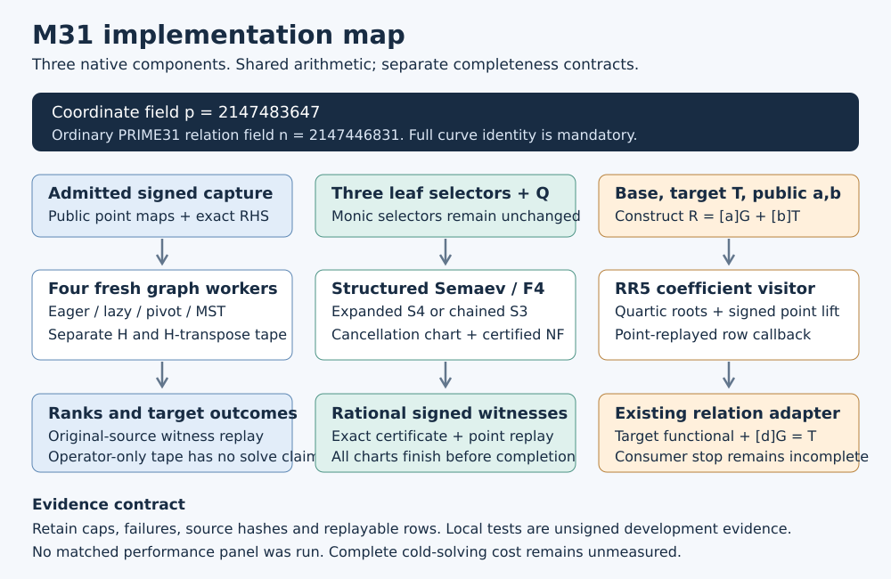

# M31 integrated implementation report

23 November 2026 Pacific | Isogeny Labs / crypto | PR #5120

## Delivered scope

The three requested native components are implemented: a fresh-process graph
comparison harness and projection operator, a constrained three-summand
Semaev/F4 solver, and immediate RR5 signed-row delivery to the existing target
adapter. The component release gates report 70 passing tests in total. This
is source and local development qualification; independent signed verification
remains pending. [pcc:unverified]

| Component | Terminal development result | Scope delivered |
| --- | --- | --- |
| Graph | 7 integration tests; exit 0 | Four original graph arms, exact projection tape, admission and process custody |
| Structured | 10 unit and 3 CLI tests; exit 0 | Expanded S4, two chained S3 orders, cancellation chart, selector certificates |
| RR5 | 42 library and 8 public-example tests; exit 0 | Three visitor APIs, caller-driven public-query adapter, compatible existing executables |

The counts describe distinct tests in these component gates, including the
unchanged RR5 regression tests. Repeated debug/release runs are not counted
again. The graph suite additionally contains 128 seeded dense-oracle systems.
The new curve-dependent controls use M31. The historical RR5 suite retains
its existing smaller-field regression controls. [pcc:unverified]



The diagram shows independent entry points and output contracts. It adds no
collector or factor-base conversion. No matched performance panel was run.

## Mathematical identity and source reuse

The principal new curve controls use the existing native PRIME31 fixture:

| Quantity | Exact value |
| --- | --- |
| Coordinate prime p | 2147483647 |
| Curve equation | y^2 = x^3 + 847514846 x + 2087444724 |
| Prime subgroup order n | 2147446831 |
| Generator G | (625037715, 2100627251) |

Coordinate polynomials operate over F_p; relation elimination operates over
F_n. The separate registered M31 curve with a=-3 and b=21 is a different
identity. Sharing p does not admit its captures into this graph harness.
One structured exceptional-point unit control uses a=2, b=3 over the same
M31 field to cover y=0; it is explicitly a correctness fixture.

The implementation reuses the repository's original graph filters, F4 visitor,
root extraction, point arithmetic and relation adapter. Graph source imports
remain relative symlinks with explicit target and content guards. The RR5 F4
closure retains literal source-range and hash checks. Two stale whole-file
pins were refreshed after a source diff: the selected field arithmetic is
unchanged, and the selected boundary range adds two test-only accessors.
The source-pin audit is in ../rr5/README.md.

## 1. Graph comparison and projection tape

The coordinator runs eager forest, lazy forest, pivot and MST in separate
Linux processes on identical admitted original-order prefixes. Each child
receives a 60-second wall limit, 60-second CPU limit and 4 GiB address-space
limit, with one active child and single-thread environment settings. Row,
point-map and byte ceilings apply before graph work. Full group admission
runs inside each bounded child. Coordinator parsing and startup are retained
as an explicit separate interval.

Input custody binds full JSONL bytes, manifest, executable, imported source
manifest and canonical prefix. Every returned witness is replayed against the
original rows. Each complete arm must agree on exact LP, useful and augmented
ranks and the target outcome; eager and lazy also agree on output witnesses.
This is not a general canonical row-space comparison between all four bases.
The separate tape controls do compare exact dense row spaces.

ProjectionTape records sparse elimination dependencies and exposes apply,
apply_transpose and projected_rhs. It does not materialize the projected small
matrix or expanded source-cancellation witnesses. Forward and transpose calls
use the same tape. Preparation and retained dependencies can be quadratic;
there is no asserted near-linear preparation bound. The operator-only mode
has no rank or scalar-recovery claim and still needs a complete Krylov solver
and its certificates to become a competing complete method.

The final release control runs four distinct children on a disclosed planted
eight-row fixture. All four return useful rank 3 and the replayed disclosed
scalar 37. Weighted, rank-deficient, anchored and LP-free cases, malformed
admission, output limits, incomplete prefixes and four retained child refusals
are covered. This is a correctness panel, not an authentic collection run.
Raw records: ../graph/evidence/06-tests.* and 06-release-cli/.
[pcc:unverified]

## 2. Structured Semaev/F4 solver

The public problem is P1+P2+P3=Q with three caller-supplied monic leaf
selectors. The solver offers an expanded S4 resultant and two chained S3
orders. Each chained formulation has a separate cancellation chart for a
pair whose sum is the point at infinity. Leading-coefficient degeneracies
are retained rather than divided away.

Optional selector preprocessing returns explicit cofactors for each changed
equation and keeps the selectors unchanged in the F4 system. A separate
replay function checks the returned transformation against the caller's
original equations. Optional preprocessing that exceeds its budget falls
back to the unchanged chart. All raw charts are constructed before optional
preprocessing can consume their budget.

The original F4 visitor receives no coordinate domain list. A trace guard
refuses full-field and Cartesian-domain fallback. This restriction carries
no subenumerative complexity guarantee: algebraic root splitting can still traverse
products of selector roots. Every accepted witness has rational signed
point lifts satisfying the full target point, including its y-coordinate.
Only completion of all charts permits a complete status; time, native modeled
allocation admission, assignment and witness caps retain incomplete output.
The allocation limits are not measurements or hard caps on process RSS.

The tests compare complete signed sets across all formulations and raw versus
prepared systems against an independent test-only finite-base oracle. They
also cover the independent Sylvester determinant, cofactor corruption,
missing cancellation chart, y=0, complete emptiness, limits and fallback.
CLI tests exercise actual process exit codes and witness replay. A second
agent independently executed the ten producer-authored debug unit tests;
that was not an independent rebuild or signed verdict. Raw release records:
../structured/evidence/release.final.log and .exit. The earlier
release.all-targets records remain intact. [pcc:unverified]

The generic quadratic-resultant construction also has the required auxiliary
record IDC1hd6568d78855aef4c in
../structured/evidence/quadratic-resultant.identity.json. The repository's
identity.certificate/v1 format is fixed to M61. Native replay checks 32
certificate points and 16 further points; both issuance and checker reject a
+1-corrupted formula. This is evaluated algebraic bookkeeping, not a formal
proof or an elliptic-curve instance. It does not substitute for the M31 signed
solution and exact selector-certificate controls. [pcc:unverified]

## 3. RR5 streaming and public-query adapter

The existing extractor now provides extract_visit, extract_cofactor_visit
and extract_hybrid677_visit. Each coefficient assignment reaches the consumer
only after quartic root recovery, signed factor-base lifting, duplicate
filtering and literal curve replay. Returning false continues; true stops.
The returned result also retains the bounded prefix of delivered relations.
The older batch entry points retain their buffered contract.

QueryPipeline accepts public base points, a public target T and public query
labels (a,b), constructs R=[a]G+[b]T, and immediately feeds each signed row
to the existing RelationAdapter. The adapter checks the actual group equality,
reduces over the subgroup field, and accepts a recovered scalar only after
literal point replay. The pipeline stops on target-functional recovery; full
column rank is unnecessary when that functional is already determined.

The disclosed base [2,3,5,11]G and target 7G provide the integration control.
Labels (21,0) and (7,2) produce the same query point 21G. Two admitted rows
isolate the target at rank 2 of 5. A five-point base checks delivery of more
than one row, so the false-callback continuation path is exercised. False
right-hand sides, duplicates, invalid fields, duplicate abscissae and native
resource refusal are also covered. [pcc:unverified]

ConsumerStopped is explicitly nonexhaustive, even when it occurs on what might
have been the final solution. QueryExhausted is relative to the supported
distinct-four RR5 chart. Identity queries and target-in-base cases remain
unsupported. Deadline, resource and output-limit reasons are preserved.
Deadlines are cooperative and cannot preempt an in-progress callback; adapter
setup and query arithmetic are outside that clock. Hard whole-operation limits
require a process supervisor. Complete cold-cost accounting remains false.

Raw records: ../rr5/evidence/native-tests-initial.log contains detailed
receipts; native-all-targets.log and .exit record the complete compatibility
gate, including all existing executables and eight public-example tests.

## Verification, unsuccessful attempts and remaining gates

The full root-library test gate did not pass. The initial attempt refused a
sparse path dependency before compilation. After hydration, the first build's
execution handle disappeared without a terminal exit; its partial log and
explicit unknown-status receipt are retained. A separate 240-second cached
release-test retry returned exit 124 during dependency compilation.

A bounded library compiler check then reached the unchanged production
prime_root_trace.rs and emitted E0425 for powers, gcds, previous, r and g.
That check also reached its 240-second cap (exit 124), so no completed root
test result is inferred. The file is byte-equal to the main baseline
ceba74bb64854027c4dd16f00428bf676383bfdb; its Git and SHA-256 identities are
retained in ../evidence/root-*-source.*. The missing tracked ecbench panel
input reported in the same log was hydrated. A wider --tests diagnostic had
also refused two sparse unrelated binary targets before compilation; it was
replaced with the focused --lib check. All attempts remain separate records.
These out-of-scope root source defects are not changed by this PR.
[pcc:unverified]

The managed Cargo wrapper selected an empty registry cache even when given
CARGO_HOME. The successful component builds use the installed direct Cargo
and rustc 1.100.0 with the existing populated cache. Sparse tracked inputs were
materialized after the source-provenance build refused their absence. No
fixture bytes or frozen source snapshots were replaced. Initial failures and
their exits remain in each evidence directory. Rustfmt is unavailable in the
installed toolchain; no formatting pass is claimed.

Implementation and independent reviews caught and corrected visitor stop polarity, optional
preprocessing starving a later chart, coefficient normalization in certificate
replay, graph partial-output labeling, mutable tape dimensions, RR5 termination
priority and the graph coordinator admission interval. The final graph gate
retains earlier 05 records and the corrected 06 records. Review scope and
independent execution hashes are in ../evidence/INDEPENDENT_REVIEW.md.

No paid experiment, natural collector rerun, B677 extraction panel or matched
cold-cost comparison was launched. Existing no-merge and no-paid-compute holds
remain. The next scientific step is an admitted same-capture graph panel and
registered structured/RR5 runs with complete phase costs and result custody.
The root build gate and signed PCC verdict are separate from local component
qualification. No end-to-end performance gain is claimed.

The canonical scoreboard, boundary targets and progress timeline are left
unchanged because this change adds no admitted performance result. The same
applies to the benchmarks index and existing historical plots. The required
new visual is the implementation diagram embedded here.

## Reproduction and sources

From the repository root, use the local development wrapper with a new output
directory. CARGO and RUSTC can select installed executable paths; OFFLINE=1
uses a populated local registry. BUILD_TIMEOUT_SECONDS bounds each component
gate. The wrapper retains every exit and continues later planned components
after a failed gate.

```sh
bash research/m31_integrated_build_20261123/check.sh NEW_EVIDENCE_DIRECTORY
```

The component READMEs document the graph CLI, structured JSON request and
streaming API. The wrapper is syntax-checked; its constituent release commands
were executed directly with retained logs. It launches development tests only.

Repository sources: src/cryptanalysis/ic_graph, large_prime_filter.rs,
f4_fp.rs, prime31_ic_20261115/native, prime31_four_summand_20261122/native,
and the existing prime31_rr5_public_relations_20261123 public-query loop.
Sources checked (KB): the research-KB service and wrapper were unavailable;
repository source, active lane handoffs and original papers supplied the
fallback. Conductor was also absent; the workers used disjoint owned paths.

- Semaev, Summation polynomials and the discrete logarithm problem on elliptic curves (2004), Theorem 1 and the S3/resultant construction: https://eprint.iacr.org/2004/031 . The author-uploaded full text was read after the IACR PDF returned 403.
- Faugere, A new efficient algorithm for computing Groebner bases (F4), 1999, Section 2: https://wstein.org/129-05/refs/faugere_f4.pdf . Input degree is not an observed solving degree.
- Gaudry, Theriault and Thome, double-large-prime technical report: https://cacr.uwaterloo.ca/techreports/2004/corr2004-29.pdf . Its hyperelliptic performance conclusions are not transferred to these ordinary elliptic fixtures.

Tracking and source publication: https://github.com/isogeny-labs/crypto/pull/5120 .
All implementation observations in this report remain unsigned producer
evidence pending the repository's independent PCC process. [pcc:unverified]
