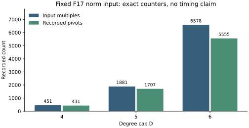

# Capped Macaulay producer and source-certificate checker

The native producer records input-row provenance; a separately compiled symbolic
checker accepts a basis only after source identities, Buchberger completion and
original-generator reductions pass. Six small ideals pass exact point/dimension
controls, and four adversarial certificates are rejected. All tested norm caps
D4/D5/D6 remain unknown. The original subexponential ECDLP criterion stays open.
PCC-20261115-be28ec:unverified. [pcc:unverified]

## Algorithm and actual scope

[produce.cpp](produce.cpp) generates every original input monomial multiple
through the fixed degree cap, performs sparse forward Gaussian elimination,
and retains scalar weights over source rows. Its candidate combines minimal-
leading pivots and all original generators. [verify.cpp](verify.cpp) reconstructs
each candidate polynomial from those input multiples, checks every S-polynomial
reduces to zero, then checks each original generator reduces to zero. Only that
checker's success permits producer exit0. A failed/incomplete candidate stays
unknown with its files retained. [pcc:unverified]

These three obligations respectively establish candidate membership in the input
ideal, completion for its generated ideal, and the reverse ideal inclusion.
A bogus unit basis can pass its own completion check; source membership prevents
that false refutation. Mere point evaluation also cannot certify source-ideal
completeness. The checker shares the canonical parser/polynomial primitives but
never calls producer Gaussian elimination. This is a local symbolic check,
not an independent signed PCC verdict or a formal proof of the C++ program.
[pcc:unverified]

The instrument supports prime p<2^31, at most20 variables and degree1..6, with
explicit row/support/step/basis/certificate limits and20s/2GiB process bounds.
It is a bounded polynomial-solver component; it has not supplied a norm relation
or been qualified as a new cold ECDLP backend. The parent msolve-based cold path
remains separately qualified. No arbitrary full-width prime implementation or
uniform useful-yield bound follows from this instrument. [pcc:unverified]

## Frozen outcomes

[PROTOCOL.md](PROTOCOL.md) predates code/data and preserves both amendments.
No scientific timing, population inference, fitted exponent or paid job occurred.

| Exact control | Final local result |
| --- | --- |
| F5 grid x²=x,y²=y | valid source basis, quotient4,4 points |
| F5 nonreduced x²=y²=0 | valid source basis, quotient4,1 point |
| F3 x²+1 | valid nonunit basis, quotient2,no rational point |
| F5 x,x-1 | valid unit certificate, quotient0 |
| F5 x and F5 x,y | exact one-point ideals |
| Wrong coefficient / forged unit | rejected by source identities |
| Missing original / incomplete GB | rejected by the corresponding check |
| Natural norm m3,t3,c1,R=(0,6), D4/D5/D6 | all incomplete, unknown |

The known positive norm input is the exact parent core001/call37 system, not a
planted coefficient witness. Its scalar/assignment/reference enters only the
outer comparison. No successful norm basis was produced at these caps, so no
norm assignment or cold recovery is claimed for this new backend. These are
three caps on one target, not three independent success/yield samples.
[pcc:unverified]



The graph copies native counters for the same fixed input. They are deterministic
counts without sampling error bars, not time or total algorithm cost. Pivot
counts are recorded counters, not separately certified matrix-rank claims.
Sources: counts.json and complete qualification-002 stdout. [pcc:unverified]

## Diagnostic correction and custody

The first candidate omitted nonminimal-leading pivots. Amendment A1 retained all
original generators with trivial source certificates. The old check message
`original generator not included` was misleading: nonzero division remainder
under an incomplete basis does not prove ideal non-membership. A2 corrected
check order/wording while preserving the same acceptance conjunction. A checker-
only replay of saved candidates passes all6 positives, rejects all4 adversarial
cases for their intended reasons, and rejects every norm candidate at Buchberger
completion. No matrix/producer was rerun during that replay. [pcc:unverified]

- Source38c0d23859: first full panel, qualification-001, with pre-run hashes.
- Source924cb61d26: candidate repair and exactly one amended full panel002.
- Source437c1abf16: final check-order/label correction; saved-certificate replay003.

[evidence/](evidence/) preserves complete panels of25696,26068,2968 bytes as
whole xz archives, with SHA256SUMS. Old binaries remain in distinct scratch
build directories; historical source hashes bind their recorded commits, not a
later working tree. Every unsuccessful candidate, certificate and status remains.
All observations remain producer-local and unverified. [pcc:unverified]

## Exact Lean instance

The native unit row is `1*x+4*(x-1)=1` over F5. The corresponding semantic
polynomial identity and unit ideal compile in [UnitCertificate.lean](lean/UnitCertificate.lean).
The pinned project gate passes2 theorems with only standard axioms, no sorry,
native-trust evaluation or raised limits. [PROOF-MAP.md](PROOF-MAP.md) records
the existing Ideal laws, actual coefficient map, build/axiom receipts and missing
native-parser/general-checker/order bridges. This is the exact unit instance,
not a proof of every C++ result or of a norm certificate. [pcc:unverified]

## Reproduce

Use the parent's pinned bootstrap, then build native components:

```sh
bash research/shared_norm_algebraic_20261115/bootstrap_backend.sh /tmp/mca-prefix
bash research/macaulay_provenance_20261115/build.sh /tmp/mca-prefix /tmp/mca-build
export MACAULAY_VERIFIER=/tmp/mca-build/verify
/tmp/mca-build/produce -t 1 -g 2 --degree 3 \
 -f research/macaulay_provenance_20261115/fixtures/grid.ms -o /tmp/new-grid-basis.gb
```

The verifier accepts INPUT,BASIS,CERTIFICATE paths; `compare` checks fixed
coordinate sets. `qualify.sh BUILD NEW_OUTDIR` runs the declared full panel.
Historical executions require their exact source commits; the current script
uses the corrected diagnostic label. Never reuse output paths. [pcc:unverified]

Next algorithmic route: use exact rowspace elimination onto univariate coefficient
columns, factor those necessary constraints and verify proposed assignments
directly. This witness-only route need not construct a complete input-ideal GB.
Its bounded branching, successful yield and general prime-field cost remain to
be established; no such implementation or result is claimed here. A separate
prospective protocol is required. An optional dual-functional audit could also
certify insufficiency of one fixed degree rowspace; current failures alone are
not degree lower bounds. [pcc:unverified]

Sources checked: prior norm/initial-elimination/selective-oracle notes; existing
Boolean Macaulay tools and GBRL Buchberger code; pinned Mathlib Ideal laws and
its monomial-order division module. No novelty or exhaustive search claim.
