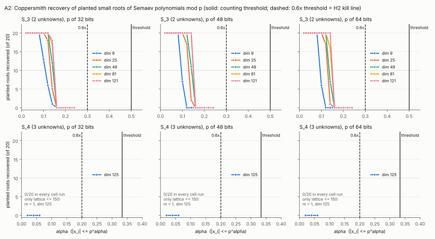

**Status: run complete for the frozen range. H2 kill holds for S_3 and S_4;
the lead is not met.** The reading of the trend clause is stated below.
Protocol: `../PROTOCOLS.md`, section "A2. P1.2/Q004", committed at `7db75ae`
(unchanged at the working tree's base `35edd50`). All numbers are measured by
the Rust code in this directory unless marked *derived*.

## Result

| poly | p bits | dim 9 | dim 25 | dim 49 | dim 81 | dim 121 | dim 125 | 0.6 x threshold |
|---|---|---|---|---|---|---|---|---|
| S_3 | 32 | 0.10 | 0.12 | 0.14 | 0.14 | 0.14 | - | 0.30 |
| S_3 | 48 | 0.08 | 0.12 | 0.14 | 0.14 | 0.14 | - | 0.30 |
| S_3 | 64 | 0.08 | 0.12 | 0.12 | 0.14 | 0.14 | - | 0.30 |
| S_4 | 32 | - | - | - | - | - | < 0.02 | 0.20 |
| S_4 | 48 | - | - | - | - | - | < 0.02 | 0.20 |
| S_4 | 64 | - | - | - | - | - | < 0.02 | 0.20 |

*Measured* alpha_max is the largest grid alpha (step 0.02) at which at least
10 of 20 planted roots were recovered. S_3 uses lattice parameter m = 1..5,
so dim = (2m+1)^2. The stricter 20/20 version and the looser "at least 1/20"
version are in `results/summary.json`. They move the value by at most one
grid step and never past 0.14. No S_3 instance was recovered at alpha >= 0.16
in any lattice: every cell run there scored 0/20, with 3 to 5 such cells per
row. S_4 recovered nothing at any alpha, including 0.02.

### Verdict against H2 as preregistered

- **Lead** ("alpha_max >= 0.6 x threshold at some frozen size"): **not met**
  for either polynomial at any p or dimension. The best S_3 value is 0.14
  against a line of 0.30. The best S_4 value is below 0.02 against 0.20.
- **Kill** ("recover only for alpha < 0.6 x threshold, with no upward trend
  as the lattice dimension grows within the frozen range"):
  - **S_3.** The first clause is met at every (p, dim). On the trend clause,
    alpha_max rises from dim 9 up to dim 49 (p = 32, 48) or dim 81 (p = 64).
    It then stays at 0.14 to the top of the range (dim 121). The protocol's
    stop rule ("two consecutive dimension increases give no improvement")
    fired at dim 121 for p = 32 and p = 48 (49, 81 and 121 all give 0.14).
    For p = 64 there is one non-improving step (81 to 121). If "no upward
    trend" means no improvement at the top of the frozen range,
    **H2 kill holds for S_3**. A reader who counts the rise among the
    smallest lattices as an upward trend would say the trend clause is not
    met. The deciding measurement is the same under both readings: alpha_max
    is flat at 0.14 for dims 49, 81 and 121, and every cell at 0.16 scores
    0/20. The *derived* determinant bound below also caps the asymptote at
    1/6 (about 0.167), which is below 0.30.
  - **S_4.** The first clause is met: nothing was recovered. The trend clause
    cannot be tested. The only box lattice for S_4 with dimension up to about 150 is
    m = 1 (dim 125); the next one, m = 2, has dimension 9^3 = 729.
    **H2 kill holds for S_4 at the frozen size**, from a single dimension.

**Scope** (from the protocol, unchanged): even full success would not be an
index-calculus speed-up. A2 settles only Q004's coordinate-aware decoder
question.

## Why the wall sits at 0.14-0.16 (*derived*, not measured)

The lattice uses one shift per monomial e of the box [0, m d]^nv:
g_e = x^(e - k d) f^k p^(m-k), with k = min_i floor(e_i / d_i), d = (2,2)
for S_3 and d = (4,4,4) for S_4. Write X = p^alpha. The determinant condition
det^(1/n) < p^m then gives alpha < sum_e k(e) / sum_e |e|. This ignores the
sqrt(n) and LLL factors.

| lattice | S_3 m=1 | m=2 | m=3 | m=4 | m=5 | m -> inf | S_4 m=1 |
|---|---|---|---|---|---|---|---|
| bound on alpha | 0.056 | 0.100 | 0.119 | 0.130 | 0.136 | 1/6 = 0.167 | 1/750 = 0.0013 |

The measured alpha_max exceeds this bound by 0.00 to 0.04. LLL does better
than the worst case, and the planted roots are uniform in the box rather
than at its corner. The 0/20 wall at 0.16 matches the asymptote. The
obstruction is the box Newton polygon of S_3: degree 2 in each unknown, with
corner x1^2 x2^2. Rewriting S_3 in s = x1 + x2 and q = x1 x2 (|s| <= 2X,
|q| <= X^2) gives the same 1/6, so the wall does not come from the choice of
variables. For S_4, the m = 1 lattice is the trivial one: f, plus p times
each of the other 124 box monomials. It cannot reach beyond XYZ of about p^(1/250).

## What ran

- **Planted instances.** Each instance draws:
  - a uniform random prime p with exactly 32, 48 or 64 bits;
  - X = floor(p^alpha), at least 1;
  - distinct uniform integers x_i in [-X, X] (2 for S_3, 3 for S_4);
  - a random curve y^2 = x^3 + a x + b through them. a and y_1 are random
    and b is solved from P_1; the draw is repeated until every x_i has a
    point and the curve is nonsingular;
  - random signs, giving the target x(P_1 +- P_2 (+- P_3)).

  Seeds are fixed functions of (poly, p bits, alpha, instance index)
  (`seed_of` in `src/main.rs`). Every lattice size in a cell therefore sees
  the same 20 instances.
- **Polynomials.** S_3 is as written in the protocol. S_4 is computed as
  `Res_X(S_3(x1,x2,X), S_3(x3,x4,X)) = (AF-CD)^2 - (AE-BD)(BF-CE)`,
  using the two quadratics in X. The target is substituted for the last
  variable, and the polynomial is made monic in the corner monomial.
- **Lattice.** The box shifts above, with off-diagonal entries reduced mod
  p^m and columns scaled by X^|e|. S_3 uses m = 1..5 (dim 9, 25, 49, 81,
  121); S_4 uses m = 1 (dim 125). m = 6 (dim 169) was not run: it exceeds
  "about 150", and the stop rule had already fired for p = 32 and 48.
- **LLL.** Own implementation (`src/lll.rs`) in the L^2 style:
  - exact integer basis and exact integer Gram matrix (num-bigint);
  - Gram-Schmidt data in a float with an f64 mantissa and a wide exponent,
    restarting automatically in double-double if it does not converge;
  - delta = 0.99, eta = 0.51.

  Every LLL call in the grid finished in f64 mode (column `lll_precision`),
  and none failed.
- **Root extraction** (`src/copper.rs`, `src/fq.rs`). This step never uses
  the planted root:
  - it takes every pair of the first 6 reduced polynomials for S_3, and
    every triple of the first 4 for S_4;
  - it computes resultants over F_q (q = 2^61 - 1) by evaluation and
    interpolation;
  - it finds roots of the univariate result by Cantor-Zassenhaus, lifts them
    to [-X, X], and back-substitutes for the remaining unknowns.

  Every candidate is then checked by substitution into S mod p and by the
  point sum on the curve. An instance counts as a success when the planted
  tuple (up to order) is among the checked candidates.
- **Grid.** alpha = 0.02, 0.04, ..., with 20 instances per cell. Each row
  (poly, p, m) stops after 3 consecutive 0/20 cells; the upper limits were
  0.50 for S_3 and 0.34 for S_4. 177 cells were run in total:
  - commands `run_all.sh`, `run_rest.sh` and `run_fill.sh` (see Deviations
    for why there are three);
  - summary by `target/release/a2_semaev_small_roots summarize`.
- **LLL wall time** (*measured*, mean over 20 instances, in seconds;
  indicative only):

  | dim | p32, alpha .02 | p32, .10 | p48, .02 | p48, .10 | p64, .02 | p64, .10 |
  |---|---|---|---|---|---|---|
  | 49 | 0.25 | 0.14 | 0.38 | 0.25 | 0.47 | 0.26 |
  | 81 | 4.7 | 1.8 | 5.9 | 2.6 | 7.4 | 3.7 |
  | 121 | 32 | 14 | 51 | 24 | 67 | 34 |
  | 125 (S_4) | 0.01-0.05 at every p and alpha | | | | | |

- **Host.** Cloud container with 4 vCPU (Intel Xeon @ 2.30 GHz), 15 GB RAM,
  Linux 6.18, rustc 1.97.0, release build. The 20 instances of a cell ran in
  parallel on 4 threads. There was no isolation, so the times are not
  benchmark evidence.

## Controls

| control | result |
|---|---|
| (1) S_3 identity, p = 101, 5 curves. Check: for every pair of affine points with x1 != x2, S_3(x1,x2,.) vanishes at x(P1+P2) and x(P1-P2) and nowhere else in F_p | 87 260 / 87 260 relations vanish; 0 root-set mismatches |
| (1) S_4 identity, p = 101: random P1, P2, P3 with x4 = x(P1+P2+P3) | 1 484 / 1 484 vanish |
| (1) S_4 on random 4-tuples of points: zero exactly when some signed sum is O | 136 zeros in 1 500, all with an F_p relation; 0 relations with S_4 != 0 |
| (2) alpha = 0.05, S_3, every p and m = 1..5 | 20/20 in all 15 cells |
| (2) alpha = 0.05, S_4, m = 1 | 0/20 at every p (expected; see below) |
| (2') 3-unknown code path: f = xyz + random multilinear terms with a planted root, run through the same build, LLL and extraction code as S_4 | 20/20 at (32 bits, dim 8, X = 4), (64, 8, 16), (64, 27, 16) and (64, 27, 64) |
| (3) every candidate root checked by substitution mod p and by the point sum | every substitution-verified root also passed the point-sum check, in every cell (column `verified_root_point_sum_failures` = 0) |

Control (2) fails for S_4 because of the lattice, not because of a code
fault. The only S_4 lattice in range has the derived bound alpha < 0.0013,
while alpha = 0.05 with a 32-bit p already gives X = 3. The reduced basis
starts with the vectors p, p x, p y and p z (norm p): LLL finds no
polynomial shorter than the modulus. The shared lattice, LLL and 3-unknown
extraction code passes control (2'), and the S_3 control (2) passes in all
15 cells.

## Deviations from the protocol

1. **Success threshold for alpha_max.** The protocol does not define
   "recovers". Here alpha_max is the largest grid alpha with at least 10/20
   successes. `summary.json` also reports the 1/20 and 20/20 versions, and
   all three give the same verdict.
2. **Grid extent.** The protocol gives no upper limit for the grid. Each row
   stops after 3 consecutive 0/20 cells (S_3 between 0.16 and 0.24, S_4 at
   0.06) instead of running to 0.50 or 0.34. Every cell from 0.02 up to the
   stop was run.
3. **Order of the m = 5 cells.** `run_all.sh` was stopped during the S_3
   p32 m5 row, after its alpha = 0.05 cell, because the low-alpha m = 5
   cells were slow (30 to 67 s per LLL call). `run_rest.sh` then ran each
   m = 5 row in two directions from alpha = 0.20: upward to at least 3 zero
   cells, and downward to 3 consecutive 20/20 cells. `run_fill.sh` filled
   the remaining lower cells afterwards. Each finished m = 5 row contains
   every grid cell from 0.02 to 0.24.
4. **S_4 dimension.** Only one lattice (dim 125) exists in range, so neither
   the stop rule nor the trend clause can be applied to S_4.
5. **Extraction uses the first K reduced vectors** (K = 6 for S_3, 4 for
   S_4), not only the vectors below the Howgrave-Graham norm bound. This can
   only help recovery, and every candidate is checked. Two columns are
   recorded per instance:
   - `n_hg_short`: the number of vectors below that bound;
   - `n_vanish_first10`: the number of the first 10 vectors that vanish at
     the planted root. It uses the planted root and is diagnostic only.

   At alpha = 0.14, recovery succeeded with no vector below the
   Howgrave-Graham bound.
6. **Knowledge-base receipt.** The research-kb MCP server was not available
   to this run. Literature context (Coppersmith, Howgrave-Graham,
   Jochemsz-May shift strategies) is cited from memory.

## Files

- `src/`: Rust source (`main.rs` driver and controls, `semaev.rs`, `fp.rs`,
  `copper.rs`, `lll.rs`, `dd.rs`, `fl.rs`, `fq.rs`). `Cargo.toml` has its
  own empty `[workspace]` table. The
  environment overrides `A2_SORT`, `A2_DELTA`, `A2_DEBUG` and `A2_OUT` in
  `main.rs` were used only for timing probes outside `results/`; no recorded
  run set them.
- `results/cells/<poly>_p<bits>_m<m>_n<dim>_a<alpha>.csv`: one row per
  instance (p, planted x_i, target, X, LLL time, swaps and precision,
  extraction status, roots found and verified, success).
- `results/cells_summary.csv`: one row per cell (successes/20, dim, mean
  and max LLL wall time).
- `results/summary.json`: alpha_max per (poly, p, dim), determinant bounds,
  the control cells, verdict inputs and the stop rule.
- `results/controls.json`: controls (1) and (2').
- `results.log`: console log of all runs.
- `success_vs_alpha.svg` (and an untracked `.png` render), drawn by `plot_results.py` (plots
  recorded numbers only).
- `REPORT.pdf`, rendered by `render_report.sh`.
