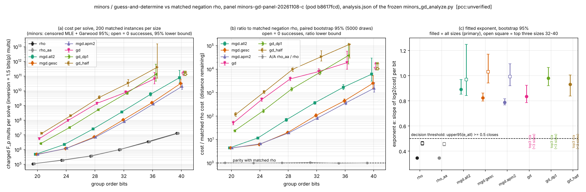

# RESULTS: minors / guess-and-determine ECDLP vs matched negation rho, panel relaunch C (slug minors_gd)

**Verdict (PROTOCOL.md section 8, applied mechanically): the lead is CLOSED for the reconstruction implemented here** (the six arms of section 2), not for the papers in general. `[pcc:unverified]`
Every arm meets the closing condition: the upper 95% bound of its all-sizes exponent is at least 0.5 (it lies between 0.815 and 1.065), and it costs more than rho at every size. No arm raises the real-lead flag, because no exponent bound is below 0.5 and no arm is cheaper than rho at 32 bits or more. The ordering holds at every inversion price and every unpriced-work weight the protocol names, and on the supplementary 3 x 3 grid, so no result is reported as unordered. The closing condition does not depend on pricing (section 8, last sentence).
**Distance to matched rho:** the cheapest minors arm (the envelope) costs **4.37x** rho at 20 bits (`mgd.gesc`, 95% [4.28, 4.46]) and **1552x** rho at 40 bits (`mgd.apm2`, 95% [1049, 2721]). The gap grows with size: for `mgd.apm2`, e_arm - e_rho is in [0.42, 0.47] over all sizes and [0.46, 0.63] over 32-40 bits. These gaps are the distance remaining. They are not a pass/fail result.
This is a standalone count and not an ecbench session. It has no replay certificate, no validator report and no `VALIDATION.json`. It therefore does not go to the IC leaderboard or `benchmarks/README.md` (PROTOCOL section 9.5, validation gate).

Evidence classes: *measured* means read from `records.jsonl`. *Derived* means computed from those records, either by the frozen `minors_gd_analyze.py` (`analysis.json`, the primary analysis) or by the independent re-derivation (`results/RD/analysis/minors_gd_summary.json`). Every number in this file is `[pcc:unverified]`, and no pcc claim has been filed.
Paths below are relative to `research/minors_guess_determine_20261107/`. `RUN` = `results/RD/b8617fcd-e2e5-4235-90b0-b201e5bb3857/`.

## 0. Execution record (reported first)

| launch | job | what happened | data | source |
|---|---|---|---|---|
| 1 | `minors-gd-panel-20261107`, 14 vCPU | The pod stayed `Pending` until it was deleted at about 12:20Z. A 14 vCPU request (14180m with daemonsets) cannot fit the 14000m allocatable of a 16 vCPU cpu-spot node. It never ran. | none | `eks/RELAUNCH_B.md`; `receipts/R2/delete/` |
| B | `minors-gd-panel-20261108-b`, 12 vCPU | The task container ran 12:22:59-12:37:20Z. Exit 137, "Pod was terminated in response to imminent node shutdown" (EKS audit log). This was a Spot loss. | A partial S3 upload may exist. It is **not admitted** and was not read. | `eks/RELAUNCH_B.md`; `receipts/RC/` |
| C | `minors-gd-panel-20261108-c`, 12 vCPU, the single allowed relaunch | The pod `minors-gd-panel-20261108-c-98v7w`, uid `b8617fcd-e2e5-4235-90b0-b201e5bb3857`, was created at 12:45:24Z. Container `task` ran 12:46:21-16:45:14Z: **exit 0, `Completed`**. | **admitted**: `RUN` | `receipts/RD/collect-v01/status-with-audit-pod.json` |

* **Pod exit evidence.** The Pod object was deleted together with its node, so the status route returns `pods: []` (`receipts/RD/collect-v01/final-status.json`). The exit code comes from the EKS API-server audit log `/aws/eks/isolab/cluster` (schema `isolab.eks.pod-from-audit/v1`).
  * The create event has audit id `e0b0b1d9-738b-4af6-bc0d-4a9f13275974`.
  * The terminated report has audit id `c22e0d20-ba30-4aa4-98a3-7ec7f1dd3d99`: exit 0 on node `ip-10-84-18-182`.
  * The job state is `succeeded`.
  * Card `cards/CARD-minors-guess-determine-20261107-RD-V01` collected the run and verified it. All 10 commands exited 0 (`cards/CARD-minors-guess-determine-20261107-RD-V01.receipt.json`).
* **The cpu change does not change the measurement.** The request for C (`eks/r2img_request_c.json`, sha256 b2de13bf...) differs from the first request only in `job.cpu`, the entry argument (JOBS 14 -> 12, the `xargs -P` shard parallelism), the job name and the provenance note. The measured quantities are exact counts, seeded by (master seed, bits, idx, solver), so JOBS changes only the wall time (PROTOCOL lines 11-13).
* **Identity (measured).**
  * `provenance.protocol_sha256` = 8f4f85b4...4ebd = `sha256(PROTOCOL.md)` = the value in `FROZEN_SHA256.txt`.
  * `RUN/binary.sha256`: `run_panel.sh` 48efa7aa... and `minors_gd_analyze.py` eb5d15cc... equal the frozen values. The binary is 523c66ff..., a musl build from `git archive` of f13a690d (see `eks/R2_READY.md`). It is not the dev-box glibc binary listed in `FROZEN_SHA256.txt`.
  * Every frozen source file (8 `src/*.rs`, `Cargo.toml`, PROTOCOL, analyze, run_panel) hashes to its frozen value at f13a690d.
* **Integrity (measured).**
  * `sha256sum -c RUN/SHA256SUMS`: every line OK, 0 failures. `sha256(RUN/panel/records.jsonl)` = 8c8a0480... equals `RUN/panel/SHA256SUMS`.
  * `RUN/progress.txt`: "end: 2026-11-08T16:45:13Z run_panel exit 0".
  * `RUN/host.txt`: jobs 12, nproc 12, AMD EPYC 7R13, 64 GB.
  * 9600 records = 8 arms x 6 sizes x 200, with idx exactly 10000..10199 in every cell. There are no duplicates.
  * (p, n, instance seed) are identical across arms for every (bits, idx), so the instances are matched. Every n has exactly `bits` bits, and every cap equals the section 5 table.
  * The record field `charged` equals muls + 1.5 bits(p) invs exactly. Source: `results/RD/analysis/minors_gd_summary.json` `integrity`.
* **Work.**
  * Total charged work over all 9600 runs is 6.69e12 units (derived, summary `total_charged_units_all_records`).
  * The 2644 censored runs stop at 1.000-1.0018x their cap.
  * Rho never hit its cap (0/2400).
* **Wall time is informational only.** The pod ran 3 h 58 min on 12 vCPU, about 47.8 vCPU-h. The per-record `wall_ms_informational` sums to 43.3 core-h.

## 1. Primary analysis vs independent re-derivation

* The frozen script's own output is the primary analysis: `RUN/panel/analysis.json`, sha256 50d0781c..., produced in-job by `run_panel.sh` with `--boot 5000 --seed 20261107`.
* The re-derivation is independent code (numpy/scipy, kept outside the repository; see Provenance). It recomputes from `records.jsonl` the pricing and the five cost tables, the Garwood intervals (chi-square quantiles, not the script's Poisson bisection), the point exponents, the ratios, the decision rule and the A/A. It uses its own 5000-draw matched bootstrap with numpy PCG64 seed 777.
* Result: **1017 quantities were compared, with 0 disagreements.**
  * Every point cost, success count, lower bound, point exponent, point ratio, A/A ratio and decision flag agrees exactly (relative difference below 1e-9). The Garwood bounds agree to better than 1e-6.
  * The bootstrap intervals agree to Monte-Carlo precision: exponent bounds within 0.011 (largest gap: `mgd.gesc` top3 upper, 1.170 vs 1.159), A/A bounds within 0.005, ratio bounds within 4.5% relative (largest: `gd_half` 32 bits upper).
  * No disagreement affects the decision. The own upper95(e_all) values are within 0.002 of the frozen ones (table T4).
* **Script vs protocol text (no effect here).**
  * PROTOCOL section 8 raises the real-lead flag for an arm cheaper than rho at a size >= 32 bits "with an interval excluding 1". The frozen script tests only point ratio < 1.
  * Both readings give "no flag": the smallest ratio lower bound at 32 bits or more is 71.8.

## 2. Tables (derived from `RUN/panel/analysis.json`, the primary analysis; re-derivation agrees)

Unit: charged F_p multiplications. One inversion costs 1.5 bits(p) units. Additions and hashing are not charged. Minors arms use cost_b = total work / successes (the censored exponential MLE). rho and rho_aa use the mean over 200 instances.

**T1 cost per solve (charged F_p mults), successes/200, 95% interval**

| arm | 20 bits | 24 bits | 28 bits | 32 bits | 36 bits | 40 bits |
|---|---|---|---|---|---|---|
| `rho` | 1.09e+05 [1.07e+05, 1.12e+05] (200) | 1.91e+05 [1.86e+05, 1.97e+05] (200) | 3.67e+05 [3.54e+05, 3.8e+05] (200) | 9.95e+05 [9.46e+05, 1.04e+06] (200) | 3.48e+06 [3.3e+06, 3.66e+06] (200) | 1.29e+07 [1.2e+07, 1.37e+07] (200) |
| `rho_aa` | 1.12e+05 [1.1e+05, 1.14e+05] (200) | 1.9e+05 [1.85e+05, 1.95e+05] (200) | 3.73e+05 [3.59e+05, 3.87e+05] (200) | 1.04e+06 [9.91e+05, 1.09e+06] (200) | 3.42e+06 [3.24e+06, 3.6e+06] (200) | 1.3e+07 [1.22e+07, 1.38e+07] (200) |
| `mgd.all2` | 4.8e+05 [4.18e+05, 5.54e+05] (200) | 2.23e+06 [1.94e+06, 2.58e+06] (200) | 2.54e+07 [2.21e+07, 2.93e+07] (200) | 3.67e+08 [3.19e+08, 4.23e+08] (200) | 5.88e+09 [4.55e+09, 7.75e+09] (58) | 7.88e+10 [3.38e+10, 2.43e+11] (5) |
| `mgd.gesc` | 4.78e+05 [4.16e+05, 5.51e+05] (200) | 1.17e+06 [1.02e+06, 1.35e+06] (200) | 7.28e+06 [6.34e+06, 8.41e+06] (200) | 1.06e+08 [9.24e+07, 1.23e+08] (200) | 1.56e+09 [1.33e+09, 1.85e+09] (145) | 3.22e+10 [1.84e+10, 6.23e+10] (12) |
| `mgd.apm2` | 4.79e+05 [4.17e+05, 5.53e+05] (200) | 1.25e+06 [1.09e+06, 1.45e+06] (200) | 7.1e+06 [6.18e+06, 8.19e+06] (200) | 8.15e+07 [7.09e+07, 9.41e+07] (200) | 1.27e+09 [1.09e+09, 1.49e+09] (160) | 2e+10 [1.28e+10, 3.31e+10] (19) |
| `gd` | 5.58e+06 [4.86e+06, 6.44e+06] (200) | 9.71e+07 [8.45e+07, 1.12e+08] (197) | 1.41e+09 [1.2e+09, 1.67e+09] (147) | 7.86e+09 [6.14e+09, 1.02e+10] (63) | 6.58e+10 [3.02e+10, 1.79e+11] (6) | >1.34e+11 (0/200, 95% LB) |
| `gd_dp1` | 2.57e+06 [2.24e+06, 2.97e+06] (200) | 3.15e+07 [2.74e+07, 3.63e+07] (200) | 5.18e+08 [4.49e+08, 6e+08] (188) | 7.24e+09 [5.72e+09, 9.3e+09] (69) | 1.33e+11 [4.54e+10, 6.43e+11] (3) | >1.34e+11 (0/200, 95% LB) |
| `gd_half` | 1.3e+07 [1.13e+07, 1.5e+07] (198) | 2.05e+08 [1.77e+08, 2.38e+08] (185) | 3.64e+09 [2.93e+09, 4.57e+09] (83) | 3.38e+10 [2.11e+10, 5.8e+10] (17) | 4e+11 [7.18e+10, 1.58e+13] (1) | >1.34e+11 (0/200, 95% LB) |

Interval columns:
* Minors arms: the exact Garwood 95% interval on the success count. The count in brackets is successes/200.
* rho: a normal 95% interval.
* `>` marks a size with zero successes: the one-sided 95% lower bound exposure/2.996. That size is excluded from the slope fits.

**T2 ratio to matched rho (distance remaining), paired bootstrap 95%**

| arm | 20 bits | 24 bits | 28 bits | 32 bits | 36 bits | 40 bits |
|---|---|---|---|---|---|---|
| `mgd.all2` | 4.39 [4.27, 4.53] | 11.7 [10.4, 13.1] | 69.3 [59.6, 80.1] | 368 [320, 422] | 1.69e+03 [1.33e+03, 2.22e+03] | 6.13e+03 [3.1e+03, 2.99e+04] |
| `mgd.gesc` | 4.37 [4.28, 4.46] | 6.11 [5.75, 6.51] | 19.8 [17.2, 22.6] | 107 [90.7, 124] | 448 [378, 532] | 2.5e+03 [1.55e+03, 5.26e+03] |
| `mgd.apm2` | 4.39 [4.29, 4.48] | 6.57 [6.16, 7.03] | 19.3 [17.2, 21.7] | 81.9 [71.8, 93.1] | 365 [309, 431] | 1.55e+03 [1.05e+03, 2.72e+03] |
| `gd` | 51.1 [42.8, 60.3] | 508 [430, 597] | 3.85e+03 [3.23e+03, 4.61e+03] | 7.9e+03 [6.25e+03, 1.03e+04] | 1.89e+04 [1e+04, 5.87e+04] | >1.04e+04 (LB) |
| `gd_dp1` | 23.5 [21.2, 26] | 165 [138, 196] | 1.41e+03 [1.17e+03, 1.68e+03] | 7.27e+03 [5.83e+03, 9.26e+03] | 3.81e+04 [1.65e+04, 1.18e+05] | >1.04e+04 (LB) |
| `gd_half` | 119 [97.7, 143] | 1.07e+03 [921, 1.23e+03] | 9.91e+03 [7.99e+03, 1.24e+04] | 3.4e+04 [2.24e+04, 6.09e+04] | 1.15e+05 [2.95e+04, 1.2e+05] | >1.04e+04 (LB) |
| **envelope** (cheapest arm) | **4.37** `mgd.gesc` [4.28, 4.46] | **6.11** `mgd.gesc` [5.75, 6.51] | **19.3** `mgd.apm2` [17.2, 21.7] | **81.9** `mgd.apm2` [71.8, 93.1] | **365** `mgd.apm2` [309, 431] | **1.55e+03** `mgd.apm2` [1.05e+03, 2.72e+03] |

* The envelope follows PROTOCOL section 7: the cheapest `mgd.*`/`gd*` arm per size, read from the per-arm table. No arm is dropped. The envelope interval is the chosen arm's own bootstrap interval; the minimum over arms is not bootstrapped (the protocol defines none).
* At 20 bits the three `mgd.*` arms are tied within their intervals (4.37-4.39).

**T3 exponents**

| arm | e_all point | e_all 95% | e_top3 point | e_top3 95% | e_arm - e_rho (all) 95% | e_arm - e_rho (top3) 95% | sizes in fit |
|---|---|---|---|---|---|---|---|
| `rho` | 0.346 | [0.342, 0.349] | 0.461 | [0.447, 0.476] | - | - | 20,24,28,32,36,40 |
| `rho_aa` | 0.345 | [0.341, 0.348] | 0.455 | [0.441, 0.469] | - | - | 20,24,28,32,36,40 |
| `mgd.all2` | 0.890 | [0.853, 0.968] | 0.969 | [0.842, 1.249] | [0.507, 0.622] | [0.381, 0.785] | 20,24,28,32,36,40 |
| `mgd.gesc` | 0.823 | [0.798, 0.861] | 1.031 | [0.942, 1.170] | [0.451, 0.517] | [0.478, 0.709] | 20,24,28,32,36,40 |
| `mgd.apm2` | 0.787 | [0.766, 0.816] | 0.992 | [0.919, 1.093] | [0.420, 0.471] | [0.458, 0.632] | 20,24,28,32,36,40 |
| `gd` | 0.835 | [0.786, 0.922] | n/a (<3 sizes) | n/a | [0.440, 0.577] | n/a | 20,24,28,32,36 |
| `gd_dp1` | 0.979 | [0.919, 1.065] | n/a (<3 sizes) | n/a | [0.574, 0.720] | n/a | 20,24,28,32,36 |
| `gd_half` | 0.930 | [0.838, 1.005] | n/a (<3 sizes) | n/a | [0.493, 0.659] | n/a | 20,24,28,32,36 |

* **e_all** is the primary all-sizes fit. **e_top3** is the fit over 32, 36 and 40 bits (the asymptotic regime).
* For the `gd` family, 40 bits has 0 successes and is excluded. That leaves fewer than three of the top sizes, so e_top3 is not estimable by the protocol's minimum of three. This is reported as n/a. It is not a closure gap: the decision uses e_all.
* rho's all-sizes slope (0.346) is held down by its fixed set-up cost at 20-28 bits. The protocol anticipates this (section 7). Its top3 slope is 0.461 [0.447, 0.476].

## 3. Decision rule (PROTOCOL section 8)

**T4 decision rule (frozen script, mechanical) and own re-derivation**

| arm | upper95(e_all) frozen | own | min ratio over sizes | sizes >= 32 cheaper than rho | closes (frozen / own) | real-lead flag (frozen / own) |
|---|---|---|---|---|---|---|
| `mgd.all2` | 0.968 | 0.969 | 4.39 | none | True / True | False / False |
| `mgd.gesc` | 0.861 | 0.860 | 4.37 | none | True / True | False / False |
| `mgd.apm2` | 0.816 | 0.815 | 4.39 | none | True / True | False / False |
| `gd` | 0.922 | 0.923 | 51.1 | none | True / True | False / False |
| `gd_dp1` | 1.065 | 1.065 | 23.5 | none | True / True | False / False |
| `gd_half` | 1.005 | 1.004 | 119 | none | True / True | False / False |

* **Closes:** upper95(e_all) >= 0.5 and min ratio over sizes > 1, using the lower bound for zero-success sizes.
  * All six arms close. In fact the *lower* 95% bound of every e_all is at least 0.766, so the condition does not sit near the threshold.
  * Every ratio's lower 95% bound is at least 4.27.
* **Real-lead flag:** none raised.
* **Pricing (section 3).** The ordering "arm costs more than rho at every size" holds:
  * under all five pricings the frozen script reports: w = 1.5 bits(p), w = 3 and w = 10, each with lam = 0; and lam = 0.1 and lam = 1 at w = 1.5 bits(p);
  * on the supplementary w x lam grid (not in the protocol; computed by the re-derivation, labelled "grid").
  * The smallest ratio anywhere is 4.37. The result is therefore **ordered**, not unordered.

**T6 pricing sensitivity: min over sizes of arm/rho (point), and e_all point**

| pricing | `mgd.all2` | `mgd.gesc` | `mgd.apm2` | `gd` | `gd_dp1` | `gd_half` | rho e_all |
|---|---|---|---|---|---|---|---|
| w=1.5b, lam 0 (primary) | 4.39 (e 0.89) | 4.37 (e 0.82) | 4.39 (e 0.79) | 51.1 (e 0.83) | 23.5 (e 0.98) | 119 (e 0.93) | 0.346 |
| w=3 (script) | 14.8 (e 0.89) | 14.8 (e 0.84) | 14.8 (e 0.80) | 196 (e 0.83) | 83.6 (e 0.98) | 374 (e 0.93) | 0.413 |
| w=10 (script) | 8.65 (e 0.89) | 8.62 (e 0.83) | 8.66 (e 0.80) | 110 (e 0.83) | 48.1 (e 0.98) | 223 (e 0.93) | 0.376 |
| lam 0.1 (script) | 4.6 (e 0.89) | 4.57 (e 0.82) | 4.59 (e 0.79) | 53.8 (e 0.83) | 24.5 (e 0.98) | 122 (e 0.93) | 0.350 |
| lam 1 (script) | 6.03 (e 0.89) | 6.01 (e 0.83) | 6.04 (e 0.79) | 73.4 (e 0.83) | 31.2 (e 0.98) | 145 (e 0.93) | 0.374 |
| w=3, lam 0.1 (grid) | 14.5 (e 0.89) | 14.4 (e 0.84) | 14.5 (e 0.80) | 191 (e 0.83) | 80.8 (e 0.98) | 359 (e 0.93) | 0.415 |
| w=3, lam 1 (grid) | 13.1 (e 0.89) | 13.1 (e 0.84) | 13.2 (e 0.80) | 172 (e 0.82) | 69.5 (e 0.98) | 298 (e 0.93) | 0.422 |
| w=10, lam 0.1 (grid) | 8.84 (e 0.89) | 8.81 (e 0.83) | 8.85 (e 0.80) | 113 (e 0.83) | 48.7 (e 0.98) | 224 (e 0.93) | 0.381 |
| w=10, lam 1 (grid) | 9.87 (e 0.89) | 9.84 (e 0.83) | 9.9 (e 0.80) | 126 (e 0.82) | 51.9 (e 0.98) | 228 (e 0.93) | 0.402 |

Here lam prices uncharged operations: adds + hash_inserts for the minors arms, and adds + 3 x steps for rho, as in the frozen script. Under every pricing the minors exponents barely move (0.79-0.98). rho's e_all moves between 0.346 and 0.422.
* **Outcome:** **CLOSED for this reconstruction**, at 20-40-bit prime-field toy sizes, against this rho. Nothing is escalated, because no arm is flagged.

## 4. Controls (PROTOCOL section 6)

| control | protocol requirement | outcome | evidence |
|---|---|---|---|
| Positive: self-test | Every arm recovers the planted k on 6 instances at 8-12 bits (rho also 16, 20). Every reported minor's point sum is O (`--dev-check`). A panel record is accepted only if `correct = true`. | **Held as a development check; not re-run inside the admitted job.** `dev/selftest.txt`: rho, `mgd.*` and `gd` 6/6 at every listed size, "SELFTEST PASS". `eks/R2_READY.md`: the musl build printed SELFTEST PASS on the build host. Gap: the self-test lists `gd` but not `gd_dp1`/`gd_half` (same code path, different d/n'). In the panel, all 6956 successes have `correct = true` (k equals the planted value), and 0 records are correct without success. | `dev/selftest.txt`; summary `integrity` (measured) |
| Negative (a): verifier rejects k+1 | yes | **Held** (development): "[neg-control] verifier accepts k, rejects k+1". | `dev/selftest.txt` |
| Negative (b): zero-2x2-minor rate of curve C vs uniform | ratio near 1 | **Held at development sizes only**: curve vs i.i.d. vs expectation 3625/3671/3624 (12 bits), 2121/2089/2091 (14), 1051/999/1039 (16). Not re-run at panel sizes. | `dev/controls_uniform_vs_curve.txt` |
| Negative (c): `bad_candidates` 0 or explained | 0 or explained | **Held: 0 over all 9600 records** (frozen `sanity.bad_candidates_total` = 0; re-derived 0). | `analysis.json` `sanity`; summary `integrity` |
| A/A: rho vs rho_aa per size | ratio with interval; its width is the noise floor | **Held**: every interval contains 1. The half-width is 2.6% (20 bits) to 8.0% (40 bits). Every minors/rho ratio (at least 4.37, lower bound at least 4.27) lies far outside that floor. | T5 below; `analysis.json` `aa_rho_vs_rho_aa` |

**T5 A/A rho_aa / rho**

| bits | ratio | 95% (frozen) | 95% (own) | half-width |
|---|---|---|---|---|
| 20 | 1.024 | [0.998, 1.050] | [0.998, 1.050] | 2.6% |
| 24 | 0.995 | [0.961, 1.033] | [0.960, 1.032] | 3.6% |
| 28 | 1.016 | [0.969, 1.065] | [0.969, 1.064] | 4.8% |
| 32 | 1.046 | [0.974, 1.124] | [0.978, 1.122] | 7.5% |
| 36 | 0.982 | [0.914, 1.056] | [0.913, 1.056] | 7.1% |
| 40 | 1.010 | [0.933, 1.093] | [0.932, 1.091] | 8.0% |

## 5. Predictions and pre-registered expectations

PROTOCOL.md has no hypothesis list labelled P1, P2 and so on. Its pre-registered statements are the section 1 outcome branches, scored in section 3 above, and the section 5 work estimate. The README text written at freeze time (before any panel record) adds development expectations. Those are not frozen and play no part in the verdict. They are scored here for transparency.

| # | statement (source) | panel outcome | held? |
|---|---|---|---|
| E1 | Total work "about 7e12 charged units" (PROTOCOL section 5, estimate) | 6.69e12 (summary) | yes |
| E2 | "25-55 core-hours", wall informational (PROTOCOL section 5); "about 2-4.6 h on 12 vCPU" (`eks/RELAUNCH_B.md`) | 47.8 vCPU-h pod / 43.3 core-h summed per record; 3 h 58 min wall | yes (informational) |
| E3 | Section 1 closing branch vs real-lead branch | closing branch for all six arms | closing branch |
| E4 | "Extrapolated gap at 40 bits about three orders of magnitude for the cheapest arm" (README, heuristic) | 1552x [1049, 2721] (`mgd.apm2`) | yes (3.2 orders) |
| E5 | "... and five for `gd`" (README, heuristic) | 40 bits: 0/200 successes, ratio > 1.04e4 (lower bound only); 36 bits: 1.89e4 [1.0e4, 5.9e4] | **UNRESOLVED** (the panel has only a lower bound at 40 bits, which neither confirms nor refutes 1e5) |
| E6 | Beyond 32 bits, minors cost per solution "grows like p" (README, heuristic), i.e. top3 exponent near 1 | `mgd.all2` 0.969 [0.842, 1.249], `mgd.gesc` 1.031 [0.942, 1.170], `mgd.apm2` 0.992 [0.919, 1.093] | yes (every interval contains 1) |
| E7 | `gd_dp1` 2-3x cheaper than `gd` at 20-28 bits (README dev observation) | 2.17x, 3.08x, 2.73x at 20/24/28 bits (T1 points); reversed at 36 bits (1.33e11 vs 6.58e10, from 3 vs 6 successes) | yes at 20-28 |
| E8 | Dev rho: 1.1e5 (20 bits), 1.3e7 (40 bits) (README) | 1.09e5, 1.29e7 | yes |
| E9 | Dev best-arm ratio about 4x at 20 bits, about 100x at 32 bits (README dev table) | 4.37x, 81.9x | yes (order of magnitude) |

## 6. Figure

SVG: `results/RD/analysis/minors_gd_fig1.svg`. The figure plots values from `RUN/panel/analysis.json` only.
* (a) Cost per solve with 95% intervals. Open markers are zero-success lower bounds.
* (b) Ratio to matched rho with paired bootstrap 95%, plus the A/A ratio. The dashed line is parity.
* (c) e_all and e_top3 with bootstrap 95% against the 0.5 decision threshold.

Report PDF: `results/RD/analysis/minors_gd_report.pdf`. Summary: `results/RD/analysis/minors_gd_summary.json`.

## 7. Diagnostics (informational; not protocol estimators, no thresholds applied)

**T7 censoring and attempts (informational)**

| arm | 20 | 24 | 28 | 32 | 36 | 40 |
|---|---|---|---|---|---|---|
| `mgd.all2` | 200/200; 203 att; obs 1.000 vs exp 1.000; unif 0.23 | 200/200; 489 att; obs 1.000 vs exp 1.000; unif 0.77 | 200/200; 3382 att; obs 1.000 vs exp 1.000; unif 0.99 | 200/200; 32589 att; obs 1.000 vs exp 1.000; unif 0.97 | 58/200; 106700 att; obs 0.290 vs exp 0.288; unif 0.82 | 5/200; 89973 att; obs 0.025 vs exp 0.025; unif 0.89 |
| `mgd.gesc` | 200/200; 200 att; obs 1.000 vs exp 1.000; unif 0.23 | 200/200; 200 att; obs 1.000 vs exp 1.000; unif 0.77 | 200/200; 296 att; obs 1.000 vs exp 1.000; unif 1.07 | 200/200; 1743 att; obs 1.000 vs exp 1.000; unif 1.02 | 145/200; 11344 att; obs 0.725 vs exp 0.722; unif 0.90 | 12/200; 12948 att; obs 0.060 vs exp 0.060; unif 0.63 |
| `mgd.apm2` | 200/200; 200 att; obs 1.000 vs exp 1.000; unif 0.27 | 200/200; 200 att; obs 1.000 vs exp 1.000; unif 0.71 | 200/200; 203 att; obs 1.000 vs exp 1.000; unif 0.92 | 200/200; 469 att; obs 1.000 vs exp 1.000; unif 1.00 | 160/200; 2919 att; obs 0.800 vs exp 0.793; unif 0.86 | 19/200; 3607 att; obs 0.095 vs exp 0.095; unif 0.79 |
| `gd` | 200/200; 200 att; obs 1.000 vs exp 1.000; unif 0.73 | 197/200; 212 att; obs 0.985 vs exp 0.994; unif 0.65 | 147/200; 360 att; obs 0.735 vs exp 0.758; unif 0.56 | 63/200; 200 att; obs 0.315 vs exp 0.317; unif 0.66 | 6/200; 200 att; obs 0.030 vs exp 0.030; unif 1.10 | 0/200; 200 att; obs 0.000 vs exp -; unif - |
| `gd_dp1` | 200/200; 200 att; obs 1.000 vs exp 1.000; unif 0.86 | 200/200; 200 att; obs 1.000 vs exp 1.000; unif 0.84 | 188/200; 200 att; obs 0.940 vs exp 0.979; unif 0.80 | 69/200; 200 att; obs 0.345 vs exp 0.339; unif 1.07 | 3/200; 200 att; obs 0.015 vs exp 0.015; unif 0.81 | 0/200; 200 att; obs 0.000 vs exp -; unif - |
| `gd_half` | 198/200; 261 att; obs 0.990 vs exp 1.000; unif 0.29 | 185/200; 534 att; obs 0.925 vs exp 0.913; unif 0.25 | 83/200; 200 att; obs 0.415 vs exp 0.423; unif 0.30 | 17/200; 200 att; obs 0.085 vs exp 0.085; unif 0.47 | 1/200; 200 att; obs 0.005 vs exp 0.005; unif 0.87 | 0/200; 200 att; obs 0.000 vs exp -; unif - |

Each cell reads: successes; total attempts (fresh `C`); observed success fraction vs 1 - exp(-cap/cost_b); "unif" = successes / sum(minors_tested / n).

* **Memoryless approximation (PROTOCOL section 9.4).**
  * The observed success fraction at the cap matches the exponential prediction within 0.04 in every cell. This is a weak check: it is close to an identity when the success fraction is small.
  * The `gd` family runs **exactly one attempt per run** from 28 bits (`gd_dp1`, `gd_half`) or 32 bits (`gd`) upward: no attempt completes without success inside the 2e9-3e9 cap. The `gd*` estimates there rest entirely on the within-attempt constant-hazard assumption.
  * Protocol section 7 says the approximation is "checked by comparing cost_b with the per-attempt estimate in the README". The README contains no per-attempt estimate to compare with, so that check is **UNRESOLVED as written**. The table above is offered in its place.
* **Uniform-minor model.** For `mgd.*` at 28-40 bits the ratio of observed successes to the uniform 1/n expectation over the minors tested is 0.63-1.07. That is consistent with no hidden structure in C beyond the 1/p heuristic at panel sizes. This is a heuristic reading, with no threshold. The values at 20-24 bits (0.23-0.77) were not interpreted: the counter's semantics when a scan stops early were not audited.
* **The rho reference (T8).**
  * Mean steps/sqrt(n) is 1.21-1.39. The ideal for negation rho is about 0.886, so this rho takes roughly 1.4-1.5x the ideal step count. The likely causes are the distinguished-point overhead with 16 walkers and the r-adding walk.
  * The rho reference is therefore not a strawman in the direction that favours rho; a better rho would only lengthen the distances above. This is a heuristic reading (PROTOCOL section 9.3).
  * Charged mults per step fall from 104 (20 bits, set-up dominated) to 11.0 (40 bits).

**T8 rho reference (informational)**

| bits | rho steps/sqrt(n) | rho_aa steps/sqrt(n) | rho charged mults/step | rho mean GAE (cost/(3+w)) |
|---|---|---|---|---|
| 20 | 1.213 | 1.293 | 103.9 | 3.31e+03 |
| 24 | 1.342 | 1.322 | 40.8 | 4.9e+03 |
| 28 | 1.267 | 1.313 | 20.5 | 8.15e+03 |
| 32 | 1.314 | 1.385 | 13.2 | 1.95e+04 |
| 36 | 1.373 | 1.346 | 11.3 | 6.11e+04 |
| 40 | 1.276 | 1.292 | 11.0 | 2.04e+05 |

## 8. Caveats and UNRESOLVED items

1. **Scope.** This is a reconstruction, not the authors' code, run in prime fields; the papers' tables are binary fields. `apm3`, Gray-code updates and two-level recursion were not run (PROTOCOL sections 2 and 9). The closure applies to these six arms at 20-40 bits only.
2. **Protocol text vs frozen source for rho.** The PROTOCOL section 2 table describes rho as "R = 64, 32 walkers". Section 5 and the README say rho was "re-tuned to R = 32, 16 walkers" before freezing. The frozen `src/rho.rs` (hash 6ab12855..., bound by `FROZEN_SHA256.txt` and the card) has `R = 32`, `W = 16`. The run used the frozen source. The section 2 sentence is stale, and it does not change any estimator.
3. **Bootstrap with sparse successes.**
   * `gd_half` has 1 success at 36 bits and `gd_dp1` has 3. Resamples with zero successes at that size drop it from that draw's fit. In the re-derivation, 37% of the `gd_half` draws and 4% of the `gd_dp1` draws are 4-size fits; the protocol does not say how to handle this.
   * The ratio bootstrap interval for `gd_half` at 36 bits ([2.95e4, 1.2e5] around a point of 1.15e5) is unreliable for the same reason. The Garwood cost interval [7.2e10, 1.6e13] is the honest one.
   * None of this affects the decision: these arms close with large margins.
4. **Censored MLE.** Every estimate at 36-40 bits for `mgd.*`, and at 28-40 bits for `gd*`, assumes a work-constant hazard (limit 9.4). See section 7.
5. **The gd-family top-size exponent is not estimable** (only 32 and 36 bits have estimates). The pre-registered top3 fit for `gd`, `gd_dp1` and `gd_half` is therefore n/a. Larger caps at 40 bits would be needed.
6. **Controls were not re-run in the admitted job.** The self-test and the uniform-minor control are development-run checks (section 4). The in-panel evidence is `correct = true` on all 6956 successes and `bad_candidates = 0`.
7. **Not an ecbench session.** There is no independent replay of the minors arms, no ecbench `rho.negation` GAE cross-check (README open thread) and no validation-gate artefacts. The GAE column in T8 is cost / (3 + w) per the protocol's conversion; a batched rho step costs about 11 mults, not 3 + w, so GAE understates rho's step count.
8. **Relaunch history.** Launch 1 never ran. B was lost to Spot and is not admitted. C is the single allowed relaunch, and it completed. No data from B was read.

## Provenance of this analysis

* AGENTS.md forbids committing Python that generates results. The re-derivation, figure and table scripts therefore live outside the repository. They are archived as `scripts.tar.gz`, recorded in `benchmarks/records/20261108T0449Z-minors-gd-panel.json` and uploaded to the store: see `results/RD/analysis/scripts-archive.json`.
  * Archive sha256 9b59797b9eff596f63a4a0d92d3a165bba9c5c9d5c0f9bae13d741eb78a3282e, at `s3://setec-astronomy-artifacts/store/sha256/9b/9b59797b...`. Per-file hashes are in `scripts-archive.json`; `rederive.py` is db11239d..., `fig.py` 9a5d5e33....
  * `results/RD/analysis/minors_gd_summary.json` sha256: cf63ffe1ee57c190b6f30d7f4f0d0a5d0ce2b4162d6a00befd24c1ddccc4cc8b.
  * After the archive was made, this file gained only this provenance block; `RESULTS.template.md` in the archive does not contain it.
* The re-derivation is numpy/scipy code. It is an independent check of the frozen script, not a native re-derivation.
* Raw data: `RUN/panel/records.jsonl` (sha256 8c8a0480cf9b874e98d059409531a32fad70fa554ad1c6716c8c2852b3ca7250) and `RUN/panel/analysis.json` (sha256 50d0781ccdf29f8dc6fdded8ed134a5b92a62b3fd372716da561a8b4b1530159). Both are listed in the benchmark record's raw entries.
* Sources checked: research-kb, Conductor and the lead atlas tools are not installed or runnable in this environment, so none were queried. The inputs read were PROTOCOL.md, sources/NOTES.md, README.md, minors_gd/src, run_panel.sh, minors_gd_analyze.py, eks/RELAUNCH_B.md, eks/R2_READY.md, the RD receipts and the RD-V01 card.
* PDF: built with Typst 0.15 (Python wheel in a scratch virtualenv) and inspected page by page.
