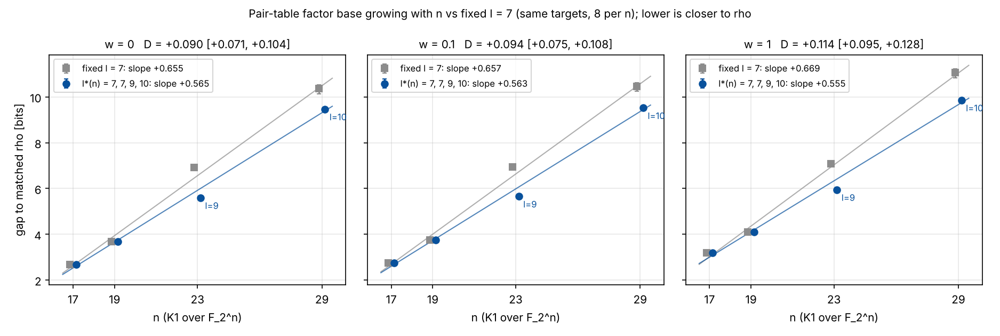

# fb-pt-lgrow-k1: pair-table factor base l*(n) growing with n vs fixed l = 7, K1 n = 17, 19, 23, 29

Status:
- **Validated** (VAL-20261114-d9190c, validation/VALIDATOR.md).
- All three frozen verdicts are POSITIVE (D, R_n23, R_n29), as predicted.
- **But the validator shows D is an offset, not a bent slope.** Read the "Slope" section before quoting D.

Route:
- RunPod CPU pod, pinned ecbench a0be1b2a, in-pod `verify --replay-all`, about 3 minutes.
- Same targets for every arm at each n: 8 targets x 5 rounds.
- l* = 7, 7, 9, 10 was frozen from a disclosed sizing (`sizing/`) on separate targets.
- Counted cost only (L0).

## Result

| unit | R_n23 = log2(S_l7 / S_l9) | R_n29 = log2(S_l7 / S_l10) | D = slope_l7 - slope_l* |
|---|---|---|---|
| band w = 0 | **+1.32** [1.27, 1.36] | **+0.89** [0.67, 1.06] | +0.090 [0.071, 0.104] |
| band w = 0.1 | **+1.28** [1.23, 1.33] | **+0.94** [0.72, 1.11] | +0.094 [0.075, 0.108] |
| band w = 1 | **+1.14** [1.08, 1.20] | **+1.20** [0.98, 1.38] | +0.114 [0.095, 0.128] |
| bitop/v1 | +0.44 [0.38, 0.49] | +0.90 [0.67, 1.07] | +0.080 [0.061, 0.094] |

Gap to rho (distance remaining), l*, in bits at w = 0 / 0.1 / 1 (bitop):

| n | log2 r | l* | gap l* | gap l = 7 |
|---|---|---|---|---|
| 17 | 16.0 | 7 | 2.67 / 2.75 / 3.20 (2.85) | same arm |
| 19 | 18.0 | 7 | 3.69 / 3.75 / 4.11 (3.28) | same arm |
| 23 | 22.0 | 9 | **5.59 / 5.66 / 5.95** (5.52) | 6.91 / 6.94 / 7.09 |
| 29 | 15.4 | 10 | **9.47 / 9.52 / 9.86** (9.23) | 10.36 / 10.46 / 11.06 |

**What is established:**
- **At n = 23 and 29, sizing the pair-table factor base for n is a verified, measured improvement over fixed l = 7 across the full section 5a band.** It is 0.9 to 1.3 bits cheaper, on the same targets, with every solve verified and all phases priced cold.
- At n = 23 this makes pt-l9 the cheapest validated one-target IC arm on K1 n = 23. Against the validated ic-ridge (cross-target, same curve), it is cheaper by 1.53 [1.30, 1.73] / 13.2 / 15.6 bits at w = 0 / 0.1 / 1.
- At n = 29, l = 7 is this protocol's only baseline; no other IC arm has run on that curve.
- Rho is still cheaper than every IC arm, by 2.7 to 9.9 bits.

## Slope: what D does and does not show

- **D is not separate evidence of a bent slope.** Because l* = 7 at n = 17 and 19, D = (R_n23 + 7 R_n29) / 84 exactly. About 83 to 88% of it comes from n = 29.
- **On the last interval (23 -> 29) the l* gap grows faster than the l = 7 gap:**
  - -0.071 [-0.109, -0.041] bits per bit of n at w = 0;
  - -0.057 [-0.095, -0.027] at w = 0.1;
  - not separated at w = 1.
- The data show a **one-time offset of about 1.1 to 1.3 bits** that appears between n = 19 and 23, not a lower growth rate.
- **n here is field degree, not problem size.** K1 n = 29 has a small prime subgroup: log2 r = 15.4, smaller than at n = 17. At that size rho is setup-dominated (80% of its cost), and pt-l7 needs only about 6 relations per solve against 50 to 57 at the other n. So "slope in n" describes these four curves only.
  - The cleaner axis is log2 r, which needs curves with growing r. Among K1 curves, ecbench builds only n = 17, 19, 23, 29 and 43 here, and 43 is out of reach for these arms.

## Caveats
- l* was selected on 2 disclosed sizing targets per n.
  - At n = 19, w = 1, l = 8 was better by 0.0025 bits (F1).
  - At n = 29, pt-l5 exhausted on both sizing targets (F2).
- Robustness:
  - leave-one-target-out D: 0.089 to 0.100;
  - leave-one-n-out D: 0.074 to 0.235;
  - Theil-Sen agrees with OLS;
  - pseudo-A/A (odd vs even rounds) moves R by at most 0.16 bits.
- Replays used the producer's binary. L0 records; wall time is not certified.

Files: `PROTOCOL.md` (frozen; hashes in `data/PROTOCOL.frozen.sha256`), `sizing/`, `specs/`, `scripts/`, `sessions/*`, `results.json`, `figures/`, `validation/`, `VALIDATION.json`.
