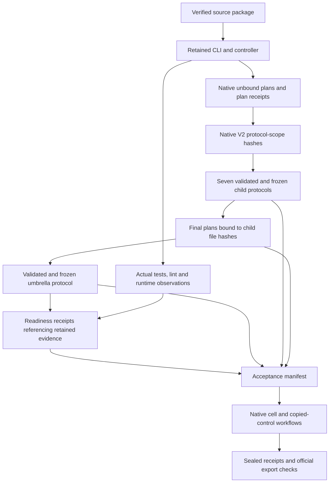

# Native acceptance input joins

The retained CLI is built from standalone source commit
`1d858fb9e4b8035b38f93db4423880627b09211f`, with executable SHA-256
`4402eb3744e5961e7bce4ebb9e15e3d6567c10a7834f2677470cf6a9ca2cac80`.
The controller independently binds its compiled source modules and the seven
fixed population/limit/policy files. Its readiness manifest is an attestation
over retained evidence; it does not independently rerun the official checker.

## Distinct hashes

| Identity | Producer and meaning |
| --- | --- |
| Plan file hash | SHA-256 of the exact retained JSON file; returned by the native CLI as `sha256`. |
| Typed plan hash | Native `PlanDocument::binding_sha256`, returned as `plan_sha256`. Preserve its value; do not reproduce the serialization outside the library. |
| V2 protocol-scope hash | Native `policy_plan.protocol_scope`: the full typed V2 plan with only `axes.protocol_sha256` cleared, under its domain separator. It binds policy order and caps as well as axes. |
| Protocol body hash | Official canonical JSON hash with the complete `freeze` object omitted. Numeric canonicalization must match the native verifier. |
| Protocol file hash | SHA-256 of the complete frozen file, including `freeze`; installed into the final plan. |
| Umbrella file hash | Binds the actual source/binary, four controller modules, ordered seven child joins, and fixed limits. |

`native-plan-preparation-01` produces unbound plans and native scope/hash
receipts. It produces no frozen protocol or generation authorization. Later
native plan invocations install the exact frozen child-file hashes. Their typed
hashes will consequently differ from the unbound plans, while the V2 scope
hashes must remain equal. The V1 child has no V2 scope extension.

The umbrella contains one join per child: ID, final typed plan hash, final plan
file hash, child protocol file hash and canonical body hash. These seven children
authorize inputs; they are not seven additional workflow samples. The actual
software workflow count remains two.

## Evidence wrappers and chronology

Test and build receipts already exist before the umbrella is frozen. Preserve
their original bytes. A later readiness wrapper may reference the umbrella
hash and those raw receipts; it must identify itself as a supplied attestation,
not claim the earlier command ran against a future umbrella document.

The six gates are native-fixture-unit-tests, unified-dataset-tests,
maintained-clippy, official-umbrella-schema, official-child-schemas and
runtime-preflight. Each gate needs retained, hash-bound raw evidence. A checker
`--help` invocation proves tool availability only. A passing draft validation
does not prove a frozen protocol. Recheck exact frozen files before admission.

The available official tooling is pinned to upstream commit
`f755085ff951888dbe64682c210c9ef7d167b40c`, under
`/home/ec2-user/ml-dataset-work-20261028/protocol-tooling-f755085ff951`.
Its six manifest hashes were rechecked on 2026-10-30; the configured interpreter
successfully displayed the official checker's help. Protocol validation remains
pending. This administrative Python schema tool is distinct from native dataset
execution, replay, control mutation, and output generation.

## Runtime-preflight implementation still required

The existing native controller records real command durations, but has no
separate pre-freeze collector that supplies the prospective workflow runtime
evidence. Its admission gate cannot be used as that collector because it already
requires the evidence. The historical preparer is a specification reference,
not an execution path to revive.

The native collector must retain actual observations for both declared workflow
arms, tied to the exact source, executable, argv, command-receipt hashes, and
measured duration. Declare its fixed preflight inputs and exclusion from
acceptance-cell selection before running it. Reuse the existing native process
supervision and receipts. Preserve raw observations separately from the method
used to estimate full workflow time. Do not label CLI help, planning, compilation,
or a worker timeout allowance as an observed solver/workflow runtime.

Until that collector and its bootstrap input contract are implemented and
checked, leave runtime estimates and the runtime readiness gate unset. Any
separately admitted preflight execution needs its own explicit software contract
and honest scope; it must not obtain admission from invented passing receipts.

The existing controller still reports full acceptance as false while the named
V2 API fixtures and official unified-export checks remain pending. Preserve that
status through input preparation and execution; successful subordinate stages
are individually useful evidence.
