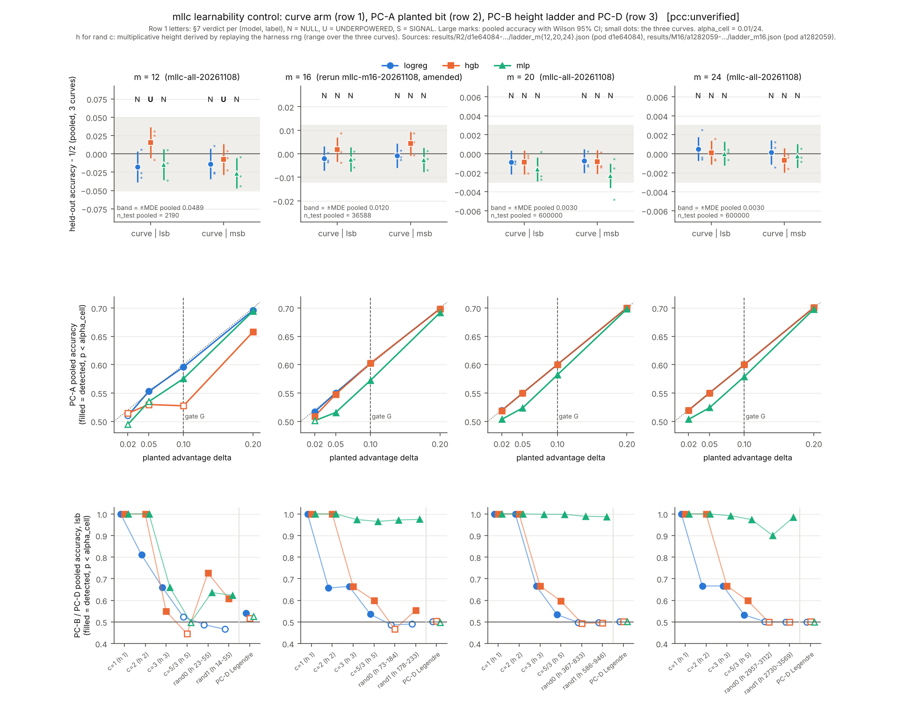

# RESULTS: ML learnability control on toy prime-order groups (slug mllc), R2 panel and m=16 rerun

**Verdict (PROTOCOL.md section 7 / `mllc_harness.decide`, applied mechanically and re-derived from the per-cell counts):** no SIGNAL in any of the 24 (size, model, label) cells. `[pcc:unverified]`

| size | source job | SIGNAL | NULL | UNDERPOWERED | PC-B c=1 detected (all models, lsb and msb) | lead closed at this scale (section 7) |
|---|---|---|---|---|---|---|
| m=12 | mllc-all-20261108 | 0 | 4 | 2 | yes | no (hgb UNDERPOWERED, both labels: gate G failed) |
| m=16 | mllc-m16-20261108 (rerun under AMENDMENT_R2_M16) | 0 | 6 | 0 | yes | yes, conditional on the amendment being admitted (section 0) |
| m=20 | mllc-all-20261108 | 0 | 6 | 0 | yes | yes |
| m=24 | mllc-all-20261108 | 0 | 6 | 0 | yes | yes |

Overall, cell by cell (no pooling across sizes or models, as section 7 requires): 0 SIGNAL, 22 NULL, 2 UNDERPOWERED. By the closing condition the lead `LEAD-EXO-ml-learned-models` is closed at m = 20 and m = 24, at m = 16 only if the amendment rerun is admitted, and not at m = 12. Each NULL is scoped by MDE(size) and by the PC-B ladder; that scope is weaker than designed, because the HD4 premise (C3) is falsified: the MLP learns the random-multiplier PC-B leak at every size (section 4, P3). No statement about attacks, speedups or rho (C4; the protocol reports no gap to rho because no solver runs).

Evidence classes: **measured** = read from the result files named below; **derived** = computed from measured counts by the analysis scripts (section 9); **heuristic** = an explanation not tested here. Every number is `[pcc:unverified]`; no pcc claim was filed.

Sources: m=12, 20, 24: `results/R2/d1e64084-42af-4973-b1a1-b1c28510c122/ladder_m{12,20,24}.json` (pod d1e64084); m=16: `results/M16/a1282059-b11b-4338-b043-d7c72944b8e2/ladder_m16.json` (pod a1282059). sha256 of each in `results/analysis/mllcan_summary.json` `sources`.

## 0. Execution record (reported first)

- **Protocol identity (derived).** `protocol.json` with `freeze` removed, serialised with sorted keys, compact separators and `ensure_ascii=False`, hashes to `674d224c94b5...38e6e2` = `freeze.protocol_sha256`; file sha256 `670432de...5d1d10` (the value the cards bind). Frozen 2026-11-08T05:01:20Z at commit 037cc3bfdb, before job 1 started (05:47:06Z, `host.txt`). `amendments` is `[]`.
- **Job 1, `mllc-all-20261108` (measured).** Image `isolab/tasks@sha256:a43ceee7...`, entry `r2mllc_entry.sh 12 16 20 24` (one harness process per size, in parallel), harness `mllc_harness.py` sha256 `b01eeb62...` (= `analysis_plan.script.sha256`), python 3.13.18, numpy 2.5.3, scipy 1.18.1, scikit-learn 1.9.1 (`versions.txt`), Intel Xeon 6975P-C node. `exit_codes.txt`: size 12 exit 0, size 16 exit 1, size 20 exit 0, size 24 exit 0; end 06:42:18Z, fail=1; Job state failed. m=16 raised `ValueError: Cannot take a larger sample than population when replace is False` in `fpstar_arm` (traceback in `ladder_m16.log`) and wrote no `ladder_m16.json`; **m=16 from job 1 is not admissible and is not used**, except its pre-crash log lines for the determinism check below.
- **Salvage, card R2-S2 (measured).** Receipt status completed, 11/11 steps exit 0. `verify_salvage.sh` required Job state failed with one pod, Job name and UID `ca04a7c5...` equal to the launch receipt, one directory named by the pod UID, the four `size` lines and `fail=1` in `exit_codes.txt`, and `sha256sum -c SHA256SUMS`; then 12 files were added to `benchmarks/records/20261108T0501Z-mllc-panel.json` and uploaded. Re-run here: `sha256sum -c` OK for all 11 listed files of R2 and all 6 of M16.
- **Amendment R2-M16 (measured: file, commit; cited: its reasoning).** `AMENDMENT_R2_M16.md` sha256 `1f18ffbc...` (equal to the M16-V01 card binding) was committed in faa70b424e at 2026-11-08T06:57:58Z, before the rerun pod was created (07:09:26Z, audit log) and started (10:51:29Z). It discloses that the main session had seen partial m=16 log lines before writing it. The fix is `n = min(n, N-1)` in `fpstar_arm`, N = p-1 the order of F_p^*: at m=16 curve 0 the number of draws N_curve-1 = 63492 exceeded N_f = 58402.
- **Rerun, `mllc-m16-20261108` (measured).** Image `isolab/tasks@sha256:37c6a451...` (a43ceee7 plus one 8019-byte layer of 10 files, per `eks/image_m16.json`; the layer contents were not inspected here), entry `r2m16_entry.sh 16`, harness `mllc_harness_r2m16.py` sha256 `1b1dd702...`, request cpu 4 (job 1: cpu 8), same library versions (`versions.txt` byte-identical, sha256 `9c943102...`), same CPU model. Pod a1282059 ran 10:51:29Z to 10:56:40Z, `exit_codes.txt` size 16 exit 0, fail=0.
- **Pod exit from the EKS audit log (measured).** The Pod object was deleted with its node, so `receipts/M16/collect-v01/final-status.json` has `pods: []`. `status-with-audit-pod.json` fills the pod from CloudWatch log group `/aws/eks/isolab/cluster` (schema `isolab.eks.pod-from-audit/v1`): create event audit id `434f2ac3...` at 07:09:26.96Z for pod `mllc-m16-20261108-f5nzz` uid a1282059, and one terminated report (container `task`, exit 0, reason Completed, started 10:51:29Z, finished 10:56:40Z, node ip-10-84-107-139, audit id `200ef72a...`). Card M16-V01: receipt completed, 12/12 steps exit 0, including `pod-from-audit` and `verify` ("SHA256SUMS lines: 6", job uid 08368c68, pod uid a1282059).
- **Determinism check (derived).** The crashed run logged 14 curve-0 rows (curve, PC-A, PC-B arms) before the crash; 14/14 are identical, for all three models, to the rerun at the log's 4-decimal resolution. No determinism deviation (PROTOCOL.md section 6) is detected; differences below 1e-4 cannot be seen in the log.
- **What the amendment changes beyond the draw cap.** Code: nothing; `diff mllc_harness.py mllc_harness_r2m16.py` is the one inserted line. Data: only the PC-D sample of m=16 curve 0 (58401 draws, n_test 11680 instead of 12698); every other n_test equals N-1-round(0.8(N-1)) (checked). Execution identity, which the frozen protocol does pin: a different image digest, harness file name and sha256, entry script, cpu request, and the size ran alone instead of beside three other size processes. Seeds, library versions, PROTOCOL.md and `mllc_ecgen.py` are unchanged (source.sha256).
- **Admissibility of m=16: UNRESOLVED.** `protocol.json` `invalidation_rules[0]`: "Rows from a different image digest, library versions, harness sha256 or seeds than the frozen ones are inadmissible." The rerun differs in image digest and harness sha256, and the amendment is not yet recorded in `protocol.json` `amendments` (the amendment itself says the main session records it there). As written the rule excludes m=16 until that is done; the m=16 verdicts below are computed under the amendment and are labelled conditional.
- **Main-session note on m=16 (2026-11-08).** The amendment cannot be added to `protocol.json` `amendments` now: the canonical protocol hash covers that list (adding an entry changes `674d224c…` to a different value, and `experiment_protocol.py validate` then reports the frozen protocol as changed). The tool's route is a new protocol version, which would be frozen after the m=16 data and could not show `filed_before_affected_data` by its own freeze time. The evidence that the amendment preceded the data is: commit faa70b424e (06:57:58Z), before the rerun pod's creation (07:09:26Z); card M16-1 bound `AMENDMENT_R2_M16.md` at sha256 `1f18ffbc…` before its launch step (launch receipt written 07:14:43Z). The session saw partial m=16 log lines from the failed run before writing the amendment, as the amendment discloses. The m=16 row therefore stays **conditional**. The lead's closure at m = 20 and m = 24 does not depend on it.

## 1. Independent re-derivation against the harness outputs (derived)

- 2784 checks on the raw per-cell data, 0 failed: acc = correct/n; one-sided exact binomial p recomputed (scipy `binomtest`); Wilson 95% CI; `null_max`, `null_mean` and R (20, 10 for mlp) from `null_accs`; n_test against N and the split; every log line against the JSON at 4 decimals; MDE.
- Decisions re-implemented from the section 7 text (not by calling `decide`) for all 24 cells, and ladder detection for 3 models x 13 control arms x 4 sizes. **Disagreements with the harness `decisions` and `ladder`: 0** (verdict, pooled p, pooled acc, replicating-curve count, gate and NULL_BIAS flag all equal).

## 2. Decision table, curve arm (measured counts; derived statistics)

alpha_cell = 0.01/24 = 0.000417. "repl." = curves with p < 0.05 and accuracy above their own relabelling-null maximum (SIGNAL needs >= 2). Gate G = pooled PC-A(delta = 0.10) one-sided p < alpha_cell for that model. NULL_BIAS: |mean null accuracy - 1/2| > 3 binomial sd.

| m | model | label | pooled acc | Wilson 95% CI | n_test pooled | p (acc > 1/2) | p (acc < 1/2) | repl. | gate G (PC-A 0.10 acc) | NULL_BIAS | verdict | harness |
|---|---|---|---|---|---|---|---|---|---|---|---|---|
| 12 | logreg | lsb | 0.4822 | [0.4613, 0.5031] | 2190 | 0.954 | 0.0499 | 0/3 | yes (0.5959) | no | **NULL** | NULL |
| 12 | logreg | msb | 0.4863 | [0.4654, 0.5072] | 2190 | 0.904 | 0.104 | 0/3 | yes (0.5959) | no | **NULL** | NULL |
| 12 | hgb | lsb | 0.5155 | [0.4946, 0.5364] | 2190 | 0.0761 | 0.93 | 0/3 | **no** (0.5274) | no | **UNDERPOWERED** | UNDERPOWERED |
| 12 | hgb | msb | 0.4922 | [0.4713, 0.5132] | 2190 | 0.773 | 0.24 | 0/3 | **no** (0.5274) | no | **UNDERPOWERED** | UNDERPOWERED |
| 12 | mlp | lsb | 0.4854 | [0.4645, 0.5063] | 2190 | 0.918 | 0.0891 | 0/3 | yes (0.5753) | no | **NULL** | NULL |
| 12 | mlp | msb | 0.4735 | [0.4527, 0.4945] | 2190 | 0.994 | 0.00699 | 0/3 | yes (0.5753) | no | **NULL** | NULL |
| 16 | logreg | lsb | 0.4981 | [0.4929, 0.5032] | 36588 | 0.773 | 0.231 | 0/3 | yes (0.6025) | no | **NULL** | NULL |
| 16 | logreg | msb | 0.4992 | [0.4941, 0.5044] | 36588 | 0.617 | 0.387 | 0/3 | yes (0.6025) | no | **NULL** | NULL |
| 16 | hgb | lsb | 0.5019 | [0.4967, 0.5070] | 36588 | 0.24 | 0.763 | 1/3 | yes (0.6025) | no | **NULL** | NULL |
| 16 | hgb | msb | 0.5043 | [0.4992, 0.5094] | 36588 | 0.0498 | 0.951 | 1/3 | yes (0.6025) | no | **NULL** | NULL |
| 16 | mlp | lsb | 0.4976 | [0.4925, 0.5027] | 36588 | 0.823 | 0.18 | 0/3 | yes (0.5723) | no | **NULL** | NULL |
| 16 | mlp | msb | 0.4975 | [0.4923, 0.5026] | 36588 | 0.836 | 0.167 | 0/3 | yes (0.5723) | no | **NULL** | NULL |
| 20 | logreg | lsb | 0.4991 | [0.4978, 0.5004] | 600000 | 0.917 | 0.083 | 0/3 | yes (0.6002) | no | **NULL** | NULL |
| 20 | logreg | msb | 0.4993 | [0.4980, 0.5005] | 600000 | 0.876 | 0.124 | 0/3 | yes (0.6002) | no | **NULL** | NULL |
| 20 | hgb | lsb | 0.4991 | [0.4978, 0.5004] | 600000 | 0.917 | 0.0834 | 0/3 | yes (0.6002) | no | **NULL** | NULL |
| 20 | hgb | msb | 0.4992 | [0.4979, 0.5004] | 600000 | 0.905 | 0.0955 | 0/3 | yes (0.6002) | no | **NULL** | NULL |
| 20 | mlp | lsb | 0.4984 | [0.4971, 0.4996] | 600000 | 0.994 | 0.00585 | 0/3 | yes (0.5820) | no | **NULL** | NULL |
| 20 | mlp | msb | 0.4977 | [0.4964, 0.4990] | 600000 | 1 | 0.000186 | 0/3 | yes (0.5820) | no | **NULL** | NULL |
| 24 | logreg | lsb | 0.5005 | [0.4992, 0.5018] | 600000 | 0.215 | 0.786 | 1/3 | yes (0.5999) | no | **NULL** | NULL |
| 24 | logreg | msb | 0.5002 | [0.4989, 0.5014] | 600000 | 0.403 | 0.598 | 0/3 | yes (0.5999) | no | **NULL** | NULL |
| 24 | hgb | lsb | 0.5001 | [0.4989, 0.5014] | 600000 | 0.427 | 0.574 | 0/3 | yes (0.5999) | no | **NULL** | NULL |
| 24 | hgb | msb | 0.4993 | [0.4981, 0.5006] | 600000 | 0.854 | 0.146 | 0/3 | yes (0.5999) | no | **NULL** | NULL |
| 24 | mlp | lsb | 0.5000 | [0.4988, 0.5013] | 600000 | 0.489 | 0.512 | 0/3 | yes (0.5789) | no | **NULL** | NULL |
| 24 | mlp | msb | 0.4998 | [0.4985, 0.5010] | 600000 | 0.633 | 0.368 | 0/3 | yes (0.5789) | no | **NULL** | NULL |

Per-curve accuracies, null means and null maxima for every cell are in `mllcan_summary.json` (`sizes.<m>.curves[i].cells`).

## 3. Closing condition, MDE and PC-B scope h* (derived)

| m | MDE per curve (harness) | MDE pooled (harness) | MDE pooled from actual pooled n | h* logreg | h* hgb | h* mlp | closed |
|---|---|---|---|---|---|---|---|
| 12 | 0.0846 | 0.0489 | 0.0494 | 3 | 55 | 55 | no |
| 16 | 0.0209 | 0.0120 | 0.0121 | 5 | 233 | 233 | yes (conditional) |
| 20 | 0.0052 | 0.0030 | 0.0030 | 5 | 833 | 946 | yes |
| 24 | 0.0052 | 0.0030 | 0.0030 | 5 | 5 | 3569 | yes |

- h* = largest multiplicative height of a PC-B multiplier detected (pooled p < alpha_cell) by that model at that size (section 7). Heights of c = 1, 2, 3, 5/3 are 1, 2, 3, 5. The rand0/rand1 multipliers are not stored in the outputs; they were recovered by replaying the harness rng draw order (development check: refitting logreg on 8 rand arms reproduced the recorded correct counts exactly), and their heights computed exactly (min over a/b = c mod N of max(|a|, b)). Because the three curves of a size have different random c, a pooled detection of rand0 or rand1 is credited with the largest of the three heights; that is this analysis's choice, the protocol does not say.
- Detection is not monotone in height (for example hgb at m=16 detects rand1, heights 178-233, but not rand0, heights 73-184). h* is computed as written (largest detected), not as a monotone threshold.
- **Scope sentence: direction UNRESOLVED.** Section 7 says the NULL excludes leaks of the form label = bit of c^-1 u "for multiplicative heights above h*", while its parenthetical says a curve NULL "says nothing about leaks the PC-B ladder cannot detect", which are the heights above h*. The two readings conflict; this report states h* and does not choose.
- MDE: the harness computes MDE from the last curve's n_test; at m=12 and m=16 the three curves have different n_test (716-746 and 11622-12698). Recomputed from the actual pooled n the pooled MDE is 0.0494 (m=12) and 0.0121 (m=16), against 0.0489 and 0.0120. The protocol table (0.047 and 0.012) assumed groups of about 4.1e3 and 6.5e4; the drawn curves have N of 3583-3733 and 58109-63493.

## 4. Controls (as protocol.json `controls` and `variable_ledger.comparisons` define them)

| control | protocol definition | outcome | passed |
|---|---|---|---|
| positive, PC-A (gate G) | delta = 0.10 planted bit detected, pooled p < alpha_cell, per size and model | detected in 11/12 (size, model); fails at m=12 hgb (pooled acc 0.5274, p 0.00549) | 11/12; the m=12 hgb cells are UNDERPOWERED as the rule prescribes |
| positive, PC-B c = 1 | identity encoding detected (closing condition; `controls.positive.expected_detection`: all models, all sizes) | detected by every model, lsb and msb, at every size (lowest pooled acc 0.9959) | yes |
| negative, relabelling null | NULL_BIAS if the null mean is more than 3 binomial sd from 1/2 | 0/24 cells flagged by the `decide` form (pooled over curves) and 0/72 by the per-curve form of section 5; per-curve null means 0.4926-0.5084 | yes |
| A/A, C-aa-curves | "per-curve accuracies of a size agree within binomial noise"; a SIGNAL needs >= 2 of 3 curves | no numeric threshold is stated, so pass/fail is **UNRESOLVED**. Descriptive: chi-square homogeneity of the three curves, curve arm, 24 cells, p 0.017-0.981 (smallest m=20 mlp msb); at most 1/3 curves replicate in any cell | UNRESOLVED (no threshold) |
| PC-D (boundary, not a gate) | Legendre character in F_p^* bits, predicted blind | detected only at m=12 logreg (pooled acc 0.5397); m=16 (curve 0 at the capped sample), 20, 24: no model detects it | reported, not scored |

### PC-A and PC-B pooled accuracy (lsb unless stated; * = detected, pooled p < alpha_cell; v = below 1/2 with p(acc < 1/2) < alpha_cell)

| arm | m=12 logreg | m=12 hgb | m=12 mlp | m=16 logreg | m=16 hgb | m=16 mlp | m=20 logreg | m=20 hgb | m=20 mlp | m=24 logreg | m=24 hgb | m=24 mlp |
|---|---|---|---|---|---|---|---|---|---|---|---|---|
| PC-A delta=0.02 | 0.510 | 0.514 | 0.495 | 0.517* | 0.509* | 0.501 | 0.519* | 0.519* | 0.503* | 0.520* | 0.520* | 0.504* |
| PC-A delta=0.05 | 0.553* | 0.530 | 0.535 | 0.550* | 0.548* | 0.516* | 0.550* | 0.550* | 0.524* | 0.550* | 0.550* | 0.524* |
| PC-A delta=0.1 | 0.596* | 0.527 | 0.575* | 0.603* | 0.603* | 0.572* | 0.600* | 0.600* | 0.582* | 0.600* | 0.600* | 0.579* |
| PC-A delta=0.2 | 0.696* | 0.658* | 0.695* | 0.698* | 0.698* | 0.692* | 0.700* | 0.700* | 0.698* | 0.701* | 0.701* | 0.698* |
| PC-B c=1 | 1.000* | 1.000* | 1.000* | 1.000* | 1.000* | 1.000* | 1.000* | 1.000* | 1.000* | 1.000* | 1.000* | 1.000* |
| PC-B c=1 msb | 0.996* | 1.000* | 0.997* | 0.999* | 1.000* | 1.000* | 0.999* | 1.000* | 1.000* | 1.000* | 1.000* | 1.000* |
| PC-B c=2 | 0.811* | 1.000* | 1.000* | 0.657* | 1.000* | 1.000* | 1.000* | 1.000* | 1.000* | 0.666* | 1.000* | 1.000* |
| PC-B c=3 | 0.660* | 0.549* | 0.660* | 0.664* | 0.664* | 0.974* | 0.667* | 0.667* | 0.998* | 0.667* | 0.667* | 0.992* |
| PC-B c=5/3 | 0.523 | 0.445v | 0.498 | 0.536* | 0.599* | 0.966* | 0.534* | 0.597* | 0.998* | 0.533* | 0.599* | 0.974* |
| PC-B c=rand0 | 0.487 | 0.726* | 0.636* | 0.486v | 0.467v | 0.972* | 0.497v | 0.494v | 0.989* | 0.501 | 0.499 | 0.901* |
| PC-B c=rand0 msb | 0.497 | 0.715* | 0.664* | 0.489v | 0.468v | 0.964* | 0.499 | 0.529* | 0.989* | 0.500 | 0.500 | 0.979* |
| PC-B c=rand1 | 0.466 | 0.607* | 0.623* | 0.490v | 0.554* | 0.975* | 0.498 | 0.494v | 0.987* | 0.500 | 0.500 | 0.985* |
| PC-D Fp*-Legendre | 0.540* | 0.516 | 0.525 | 0.502 | 0.503 | 0.497 | 0.501 | 0.501 | 0.501 | 0.500 | 0.501 | 0.500 |

Random multipliers and heights (derived by rng replay): m=12: curve 0 rand0 2085 (h 23), rand1 2317 (h 14), curve 1 rand0 1159 (h 34), rand1 1764 (h 55), curve 2 rand0 1775 (h 55), rand1 2540 (h 39); m=16: curve 0 rand0 15528 (h 184), rand1 8430 (h 195), curve 1 rand0 40498 (h 73), rand1 47989 (h 178), curve 2 rand0 4136 (h 89), rand1 57654 (h 233); m=20: curve 0 rand0 82717 (h 367), rand1 376731 (h 847), curve 1 rand0 421947 (h 755), rand1 235527 (h 946), curve 2 rand0 856382 (h 833), rand1 449770 (h 586); m=24: curve 0 rand0 7645945 (h 3112), rand1 9899895 (h 2895), curve 1 rand0 5801892 (h 2963), rand1 1329708 (h 2730), curve 2 rand0 13919321 (h 2957), rand1 1901978 (h 3569).

## 5. Preregistered predictions (protocol.json `hypotheses`, PROTOCOL.md section 8), scored as written

| id | role | prediction | outcome |
|---|---|---|---|
| P1 | decisive (m >= 16) | PC-A delta = 0.10 detected by all models at m >= 16 | **holds** (9/9 size-model pairs) |
| P1b | calibration, in-sample (m=12 development data seen) | at m=12 PC-A detected only at delta = 0.20 | **fails** for logreg (detects 0.05, 0.10, 0.20) and mlp (0.10, 0.20); holds for hgb |
| P2 | calibration | c = 1 detected by all models at every size; c = 2 detected; c = 3 partly | c = 1 holds; c = 2 detected by every model at every size; c = 3 detected by every model at every size ("partly" is not defined numerically, so not scored) |
| P3 | decisive (m >= 16) | PC-B 5/3 and random c within chance at m >= 16; falsified if random c reads >= 0.9 at m=16 | **fails**. Detected: m=16 logreg c=5/3 0.5360; m=16 hgb c=5/3 0.5994; m=16 hgb c=rand1 0.5537; m=16 mlp c=5/3 0.9656; m=16 mlp c=rand0 0.9721; m=16 mlp c=rand1 0.9747; m=20 logreg c=5/3 0.5337; m=20 hgb c=5/3 0.5973; m=20 mlp c=5/3 0.9983; m=20 mlp c=rand0 0.9892; m=20 mlp c=rand1 0.9873; m=24 logreg c=5/3 0.5329; m=24 hgb c=5/3 0.5986; m=24 mlp c=5/3 0.9742; m=24 mlp c=rand0 0.9008; m=24 mlp c=rand1 0.9846; m=16 mlp c=rand0 msb 0.9643; m=20 hgb c=rand0 msb 0.5295; m=20 mlp c=rand0 msb 0.9893; m=24 mlp c=rand0 msb 0.9794. The falsifier is met: mlp random c at m=16 reads 0.9721 (rand0), 0.9747 (rand1), 0.9643 (rand0 msb). C3 (HD4) is not supported |
| P4 | calibration / boundary | PC-D within chance for all models | holds at m = 16, 20, 24; fails at m=12 for logreg (detected) |
| P5 | decisive | curve arm within chance for all models, sizes and labels | one-sided (the section 7 statistic): **holds**, no pooled curve accuracy above 1/2 at alpha_cell. Two-sided at alpha_cell: fails in m=20 mlp msb (acc 0.4977, p(acc<1/2) 0.00019). The prediction does not say which; both are reported |

Protocol text conflict, reported not resolved: PROTOCOL.md section 8 says that if random c reads >= 0.9 at m=16 "the memo's falsifier holds and PC-B is a valid control as designed", while protocol.json C3 `if_not_supported` says the same event means "the PC-B scope sentence is weaker". This report follows C3 for the scope and states the conflict.

## 6. Surprising results and caveats

1. **The MLP learns the random-multiplier leak at every size (measured).** Pooled mlp accuracy on PC-B rand0/rand1 is m=16 0.964-0.975, m=20 0.987-0.989, m=24 0.901-0.985, with derived heights up to 3569 at m=24, where the training set is 3% of the group. *Heuristic explanation, not tested here:* with w_i = c^-1 2^i mod N and S = sum_i u_i w_i, k = S - qN with q = floor(S/N) in [0, m), so lsb(k) = parity(sum of u_i over odd w_i) XOR parity(q) (N odd). Both parts are threshold functions of two linear forms in the input bits, which a 128x128 ReLU network can represent, while logistic regression cannot and depth-6 trees represent a parity of about m/2 bits poorly. If so, multiplicative height does not measure difficulty for the MLP in this encoding, and the PC-B ladder gives the mlp NULLs no height scope.
2. **Significant below-chance accuracy (measured), which the one-sided rule cannot register.** m=12 PC-B|c=5/3|lsb|hgb 0.4452 (p 1.6e-07); m=16 PC-B|c=rand0|lsb|logreg 0.4864 (p 9.3e-08); m=16 PC-B|c=rand0|lsb|hgb 0.4670 (p 6.3e-37); m=16 PC-B|c=rand0|msb|logreg 0.4893 (p 2.1e-05); m=16 PC-B|c=rand0|msb|hgb 0.4679 (p 5.5e-35); m=16 PC-B|c=rand1|lsb|logreg 0.4902 (p 9.3e-05); m=20 curve|msb|mlp 0.4977 (p 0.00019); m=20 PC-B|c=rand0|lsb|logreg 0.4974 (p 3.1e-05); m=20 PC-B|c=rand0|lsb|hgb 0.4938 (p 6.5e-22); m=20 PC-B|c=rand1|lsb|hgb 0.4945 (p 4.2e-18). All occur where the sample covers much of the group (m=12 and 16: all of it; m=20: 70%); none at m=24 (4%). *Heuristic:* -Q has logarithm N-k and lsb(N-k) = 1 - lsb(k), msb flips likewise, and Q and -Q share x; a learner that keys on features the pair shares predicts the opposite of the true label when the partner was in training. For the PC-B arms the partner of u is N-u, which shares no input bits with u, so this explanation covers the curve arm only; the PC-B below-chance cells are unexplained here. The curve-arm effect would be the known k <-> -k symmetry, not a new leak, but it means the m=20 mlp|msb curve cell is not "at chance" under a two-sided reading. Verdicts are unaffected (H1 is accuracy > 1/2).
3. **m=12 hgb is UNDERPOWERED** because hgb did not detect the delta = 0.10 planted bit (pooled acc 0.5274 on n = 2190). The protocol states that m=12 is blind below an advantage of about 0.05-0.08.
4. **m=16 comes from a different job** (`mllc-m16-20261108`, image 37c6a451, harness `mllc_harness_r2m16.py`) run under AMENDMENT_R2_M16 and is admissible only once the amendment is recorded in `protocol.json` (section 0). Its curve 0 PC-D row uses 58401 draws (test 11680).
5. **NULL_BIAS has two readings.** `decide` compares the mean of the three curves' null means with 3 x 0.5/sqrt(3 n_test(curve 0)); section 5 flags a single (curve, model, label) cell whose null mean is more than 3 binomial sd from 1/2. Both were evaluated; neither flags any cell.
6. **Power limits stated by the protocol apply to every NULL:** MDE per section 3 table above; at m=20 and 24 the sample is 7e5 draws (about 70% and 4% of the group), so a memoriser-type leak that needs most of the group is outside power at m=24 by design (C4).
7. **The A/A comparison has no numeric pass rule** (section 4); the descriptive homogeneity p values are not a gate.
8. Job 1 ran four size processes in parallel in one pod; the rerun ran one. Accuracy counts are not clock metrics; the 14 matching rows are the only direct evidence that co-location did not change results.
9. The analysis is Python (re-derivation and plotting of recorded counts), not native code; AGENTS.md forbids committing it, so it is archived (section 9). A native or independent re-derivation would be needed before any promotion. The rng replay that recovers the random multipliers is a development check, not evidence.
10. experiment.export/v1 was not assembled (protocol `reporting.export_schema`); open for the main session.

## 7. Figure

SVG: `results/analysis/mllcan_fig1.svg`; data: `results/analysis/mllcan_summary.json`. Row 1: curve arm, pooled accuracy - 1/2 with Wilson 95% CI, the three curves as dots, the +-MDE(pooled) band and the section 7 verdict letter. Row 2: PC-A accuracy against the planted advantage, gate at 0.10. Row 3: PC-B ladder by height and PC-D. Filled marks are detected (pooled p < alpha_cell). Report PDF: `results/analysis/mllcan_report.pdf`.

## 8. Benchmark record

`benchmarks/records/20261108T0501Z-mllc-panel.json` (left open, not closed): the 24 pooled curve-arm held-out accuracies are added as metrics `heldout_accuracy/curve/m<size>/<model>/<label>` (unit `ratio` = correct/n, baseline 0.5, Wilson 95% interval, n = pooled n_test), the protocol's primary metric; the scripts archive is a raw entry at `research/ml_learnability_control_20261107/results/analysis/scripts.tar.gz`.

## 9. Provenance of this analysis

Scripts (Python, not committed; archived by sha256 in S3, see `results/analysis/scripts-archive.json`):

- `run.sh` f4de8bda3acc5863dc42f5059d955acf1fdbf3b8d1e33ee2ead6f51745d5f50f
- `mllcan_analyze.py` ca9e90720fb36fe5aba0ee89292f83bd1f23dab2ec4f5fad9822a6acb926f7ce
- `mllcan_analyze_lib.py` fefe109b3bf49048fdb1ec8b5bfb2ffcc52feb461a01c8a114bd082e7bf7167b
- `mllcan_devcheck.py` 72d7ebca3f233b26a182de925cdd5118631a3b0f7bc24b8e9f792fa805fdfd61
- `mllcan_fig.py` 5906c5f8a8efcbfaa80bd8b04a78b71895d4e470b9a64f0f1bcfd118689d6af0
- `mllcan_md.py` 515b070db8c016c12dbef9ff21db89420b34dd8271cc508e2f2e735d6a088823
- `mllcan_report.py` 9df6fd957113defeec72929f966cfdefab4979f8a1e781e2cbd52eb2f97d2c53
- archive `scripts.tar.gz` 95299a16b72eb104ecc4a7236cd6a9ac51833371431742e989d789a467383c85

Raw inputs (sha256, verified against SHA256SUMS): `results/R2/d1e64084-42af-4973-b1a1-b1c28510c122/ladder_m12.json` 06d26f77e7f6fe9a...; `results/M16/a1282059-b11b-4338-b043-d7c72944b8e2/ladder_m16.json` a26cc2384974b1cf...; `results/R2/d1e64084-42af-4973-b1a1-b1c28510c122/ladder_m20.json` 28e3c93ecc230157...; `results/R2/d1e64084-42af-4973-b1a1-b1c28510c122/ladder_m24.json` 4e13f6aba395d24d....

Sources checked: research-kb, Conductor and ecdb are not installed in this environment; none was queried. No literature or novelty claim is made.

Rendering: figure with matplotlib (SVG and 150 dpi PNG); PDF with matplotlib's PDF backend (no Typst or LaTeX here, pandoc has no PDF engine).
