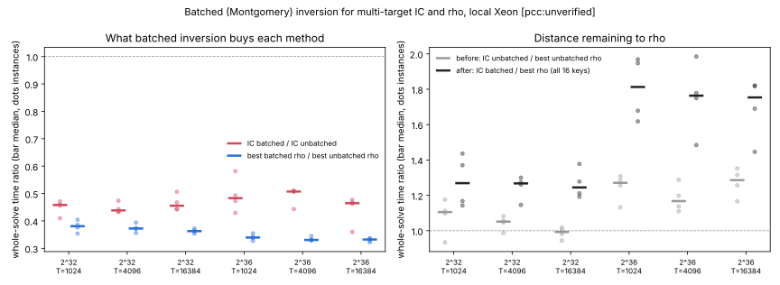

# Batched inversion halves the multi-target IC's cost, but rho gains more: distance 1.25× at 2^32, 1.76–1.81× at 2^36 (2026-11-15)

Protocol: [`PROTOCOL.md`](PROTOCOL.md), [`run.py`](run.py) and [`analyze.py`](analyze.py), committed in
`399a97e763` before any measured run; [`plot.py`](plot.py) committed before data too. The analysis was run
unchanged. Every number here is [pcc:unverified].

- Host: this session's container, **Intel Xeon @ 2.30 GHz**, 4 vCPU; every execution pinned to CPU 2, one at a
  time, 18:47–19:43Z. Binary SHA-256 `ea2f038e…` (built from `8c3d232b09`; in `results/main/host.json` and on
  every row).
- Pre-run checks: [`check.out`](check.out), all pass (plain byte-identical to the previous binary; `bi` keeps
  every table entry and trial; `rhodpb` recovers every target at 2^24, 2^32, 2^36). Smoke: `results/smoke/`.
- **1,296 executions, 0 errors, every target recovered and checked by the harness; `ic:bi` has exactly
  `ic:plain`'s table, trials, relations and p1_trials in all 24 configurations.** Raw rows:
  `results/main/runs.jsonl` (SHA-256 `ed2edfbc…`).
- Gate values: [`summary.json`](summary.json); figure: [`fig_batch_inv.svg`](fig_batch_inv.svg); report:
  [`REPORT.pdf`](REPORT.pdf).

## Gates

| gate | result | prior |
|---|---|---|
| correctness | **pass** | |
| **primary**: `ic:bi` / `ic:plain` < 1, 4 of 4, all 6 cells | **lower** (24 of 24 configurations) | 0.9 |
| batching helps rho at least as much as the IC (2^32) | **yes**, at 2^32 and 2^36 | 0.5 |
| IC ahead of the best rho (≤ 1, 4 of 4) | 0 of 6 cells | 0.15 (any cell) |

## Per cell: median (per-instance range)

| cell | IC bi / IC plain | best batched rho / best unbatched rho | **IC bi / best rho** | before: IC plain / best unbatched rho |
|---|---|---|---|---|
| 2^32, T = 1024 | 0.458 (0.410–0.471) | 0.381 (0.354–0.404) | **1.269** (1.142–1.436) | 1.105 (0.935–1.176) |
| 2^32, T = 4096 | 0.438 (0.433–0.473) | 0.372 (0.356–0.394) | **1.268** (1.146–1.300) | 1.051 (0.987–1.082) |
| 2^32, T = 16384 | 0.456 (0.442–0.507) | 0.363 (0.354–0.372) | **1.245** (1.193–1.378) | 0.993 (0.945–1.018) |
| 2^36, T = 1024 | 0.483 (0.430–0.582) | 0.340 (0.327–0.354) | **1.813** (1.618–1.969) | 1.271 (1.132–1.308) |
| 2^36, T = 4096 | 0.507 (0.443–0.511) | 0.331 (0.329–0.344) | **1.764** (1.484–1.985) | 1.167 (1.110–1.288) |
| 2^36, T = 16384 | 0.465 (0.360–0.477) | 0.332 (0.322–0.336) | **1.754** (1.446–1.821) | 1.286 (1.166–1.352) |

The best rho is `rhodpb` (κ = 0 or 0.25) in all 24 configurations. IC bi / best batched rho equals IC bi / best
rho everywhere.

IC whole-solve, table-build and target-phase medians (ms), with counted I and M:

| cell | plain: whole / table / targets | bi: whole / table / targets | I plain → bi | M plain → bi |
|---|---|---|---|---|
| 2^32, T = 4096 | 950 / 466 / 429 | 416 / 223 / 164 | 3.39 M → 0.42 M | 6.9 M → 15.8 M |
| 2^36, T = 4096 | 4,506 / 2,291 / 2,137 | 2,291 / 1,179 / 957 | 12.8 M → 1.0 M | 25.9 M → 61.3 M |

## Reading

- **A measured reduction of the multi-target IC baseline's cost** [pcc:unverified]**:** batched inversion takes
  the IC to 0.44–0.51× of its unbatched time (cell medians), with the same table, the same trials and the same
  recovered logs. Inversions drop about 8–12×; the extra multiplications are cheap at about 30 per inversion.
- **The distance to rho grows anyway.** Rho is a stronger beneficiary: every step is one addition with one
  inversion and little else, so batching takes the best rho to 0.33–0.38× of its unbatched time. The IC also pays
  for table probes, combination work and memory traffic that batching does not touch. Distance remaining: 1.25–1.27×
  at 2^32 and 1.75–1.81× at 2^36, from 0.99–1.11× and 1.17–1.29× when both were unbatched on this host.
- The previous rounds compared an IC and a rho that both paid one full inversion per group operation. That shared
  overhead flattered the IC's ratio. With it removed from both, the gap reflects the methods' real per-target work.
- At 2^36 the IC's batched target phase is 0.45× of its plain target phase and the table build 0.51×; both big
  phases still take most of the time.

## §5a pricing

Every arm is timed whole, so all native work is inside `ms_arm`; the 0 / 0.1 / 1 GAE band of unpriced native work
is empty for every arm, rho included.

## Not claimed

No `S`, no single-target change, no BSGS result, no leaderboard or `benchmarks/` row (no replay certificate or
validator report). Wall time on one container and one binary, read as paired ratios. `rho2xksp` has no batched form
here. A different inversion algorithm (binary GCD, Montgomery-form arithmetic) would change every arm and is not
tested.
