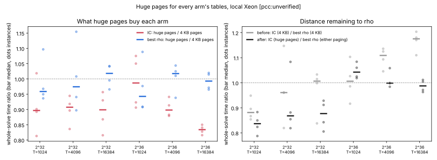

# Huge pages take the IC at 2^36, T = 16384 to 0.83× and level with the tuned rho (0.99×, from 1.22×); rho barely moves (2026-11-18)

Protocol: [`PROTOCOL.md`](PROTOCOL.md), [`run.py`](run.py) and [`analyze.py`](analyze.py), committed in
`3a53f555ba` (wording fix `a493e3f54e`) before any measured run; [`plot.py`](plot.py) before data too. The analysis
was run unchanged. Every number here is [pcc:unverified].

- Host: this session's container, **Intel Xeon @ 2.30 GHz**, 4 vCPU, THP mode `madvise`; every execution pinned
  to CPU 2, one at a time, 03:02–03:42Z.
- Binary: SHA-256 `c049a323…`, built standalone with `rustc` at cargo's release settings, because `main`'s library
  does not compile. The build command is in [`check.out`](check.out).
- Pre-run checks: [`check.out`](check.out), all pass.
  - With `MTF_HP=0` the output is byte-identical to the previous instrument; with `MTF_HP=1` it is identical to
    `MTF_HP=0` (all fields but times), for IC and rho.
  - During an IC execution at 2^36, T = 16384, 778 MB of the process sat on huge pages with `MTF_HP=1`, and 0 with
    `MTF_HP=0`.
- **1,872 executions, 0 errors, every target recovered and checked by the harness; every arm's counted fields
  agree between huge and 4 KB pages in all 24 configurations.** Raw rows: `results/main/runs.jsonl` (SHA-256
  `cee9eeeb…`). Smoke: `results/smoke/`.
- Gate values: [`summary.json`](summary.json); figure: [`fig_ic_hp.svg`](fig_ic_hp.svg); report:
  [`REPORT.pdf`](REPORT.pdf).

## Gates

| gate | result | prior |
|---|---|---|
| correctness | **pass** | |
| **primary**: IC hp1 / hp0 < 1, 4 of 4, all three 2^36 cells | **mixed**: lower 4 of 4 at T = 4096 and 16384; mixed at T = 1024 | lower: 0.8 |
| IC ahead in a 2^36 cell (≤ 1, 4 of 4) | no (T = 4096: 0.999, T = 16384: 0.988, each with one instance above 1) | 0.35 |
| huge pages lower best rho by > 3 % in any cell | yes, 2 cells (2^32 T = 1024: 4.1 %, 2^36 T = 1024: 5.7 %) | 0.15 |

## Per cell: median (per-instance range)

| cell | **IC: huge / 4 KB pages** | best rho: huge / 4 KB | **IC (huge pages) / best rho (either paging)** | before: IC / rho, both 4 KB |
|---|---|---|---|---|
| 2^32, T = 1024 | 0.897 (0.813–1.018) | 0.959 | **0.837** (0.788–0.883) | 0.881 |
| 2^32, T = 4096 | 0.907 (0.836–0.945) | 0.974 | **0.868** (0.819–1.084) | 0.961 |
| 2^32, T = 16384 | 0.899 (0.816–0.957) | 1.018 | **0.877** (0.806–0.929) | 1.007 |
| 2^36, T = 1024 | 0.987 (0.906–1.075) | 0.943 | 1.043 (1.019–1.084) | 1.006 |
| 2^36, T = 4096 | **0.898** (0.879–0.941) | 1.018 | **0.999** (0.984–1.058) | 1.109 |
| 2^36, T = 16384 | **0.834** (0.816–0.850) | 0.993 | **0.988** (0.963–1.012) | 1.175 |

IC phase medians (ms), and per-operation cost:

| cell | 4 KB pages: table / targets | huge pages: table / targets | ns per table entry | ns per target trial |
|---|---|---|---|---|
| 2^36, T = 4096 | 606 / 822 | 582 / 707 | 70 → 67 | 52 → 45 |
| 2^36, T = 16384 | 1,359 / 1,768 | 1,187 / 1,410 | 76 → 67 | 56 → 44 |

Repeat spread (max / min of 3 repeats, median) was 10 % for both arms in this run, lower than the 14 % of the IC
in the previous three rounds.



## Reading

- **A measured reduction of the IC baseline at 2^36** [pcc:unverified]**:** with huge pages the IC takes 0.83× of
  its time at T = 16384 and 0.90× at T = 4096, 4 of 4 each, with identical counted operations. The target phase
  gains most (a trial costs 44–45 ns, as at 2^32, against 52–56 ns on 4 KB pages). At T = 1024 (a 128 MB table)
  the change is inside the noise.
- **Distance remaining at 2^36:** the IC is now level with the tuned rho at T = 4096 (0.999×) and T = 16384
  (0.988×), from 1.11× and 1.18× on 4 KB pages in this same run. No 2^36 cell is IC-ahead 4 of 4 (each has one
  instance above 1). T = 1024 stays behind (1.04×, 4 of 4): the relation phase and the 1.4× operation count weigh
  most there.
- **Rho barely moves with huge pages** (0.94–1.02×): its distinguished-point tables are small. Rho takes whichever
  paging is lower per configuration.
- **At 2^32 huge pages also lower the IC by about 10 %** (0.897–0.907 cell medians; tables 32–128 MB still overrun
  the 4 KB-page TLB reach). The IC is below the best rho 4 of 4 at T = 1024 (0.837×) and T = 16384 (0.877×), and
  0.868× at T = 4096 with one instance above 1. Earlier 2^32 readings moved by about the size of such a lead
  between runs; read with this host's noise in mind.
- The table build is now the larger IC phase at 2^36 (67 ns per entry against 44–45 ns per trial). Its inserts are
  writes to a cold line; that is the next place to look.

## §5a pricing

Every arm is timed whole, so all native work is inside `ms_arm`; the 0 / 0.1 / 1 GAE band of unpriced native work
is empty for every arm, rho included.

## Not claimed

No `S`, no single-target change, no BSGS result, no leaderboard or `benchmarks/` row (no replay certificate or
validator report; planted targets on generated instances). Huge pages are a paging policy: on a host with THP
`always` both arms would have them already. Wall time on one container, one binary.

## Bench record

`benchmarks/records/20261118T0302Z-mt-ic-hp-2p32-2p36.json` holds this round's 12 metrics and three hashed raw
files, but is still **open**. `benchrec.py close` rebuilds the progress report from every record, and main's
`benchmarks/records/20261117T0334Z-hec-multi-production-cold.json` (written by another lane outside the
`bench.record/v1` schema: raw rows as metrics, strings as commands) makes that rebuild fail. Once that record is
repaired, close this one with:

```
python3 tools/benchrec.py close benchmarks/records/20261118T0302Z-mt-ic-hp-2p32-2p36.json --status measured \
  --report research/mt_ic_hp_20261118/REPORT.pdf --svg research/mt_ic_hp_20261118/fig_ic_hp.svg \
  --summary "Huge pages (MTF_HP=1, all arms): IC 0.83x at 2^36 T=16384 and 0.90x at T=4096 (4/4); IC / best rho 0.988x and 0.999x at 2^36 (from 1.18/1.11 on 4 KB pages), 1.04x at T=1024; rho 0.94-1.02x; 1872 executions, 0 errors [pcc:unverified]"
```
