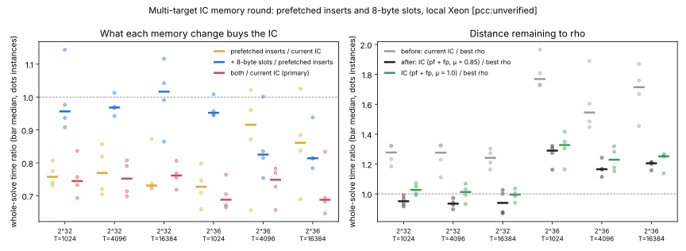

# Multi-target IC memory round: prefetched inserts and 8-byte slots take the IC to 0.69–0.76×, below the batched rho at 2^32 (0.94–0.95×), still 1.17–1.29× at 2^36 (2026-11-15)

Protocol: [`PROTOCOL.md`](PROTOCOL.md), [`run.py`](run.py) and [`analyze.py`](analyze.py), committed in
`0bc69900d4` before any measured run, and [`plot.py`](plot.py) after it, also before data. The analysis was run
unchanged. Every number here is [pcc:unverified].

- Host: this session's container, **Intel Xeon @ 2.30 GHz**, 4 vCPU; every execution pinned to CPU 2, one at a
  time, 22:31–22:46Z. Binary SHA-256 `5151b2b0…` (built from `0bc69900d4`; in `results/main/host.json` and on
  every row).
- Pre-run checks: [`check.out`](check.out), all pass. The previous binary and the new one give byte-identical
  output for the default options, and `pf` and `flatf` keep every table entry, trial and counted operation.
  Smoke: `results/smoke/`.
- **720 executions, 0 errors, every target recovered and checked by the harness. `ic:bi`, `ic:pf` and `ic:pf+fp`
  have identical table, trials, relations, p1_trials, I, M and S in all 24 configurations.** Raw rows:
  `results/main/runs.jsonl` (SHA-256 `5fbf7920…`).
- Gate values: [`summary.json`](summary.json); figure: [`fig_ic_mem.svg`](fig_ic_mem.svg); report:
  [`REPORT.pdf`](REPORT.pdf).

## Gates

| gate | result | prior |
|---|---|---|
| correctness | **pass** | |
| **primary**: `ic:pf+fp` / `ic:bi` < 1, 4 of 4, all 6 cells | **lower** (24 of 24 configurations) | 0.9 |
| IC ahead of the best rho (≤ 1, 4 of 4) | **2 of 6 cells** (2^32, T = 1024 and 4096) | ≥ 1 cell: 0.35 |
| IC behind the best rho (> 1, 4 of 4) | 3 of 6 cells (all of 2^36) | |
| μ = 1.0 lower than μ = 0.85 | 0 of 6 cells | ≥ 4 of 6: 0.3 |

## Per cell: median (per-instance range)

| cell | **IC (pf + fp) / current IC** | prefetched inserts / current IC | + 8-byte slots / prefetched inserts | **IC (pf + fp) / best rho** | before: current IC / best rho |
|---|---|---|---|---|---|
| 2^32, T = 1024 | **0.745** (0.693–0.836) | 0.758 | 0.956 | **0.951** (0.916–0.991) | 1.277 |
| 2^32, T = 4096 | **0.752** (0.699–0.808) | 0.769 | 0.968 | **0.935** (0.897–0.972) | 1.276 |
| 2^32, T = 16384 | **0.762** (0.719–0.806) | 0.731 | 1.016 | **0.939** (0.869–1.026) | 1.241 |
| 2^36, T = 1024 | **0.688** (0.665–0.764) | 0.728 | 0.952 | **1.290** (1.162–1.321) | 1.769 |
| 2^36, T = 4096 | **0.749** (0.657–0.783) | 0.916 | 0.825 | **1.165** (1.114–1.242) | 1.545 |
| 2^36, T = 16384 | **0.688** (0.647–0.834) | 0.861 | 0.814 | **1.205** (1.158–1.213) | 1.714 |

At p < 2^32 the `flatf` table is the `flat` table (the slots are 8 bytes already), so the 2^32 column for the
8-byte slots measures nothing but noise (0.956–1.016). The best rho is a `rhodpb` key in every configuration: κ = 0
in 15 of 24, κ = 0.25 in 9.

Phase costs, medians over instances and repeats (derived from the `ms_at_*` timestamps):

| cell | current IC: table build / target phase (ms) | IC (pf + fp) | ns per table entry | ns per target trial |
|---|---|---|---|---|
| 2^32, T = 4096 | 204 / 164 | 109 / 171 | 94 → 50 | 40 → 42 |
| 2^36, T = 4096 | 1,043 / 875 | 548 / 795 | 120 → 63 | 55 → 50 |

## Reading

- **A measured reduction of the multi-target IC baseline's cost** [pcc:unverified]**:** prefetching the table-build
  inserts and, above 2^32, 8-byte fingerprint slots take the IC to 0.69–0.76× of its time with batched inversion,
  every configuration lower, with the same table, trials and counted operations. A table entry now costs about as
  much as a target trial (50–65 ns), down from 94–134 ns.
- **At 2^32 on this host the IC is below the best batched rho:** 0.935–0.951× (cell medians), 4 of 4 instances at
  T = 1024 and 4096, 3 of 4 at T = 16384 (one instance 1.026). This is the first round in this series with the IC
  ahead in a cell.
- **At 2^36 it is still behind:** 1.17–1.29× (from 1.55–1.77×). The IC still does about 1.4× as many group
  operations as rho, and at 2^36 its slot array (about 0.13–0.54 GB) misses in cache on every probe and insert;
  its cheaper arithmetic per operation (about 3.5 multiplications per x-only point against rho's 6) covers the
  extra operations at 2^32 but not at 2^36.
- A larger table (μ = 1.0) is not lower in any cell, although table entries are now cheaper; μ = 0.85 stays.

## Threats to the 2^32 reading

- **Rho's tuning.** `rhodpb` runs 32 lock-step lanes, the IC's batch size, with κ ∈ {0, 0.25} and three DP-rate
  offsets. Its lane count was not tuned; more lanes amortise its batched inversion over more additions. The IC was
  tuned in three rounds; rho should get the same before "IC ahead" is read as more than this grid.
- One host (a 4-vCPU cloud Xeon), one binary, wall time. The memory changes depend on the memory system; another
  CPU may move both arms.
- Targets are planted from a fixed seed on generated W-family instances, not cold public targets; no replay
  certificate or validator report. This is not a T0 claim under [`docs/ic/SUCCESS_CRITERIA.md`](../../docs/ic/SUCCESS_CRITERIA.md).

## §5a pricing

Every arm is timed whole, so all native work is inside `ms_arm`; the 0 / 0.1 / 1 GAE band of unpriced native work
is empty for every arm, rho included.

## Not claimed

No `S`, no single-target change, no BSGS result, no leaderboard or `benchmarks/` row (no replay certificate or
validator report). Field arithmetic is unchanged for every arm.

## Follow-up: the 2^32 "IC ahead" reading does not hold with rho tuned

[`../mt_lanes_20261115/`](../mt_lanes_20261115/RESULTS.md) re-measured these configurations with rho's lane count
(16–128) and the IC's batch (32–256) both tuned: the IC is level with rho at 2^32 (0.91–1.00×, every cell's
per-instance range crossing 1) and 1.09–1.23× at 2^36 [pcc:unverified]. The untuned pair measured here moved by
about 6 % between the two runs at T = 1024, the size of the lead reported above.
