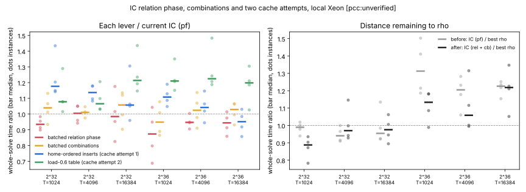

# Multi-target IC: the batched relation phase lowers 2^36, T = 1024 to 0.87× (gap 1.31 → 1.13); everything else is inside this host's noise; both cache attempts lose (2026-11-15/18)

Protocol: [`PROTOCOL.md`](PROTOCOL.md), [`run.py`](run.py) and [`analyze.py`](analyze.py), committed in
`e33d54e9c0` before any measured run. The analysis was run unchanged; [`plot.py`](plot.py) was written after the
data. Every number here is [pcc:unverified].

- Host: this session's container, **Intel Xeon @ 2.30 GHz**, 4 vCPU; every execution pinned to CPU 2, one at a
  time, from 2026-11-15T23:49Z. Binary SHA-256 `cb370e2b…` (built from `e33d54e9c0`).
- Pre-run checks: [`check.out`](check.out), all pass. The previous binary and the new one give byte-identical
  output for the default options, and every option keeps the table, trials, relations and relation-phase trials.
  Smoke: `results/smoke/`.
- **1,728 executions, 0 errors, every target recovered and checked by the harness; all six IC keys agree on
  table, trials, relations and p1_trials in all 24 configurations.** Raw rows: `results/main/runs.jsonl` (SHA-256
  `f0079ca7…`).
- The write-up was delayed by session restarts; the run finished before them and its rows are unchanged.
- Gate values: [`summary.json`](summary.json); figure: [`fig_ic_rel.svg`](fig_ic_rel.svg); report:
  [`REPORT.pdf`](REPORT.pdf).

## Gates

| gate | result | prior |
|---|---|---|
| correctness | **pass** | |
| **primary**: `ic:rel+cb` / `ic:pf` < 1, 4 of 4, all 6 cells | **mixed** (lower 4 of 4 in 2 cells: 2^32 and 2^36 at T = 1024) | lower: 0.6 |
| `rad` lower in ≥ 3 of 6 cells | no (1 cell median below 1) | 0.15 |
| `dense` lower in ≥ 3 of 6 cells | no (0 cells) | 0.1 |
| IC ahead of the best rho (≤ 1, 4 of 4) | 1 of 6 cells (2^32, T = 1024) | ≥ 1 cell: 0.3 |
| IC behind (> 1, 4 of 4) | 1 of 6 cells (2^36, T = 16384) | |

## Per cell: median (per-instance range)

| cell | **rel + cb / pf** | rel / pf | cb / pf | rad / pf | dense / pf | **IC (rel + cb) / best rho** | before: IC (pf) / best rho |
|---|---|---|---|---|---|---|---|
| 2^32, T = 1024 | **0.889** (0.833–0.935) | 0.934 | 1.039 | 1.176 | 1.078 | **0.888** (0.782–0.935) | 0.989 |
| 2^32, T = 4096 | 1.055 (0.943–1.187) | 1.005 | 1.011 | 1.137 | 1.066 | 0.970 (0.928–1.146) | 0.940 |
| 2^32, T = 16384 | 1.000 (0.833–1.150) | 0.984 | 1.058 | 1.057 | 1.214 | 0.975 (0.895–1.062) | 0.954 |
| 2^36, T = 1024 | **0.836** (0.722–0.973) | **0.873** | 0.949 | 1.108 | 1.210 | **1.133** (0.989–1.182) | 1.313 |
| 2^36, T = 4096 | 0.938 (0.808–1.052) | 0.947 | 1.024 | 1.042 | 1.225 | 1.058 (0.995–1.315) | 1.205 |
| 2^36, T = 16384 | 1.022 (0.840–1.106) | 0.944 | 1.029 | 0.951 | 1.198 | 1.218 (1.052–1.347) | 1.226 |

Best rho per configuration: 64 lanes in 11 of 24, 128 lanes in 9, 32 lanes in 4.

## How noisy is this host?

Three repeats of the same IC key and configuration differ by a median of 14 % (max / min), 90th percentile 28 %;
rho's differ by 7 % (23 %). The previous two local rounds show the same (IC 14–16 %, rho 6–7 %). The IC is
memory-bound and this is a shared 4-vCPU container. With medians of 3 repeats and 4 instances per cell, effects
below about 10 % are not resolved per cell here. That includes most of what this round tests.

## Reading

- **The batched relation phase is a measured reduction where it was predicted to matter** [pcc:unverified]**:**
  at 2^36, T = 1024 the relation phase was about a fifth of the solve. `rel` alone takes the IC to 0.873× (rel + cb:
  0.836×, 4 of 4), and the distance to the best rho from 1.31× to 1.13×. Elsewhere the relation phase is 1–6 %
  of the solve, and the measured medians (0.93–1.01) sit inside the noise.
- **Batched combinations (`cb`) are not resolved:** the step is 3–4 % of the solve, and its medians (0.95–1.06)
  are noise.
- **Both cache attempts lose.** Home-ordered inserts are slower in 5 of 6 cells (to 1.18×); a load-0.6 table is
  slower in all 6 (1.07–1.23×), because misses walk longer probe chains. Cache misses on the 2^36, T = 16384 table
  remain the IC's main excess there (1.22× rho).
- **2^32, T = 1024:** the IC (rel + cb) is below the best rho 4 of 4 (0.888×, 0.78–0.94). The tuning round found
  this cell level (0.996×), and this host's noise is the size of that difference, so this is not read as the IC
  ahead. At 2^32 the IC and the tuned rho remain level within this host's resolution.

## §5a pricing

Every arm is timed whole, so all native work is inside `ms_arm`; the 0 / 0.1 / 1 GAE band of unpriced native work
is empty for every arm, rho included.

## Not claimed

No `S`, no single-target change, no BSGS result, no leaderboard or `benchmarks/` row (no replay certificate or
validator report; planted targets on generated instances). Wall time on one noisy container; a quieter,
dedicated host (isolab) with more repeats is needed to resolve the few-per-cent levers.
