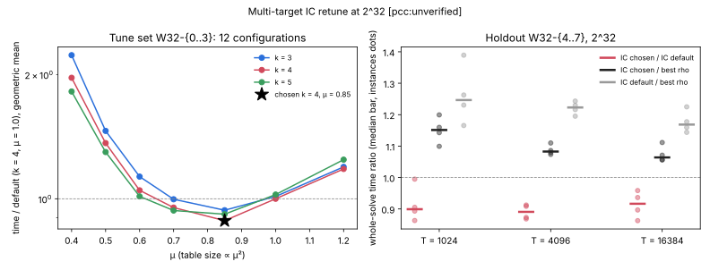

# Multi-target IC at 2^32: retuning (k, μ) to 4, 0.85 lowers the whole solve to 0.86–0.995× of IC-B (2026-11-15)

Protocol: [`PROTOCOL.md`](PROTOCOL.md), [`run.py`](run.py) and [`analyze.py`](analyze.py), all committed in
`05c0deda0a` before any measured run. The choice [`frozen_choice.json`](frozen_choice.json) was committed in
`232f6e3bb9` before the holdout ran. The analysis was run unchanged. Every number here is [pcc:unverified].

- Host: RunPod `cpu5c` pod `pusjls2njr7coy`, **AMD EPYC 9575F** (the CPU model of the table-layout round; the
  rematch drew an EPYC 4564P). Every execution was pinned to one CPU, 06:30–06:58Z. The pod was deleted, and the API
  returns 404 for it. The binary and instances were checked against `MANIFEST.sha256` on the pod.
- **Tune: 756 executions, holdout: 792 executions, 0 errors, every target recovered and checked by the harness.**
  Raw rows: `results/tune/runs.jsonl` (SHA-256 `95482218…`), `results/holdout/runs.jsonl` (`1ee66b78…`).
- Gate values: [`summary.json`](summary.json); tune table: [`results/tune_table.json`](results/tune_table.json);
  figure: [`fig_retune.svg`](fig_retune.svg) ([`plot.py`](plot.py)); report: [`REPORT.pdf`](REPORT.pdf).

## Tune (W32-{0..3}, 12 configurations)

Time relative to the default (k = 4, μ = 1.0), geometric mean over the 12 configurations:

| μ | 0.4 | 0.5 | 0.6 | 0.7 | **0.85** | 1.0 | 1.2 |
|---|---|---|---|---|---|---|---|
| k = 3 | 2.228 | 1.460 | 1.132 | 0.997 | 0.938 | 1.013 | 1.195 |
| k = 4 | 1.964 | 1.364 | 1.048 | 0.952 | **0.885** | 1.000 | 1.181 |
| k = 5 | 1.819 | 1.298 | 1.013 | 0.937 | 0.917 | 1.024 | 1.244 |

The frozen rule chose **k = 4, μ = 0.85**: inside the grid, at or below the default in 12 of 12 tune
configurations. k = 5 (newly allowed) is second (0.917). Small tables are costly: μ = 0.5 takes 1.30–1.46×.

## Holdout (W32-{4..7}, never used in the tune)

| gate | result |
|---|---|
| correctness | **pass** |
| **primary**: IC-chosen / IC-default < 1, 4 of 4, every T cell | **lower** (12 of 12 instances) |
| IC ahead of the best rho (≤ 1, 4 of 4) | 0 of 3 cells |

| T | IC-chosen / IC-default | per instance | IC-chosen / best rho | per instance | IC-default / best rho | per instance |
|---|---|---|---|---|---|---|
| 1024 | 0.899 | 0.863–0.995 | 1.151 | 1.099–1.199 | 1.247 | 1.166–1.389 |
| 4096 | 0.891 | 0.868–0.913 | 1.083 | 1.074–1.110 | 1.223 | 1.195–1.243 |
| 16384 | 0.917 | 0.863–0.959 | 1.064 | 1.056–1.111 | 1.168 | 1.144–1.225 |

Best rho per configuration: `rhodpup` κ = 0 in 9 of 12, `rho2xksp` in 2 (T = 1024), `rhodpu` in 1.

## Reading

- **A measured reduction of the multi-target IC baseline's cost at 2^32** [pcc:unverified]**.** On instances the
  tune never saw, IC-B with k = 4, μ = 0.85 takes 0.86–0.995× of IC-B with the old k = 4, μ = 1.0, median
  0.89–0.92× per T cell. Counted operations change with μ (smaller table, more target trials), so this is a
  parameter change of the algorithm, not a relabelling.
- **Distance remaining to rho at 2^32, this host and these instances:** 1.15× (T = 1024), 1.08× (4096), 1.06×
  (16384), from 1.25×, 1.22×, 1.17× with the old parameters. The retune removes 39–63 % of the excess
  over rho; the IC is still behind in every holdout instance (1.056–1.199).
- The optimum is a slightly **smaller** table (μ = 0.85, table ≈ 0.72× entries), as expected once batched probes
  made target trials cheaper. It is not much smaller: at μ ≤ 0.6 the extra target trials cost more than the
  smaller precompute saves.
- On this CPU (EPYC 9575F) the default's gap is larger than the rematch measured on an EPYC 4564P (1.05×). The
  direction is the same on both; the size depends on the CPU and the instances.

## Not claimed

No `S`, no single-target change, no BSGS result, no leaderboard or `benchmarks/` row (no replay certificate or
validator report). Wall time on a shared cloud pod, one binary, paired ratios. Only 2^32 is measured; whether
μ = 0.85 stays best at larger groups is not tested.
