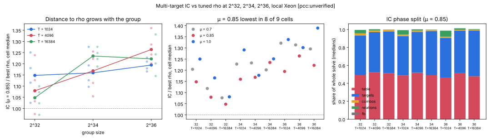

# Multi-target IC vs tuned rho at 2^32, 2^34, 2^36: the gap grows, from 1.05–1.15× to 1.19–1.26× (2026-11-15)

Protocol: [`PROTOCOL.md`](PROTOCOL.md), [`run.py`](run.py) and [`analyze.py`](analyze.py), committed in
`1c3c19b506` before any measured run; amendment A1 (local host) in `efb0f1c624`, also before data. The analysis was
run unchanged. Every number here is [pcc:unverified].

- Host: this session's container, **Intel Xeon @ 2.30 GHz**, 4 vCPU; every execution pinned to CPU 2, one at a
  time, 17:00–18:45Z. Binary SHA-256 `b1450fc2…` (in `results/scale/host.json` and on every row).
- **2,052 executions, 0 errors, every target recovered and checked by the harness.** Raw rows:
  `results/scale/runs.jsonl` (SHA-256 `122a592b…`).
- Gate values: [`summary.json`](summary.json); figure: [`fig_scale.svg`](fig_scale.svg) ([`plot.py`](plot.py));
  report: [`REPORT.pdf`](REPORT.pdf). Phase split (descriptive, outside the frozen analysis):
  [`results/phase_split.json`](results/phase_split.json).

## Gates

| gate | result | prior |
|---|---|---|
| correctness | **pass** | |
| **primary**: IC (μ = 0.85) / best rho larger at 2^36 than at 2^32 in all 3 T cells | **gap grows** (3 of 3) | 0.75 |
| μ = 0.85 lowest of the three μ, per cell | 8 of 9 cells | ≥ 6 of 9: 0.5 |
| IC ahead of the best rho (≤ 1, 4 of 4) | 0 of 9 cells | |

## Distance remaining: IC (k = 4, μ = 0.85) / best rho, cell median (per-instance range)

| T | 2^32 | 2^34 | 2^36 |
|---|---|---|---|
| 1024 | 1.148 (1.025–1.251) | 1.160 (1.097–1.276) | 1.194 (1.165–1.227) |
| 4096 | 1.079 (0.975–1.238) | 1.168 (1.054–1.255) | 1.264 (1.201–1.360) |
| 16384 | 1.048 (0.971–1.099) | 1.235 (1.188–1.276) | 1.222 (1.145–1.331) |

Two single instances at 2^32 have the IC below the best rho (0.975 and 0.971); no cell is 4 of 4. Above 2^32 every
instance has the IC behind.

The neighbouring μ, cell medians of IC / best rho:

| cell | μ = 0.7 | **μ = 0.85** | μ = 1.0 |
|---|---|---|---|
| 2^32, T = 1024 | 1.204 | **1.148** | 1.250 |
| 2^32, T = 4096 | 1.118 | **1.079** | 1.166 |
| 2^32, T = 16384 | 1.076 | **1.048** | 1.081 |
| 2^34, T = 1024 | 1.228 | **1.160** | 1.291 |
| 2^34, T = 4096 | 1.233 | **1.168** | 1.177 |
| 2^34, T = 16384 | **1.202** | 1.235 | 1.251 |
| 2^36, T = 1024 | 1.321 | **1.194** | 1.338 |
| 2^36, T = 4096 | 1.313 | **1.264** | 1.301 |
| 2^36, T = 16384 | 1.295 | **1.222** | 1.389 |

Best rho per configuration: at 2^32, `rho2xksp` in 7 of 12, `rhodpup` κ = 0 in 3, `rhodpu` κ = 0 in 2; at 2^34
and 2^36, `rhodpu` or `rhodpup` with κ = 0 in 24 of 24. The best rho's time per configuration roughly doubles per
2 bits at fixed T (cell means 419 → 893 → 1,880 ms at T = 1024), as √n predicts.

## Where the IC's time goes (descriptive)

From the `ms_at_*` timestamps of every `ic:4:0.85` row (medians), the whole solve splits into the table build,
47–52 %, and the target phase, 44–51 %; combos, relations and the factor base together take 2–9 %. The split
barely moves with size or T. A separate profile of one W32-4 run counted about 1.1 M modular inversions in the
table build and 2 M in the target phase; one inversion (extended Euclid on i128) costs about 180 ns on this host,
against about 5.9 ns for a multiplication [pcc:unverified]. Both big phases are inversion-bound, which motivates
the batched-inversion round [`../mt_batch_inv_20261115/`](../mt_batch_inv_20261115/).

## Reading

- **The distance to rho grows with the group** [pcc:unverified]**.** From 1.05–1.15× at 2^32 to 1.19–1.26× at
  2^36, in every T cell. At 2^32 this host reproduces the retune's EPYC 9575F distances (1.15 / 1.08 / 1.06) to
  within 0.02.
- At 2^32 the gap shrinks with T (1.15 → 1.05); at 2^34 and 2^36 it does not. Larger T helps the IC less as the
  group grows here.
- **μ = 0.85 stays the best of its neighbours** at 2^34 and 2^36 (8 of 9 cells); the retune's choice transfers.
- The IC's table is built with one modular inversion per entry and every target trial pays one too. The same is
  true of every rho step, so the lever tested next (batched inversion) is given to both.

## §5a pricing

Every arm is timed whole, so all native work is inside `ms_arm`; the 0 / 0.1 / 1 GAE band of unpriced native work
is empty for every arm, rho included.

## Not claimed

No `S`, no single-target change, no BSGS result, no leaderboard or `benchmarks/` row (no replay certificate or
validator report). Wall time on one container and one binary, read as paired ratios; absolute times are not
comparable to the RunPod rounds. Four instances per size; 2^38 and beyond are not measured.
