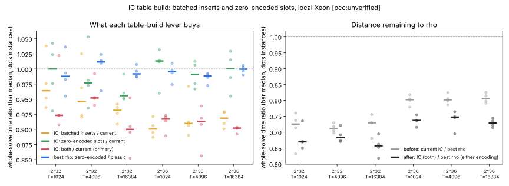

# Batched in-order inserts take the IC to 0.90–0.92× at 2^36 (table entry 62 → 48 ns); on this host the IC is 0.66–0.75× the tuned rho, mostly because of the host (2026-11-19)

Protocol: [`PROTOCOL.md`](PROTOCOL.md), [`run.py`](run.py), [`analyze.py`](analyze.py) and [`plot.py`](plot.py),
committed in `fdf1ae109a` before any measured run. The analysis was run unchanged. Every number here is
[pcc:unverified].

- Host: this session's container, **Intel Xeon @ 2.10 GHz** (with AMX and AVX-512 FP16, 266 MB last-level cache),
  4 vCPU, THP `madvise`. Every execution pinned to CPU 2, one at a time, 03:21–04:09Z, all with `MTF_HP=1`.
- Binary: SHA-256 `198a6e49…`, built standalone with `rustc` at cargo's release settings. Command and pre-run checks
  are in [`check.out`](check.out); all checks pass.
  - The new binary gives byte-identical output to the huge-page round's binary.
  - `MTF_Z=1` gives the same output as `MTF_Z=0`.
  - `rel,ib` keeps `pf,rel`'s table, trials, relations, I, M and S.
- **2,016 executions, 0 errors, every target recovered and checked by the harness; the IC keys agree on table,
  trials, relations and p1_trials, and each rho key on I, M, S, walks and db across `MTF_Z`, in all 24
  configurations.** Raw rows: `results/main/runs.jsonl` (SHA-256 `38c05899…`). Smoke: `results/smoke/`.
- Gate values: [`summary.json`](summary.json); figure: [`fig_ic_tb.svg`](fig_ic_tb.svg); report:
  [`REPORT.pdf`](REPORT.pdf).

## Gates

| gate | result | prior |
|---|---|---|
| correctness | **pass** | |
| **primary**: `ic:z+ib` / `ic:pf` < 1, 4 of 4, all three 2^36 cells | **lower** (0.917, 0.913, 0.902) | 0.85 |
| IC ahead of the best rho in a 2^36 cell (≤ 1, 4 of 4) | yes, all three (and all three 2^32 cells) | 0.5 |
| `MTF_Z` lowers best rho by more than 3 % in any cell | no (0.988–1.012) | 0.1 |

## Per cell: median (per-instance range)

| cell | **IC both / current** | batched inserts / current | zero-encoded slots / current | rho: zero / classic | **IC (both) / best rho** | before: current IC / best rho |
|---|---|---|---|---|---|---|
| 2^32, T = 1024 | 0.923 (0.908–1.022) | 0.964 | 1.000 | 0.988 | **0.670** (0.650–0.735) | 0.725 |
| 2^32, T = 4096 | 0.952 (0.940–0.992) | 0.946 | 0.977 | 1.012 | **0.683** (0.671–0.721) | 0.711 |
| 2^32, T = 16384 | 0.900 (0.852–0.952) | 0.931 | 0.956 | 0.992 | **0.657** (0.618–0.694) | 0.730 |
| 2^36, T = 1024 | **0.917** (0.889–0.923) | 0.901 | 1.013 | 0.996 | **0.737** (0.715–0.755) | 0.803 |
| 2^36, T = 4096 | **0.913** (0.856–0.939) | 0.910 | 0.991 | 0.988 | **0.747** (0.695–0.764) | 0.802 |
| 2^36, T = 16384 | **0.902** (0.892–0.903) | 0.919 | 1.000 | 1.000 | **0.729** (0.714–0.744) | 0.806 |

IC phase medians (ms) and per-operation cost:

| cell | current: whole / table / targets | both: whole / table / targets | ns per table entry | ns per target trial |
|---|---|---|---|---|
| 2^36, T = 1024 | 650 / 276 / 311 | 595 / 218 / 311 | 62 → 49 | 40 → 39 |
| 2^36, T = 16384 | 2,550 / 1,099 / 1,334 | 2,296 / 849 / 1,310 | 62 → 48 | 42 → 41 |

Repeat spread (max / min of 3 repeats, median) was 6.3 % for the IC and 5.4 % for rho.



## Reading

- **A measured reduction of the IC baseline** [pcc:unverified]**:** batched in-order inserts take the IC to
  0.90–0.92× of its time at 2^36, 4 of 4 in every 2^36 cell, with identical table, trials and relations. A table
  entry now costs 48–49 ns against 62 before, closer to a target trial's 39–41 ns. The cost was in the instrument:
  a per-insert match on the table variant inside a non-inlined call, and a ring buffer. The arithmetic and the
  memory traffic are unchanged.
- **Zero-encoded empty slots buy little in situ:** 0.956× at 2^32, T = 16384 (4 of 4), and 0.98–1.01× in the
  other cells, although a microbenchmark showed a 355 ms → 90 ms drop for allocating 537 MB. Rho is unaffected
  (0.988–1.012).
- **Distance to rho on this host:** the IC (both levers) is 0.66–0.75× the best tuned rho, 4 of 4 in all six cells.
  **Most of this is the host, not the levers.** The current IC was already 0.71–0.81× rho here, against 0.99–1.04×
  on the huge-page round's host (Xeon @ 2.30 GHz, 2026-11-18). Per operation, the IC costs about the same on both
  hosts (46–54 ns), while rho's step costs 11–16 % more on this one (96–100 ns against 86–87 ns, `rhodpb` 64 lanes,
  κ = 0). This CPU has a 266 MB last-level cache, which holds the IC's whole table at 2^32 and much of it at 2^36.
  The levers' own effect is the 0.90–0.92× above, measured within one run on one host.
- **Which host decides "IC ahead"** is therefore open. A claim needs the comparison on the reference hosts the lab
  uses for rho (isolab), with the matched rho measured there.

## §5a pricing

Every arm is timed whole, so all native work is inside `ms_arm`; the 0 / 0.1 / 1 GAE band of unpriced native work
is empty for every arm, rho included.

## Not claimed

No `S`, no single-target change, no BSGS result, no leaderboard or `benchmarks/` row (no replay certificate or
validator report; planted targets on generated instances). In particular "IC ahead of rho" is not claimed: it holds
on this host and not on the previous one.

## Bench record

`benchmarks/records/20261119T0321Z-mt-ic-tb-2p32-2p36.json` holds this round's 12 metrics and three hashed raw
files, but is still **open**. `benchrec.py close` rebuilds the progress report from every record, and main's
`benchmarks/records/20261117T0334Z-hec-multi-production-cold.json` (outside the `bench.record/v1` schema) makes that
fail. Once it is repaired:

```
python3 tools/benchrec.py close benchmarks/records/20261119T0321Z-mt-ic-tb-2p32-2p36.json --status measured \
  --report research/mt_ic_tb_20261119/REPORT.pdf --svg research/mt_ic_tb_20261119/fig_ic_tb.svg \
  --summary "Batched in-order inserts (+ zero-encoded slots): IC 0.90-0.92x at 2^36 (4/4), table entry 62 -> 48 ns; IC / best rho 0.66-0.75x on this host (current IC already 0.71-0.81x here vs ~1.0 on the 2.30 GHz host: host-dependent); 2016 executions, 0 errors [pcc:unverified]"
```
