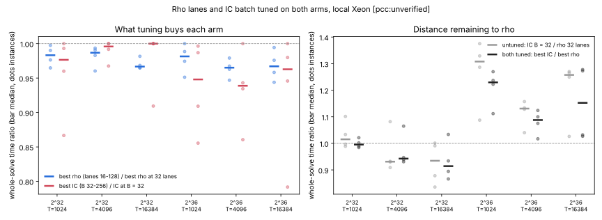

# With rho's lanes and the IC's batch both tuned, the IC is level with rho at 2^32 (0.91–1.00×, no cell 4 of 4) and 1.09–1.23× at 2^36 (2026-11-15)

Protocol: [`PROTOCOL.md`](PROTOCOL.md), [`run.py`](run.py) and [`analyze.py`](analyze.py), committed in
`dc8ccb64de` before any measured run. The analysis was run unchanged; [`plot.py`](plot.py) was written after the
data. Every number here is [pcc:unverified].

- Host: this session's container, **Intel Xeon @ 2.30 GHz**, 4 vCPU; every execution pinned to CPU 2, one at a
  time, 22:50–23:28Z. Binary: the memory round's, SHA-256 `5151b2b0…` ([`check.out`](check.out)).
- **1,944 executions, 0 errors, every target recovered and checked by the harness; the IC keys agree on table,
  trials, relations and p1_trials in all 24 configurations.** Raw rows: `results/main/runs.jsonl` (SHA-256
  `b9fd281e…`). Smoke: `results/smoke/`.
- Gate values: [`summary.json`](summary.json); figure: [`fig_lanes.svg`](fig_lanes.svg); report:
  [`REPORT.pdf`](REPORT.pdf).

## Gates

| gate | result | prior |
|---|---|---|
| correctness | **pass** | |
| **primary**: the memory round's two "IC ahead" cells (2^32, T = 1024, 4096) are "IC ahead" (4 of 4) with both arms tuned | **do not hold** (0 of 6 cells IC ahead) | hold: 0.45 |
| IC behind (> 1, 4 of 4) | 3 of 6 cells (all of 2^36) | |
| lane tuning lowers best rho by more than 3 % in ≥ 3 cells | yes, 3 cells (3.3–3.5 %) | 0.4 |
| larger B lowers the IC by more than 3 % in ≥ 3 cells | yes, 3 cells (all of 2^36, 3.7–6.1 %) | 0.5 |

## Per cell: median (per-instance range)

| cell | **best IC / best rho (both tuned)** | untuned: IC B32 / rho L32 | best rho / rho at 32 lanes | best IC / IC at B = 32 |
|---|---|---|---|---|
| 2^32, T = 1024 | **0.996** (0.984–1.021) | 1.015 (0.989–1.101) | 0.983 | 0.977 |
| 2^32, T = 4096 | **0.943** (0.931–1.065) | 0.931 (0.909–1.082) | 0.987 | 0.996 |
| 2^32, T = 16384 | **0.914** (0.866–1.034) | 0.935 (0.836–1.001) | 0.967 | 1.000 |
| 2^36, T = 1024 | **1.230** (1.112–1.270) | 1.308 (1.087–1.375) | 0.981 | 0.948 |
| 2^36, T = 4096 | **1.088** (1.017–1.124) | 1.131 (1.040–1.157) | 0.965 | 0.939 |
| 2^36, T = 16384 | **1.152** (1.027–1.278) | 1.257 (1.026–1.270) | 0.967 | 0.963 |

Best rho per configuration: 64 lanes in 13 of 24, 128 lanes in 10, 32 lanes in 1, 16 lanes in none. Best IC:
B = 128 in 12, B = 32 in 8, B = 256 in 4.

## Reading

- **At 2^32 the IC and the tuned rho are level on this host** [pcc:unverified]**:** cell medians 0.91–1.00× with
  every cell's per-instance range crossing 1 (one instance above 1 in each cell). The memory round's "IC ahead at
  2^32, T = 1024 and 4096" does not survive this re-measurement. Even the untuned pair it measured (IC B32 / rho
  L32) came out 1.015× here at T = 1024, against 0.951× there: run-to-run variation of a few per cent on this
  container is the size of the lead it reported.
- Tuning helps both arms by a few per cent. Rho prefers 64–128 lanes (1.3–3.5 % below 32 lanes). The IC prefers B
  = 128 at 2^36 (3.7–6.1 %) and gains little at 2^32.
- **At 2^36 the IC is behind by 1.09–1.23×** with both tuned (4 of 4 in every cell), from 1.17–1.29× in the
  memory round. Its remaining cost there is the table's cache misses on every probe and insert, and about 1.4× as
  many group operations as rho.
- The distance at 2^32 is now within run-to-run variation; moving it below 1 reliably needs a further reduction of
  the IC's cost of several per cent, or a larger instance set and more repeats to resolve a small lead.

## §5a pricing

Every arm is timed whole, so all native work is inside `ms_arm`; the 0 / 0.1 / 1 GAE band of unpriced native work
is empty for every arm, rho included.

## Not claimed

No `S`, no single-target change, no BSGS result, no leaderboard or `benchmarks/` row (no replay certificate or
validator report; planted targets on generated instances, so no T0 claim under `docs/ic/SUCCESS_CRITERIA.md`).
Tuned on the configurations it reports; rho's minimum is over 24 keys, the IC's over 3.
