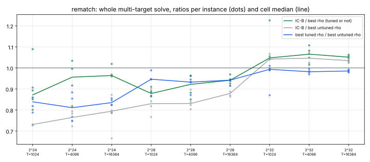

# Multi-target IC vs a fairly tuned rho: ahead at 2^24–2^28, behind at 2^32 (2026-11-15)

Protocol: [`PROTOCOL.md`](PROTOCOL.md) and analysis [`analyze.py`](analyze.py), both committed in `77ca132b4f` before any
measured run; the analysis was run unchanged. Pre-run check: [`check_rho.out`](check_rho.out). Every number here is
[pcc:unverified].

- Host: RunPod `cpu5c` pod `nhmrbwqb0srs51`, **AMD EPYC 4564P** (the table-layout round ran on an EPYC 9575F; absolute
  times are not comparable across the two rounds, only the paired ratios within each), every execution pinned to CPU
  16, 02:17–03:21Z. The pod was deleted and confirmed gone. Binary SHA-256 `5eb3e3252e2154b4…`, checked on the pod
  with the instances (`results/MANIFEST.sha256`).
- **2,376 executions (36 configurations × 22 keys × 3 interleaved repeats), 0 errors, every target recovered and
  checked by the harness.** Smoke: 66, 0 errors. `rhodpup`'s counted totals equal `rhodpu`'s in every configuration
  (0 mismatches).
- Gate values: [`summary.json`](summary.json); figure: [`fig_rematch.svg`](fig_rematch.svg) ([`plot.py`](plot.py)).

## Gates

| gate | result |
|---|---|
| correctness | **pass** |
| **primary**: IC-B / best rho at 2^32 | **mixed on the letter**: behind (≥ 1, 4 of 4) at T = 4096 and 16384; at T = 1024 three instances are behind (1.041–1.226) and one is at 0.990 |
| secondary: tuned rho faster than untuned rho at 2^32, 4 of 4 | T = 1024 no (one instance 1.010); T = 4096 and 16384 yes, by 0.4–3 % |

## Table (whole solve, `ms_arm`; median over 4 instances of per-instance ratios)

| bits | T | IC-B / best rho | per instance | IC-B / best untuned rho | best tuned / best untuned rho | IC-A / best rho | best rho (instances) |
|---|---|---|---|---|---|---|---|
| 24 | 1024 | 0.872 | 0.801–1.089 | 0.731 | 0.839 | 1.093 | rho2xksp ×4 |
| 24 | 4096 | 0.956 | 0.818–1.034 | 0.765 | 0.811 | 1.064 | rho2xksp ×4 |
| 24 | 16384 | 0.964 | 0.787–1.019 | 0.795 | 0.836 | 1.004 | rho2xksp ×4 |
| 28 | 1024 | 0.879 | 0.865–0.911 | 0.830 | 0.947 | 1.027 | rho2xksp ×3, rhodpup ×1 |
| 28 | 4096 | 0.922 | 0.850–0.964 | 0.831 | 0.933 | 1.105 | rho2xksp ×4 |
| 28 | 16384 | 0.942 | 0.927–0.969 | 0.879 | 0.942 | 1.149 | rho2xksp ×4 |
| 32 | 1024 | 1.048 | 0.990–1.226 | 1.042 | 0.994 | 1.217 | rhodpup ×2, rho2xksp ×1, rhodpu ×1 |
| 32 | 4096 | 1.065 | 1.017–1.107 | 1.046 | 0.982 | 1.305 | rhodpup ×3, rho2xksp ×1 |
| 32 | 16384 | 1.051 | 1.034–1.063 | 1.035 | 0.986 | 1.270 | rhodpup ×3, rho2xksp ×1 |

## Reading

- **Giving rho the same treatment helps it where its lookups matter.** `rho2xksp` (flat database, pipelined
  prefetched lookups) is the best rho at 2^24–2^28, and brings the best rho to 0.81–0.95× of its untuned time there [pcc:unverified]. At 2^32 the
  best rho is mostly the distinguished-point walk (`rhodpu`/`rhodpup`), which looks up once per 2^d steps, so the
  treatment buys it only 0.98–0.99×.
- **Against the fairly tuned rho, the multi-target IC (IC-B) is ahead at 2^28 in all 12 instances (0.85–0.97×), ahead
  in 10 of 12 at 2^24, and behind at 2^32 in 11 of 12 (1.017–1.226×).** The primary verdict is "mixed" only because
  one 2^32, T = 1024 instance sits at 0.990. The size trend against the IC remains: it is a constant-factor
  advantage at small groups that turns into a deficit by 2^32.
- Without the table treatment (IC-A) the IC is behind the best rho in 35 of 36 configurations here.
- On this host the IC-B / best-untuned-rho ratio at 2^32 is 1.035–1.046, against 1.07–1.18 on the EPYC 9575F of the
  table-layout round: the size of the gap depends on the CPU. Its direction at 2^32 does not.

## Not claimed

No `S`, no single-target change, no BSGS result, no leaderboard or `benchmarks/` row; wall time on a shared cloud pod,
one binary, paired ratios; no replay certificate or validator report. `rho2xksp` is a different random sample of
`rho2xks` (the deferred hit moves restarts and the RNG stream; counted target steps within −4.2 to +7.9 per target in
the pre-run check).
