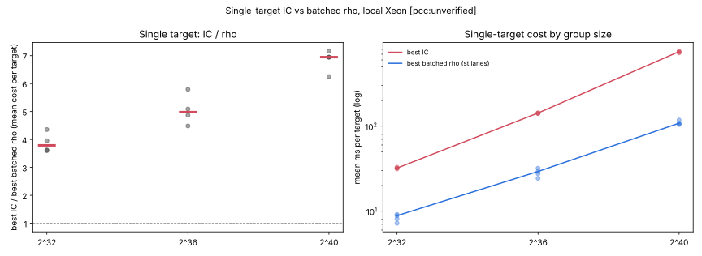

# Single target: the multi-target IC instrument is 3.8× / 5.0× / 6.9× behind batched rho at 2^32 / 2^36 / 2^40, and the gap grows with the group (2026-11-19)

Protocol: [`PROTOCOL.md`](PROTOCOL.md), [`run.py`](run.py), [`analyze.py`](analyze.py) and [`plot.py`](plot.py),
committed in `6f0a6cdf80` (wording `86825b7ab2`) before any measured run. Amendment A1 (`96304f3926`, before any data
was read): the first main run was stopped after build load on the host and restarted from scratch. The analysis was
run unchanged. Every number here is [pcc:unverified].

- Host: this session's container, **Intel Xeon @ 2.10 GHz**, 4 vCPU, THP `madvise`. Every execution pinned to CPU 2,
  one at a time, 17:46–18:01Z, idle otherwise, all with `MTF_HP=1` and `MTF_Z=1`. RunPod was asked for, but the
  account balance is negative, so no pod could be rented.
- Binary: SHA-256 `13c60206…`, built standalone with `rustc` at cargo's release settings from `f47b6e9d42`. The
  pre-run checks in [`check.out`](check.out) all pass:
  - multi-target output is unchanged;
  - `blk` is exact;
  - `st` recovered 96 of 96 test targets.
- **5,376 executions, 0 errors, every target recovered and checked by the harness; every key has 32 targets per
  instance.** Raw rows: `results/main/runs.jsonl` (SHA-256 `db099c57…`). Smoke: `results/smoke/`.
- Gate values: [`summary.json`](summary.json); figure: [`fig_st.svg`](fig_st.svg); report: [`REPORT.pdf`](REPORT.pdf).

## Gates

| gate | result | prior |
|---|---|---|
| correctness | **pass** | |
| **primary**: IC / rho cell medians 2^32 < 2^36 < 2^40 | **gap grows** (3.79 → 4.98 → 6.95) | 0.7 |
| IC behind in all three cells (> 1, 4 of 4) | **yes** | 0.95 |
| IC ahead in any cell | no | 0.02 |

## Per size (mean cost per target over 32 targets; ranges over the 4 instances)

| size | best IC (mean ms) | best IC μ | best batched rho (mean ms) | **IC / rho** | serial rho / batched rho |
|---|---|---|---|---|---|
| 2^32 | 31–33 | 2.0 | 7.2–9.1 | **3.79** (3.60–4.35) | 2.85 |
| 2^36 | 140–143 | 2.0–2.5 | 24.3–32.0 | **4.98** (4.48–5.79) | 2.92 |
| 2^40 | 726–764 | 2.5 | 104–118 | **6.95** (6.25–7.16) | 3.94 |

Where the IC's time goes (μ = 2.5 at 2^40, means over 32 targets): table build 275 ms, relation phase 391 ms, the
target's own search 32 ms. It finds m = 63 relations, at about 8.2 M relation-phase trials against 80 k trials for
the target itself.

Best rho keys use 16–64 lanes. Single-target rho's time per target varies widely (coefficient of variation about
0.5); the means over 32 targets absorb it.



## Reading

- **The multi-target IC instrument cannot compete with rho on a single target** [pcc:unverified]. It is 3.8× slower
  at 2^32, 5.0× at 2^36 and 6.9× at 2^40, behind on every instance.
- **The gap grows with the group, as the structure predicts.** With one target the IC still has to find a log for
  each of its m factor-base points, and each relation costs a search comparable to the target's own. The cost is of
  order √((m + 1)·n), against √n for rho, and m grows with the group here (29 → 41 → 57–63).
- **Its advantage in the multi-target rounds was amortisation.** One table and one set of factor-base logs served
  thousands of targets. At T = 1 nothing amortises, and batching, memory or tuning levers cannot remove a √(m + 1)
  factor.
- **Batched single-target rho** (lanes walking one target, one simultaneous inversion per round) is 2.85–3.94× faster
  than serial rho. It is the fair single-target reference; serial rho would have flattered the IC.
- The single-target optimum table is larger than the multi-target one (μ = 2.0–2.5 against 0.85), since relations
  dominate.

## What this does not say

This IC is a generic combination-table index calculus with no point decomposition. A decomposition-based index
calculus (summation polynomials), where a relation does not cost a full search, has a different cost structure and
is not measured here.

## Bench record

`benchmarks/records/20261119T1736Z-mt-st-2p32-2p40.json` gets this round's metrics and hashed raw files.
`benchrec close` is blocked, as for the two previous rounds, by main's malformed
`benchmarks/records/20261117T0334Z-hec-multi-production-cold.json`. The close command:

```
python3 tools/benchrec.py close benchmarks/records/20261119T1736Z-mt-st-2p32-2p40.json --status measured \
  --report research/mt_st_20261119/REPORT.pdf --svg research/mt_st_20261119/fig_st.svg \
  --summary "Single target (T=1): multi-target IC instrument / batched single-target rho 3.79x / 4.98x / 6.95x at 2^32 / 2^36 / 2^40 (behind 4/4, gap grows); batched rho 2.85-3.94x faster than serial; 5376 executions, 0 errors [pcc:unverified]"
```

## §5a pricing

Every arm is timed whole, so all native work is inside `ms_arm`; the 0 / 0.1 / 1 GAE band of unpriced native work
is empty for every arm, rho included.

## Not claimed

No `S`, no leaderboard or `benchmarks/` row (no replay certificate or validator report; planted targets on generated
instances). Wall time on one container, one binary.
