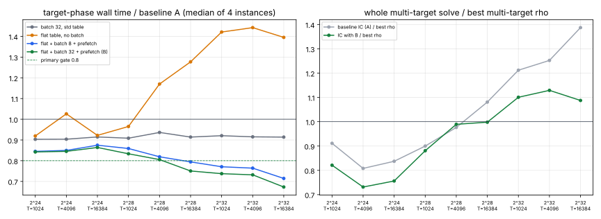

# Multi-target IC target phase: a compact, batched, prefetched table cuts it to 0.67–0.73× at 2^32

Protocol: [`PROTOCOL.md`](PROTOCOL.md), committed in `44759a4e48` with the instrument before any measured run.
Analysis: [`analyze.py`](analyze.py), committed in `61b3bc7fa8` before the holdout data was read, run unchanged.
Every number here is [pcc:unverified].

- Host: RunPod `cpu5c` pod (`b99pqtneiuoqu5`, AMD EPYC 9575F, 8 vCPU), every execution pinned to CPU 81, one
  process at a time, 22:24–23:12Z; the pod was deleted afterwards and confirmed gone. Binary SHA-256
  `f90910261c33be2d…`, checked on the pod with the instances (`results/MANIFEST.sha256`).
- **1,620 executions (36 configurations × 15 keys × 3 interleaved repeats), 0 errors, every target recovered and
  checked by the harness.** Smoke: 45 executions, 0 errors. Data: `results/holdout/runs.jsonl`, `host.json`; gate values:
  [`summary.json`](summary.json); figure: [`fig_layout.svg`](fig_layout.svg) ([`plot.py`](plot.py)).
- A local pre-run check ([`check_equal.py`](check_equal.py), 30 runs at 2^24–2^32) also found `ic5b` equal to `ic5`.

## Gates

| gate | result |
|---|---|
| correctness: every `ic5b` key recovers every target, counted totals I, M, S, H, L, N equal key A's, every configuration and repeat | **pass** (0 mismatches) |
| **primary**: target phase B/A ≤ 0.8 at 2^32, T = 4096 and 16384, 4 of 4 | **met**: 0.687–0.762 and 0.623–0.751 |
| null: B/A ≥ 0.95 there | not met |
| secondary: whole solve B/best rho ≤ 1 at 2^32 in ≥ 2 of 3 T cells | **not met**: 1.068–1.182 in every cell |

## Table (median over 4 instances of per-instance ratios; each key's time is the median of 3 repeats)

| bits | T | B/A target phase | batch 32 std / A | flat, no batch / A | flat + batch 8 / A | B/A whole solve | B / best rho | A / best rho |
|---|---|---|---|---|---|---|---|---|
| 24 | 1024 | 0.842 | 0.903 | 0.919 | 0.845 | 0.892 | 0.821 | 0.911 |
| 24 | 4096 | 0.845 | 0.904 | 1.026 | 0.850 | 0.889 | 0.731 | 0.808 |
| 24 | 16384 | 0.864 | 0.915 | 0.922 | 0.875 | 0.919 | 0.756 | 0.837 |
| 28 | 1024 | 0.833 | 0.909 | 0.965 | 0.859 | 0.984 | 0.881 | 0.900 |
| 28 | 4096 | 0.805 | 0.936 | 1.170 | 0.819 | 1.002 | 0.989 | 0.976 |
| 28 | 16384 | 0.750 | 0.914 | 1.277 | 0.794 | 0.925 | 0.998 | 1.081 |
| 32 | 1024 | 0.737 | 0.921 | 1.421 | 0.771 | 0.886 | 1.101 | 1.212 |
| 32 | 4096 | 0.732 | 0.915 | 1.442 | 0.764 | 0.907 | 1.129 | 1.252 |
| 32 | 16384 | 0.673 | 0.914 | 1.395 | 0.715 | 0.794 | 1.087 | 1.387 |

## Reading

- **An improvement of the multi-target IC baseline** [pcc:unverified]**.** With identical counted operations and identical recovered
  logs, the target phase takes 0.67–0.74× the baseline's time at 2^32. The gain grows with the group (0.84–0.86× at
  2^24), as expected if the cost being hidden is cache misses on a table that outgrows the caches. The whole solve
  takes 0.79–0.91× at 2^32, because the target phase is only part of it.
- **Where the gain comes from.** Batching alone (std table) gives 0.91–0.94×. The flat layout alone is *slower*
  at 2^28–2^32 (1.17–1.44×), so the compact layout by itself is not the lever. Flat + batch + prefetch gives
  0.67–0.77×: the gain is overlapping the cache misses of many independent probes, which the flat table's
  computable slot address makes possible. Batch 32 beats batch 8 in every 2^28–2^32 cell.
- **Against rho.** The trend still runs against the IC. At 2^24 the improved IC is 0.73–0.82× the best rho (was
  0.81–0.91×). At 2^28 it is 0.88–1.00×. At 2^32 it is 1.09–1.13× (was 1.21–1.39×): about half of the 2^32 gap is
  closed, but the IC is still slower than rho there. Nothing here touches the structural BSGS gap
  (`../mt_bsgs_gap_20261111/`).

## Not claimed

No `S`, no single-target change, no BSGS result, no leaderboard or `benchmarks/` row (wall time on a shared cloud
pod, one binary, read as paired ratios; no replay certificate or validator report yet). The rho arms were not given
the same batching/prefetch treatment; their tables are probed far less often per unit of work, but an equally tuned
rho could narrow the remaining comparison either way.
