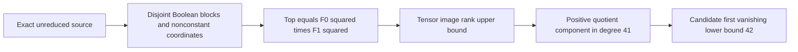

# Candidate obstruction for Boolean coordinate encodings

2026-10-30. Unvalidated derivation and next dataset specification. This note
promotes no bound and changes no recorded result. The completed radix census
remains an exhaustive result only for its specified presentation family.

## Source and scope

Read HILBERT_DESIGN.md, RADIX_PRESENTATION_DESIGN.md and
PRIME_LEFSCHETZ_CANDIDATE.md before this construction. The latter addresses
higher-m syzygies and is a different unfinished construction. Rechecked
Lundqvist–Nicklasson, https://arxiv.org/html/1604.06820, Section 2,
Theorem 2.2 and Remark 2.3: square-zero block ranks for powers of a linear form
have a large-characteristic justification. That theorem supports the existing
linear baseline; it does not establish the arbitrary-form argument below.
No novelty claim is made.

Proposed scope: a prime short-Weierstrass m=2 source consisting of the single
Semaev equation S3(f0(a),f1(b),t) and the 54 Boolean equations, where each
nonconstant coordinate polynomial uses its own disjoint block of 27 selectors.
Take ordinary highest homogeneous forms BEFORE quotient reduction. No added
curve-lift constraints, auxiliary variables, affine consequences, or preprocessing.
A candidate domain can differ from the original interval; injectivity, cardinality,
curve lifts and factor-base identity are separate obligations. This proposed
obstruction alone needs none of those properties, but a claimed eligible factor
base must verify them. Restrict coordinate polynomials to their multilinear
representatives for the proposed finite degree-pair dataset.

## Proposed argument, pending independent checking

Write di=deg(fi)>=1 and Fi=top(fi). In the short-Weierstrass S3, the term
X0^2 X1^2 has degree 2d0+2d1 after substitution, strictly exceeding every other
term, since both di are positive. Therefore its original highest form is
F0^2 F1^2. This must be checked against the actual source convention.

Put A=k[a1,...,a27]/(ai^2), B=k[b1,...,b27]/(bi^2). The proposed top quotient
is Q=(A tensor B)/(F0^2 F1^2), bigraded by selector block. A degree-j block has
h(j)=binomial(27,j) basis monomials, with h(j)=0 outside 0..27.
Multiplication by F0^2 F1^2 in bidegree (i,j) is a tensor product, so its rank
is the product of the two block ranks. This remains true if either factor
vanishes in its square-zero quotient.

In bidegree (27,14), the first block rank is at most dim(A27)=1.
The second block rank is at most h(14-2d1)<=h(12), since d1>=1 and the binomial
coefficients increase through degree 13. Consequently

    dim Q_(27,14) >= h(14)-h(12) > 0.

This would certify nonvanishing in total degree 41. A standard graded algebra
has no nonzero component after its first zero component, so its first vanishing
degree would be at least 42. Unlike exact baseline ranks, this dimension
inequality needs no Lefschetz assumption.

If d1>=2, the same argument in bidegree (27,15) gives

    dim Q_(27,15) >= h(15)-h(11) > 0,

and hence first vanishing degree at least 43. Swap blocks if only d0>=2.
If both coordinates have degree one, the existing nonzero-weight baseline
attains 42 in the actual large prime. Zero weights do not invalidate the
proposed lower bound, but invalidate an automatic maximal-rank assertion.

These implications concern the original-top graded-vanishing convention only.
They do not give FFD, LFD, solving degree, binary Weil-descent regularity, or
higher-m regularity. Reducing S3 by Boolean equations BEFORE extracting its top
can change the presentation and is deliberately outside these hypotheses.

## Next dataset and proof obligations

Before production, freeze a protocol identifying the exact source, immutable
baseline and computation units. Do not silently reuse the radix protocol.

1. Native small-block controls: independently expand arbitrary homogeneous
   coordinate forms, construct the complete multiplication matrices, and compare
   quotient dimensions to the tensor formula. Include zero square factors,
   missing weights, unequal degrees and small characteristics. Preserve matrices
   and coefficients, including failures. Check the source top before reduction.
2. Native n=27 finite certificate: cover all 729 multilinear degree pairs
   (d0,d1) in 1..27. Retain the witness bidegree, target dimension, source-dimension
   rank bound, positive difference and resulting first-vanishing lower bound.
   This verifies the arithmetic for all pairs, not the universal polynomial bridge.
3. Negative applicability controls: constant coordinates, overlapping selector
   blocks, an added equation, and preprocessing must not receive this certificate.
   Reject or label them outside scope, rather than count them as counterexamples.
4. Formalization: squarefree graded basis, tensor image/rank, exact S3 highest
   form, quotient nonvanishing, and no-gap implication. A finite arithmetic Lean
   lemma alone cannot certify this statement. No formalization is claimed here.
5. Independent scientific review before changing a result table. Then join only
   actual sources satisfying every hypothesis. Keep higher-m and binary sources
   separate. Retain fresh replay, S3-restored replay and source identities.

## Planned file structure

The future dataset should contain source-binding.json (actual polynomial/source
hash and presentation gates), cases/DEG0-DEG1.json (degree pair, explicit rank
bound and witness dimensions), controls/ (full forms and matrices with field
and basis order), manifest.json (path, byte count, SHA-256), summary.json
(exact scope, covered pairs, rejections and null unresolved quantities), and
proof-map.json (each obligation, declaration or written proof, and status).
No files described in this paragraph are claimed generated by this note.

