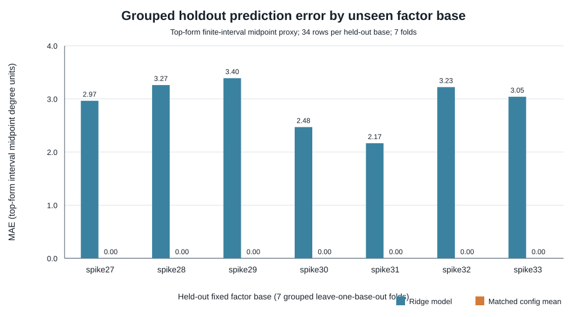

# Full-domain N83 top-form model, fixed factor bases (2026-11-01)

**Measured result.** Seven fixed factor bases (spike27–spike33), each evaluated on the same 48 family/m/target configurations, produced 336 top-form certificates. Independent replay verified all 336. Across all 48 matched configurations, the certificate status and both interval bounds were identical across the seven bases. The grouped ridge model therefore found no predictive lead in these labels: its 7-fold grouped out-of-base MAE was 2.939, while the matched-configuration mean baseline had MAE 0.000. It won 0/7 held-out bases.

## Scope and interpretation

This is a model of the **top-form certificate finite-interval midpoint proxy**, not exact degree of regularity, FFD, LFD, affine solving degree, or a general ranking of factor bases. There are 238 finite-interval rows and 98 positive-dimensional-top-ideal rows without a finite label. Each base contributes 34 finite-label rows and 14 positive-dimensional rows. The equality statement compares exact `(status, dreg_lower_bound, dreg_upper_bound)` tuples for the 48 matched family/m/target configurations across all seven bases.

The result points to a concrete next lead: for these configurations and this top-form certificate, changing among these seven factor bases does not change the observed label. The current feature model cannot identify an elite base because the target is invariant at the measured resolution. The next useful model must use a label that responds to the factor-base selection, such as a separately checked downstream degree/cost quantity, while keeping the bases fixed and grouped held-out validation. This does not imply equality of the underlying ideals or any unmeasured solving cost.

## Model and validation

The runner fitted ridge regression (alpha 10, train-only standardization, unpenalized intercept) with seven leave-one-base-out folds. Features were system dimensions, family/target indicators, and summary statistics of sampled factor-base point coordinates/selectors. The baseline predicts the training mean for the same family, m, and target kind. Finite interval labels use the midpoint of the certified interval; positive-dimensional labels are excluded from regression and counted separately. The exploratory-lead rule required at least 5/7 fold wins and a lower aggregate MAE. It was not met.

| Held-out base | Finite rows | Ridge MAE | Matched-config baseline MAE |
|---|---:|---:|---:|
| spike27 | 34 | 2.973 | 0.000 |
| spike28 | 34 | 3.270 | 0.000 |
| spike29 | 34 | 3.399 | 0.000 |
| spike30 | 34 | 2.476 | 0.000 |
| spike31 | 34 | 2.171 | 0.000 |
| spike32 | 34 | 3.231 | 0.000 |
| spike33 | 34 | 3.049 | 0.000 |



## Inputs, protocol, and replay

- Fixed bases: `attempt-05/inputs/spike27` through `spike33`; each samples selectors from the same 2^27 candidate x-domain. Selector lists are candidate-specific after lift/rejection, so this is not a paired point-for-point basis comparison.
- Systems: 48 per base, across Koblitz, binary, and prime families, m=2–9, and natural/planted target kinds.
- Frozen protocol v3 SHA-256: `280a78bd11e6fc20ae274c47525070a2cb6e455401593774b1688dbdd9537e94`.
- Labeler binary SHA-256: `4749b49ba7e98cd916c9d36d4b14c0396041fd6ff31e3708e17e7a91749fe53a`.
- Label summary: `attempt-05/top/top-summary.json`; model result: `attempt-05/model/result.json`; row-level inputs and predictions: `attempt-05/model/rows.json`, `predictions.json`. Per-base certificate and replay summaries live under `attempt-05/top/spikeNN/`.
- Input generation summary: `attempt-05/generation-summary.json`; all 336 generated inputs passed their saved factor-base membership and source-digest checks.
- Commands used:
```text
python3 research/n83_candidate_pdp_20261028/evidence/model-expansion-followup-20261101/run_top_full_domain.py
python3 research/n83_candidate_pdp_20261028/evidence/model-expansion-followup-20261101/train_full_domain.py
```

Top-form producer and replay timings are diagnostic only and are not used as performance claims. The exact raw rows and certificates remain the supporting records.
