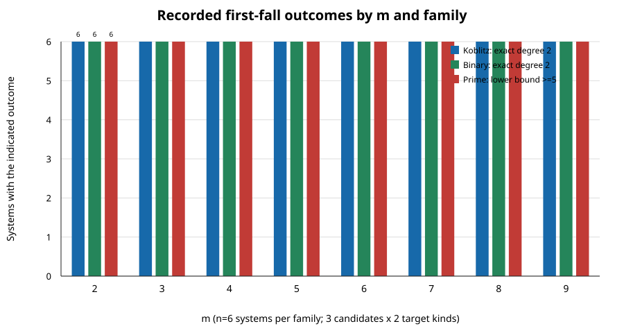

# N83 fixed-base first-fall continuation: 144 systems

**Outcome.** The frozen V2 first-fall procedure now has 144/144 preserved certificates and fresh replays across spike35, spike36, and spike37, with m=2–9, families Koblitz/binary/prime, and planted/natural target variants. The original attempt-01 runner exception after its first case is preserved; the remaining 143 cases completed under the separate attempt-02 continuation.

Protocol: `N83-FACTOR-BASE-PDP-FFD-LFD-20261031-V2`; frozen digest `50cd6f8213789de2dfd54a3b33a067ed87cc0def761b7c98769be3e19aee47a9`. Attempt-02 independent checker: 143 certificates hashed and bound, 143 fresh replays verified, no problems. The recovered attempt-01 certificate was separately downloaded byte-for-byte from S3 and replayed successfully. The producer exit code for that first case was not captured and remains unknown.

## Recorded outcomes

- **binary:** 48 exact degree-2 first-fall certificates; 0 cases with lower bound 5.
- **koblitz:** 48 exact degree-2 first-fall certificates; 0 cases with lower bound 5.
- **prime:** 0 exact degree-2 first-fall certificates; 48 cases with lower bound 5.

At every m, each family contains six systems (three candidates × two target kinds). Koblitz and binary records report an explicit degree-2 first-fall result. Prime-family records report a lower bound of 5 with no exact first-fall degree found within this procedure. These are recorded first-fall outcomes, not LFD or affine degree-of-regularity results.

## Methods and provenance

The 144 systems reuse the pre-existing fixed factor-base dataset; no bases were regenerated. The preflighted x-domain remains the fixed 2^27 candidate domain. V2 limits each case to 60 seconds and 8 GiB, runs sequentially, and fresh-process replay checks each certificate. Attempt-01 used a runner that failed with `TypeError: bounded() missing 1 required positional argument: env` after writing its first certificate; its raw error and certificate were retained. Attempt-02 excluded that verified case and processed exactly the other 143.

Evidence files: `../attempt-01/`, `../attempt-02/`, and `combined-summary.json`. S3 records are under `s3://setec-astronomy-artifacts/runs/n83-ffd-lfd-factorbase-panel-20261102/v2/` with separate attempt prefixes; the archival bundle is recorded in `S3-CUSTODY.json`.

## Claim boundary and next step

This run measures only first-fall certificates/lower bounds. It does not establish last fall degree, affine degree of regularity, solving degree, or a factor-base ranking. The existing executable does not perform the frozen binary closure component needed for exact LFD; the next step is to implement/freeze that procedure, then run it across the same fixed-base cohort.
