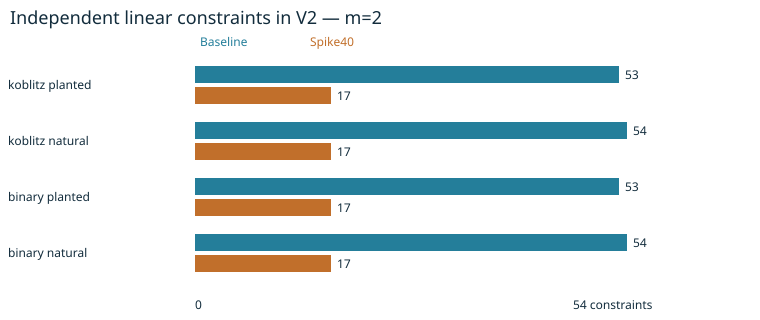

# Paired n83 baseline/spike40 fall panel

Observations only; no elite-base, regularity, solving-speed or ECDLP claim.

All96 FFD computations,64 binary V2 closures,160 producer replays and96 structural
catalogs completed. All48 pairs have identical targets, planted tuples and witnesses.
Natural baseline source hashes equal the original fixed-base systems. Planted
points are sampled only from the bases' common low26 support.

| Quantity | Baseline | Spike40 |
|---|---:|---:|
| Koblitz/binary FFD, m2..9 | 2 | 2 |
| Prime FFD, m2..9 | >=5 | >=5 |
| Koblitz/binary m2 planted V2 linear rank | 53 | 17 |
| Koblitz/binary m2 natural V2 linear rank | 54 | 17 |
| Koblitz/binary m2 exact LFD | 2 | unknown |
| Koblitz/binary m3..9 V2 linear rank | 1 | 1 |
| Exact regularity / intermediate solving degree | unmeasured | unmeasured |

Candidate LFD unknown does not mean LFD>2. Prime exact FFD and all prime LFD
remain unknown. For larger binary m, both arms have equal recorded V2 closure
ranks; neither supplies a global LFD upper certificate. The m2 elimination
results differ despite identical FFD, on the same targets and representation.

Run06:18:11–06:25:17UTC on28October2026. One native process at a time,8GiB virtual
cap,60seconds per closure/replay; no retry, timeout or process failure. All989
raw-manifest hashes and160 fresh producer replays pass. No independent review or
performance qualification is claimed.

- [Paired native results](../../evidence/pdp/paired-summary.json)
- [Unified export](../../experiment-pdp.export.json)
- [Frozen protocol](../../protocol-pdp.json)
- [File structure](../../PDP_FORMAT.json)
- [Binary closure layout](../../PDP_COMPONENT_FORMAT.json)
- [Archive and S3 pointers](../../evidence/pdp-storage.json)
- [PDF](report.pdf)

The next planned measurement is a separately frozen higher-degree closure on the
same m2 candidate systems. All larger-m, prime and regularity requirements remain
open. Earlier bases, failures, source, executables and raw traces are retained.
