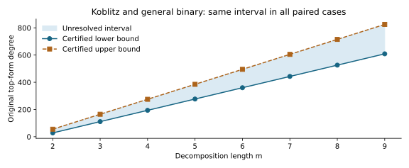

# Paired n83 top-form certificates

Observations only. Run `n83-paired-top-20261028-r1` certifies original-top
regularity bounds on the exact96 retained paired systems. It makes no scientific
promotion, exact finite-degree assertion inside an interval, or elite-base claim.

All96 producers,96 fresh replays and16 prime paired graded-isomorphism checks
passed. The ten native unit controls passed. No production failure, timeout,
retry, resume or exclusion. These exact input-specific records supply no
population inference or timing comparison.

| m | Koblitz and binary, both bases and targets | Prime, both bases and targets |
|---:|---|---|
| 2 | 28 <= dreg <= 55 | 29 <= dreg <= 55 |
| 3 | 111 <= dreg <= 165 | positive-dimensional top quotient |
| 4 | 194 <= dreg <= 275 | positive-dimensional top quotient |
| 5 | 277 <= dreg <= 385 | positive-dimensional top quotient |
| 6 | 360 <= dreg <= 495 | positive-dimensional top quotient |
| 7 | 443 <= dreg <= 605 | positive-dimensional top quotient |
| 8 | 526 <= dreg <= 715 | positive-dimensional top quotient |
| 9 | 609 <= dreg <= 825 | positive-dimensional top quotient |

Each binary row summarizes eight recorded cases: two bases, two families and
two target kinds. They have identical intervals. The shaded range remains
unresolved. These are bounds on original top-form regularity, not LFD or
intermediate solving-degree observations. Upper bounds did not tighten:
original linear-top rank is zero in all64 binary systems. This zero is measured,
not substituted for an unknown. All failed projection candidates are retained.

For the binary cases the stronger greedy projection retains27 selector variables
from a base block and83(m-2) intermediate variables. Each original top generator
vanishes under the checked projection modulo retained variable squares. Its
squarefree product survives in degree27+83(m-2), certifying the recorded lower
bounds. This is a presentation-dependent obstruction checked on all saved inputs;
it is not a universal theorem for arbitrary encodings. The larger bound comes
from a stronger certificate on unchanged equations, not a new harder input.

All16 prime pairs have an explicit graded-isomorphism certificate. The diagonal
map scales the last selector in each block by16384 and all other variables by1;
the inverse of16384 modulo the saved prime is4835408130856784033218561. Every
source selector weight maps exactly, every original highest S3 form maps to
its counterpart, and selector-square generators acquire nonzero multiples.
Thus these original top quotients have identical Hilbert functions and the
same regularity convention. This is not an equivalence of the affine Boolean
selector ideals. For m3..9, both top quotients are positive dimensional; no
finite graded vanishing degree exists in this definition. No infinite
Castelnuovo–Mumford regularity claim follows.

## Inputs and method

Baseline coordinates use positions0..26; spike40 uses0..25,40. Every curve has
2^27 candidate x-values, with fixed point manifests throughout m2..9. No input
polynomial, target, curve or base point is changed here. Natural targets are
paired; planted tuples use the common low26 support and are not uniform over
whole bases. Candidate roots still require curve-lift and sign checks.

The native parser cancels terms within each original polynomial before selecting
its highest part. Six deterministic coordinate projections are retained:
first27, first26, all base selectors, low26 per block, greedy ascending and
greedy descending. The greedy maps are not claimed optimal. A projection fails
if any original top monomial survives; its failed terms stay in the record.

All variable field tops are squares. Rank r of original linear tops is certified
by XOR witnesses in original generator IDs. Quotienting by squares and those
r linear forms gives an upper bound nvars-r+1 in characteristic2. No affine
row reduction or lower-degree consequence is added. Prime source formulas and
actual selector weights are checked literally before their projection or map
certificates are accepted. Fresh-process replay recomputes all checks.

## Provenance and retention

Started2026-10-28 15:40:16 UTC; terminal2026-10-28 15:45:17 UTC. Existing Spot
host after recorded EKS shared-bucket authorization denial. One native process,
8GiB virtual memory,900seconds each producer/replay,1900seconds outer, no retries.
Times are diagnostic only; per-case CPU/RSS and qualified wall time are absent.

Source commit94b5400d9cbd670a048307809e439c6859fa24a0; frozen protocol
commit5af325f18cc. Protocol version2 SHA256
5b0a75feb54abe9be95f384be778d804e985656e608a11c2684c40ea9312edb7.
Native SHA256
5bbcafb370fea6310cd78c377aacc613cad3d8e4ff9b0f322d79c8f987322e4c.
The predata amendment corrected a premature source revision pin; no affected
production occurred under version1. Both freezes and validation failures remain.

Launch: `run-top.sh BINARY PRIOR_PAIRED_RAW FRESH_OUT`, under the outer timeout.
Per-pass commands: `instrument run OUT/inputs OUT/certificates` and
`instrument replay OUT/inputs OUT/certificates`. Original seed20261027 is retained;
no target is resampled. Frozen source archive SHA256
376fa9b2fc4b97f03f1a76e09291ed3886ba9581b06b9207e7a7f93e153a9bce was downloaded
from S3 and verified. The complete raw run is one deterministic archive, with
original inputs, all112 certificates, failed projections, executable, controls,
logs, partial summary, final summary, replay, environment and manifest.

See `../../evidence/top-storage.json`, `../../TOP_FORMAT.json`,
`../../experiment-top.export.json` and `../../protocol-top.json`.
Extract the archive into a fresh directory and run `sha256sum -c manifest.sha256`.
Raw prefix: `s3://setec-astronomy-artifacts/runs/n83-paired-top-20261028-r1/local/`.
Producer replay is not independent scientific review.

Definitions and scope: [Caminata–Gorla](https://arxiv.org/html/2112.05579);
S3 and first-fall caution: [Kosters–Yeo](https://arxiv.org/html/1503.08001).
The original fixed-base and paired FFD/LFD datasets remain intact. Prime exact
finite regularity, larger-m/prime LFD, held-out candidate comparisons and an
elite-base result remain open.
