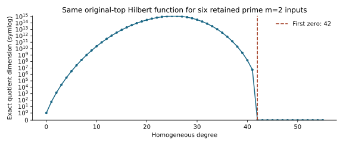

# Exact prime m2 original-top Hilbert certificates

Observations only. Run `n83-prime-m2-hilbert-20261028-r2` completed 6 source
certificates and 6 fresh-process replays. R2 had no failure, timeout, retry, resume
or exclusion. The preceding r1 failed closed on its first source check; the
other five cases were not reached. All r1 raw files and partial computations
are retained in hilbert-archives/r1-failed.tar.xz and its separate failed export. These are retained input identities, not independent random samples.

| Dataset | Target | Exact original-top degree |
|---|---|---:|
| original | planted | 42 |
| original | natural | 42 |
| baseline | planted | 42 |
| baseline | natural | 42 |
| spike40 | planted | 42 |
| spike40 | natural | 42 |

The original fixed-base pair and four paired baseline/spike40 inputs all have
first zero homogeneous quotient degree **42**. The coefficient at degree
41 is **5348880**; the coefficient at degree 42 is
**0**. The total quotient dimension is **9159376218609600**.
All coefficients and all 784 bidegree image dimensions are retained in
`evidence/hilbert/hilbert.json`. These exact arithmetic values apply to the
ORIGINAL highest-form ideal; no affine consequence was added.



The graph plots recorded coefficients, with a symmetric-log axis so zero is
visible. All six certificates point to the same exact function. Original and
paired natural source files may coincide. The paired planted targets use the
common low26 intersection; the original planted target differs.

## Method and controls

The strict checker matches every byte of each complete m2 S3 presentation and
all 54 selector equations against its frozen metadata. Nonzero coordinate
weights normalize to two disjoint27-variable blocks. Modulo variable squares,
the remaining top generator is the product of the two squared sums.
The Wilson inclusion-matrix diagonal formula gives ranks for each block;
bidegree tensor images give the Hilbert function. All weights/inverses,
rank diagonals, multiplicities and residues are saved. A native full Lucas
primality certificate verifies p=4835703278761981908090881; p>27 satisfies
the finite-characteristic condition. The written proof is HILBERT_DESIGN.md.

Controls passed: 168 explicit rank matrices,
63 explicit product-quotient degree matrices,
and 44 detected nonmaximal-rank small-characteristic
cases. Eight development unit tests passed. The fresh replay uses the producer
implementation; independent scientific review remains pending.

Lean 4.34.1 kernel-checked the finite combinatorial first-zero calculation with
no axioms. The inclusion-rank theorem and polynomial/tensor bridge are NOT
formalized; HILBERT_PROOF_MAP.json states every missing bridge. This is partial
formalization, not a fully Lean-proven regularity theorem.

## Execution and retention

UTC 2026-10-28T16:40:30Z to 2026-10-28T16:40:33Z, existing-host fallback after the
retained EKS shared-bucket denial. One thread, 2 GiB, 120 s each producer/replay,
no clock comparison. Source `64e06657f1a2e6df003130fa7f4e9a034d44b826`;
protocol `97da83f16a1a375a486546970b5b95c3313a63f838b366d07ff504209323a32b`. Exact command:

```sh
bash research/n83_candidate_pdp_20261028/run-hilbert-v2.sh /home/ec2-user/n83-candidate-recovery/target/release/hilbert_v2 /home/ec2-user/n83-candidate-recovery/hilbert-r2
```

Raw data: `/home/ec2-user/n83-candidate-recovery/hilbert-r2` and
`s3://setec-astronomy-artifacts/runs/n83-prime-m2-hilbert-20261028-r2/local/`.
`hilbert-archives/runs.tar.xz` is the deterministic archive; its content-addressed
S3 identity and restoration instructions are in `evidence/hilbert-storage.json`.
All sealed file hashes were verified after S3 download into a fresh directory.
The source archive and publication helpers are retained separately.
`experiment-hilbert.export.json` carries the complete six-row flow and file hashes.

## Limits

This does not measure solving degree, affine basis degree or LFD, and does not
establish an elite factor base. Binary/Koblitz exact regularity and larger-m
LFD remain open. Earlier larger-m prime top quotients are positive-dimensional
in their saved presentation; do not assign them a finite vanishing degree.
Earlier resource-limited solver logs and every old dataset remain preserved.

Primary sources read: Ghorbani et al., Corollary 3,
https://arxiv.org/pdf/0709.3144; Phuong and Tran, Theorem 2.7,
https://arxiv.org/pdf/2211.13548. The characteristic hypotheses are checked,
not inferred from a characteristic-zero statement.

The current layout guide is `HILBERT_FORMAT_V2.json`. Dimensions use exact
JSON integers; total_dimension exceeds2^53, so use an exact integer parser.
