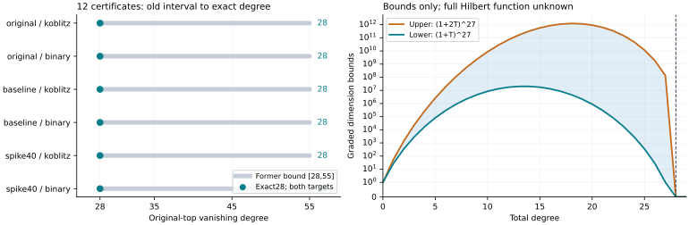

# Exact binary/Koblitz m=2 original-top regularity

All 12 retained cases have exact degree 28. The producer, fresh-process replay and S3-restored replay passed on every case. Previous bounds28–55 are closed for these saved systems.

| Dataset / family | Targets | Former bound | Exact degree | Quadratic rank |
|---|---:|---:|---:|---:|
| original / koblitz | 2 | 28–55 | 28 | 53 |
| original / binary | 2 | 28–55 | 28 | 53 |
| baseline / koblitz | 2 | 28–55 | 28 | 53 |
| baseline / binary | 2 | 28–55 | 28 | 53 |
| spike40 / koblitz | 2 | 28–55 | 28 | 67 |
| spike40 / binary | 2 | 28–55 | 28 | 67 |

The original, paired baseline and spike40 domains each have 2^27 candidate x-coordinates. A domain stays fixed across m=2..9. These12 certificates reuse the unchanged saved m=2 sources. Original planted targets differ from paired planted targets; duplicate natural inputs are provenance identities, not independent samples.

The checker reconstructs every source byte. Product coordinates are written as explicit F2 combinations of original quadratic equations. A checked invertible 27-by-27 matrix over F2^83 changes variables so the ideal contains27 pair products plus all squares. The resulting quotient vanishes at degree 28; the projection onto 27 square-zero variables has a nonzero degree 27 monomial. Matching bounds give exact28. The saved Hilbert arrays are bounds, not exact full Hilbert functions.

Spike40 changes quadratic rank 53 to 67 but does not lower original-top regularity on these m=2 targets. Previously certified paired binary/Koblitz LFDs remain 2 for baseline and 3 for spike40. Those are different invariants. Prime m=2 original-top degree 42 was certified in the preceding report. No elite-base improvement is established here.

Validation: five native tests;128 independent multiplication comparisons;512 direct S3 Boolean evaluations;8 explicit small quotient Hilbert cases; all field Frobenius checks;27 pair relations with 729 checked coefficients per case; both matrix inverse products; full source and lower projection checks. Lean formalizes the elementary27-slot bound only, using standard propext and Quot.sound. The algebraic bridge is written/native evidence; independent review is pending.

Data: [verified summary](../../evidence/binary-pair/verified-summary.json), [unified export](../../experiment-binary-pair.export.json), [file-format guide](../../BINARY_PAIR_FORMAT.json), [proof and literature](../../BINARY_PAIR_DESIGN.md), [storage receipt](../../evidence/binary-pair-storage.json). Raw archive contains60 manifest entries plus the manifest; all 60 matched before and after S3-restored replay.

Archive: `s3://setec-astronomy-artifacts/store/sha256/38/38c0fd69215a2cf966a2bd14049f4f5b465aa8b4302f363c77c23079aca861dc`; SHA256 `38c0fd69215a2cf966a2bd14049f4f5b465aa8b4302f363c77c23079aca861dc`. Source commit `ac08cf2f9029145b48e799c1de5ede0564732b3d`; frozen protocol `95cf1fbd579f98e7b766b3fceb105b833d90c372566e180defe027e13cf95ad6`. Data commit `4f52357908db49c3fb9171c969603464de7362c9`. Run 17:15:52–17:16:05 UTC; wall time is diagnostic, not performance evidence. Existing-host fallback follows retained EKS bucket denial; no infrastructure permissions were changed.

Larger-m binary regularity/LFD, prime LFD and held-out base comparisons remain open. Prime m=3–9 original top quotients are positive-dimensional in the current presentation. This batch makes no universal FFD/LFD, solving-degree, attack or speed claim. Every prior dataset and failed attempt remains preserved.
