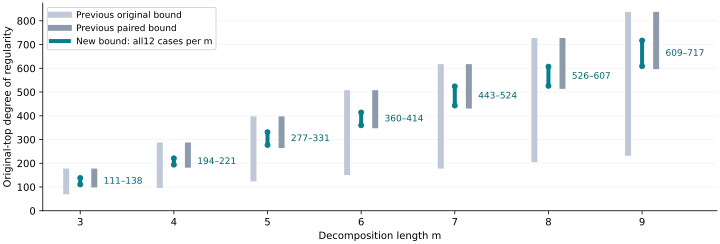

# Stronger original-top binary chain bounds

All 84 retained binary/Koblitz cases passed producer, fresh replay and S3-restored replay. The new intervals below hold for original/baseline/spike40, both families and both target kinds. They tighten knowledge about unchanged systems; they do not demonstrate a lower degree caused by a new factor base.

| m | Previous original | Previous paired | New interval (12 cases each) | Selected disjoint blocks |
|---:|---:|---:|---:|---:|
| 3 | 82–165 | 111–165 | **111–138** | 1 |
| 4 | 109–275 | 194–275 | **194–221** | 2 |
| 5 | 136–385 | 277–385 | **277–331** | 2 |
| 6 | 163–495 | 360–495 | **360–414** | 3 |
| 7 | 190–605 | 443–605 | **443–524** | 3 |
| 8 | 217–715 | 526–715 | **526–607** | 4 |
| 9 | 244–825 | 609–825 | **609–717** | 4 |

Every exact full-system degree remains unknown in this batch. The m2 results remain Koblitz 28, binary 28 and prime 42. Higher-m prime top quotients remain positive-dimensional in the saved presentation. No input, target, point domain or affine preprocessing rule changed.

The source checker verifies every original highest coefficient and complete support, all variable squares, ring and witness suffix. It selects nonadjacent S3 groups on disjoint variable blocks. Explicit field/matrix and coefficient certificates prove each isolated component reduces its square-zero socle upper bound by 27. The final quadratic block's missing product direction contributes only a degree 2 defect, which cannot change its degree 84 vanishing threshold. Tensoring the selected disjoint blocks yields the upper bound. Projection onto the first 27 selectors and all intermediate variables gives the lower bound.

Validation: five native tests,30 explicit small quotient Hilbert calculations (24 quadratic,6 cubic),128 independent field arithmetic comparisons, Rabin certificates, both matrix inverse products and all coefficient identities. All 84 producer and84 fresh-process replays passed. The S3-restored instrument replayed all 84 again; all 360 raw manifest entries matched before and afterward. All 84 immutable progress snapshots remain in the archive. These are producer replays; independent scientific review is pending. Lean proves slot-sum arithmetic only, not the full algebraic bridge.

Data: [summary](../../evidence/chain/verified-summary.json), [unified export](../../experiment-chain.export.json), [proof](../../CHAIN_DESIGN.md), [formats](../../CHAIN_FORMAT.json), [storage](../../evidence/chain-storage.json).

Archive: `s3://setec-astronomy-artifacts/store/sha256/5d/5da13e39bbc9db23f61a2fbd709da896bda04b1bb8eacbe78c218011758d579d`. SHA256 `5da13e39bbc9db23f61a2fbd709da896bda04b1bb8eacbe78c218011758d579d`. Source `8ccd4eb9729cb01767064e41c5507dcb0476b2ac`; protocol `ce0a47828dbf3f0dcfe311cefd43730ab671dcf9ac1da7e0cee8ecd2d9a1fb72`; data `19c6cc710c2acfafef5a20ad7847f48d44524428`. Run 2026-10-28T17:53:44Z through 2026-10-28T17:56:19Z; wall time diagnostic only. Existing-host fallback follows retained EKS bucket denial; no permissions or capacity changed. Every prior dataset and failed attempt remains.

These overlapping intervals do not order baseline and spike40. Larger-m exact regularity/LFD, prime LFD, held-out target studies and an elite-base improvement remain open.
