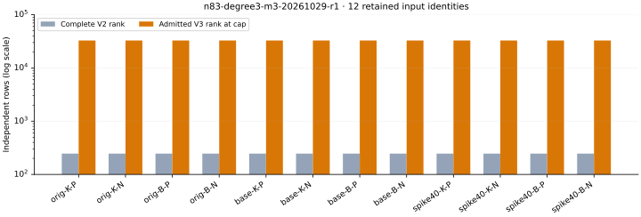

# Retained n83 m3 degree-three closure

Run `n83-degree3-m3-20261029-r1`. Producer observations only; independent scientific review is pending. Of 12 retained cases, 12 passed producer and fresh replay. 12 certify LFD>=3; 0 have an exact LFD certificate. 0 queues exhausted. A capped V3 subspace is not complete V3, and a resource limit is not a degree bound.

| Case | Admitted V3 rank | Linear rank | LFD lower | LFD upper | Termination |
|---|---:|---:|---:|---:|---|
| original-koblitz-m3-planted | 32768 | 1 | 3 | unknown | row_cap |
| original-koblitz-m3-natural | 32768 | 1 | 3 | unknown | row_cap |
| original-binary-m3-planted | 32768 | 1 | 3 | unknown | row_cap |
| original-binary-m3-natural | 32768 | 1 | 3 | unknown | row_cap |
| baseline-koblitz-m3-planted | 32768 | 1 | 3 | unknown | row_cap |
| baseline-koblitz-m3-natural | 32768 | 1 | 3 | unknown | row_cap |
| baseline-binary-m3-planted | 32768 | 1 | 3 | unknown | row_cap |
| baseline-binary-m3-natural | 32768 | 1 | 3 | unknown | row_cap |
| spike40-koblitz-m3-planted | 32768 | 1 | 3 | unknown | row_cap |
| spike40-koblitz-m3-natural | 32768 | 1 | 3 | unknown | row_cap |
| spike40-binary-m3-planted | 32768 | 1 | 3 | unknown | row_cap |
| spike40-binary-m3-natural | 32768 | 1 | 3 | unknown | row_cap |

The original, paired baseline and spike40 datasets retain their 2^27-candidate per-curve bases across m=2–9. This batch uses only the existing m3 Koblitz/binary presentations, 164 variables each; no target, point or equation was regenerated. Original planted targets differ from paired planted targets. Natural targets repeat across original/baseline, so 12 provenance identities are not 12 independent draws. The presentation uses candidate x-coordinates; any proposed point decomposition still requires curve lifts and signs.

A recorded degree<=2 polynomial is generated by ordinary-degree<=3 row operations and has a nonzero echelon remainder against the fully replayed complete V2 space. This proves LFD>=3 for that saved presentation. The witness is retained with its row ID, polynomial columns, V2 reductions and remainder. No plateau or unfinished queue establishes global stabilization. Exact LFD would require a matching global upper certificate. The frozen batch requested and attempted 12 cases; all 12 producer processes and their replays completed, with 12 row caps, zero process errors and zero timeouts. No case completed the full V3 closure.

The new instrument uses direct graded-colex indices for 735295 squarefree columns. Seven native tests pass: all column indices, products across 64/128 variables, ordinary-degree guard, missing fields, duplicate IDs, positive/negative LFD controls, capped traces and false-completion/tampered-trace rejection. Every admitted row and the remaining queue is replayed. Native runtime controls also pass.

S3 verification: 12 restored replays; all 230 raw manifest entries match before and after replay. Twelve immutable cumulative summaries, all rows/operations, original inputs and V2 traces, controls, executable, failures/partials and metadata remain. No earlier dataset was removed. Raw format: [DEGREE3_M3_FORMAT.json](../../DEGREE3_M3_FORMAT.json); [design](../../DEGREE3_M3_DESIGN.md); [summary](../../evidence/degree3-m3/summary.json); [export](../../experiment-degree3-m3.export.json); [storage](../../evidence/degree3-m3-storage.json).

Source `6a2c028999634a4ddf9791dc3082180086b6c2ff`; protocol `e4d9a88ecf15df5dd837e713d1cfaf936c02fae9b9b9359d6803d20214fbb438`; data `cc063967c673e8bca317bfddf4cea1c35f7f76a1`. Archive `s3://setec-astronomy-artifacts/store/sha256/37/37d67c62bc7a551c54485693a613a22384144ace1fdeb713802b19438b5e32d4`; SHA256 `37d67c62bc7a551c54485693a613a22384144ace1fdeb713802b19438b5e32d4`. The batch ran 2026-10-29T03:05:54Z to 2026-10-29T03:21:53Z on the saved existing-host profile. These timestamps are diagnostic; CPU timing was not measured. One native process, 8 GiB, 600 seconds per phase, 32768-row/131072-operation caps, no retries. Runner invocation: `bash research/n83_candidate_pdp_20261028/run-degree3-m3.sh /home/ec2-user/n83-candidate-recovery/target/release/degree3_m3 /home/ec2-user/n83-candidate-recovery/degree3-m3-r1`. The original output directory is sealed; replay from a restored archive instead of repeating this invocation. Existing-host fallback follows the retained EKS bucket denial; no IAM/capacity changes.

The earlier fixed-base sweep remains 48 inputs/96 solver attempts, with 4 affine completions, 63 timeouts and 29 memory limits. Those limits are not degrees. Subsequent original-top certificates give m=2 exact Koblitz 28/binary 28/prime 42 and binary m3..9 intervals 111–138, 194–221, 277–331, 360–414, 443–524, 526–607, 609–717. This LFD batch does not alter those regularity results or establish an elite-base improvement. Prime LFD, exact larger-m values and held-out target/base studies remain open.
