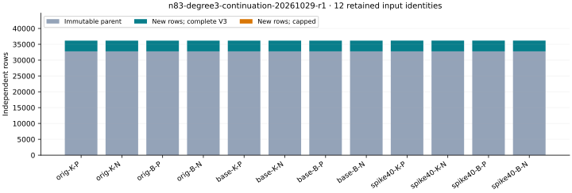

# Retained n83 m3 closure continuation

Run `n83-degree3-continuation-20261029-r1`. Producer observations only; independent scientific review is pending. 12/12 cases passed production and fresh replay; 12 S3-restored replays passed. 12 queues exhausted, 0 remained capped. Exact LFD is certified for 0 cases. Full V3 alone is not a global LFD upper bound.

| Retained case | New rows | Total rank | Complete V3 | LFD upper |
|---|---:|---:|---|---|
| original-koblitz-m3-planted | 3391 | 36159 | yes | unknown |
| original-koblitz-m3-natural | 3391 | 36159 | yes | unknown |
| original-binary-m3-planted | 3391 | 36159 | yes | unknown |
| original-binary-m3-natural | 3391 | 36159 | yes | unknown |
| baseline-koblitz-m3-planted | 3391 | 36159 | yes | unknown |
| baseline-koblitz-m3-natural | 3391 | 36159 | yes | unknown |
| baseline-binary-m3-planted | 3391 | 36159 | yes | unknown |
| baseline-binary-m3-natural | 3391 | 36159 | yes | unknown |
| spike40-koblitz-m3-planted | 3405 | 36173 | yes | unknown |
| spike40-koblitz-m3-natural | 3405 | 36173 | yes | unknown |
| spike40-binary-m3-planted | 3405 | 36173 | yes | unknown |
| spike40-binary-m3-natural | 3405 | 36173 | yes | unknown |

There are 40748 newly certified rows and 61224 new processed queue sources, derived by summing those native fields over verified cases. The parent contributes 32768 rows per case. 12 strict-fall witnesses are inherited from the parent; 0 reported witnesses first occur in the suffix. Inherited lower bounds are not newly discovered falls. No rank is interpreted as degree of regularity or solving degree, and differences between these retained inputs do not rank factor-base quality.

All twelve original/baseline/spike40 Koblitz/binary, planted/natural m3 identities are preserved. Each system has 164 Boolean variables and retains its fixed 2^27-candidate per-curve base used across m2..9. No point, target, equation or random draw changed. Original and paired planted targets differ; paired planted targets share low26 support. Repeated natural sources are not independent samples.

The native instrument first replays complete V2 and the original V3 prefix, validates the parent's exact verdict and four file hashes, and reconstructs its queue. Only new rows and operations are written. Global IDs continue across the boundary. Fresh replay recomputes each suffix operation canonically, verifies all bytes and the exact first stopping boundary. Ten tests pass, including all 735295 column indices, ordinary-degree guards, byte-identical concatenation versus uninterrupted toy runs, both cap kinds and rejection of wrong parent/offset/operations/trailing bytes/false completion. All runtime controls pass. Frozen parent code and data remain unchanged.

The frozen limits are 65536 total rows and 262144 total operations including the parent, 8 GiB, one process, 1200 seconds per producer/replay plus 5 seconds termination grace, 30000 seconds batch, no retries. The command was `bash research/n83_candidate_pdp_20261028/run-degree3-continuation.sh /home/ec2-user/n83-candidate-recovery/target/release/degree3_continue /home/ec2-user/n83-candidate-recovery/degree3-continuation-r1`. The original output is sealed; replay from restored archives instead of repeating that invocation. Batch 2026-10-29T06:51:31Z–2026-10-29T07:11:55Z; timestamps are diagnostic, CPU and qualified wall timing were not measured.

The EKS storage probe ended exit 1; MCP log retrieval failed and local kubectl could not assume the launcher role. Its application failure cause is unconfirmed. Existing-host fallback changed no IAM or capacity. This is algebraic trace continuation under a new protocol, not process-memory/CRIU restoration; physical process-restoration count is 0.

All 270 new raw manifest entries and 230 parent entries match before and after restored replay. Every suffix, capped/partial output, operation, control, immutable progress summary and error is retained. Parent archive `37d67c62bc7a551c54485693a613a22384144ace1fdeb713802b19438b5e32d4` remains independently stored. New archive `s3://setec-astronomy-artifacts/store/sha256/b6/b6101a8e8a33b96ba6f6522802343eec2104b74e07b868279d4050765f059a4c`; SHA256 `b6101a8e8a33b96ba6f6522802343eec2104b74e07b868279d4050765f059a4c`. Raw new bytes: 3906117684; suffix dense-row bytes: 3745230704. See [format](../../DEGREE3_CONTINUATION_FORMAT.json), [design](../../DEGREE3_CONTINUATION_DESIGN.md), [native summary](../../evidence/degree3-continuation/summary.json), [export](../../experiment-degree3-continuation.export.json), [storage](../../evidence/degree3-continuation-storage.json) and [publication checks](../../evidence/degree3-continuation-publication.json).

Source `bc39e12318d778a08bcbc8edc093db498cd75e74`; protocol `a0b03b7a6355e5904f5ed8b242940fa0b5c41ad2ab79b4dc1872d42c615447b4`; data `51b92f9146f0856aafcbb99136eafad67856a9f2`. Source/protocol and S3 checkpoint preceded production. Data were committed and pushed before this report. The prior fixed-base solver attempts, exact m2 regularities K28/B28/P42 and larger-m binary intervals remain unchanged. Higher-degree fall witnesses require nonmembership in complete lower spaces; global LFD bounds, exact larger-m regularity and held-out elite-base selection remain open. Literature basis: [Caminata–Gorla, definitions 1.3–1.5 and Example 2.4](https://arxiv.org/html/2112.05579).

## Original fixed-base regularity table

This is a view of previously published certificates on the original fixed bases, not a new solver run. All 48 source hashes and base identities match. Each family/m row below represents both saved target kinds; their values agree. The unchanged original point counts are Koblitz 134220785, general binary 134227133 and prime 134213656, from 134217728 candidate x-values each.

| m | Koblitz | General binary | Prime |
|---|---|---|---|
| 2 | 28 (exact) | 28 (exact) | 42 (exact) |
| 3 | 111–138 (bounds) | 111–138 (bounds) | No finite top vanishing degree |
| 4 | 194–221 (bounds) | 194–221 (bounds) | No finite top vanishing degree |
| 5 | 277–331 (bounds) | 277–331 (bounds) | No finite top vanishing degree |
| 6 | 360–414 (bounds) | 360–414 (bounds) | No finite top vanishing degree |
| 7 | 443–524 (bounds) | 443–524 (bounds) | No finite top vanishing degree |
| 8 | 526–607 (bounds) | 526–607 (bounds) | No finite top vanishing degree |
| 9 | 609–717 (bounds) | 609–717 (bounds) | No finite top vanishing degree |

The degree convention is the first vanishing degree of the quotient by the original highest homogeneous forms. Positive-dimensional quotients have no finite such degree in this presentation; this says nothing about infinite Castelnuovo–Mumford regularity. Bounds remain bounds. These values are distinct from FFD, LFD and solving degree. The original bounded solver sweep attempted all 48 inputs in 96 runs: 4 affine completions, 63 timeouts and 29 memory limits. Those limits are not degree certificates. Read [the 48-row CSV](../../FIXED_BASE_REGULARITY.csv) and [JSON field semantics and source hashes](../../FIXED_BASE_REGULARITY.json).
