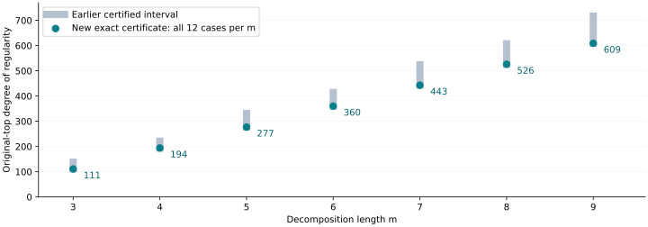

# Exact original-top degrees for the retained binary chains

All 84 unchanged binary/Koblitz m3–9 systems passed the new certificate construction,
fresh-process replay and S3-restored replay. The written overlap proof, with
native checks of its source-specific hypotheses, gives matching lower and upper
degrees. Full algebraic Lean formalization and independent scientific review
remain pending. These are exact original-top degrees, not measured solver degrees.

| m | Earlier interval | Exact original-top degree | Retained cases |
|---:|---:|---:|---:|
| 3 | 111–138 | **111** | 12 |
| 4 | 194–221 | **194** | 12 |
| 5 | 277–331 | **277** | 12 |
| 6 | 360–414 | **360** | 12 |
| 7 | 443–524 | **443** | 12 |
| 8 | 526–607 | **526** | 12 |
| 9 | 609–717 | **609** | 12 |

Run: `n83-chain-exact-20261029-r1`; twelve retained cases per m. Each base uses 2^27 candidate x-values per curve.

Every result holds for original, baseline and spike40, Koblitz and general binary,
planted and natural target identities. The same per-family base is fixed across m.
Original/baseline use selector positions0–26; spike40 uses0–25,40. No point, target,
source or affine preprocessing rule changed. Repeated natural systems are not
independent statistical samples; paired planted targets share low26 support.

The prior m2 values remain Koblitz 28, binary 28 and prime 42. Prime m3–9 top ideals
remain positive-dimensional: no finite first graded vanishing degree in that
presentation, not a statement of infinite Castelnuovo–Mumford regularity.
The updated48-row original fixed-base view has34 exact entries and14 such prime
entries; prior views and every interval certificate remain retained.

The proof diagonalizes all field-product cubics using coefficient Frobenius.
All 83 cyclic27-row selector windows have verified inverse pairs. Counting their
intersections bounds every subset rank. Decomposing by intermediate-variable
supports bounds the augmented product quotient. A separate annihilator and
truncated-chain argument bounds the degree-two defect from the terminal quadratic.
The original source projection gives the matching lower bound. Full proof:
[CHAIN_EXACT_DESIGN.md](../../CHAIN_EXACT_DESIGN.md).

Controls: five native tests pass;44 explicit mixed-degree Hilbert calculations
(36 in-domain matches,8 outside-hypothesis cases with degree 7 instead of formula 6).
Complete augmented and truncated Hilbert arrays and kernel differences are saved.
Two Lean arithmetic lemmas compile with standard propext/Quot.sound; no full
polynomial or exact-sequence formalization is claimed. Native checks reconstruct
every original highest coefficient and support, matrix inverse and all 83 embedding
identities. Producer replay is not independent scientific review.

Preservation: all 360 manifest entries matched before/after
S3-restored replay; all 84 immutable progress summaries retained. Archive
`s3://setec-astronomy-artifacts/store/sha256/a0/a0f135c6a765d04f9169f875cd90a73b56c97db42f4c99bb9595949a0925ced3`; source `15b67074130e90f92852b261f46e253b74eab338`; protocol
`35d448ff9521388239b6aaca3cb6efaeca9a354b0d32d7d97a7ccf44fffd5c29`; data commit `7ea0bcc977e315edadb1af6c5d2b384fdec5dc48`.
Production 2026-10-29T16:07:59Z through 2026-10-29T16:11:05Z; times diagnostic only.
The prior EKS storage probe failed and refreshed logs were empty, leaving its cause
unconfirmed. Existing-host fallback used; no IAM/capacity changes or timing claim.
The missing local protocol-helper path and checkpoint profile-selection failure
were retained and corrected before production using existing tools/credentials.

[Native summary](../../evidence/chain-exact/verified-summary.json),
[unified export](../../experiment-chain-exact.export.json),
[file formats](../../CHAIN_EXACT_FORMAT.json),
[storage](../../evidence/chain-exact-storage.json),
[original fixed-base view](../../FIXED_BASE_REGULARITY_V2.json).

The three tested linear bases have the same original-top degrees. This phase
closes those regularity intervals; it does not demonstrate an elite-base gain,
settle FFD/LFD, compute a full n83 Hilbert function or establish faster ECDLP.
Next discrimination should use affine/fall invariants with strict witnesses or
an explicitly different selector presentation; the broad goal remains active.
