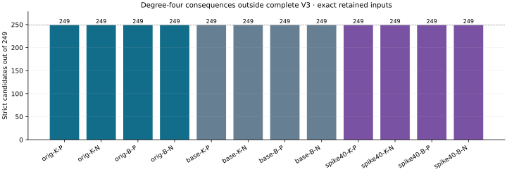

# Strict degree-four falls on retained n83 m3 systems

Run `n83-degree4-witness-20261029-r1`. **12/12 producer/fresh-process pairs and 12/12 S3-restored replays passed.** Native results record 2988 strict candidates among 2988 verified coordinate candidates. 12 exact saved systems acquire the new lower bound **LFD >= 4**; 0 have no strict witness in this family. Exact LFD and global upper bounds remain unknown. Independent scientific review is pending.

| Retained case | Candidates | Strict | Complete V3 rank | LFD bound |
|---|---:|---:|---:|---|
| original-koblitz-m3-planted | 249 | 249 | 36159 | >= 4 |
| original-koblitz-m3-natural | 249 | 249 | 36159 | >= 4 |
| original-binary-m3-planted | 249 | 249 | 36159 | >= 4 |
| original-binary-m3-natural | 249 | 249 | 36159 | >= 4 |
| baseline-koblitz-m3-planted | 249 | 249 | 36159 | >= 4 |
| baseline-koblitz-m3-natural | 249 | 249 | 36159 | >= 4 |
| baseline-binary-m3-planted | 249 | 249 | 36159 | >= 4 |
| baseline-binary-m3-natural | 249 | 249 | 36159 | >= 4 |
| spike40-koblitz-m3-planted | 249 | 249 | 36173 | >= 4 |
| spike40-koblitz-m3-natural | 249 | 249 | 36173 | >= 4 |
| spike40-binary-m3-planted | 249 | 249 | 36173 | >= 4 |
| spike40-binary-m3-natural | 249 | 249 | 36173 | >= 4 |

K/B denote Koblitz/general binary; P/N denote planted/natural. Counts are deterministic, correlated coordinate witnesses, not independent samples or a ranking of factor-base quality. The old lower bound 3 is inherited; the strict degree4 witnesses are new.

All 12 original/baseline/spike40 Koblitz/binary, planted/natural m3 identities retain n83, ell27, 164 Boolean variables and their exact saved point manifests. Each base remains fixed across its m2--9 panel. No point, target, equation or random draw changed. Original and paired planted targets differ; paired planted targets share low26 support; natural inputs repeat across original/baseline and are not independent draws.

## Certificate mechanism

Assemble the complete first 83 saved equations into the field-valued F=S3(X0,X1,U), checking every coefficient including lower terms. For L=X0,X1,U, construct the ordinary product L*F, whose coordinate equations have degree<=4 derivations. Reduce with the original Boolean field equations, retaining ordinary polynomials and multilinear normal forms, and verify degree<=3. All83 coordinates per multiplier are tested.

Replay complete V2, the immutable V3 prefix and its completed suffix. Reduce each candidate against this complete V3, recording every reducer ID and the full remainder. A nonzero remainder proves a degree<=3 polynomial in V4 outside V3; hence LFD>=4. The finite-family test does not construct complete V4 or a global upper certificate. These data cannot distinguish LFD=4 from LFD>4.

The construction is the known multiplier identity in [Semaev section4.5](https://arxiv.org/html/1504.01175). The strictness criterion follows [Caminata--Gorla Definitions1.5/2.6 and Theorem2.8](https://arxiv.org/html/2112.05579). This phase checks nonmembership for the full retained chained systems; it does not assume a first-fall heuristic.

## Preservation and verification

Fourteen native tests passed, including independent tiny complete V3/V4 controls, field multiplication checked against polynomial long division, ordinary-degree restrictions, parent/trace completion and altered serialized witness rejection. Runtime xyz+1 yields3 strict candidates and xyz yields0. The initial control setup failure and every earlier dataset remain preserved.

All 370 new raw files, 230 immutable-prefix files and 270 completed-suffix files passed manifest checks before and after restored replay. The dataset retains 12 cumulative case summaries and 36 block summaries, all candidate/remainder rows and all ordinary/normal polynomial files. Restored parent trees retain their earlier S3 download provenance and were reverified here.

The diagnostic launcher interval is 2026-10-29T17:26:50Z to 2026-10-29T17:50:29Z; it includes setup and fresh replay. One native process, 8 GiB virtual memory,1800 s per producer/replay plus 5 s grace. No clock was qualified for performance. The EKS inventory recovered after one timeout; the earlier n83 storage probe remains failed with unconfirmed cause. The recorded existing-host fallback changes no IAM or capacity settings.

Source commit: `17f501a6e6b918525c1f0a9bee84b398ab7430b4`. Protocol identity: `605323399f307993d011309e52f91b364bd31347e1107bd31d4c911de83d516d`. Binary SHA256: `41e9bc914cf82140bc7028084b1a47b512514665c15e5a31cc7c7603f39d3484`. Data commit before report: `38611ee034d53409c028b5c7deabfb06b104d985`.

Raw object: `s3://setec-astronomy-artifacts/store/sha256/ae/ae391069036e3550c1618a1415667074d5da96828e2d27a6aec4f42daa80141a`. Both parent archives listed in `evidence/degree4-witness-storage.json` are required for replay. `DEGREE4_WITNESS_FORMAT.json` documents header offsets, coefficient encodings, graded colex columns, reducer IDs, partial-file semantics and nulls. The native summary, per-case results, unified export and publication receipt retain exact hashes and outcomes.

The original objective remains open: all three n83 families, m2--9, exact FFD/LFD characterization and elite bases lowering PDP regularity. This batch adds strict m3 LFD lower certificates; it establishes no regularity reduction or elite-base advantage.
