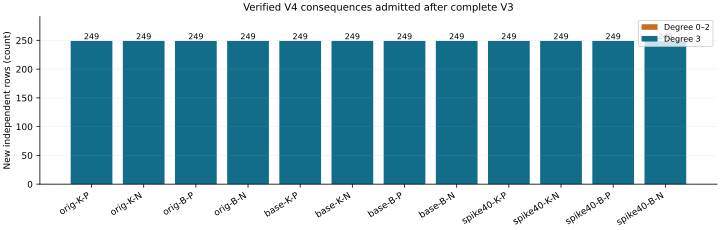

# Propagating degree-four consequences on retained n83 m3 systems

Observation report for `n83-degree4-propagation-20261029-r1`; independent scientific review is pending. **12/12 producer/fresh-process pairs and 12/12 S3-restored replays passed.** Counts below come from native results; totals sum verified cases. Global upper certificates: **0**; exact LFD certificates: **0**. Lower4 is inherited from the prior strict-witness dataset. No unrestricted V4 computation or elite-base advantage is claimed.

| Retained case | New rows | New operations | Linear rank | LFD |
|---|---:|---:|---:|---|
| original-koblitz-m3-planted | 249 | 249 | 1 | >=4 |
| original-koblitz-m3-natural | 249 | 249 | 1 | >=4 |
| original-binary-m3-planted | 249 | 249 | 1 | >=4 |
| original-binary-m3-natural | 249 | 249 | 1 | >=4 |
| baseline-koblitz-m3-planted | 249 | 249 | 1 | >=4 |
| baseline-koblitz-m3-natural | 249 | 249 | 1 | >=4 |
| baseline-binary-m3-planted | 249 | 249 | 1 | >=4 |
| baseline-binary-m3-natural | 249 | 249 | 1 | >=4 |
| spike40-koblitz-m3-planted | 249 | 249 | 1 | >=4 |
| spike40-koblitz-m3-natural | 249 | 249 | 1 | >=4 |
| spike40-binary-m3-planted | 249 | 249 | 1 | >=4 |
| spike40-binary-m3-natural | 249 | 249 | 1 | >=4 |

Graph: exact counts for the 12 retained identities in this run; K/B denote Koblitz/general binary and P/N planted/natural. Deterministic counts have no sampling error bar. Natural original/baseline inputs repeat; the identities are not independent draws and row counts do not rank base quality.

Native totals: 2988 new independent rows, 2988 independent seed insertions and 2988 new operations. Stops: restricted_queue_exhausted: 12. Unit certificates: 0; affine-completion certificates: 0. Missing or failed cases retain their exact status and partial data; unknown upper and exact degrees remain null.

## Procedure and claim boundary

All cases retain n83, m3, ell27 and 164 Boolean variables, with unchanged saved points, targets and equations. Each actual point-base manifest remains fixed across m2–9 within its dataset/family. Original and paired planted targets differ; the paired targets share low26 support. The original 48-row fixed-base degree-of-regularity view remains separate and unchanged.

Replay complete V2, the immutable V3 prefix, its completed suffix and all249 strict degree-four coordinate candidates. Insert the candidates against the evolving complete-V3 basis. Queue variable multiples of newly inserted rows only when their degree is at most2; each such ordinary product has degree at most3 and remains in V4. Save every reducer, inserted row and remaining queue. Cubic multiplication is outside this procedure.

Only two gates can certify a global upper4. An admitted unit proves1 belongs to V4. Alternatively, extract linear constraints and, when at most12 variables remain free, enumerate every affine Boolean assignment and check every original equation. If all satisfy the equations, the admitted linear-plus-Boolean ideal equals the original ideal; degree-compatible reductions give the global upper. Together with the inherited strict lower4, either gate gives exact LFD4 for that saved system.

A restricted queue exhaustion or resource cap supplies neither a global upper bound nor a lower5. It is not a complete V4 computation. The lower bound is inherited and explicitly labelled. Runtime positive control xyz+1 reaches exact4 with independent tiny V3/V4 checks; negative control xyz produces no upper certificate. All19 native tests pass, covering both caps, unit/dependent seeds, affine certificates with pending queues, and tampered/truncated serialization.

The underlying multiplier identity is established in [Semaev section4.5](https://arxiv.org/html/1504.01175). The global closure and fall definitions are in [Caminata--Gorla Definition1.5 and Theorems2.8–2.9](https://arxiv.org/html/2112.05579). The complete upper argument is written in DEGREE4_PROPAGATION_DESIGN.md; tests and deterministic replay are distinct from independent scientific review.

## Reproduction and storage

Frozen limits:65536 total rows including complete V3,262144 new operations,12 free variables for exhaustive affine checks,8GiB virtual memory,one native process,1800s per producer/replay plus5s grace,48000s outer; no automatic retry. Diagnostic batch boundaries: 2026-10-29T19:07:17Z to 2026-10-29T19:30:38Z. These include setup and replay and are not a performance measurement. Existing-host L0 fallback follows the retained failed EKS storage probe, whose application cause is unconfirmed; no IAM or capacity changes.

Manifest payload counts checked before and after restored replay: raw: 299, prefix: 230, suffix: 270, witness: 370. All 12 cumulative summaries, operations, row bytes, pending queues and affine checks are retained. Every successful producer was replayed using S3-restored raw data and three previously restored immutable parents. Native replay writes no dataset files.

Source `57e4f7a928f8a3d9a29c47e3c19c2e8d51d81807`; protocol `bd04d5cc6828bb5211c701edddbf001f68f806a751e78d69fbfb32185835bee1`; binary `fb961b36271bbef8acce8d5f169eb712be6b4bd385b828dacfcdba9e388463a2`; committed data before report `7e0b9bd3303098a4d6fb9dee647f08bc762b5376`. Raw object: `s3://setec-astronomy-artifacts/store/sha256/7e/7e6c97a8ef853f0f826b9660fabab4aff5043fc7306c24602180f916c2875918`. Read DEGREE4_PROPAGATION_FORMAT.json for header offsets, graded colex column order, row IDs, JSON fields, partial records and null semantics. The archive README gives the replay command. All three parent archives are required.

The full objective remains active: all three n83 families, m2–9, FFD/LFD characterization and held-out factor-base selection that lowers PDP regularity. No new regularity reduction follows from this propagation dataset.
