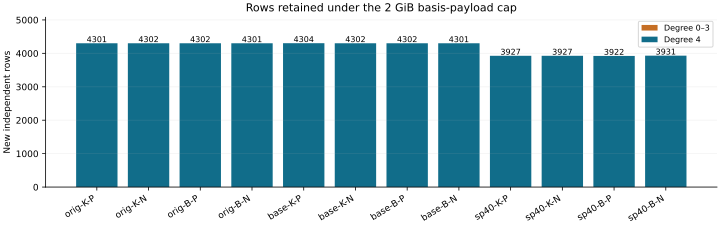

# Hybrid quartic closure on retained n83 m3 systems

Observation report for `n83-degree4-quartic-20261029-r1`. **12/12 producer/fresh-process pairs and 12/12 S3-restored replays passed.** Independent scientific review remains pending. Native totals are **50122 new independent rows**, including **0 of degree at most three**. Full V4 normal-form closures: **0**. Global LFD upper certificates: **0**; exact LFD certificates: **0**. The lower bound4 is inherited from the verified strict-witness dataset.

| Retained case | New rows | Product attempts | Products pending | LFD |
|---|---:|---:|---:|---:|
| original-koblitz-m3-planted | 4301 | 4302 | 5916919 | >=4 |
| original-koblitz-m3-natural | 4302 | 4303 | 5916918 | >=4 |
| original-binary-m3-planted | 4302 | 4303 | 5916918 | >=4 |
| original-binary-m3-natural | 4301 | 4302 | 5916919 | >=4 |
| baseline-koblitz-m3-planted | 4304 | 4305 | 5916916 | >=4 |
| baseline-koblitz-m3-natural | 4302 | 4303 | 5916918 | >=4 |
| baseline-binary-m3-planted | 4302 | 4303 | 5916918 | >=4 |
| baseline-binary-m3-natural | 4301 | 4302 | 5916919 | >=4 |
| spike40-koblitz-m3-planted | 3927 | 3928 | 5919589 | >=4 |
| spike40-koblitz-m3-natural | 3927 | 3928 | 5919589 | >=4 |
| spike40-binary-m3-planted | 3922 | 3923 | 5919594 | >=4 |
| spike40-binary-m3-natural | 3931 | 3932 | 5919585 | >=4 |

The plot shows exact native counts under the frozen storage cap, not a ranking of factor bases. K/B denote Koblitz/general binary; P/N denote planted/natural targets. Repeated natural original/baseline inputs are not independent draws. There is no sampling error bar or performance comparison.

## What was computed

The inputs retain n83, m3, ell27 and 164 Boolean variables. Actual point manifests, targets and original equations are unchanged; each point base remains fixed across m2–9 within its dataset/family. The original 48-row fixed-base degree-of-regularity view is a separate, unchanged result. This batch does not measure prime-field or higher-m LFD.

The native program first replays complete V2 and four immutable parent layers: the V3 prefix and completed suffix, strict degree-four coordinate witnesses, and their restricted propagation. It then queues variable products of all added parent rows of degree at most3, followed by all complete-V3 cubics. Variables are outermost in the initial queue; every new degree<=3 row receives an urgent all-variable task. Quartic rows are not multiplied. Every allowed ordinary product has degree at most4 before reduction by the original Boolean field equations.

Each row contains a dense degree<=3 block plus sorted quartic column indices. The trace records every ordered reducer and insertion. A candidate that crosses the payload limit is saved separately and its source remains pending. A weight cap would preserve the partial reduction and reducer prefix. Neither blocked candidate is counted as an admitted basis row. Full queue exhaustion would certify the Boolean normal-form image of V4, but would not by itself prove a global LFD upper bound.

Recorded totals: 50134 attempted products, 50122 completed products, 71013702 pending products and 25759716016 admitted row-record bytes. Stops: basis_payload_cap: 12. These sums are labelled arithmetic on the per-case native counters. The smaller capped row count for a case cannot establish lower PDP regularity.

## Certificate and validation boundaries

Only an admitted unit or exhaustive affine ideal equality can provide the implemented global upper4 certificate. The affine check enumerates all assignments only when at most 12 variables remain free. In this batch no new lower-degree rows were found in the recorded prefixes; the native per-case affine results describe whether any assignment check was possible. Unknown upper and exact degrees stay null. A cap supplies no lower5, no full V4 result and no universal FFD/LFD theorem.

All 28 native tests pass. Independent tiny dense V4 calculations agree with completed hybrid closures. Controls cover a genuine quartic-to-linear cancellation, exact4 for xyz+1, a negative xyz case, every cap, fill-in interrupted during reduction, complete queue coverage and priority, unit/affine gates, and altered/truncated/tail records. Software replay is distinct from independent mathematical review and full algebraic formalization.

The retained multiplier identity is discussed in [Semaev section4.5](https://arxiv.org/html/1504.01175). Degree-bounded closure and global fall definitions are given by [Caminata–Gorla Definition1.5 and section2](https://arxiv.org/html/2112.05579). The exact algorithm and upper-certificate scope are documented in [the frozen design](../../DEGREE4_QUARTIC_DESIGN.md).

## Reproduction and storage

Limits: 16,384 new independent rows; 2 GiB serialized new basis payload; 131,072 product attempts; 1,048,576 active quartic nonzeros; 8 GiB virtual memory; one native process; 1800s producer/fresh replay plus 5s grace; 48000s outer. Every case was attempted once. Batch boundaries in UTC were 2026-10-29T20:48:10Z to 2026-10-29T21:55:27Z; these include preparation and replay and are not performance measurements. The existing-host L0 fallback retains the failed EKS storage-probe evidence without claiming a diagnosed application cause, IAM changes or CRIU recovery.

Before/after restored-replay manifest counts: raw: 278, prefix: 230, suffix: 270, witness: 370, propagation: 299. The complete raw archive, all 12 cumulative summaries, blocked candidates and compact pending queues remain retained. Restored verification interrupted attempts retained: 1; completed statuses were verified and skipped during resume, and the interrupted log was preserved. Production was not rerun. Native replay writes no dataset files.

Source `2b9a04ffecce07bf46606e5751f28f8a80792b31`; protocol `514afddfda129310ee67ace84defbfabac5631506bff9c392b41b247a0b84700`; binary `69548bc4eb61d194491dc19a502be752f879754daa2a7c25bce2e1e9970ecc70`; committed data before this report `a5320f7f1cd20554938bd692edd52bb6c04e512d`. Raw object: `s3://setec-astronomy-artifacts/store/sha256/e8/e84683ab32f224290c3db9f80e04963edfead2fc382949b1df8fa18574fe7aee`. The [format map](../../DEGREE4_QUARTIC_FORMAT.json) specifies headers, offsets, row IDs, hashes, queue cursors and null semantics. The [archive README](../../degree4-quartic-archives/README.md) gives the replay command; all four immutable parent archives are required.

The broad goal remains active: all three n83 families, m2–9, FFD/LFD characterization and held-out factor bases that reduce PDP regularity. These capped membership prefixes do not establish an elite-base advantage.
